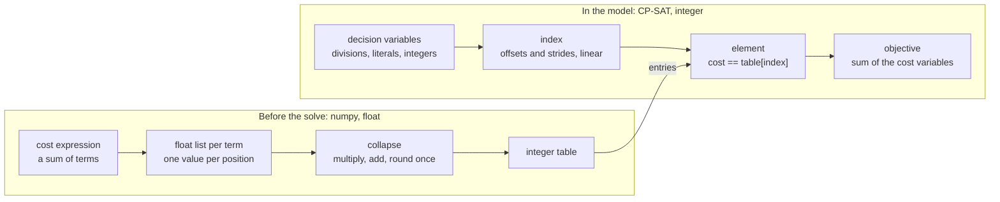
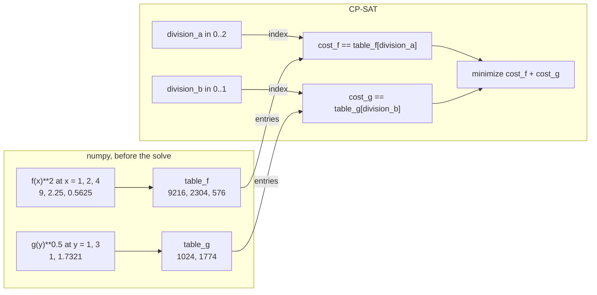
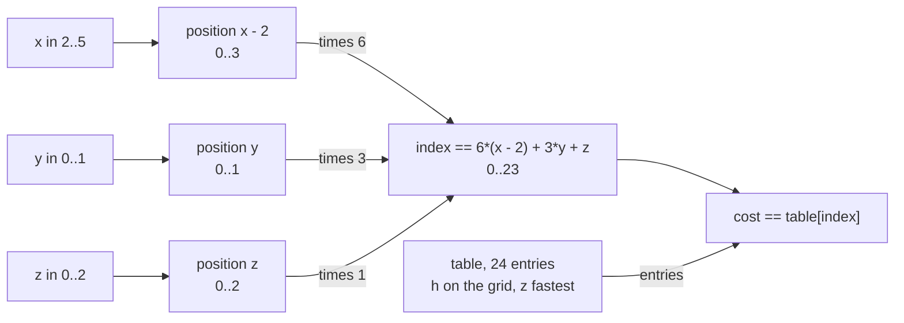
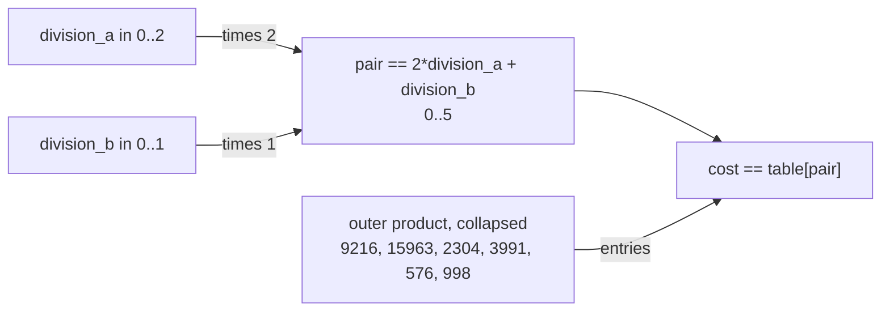
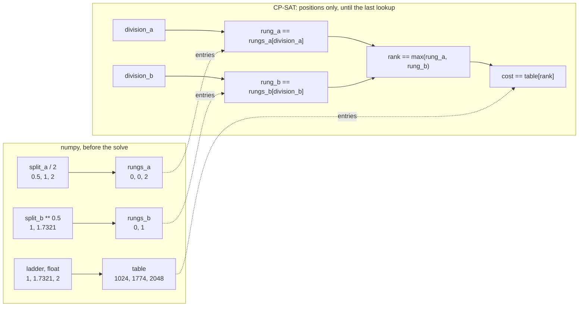
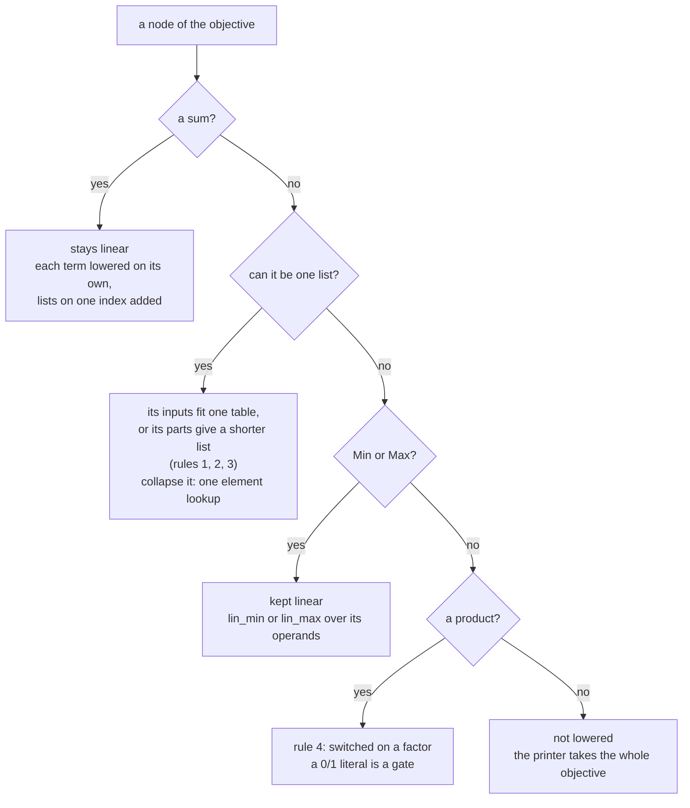
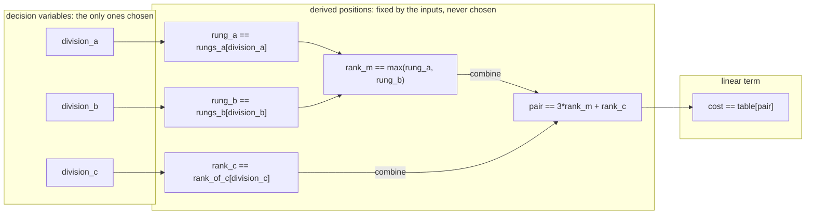
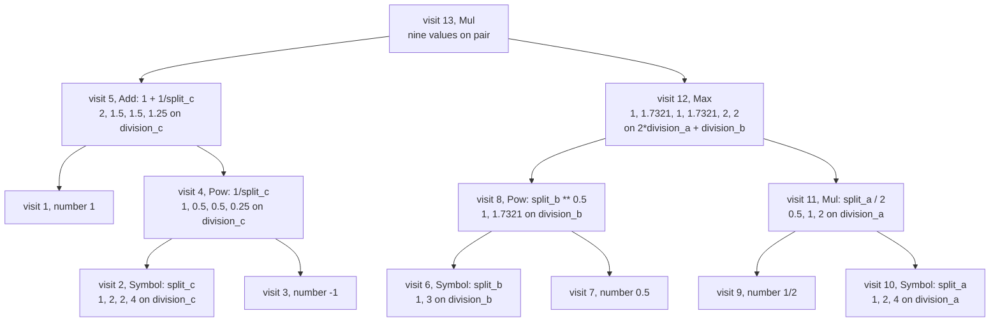

# CP-SAT table lowering, rebuilt bottom-up behind a config flag

Reference result: torch-spyre#6315 (`table-lowering-experimental`, tip `c26f6171`, draft).
Code base: torch-spyre `cab4721d`, the PR's base. Line numbers are at that commit.

Short paths: `config.py` and `cost_model.py` are under `torch_spyre/_inductor/`.
`cpsat_table_lowering.py`, `cost_expr_numpy.py`, `cpsat_expr_printer.py`,
`ilp_solver_ortools.py`, `plan_solver.py` and `sa_cooptimizer.py` are under
`torch_spyre/_inductor/scratchpad/`.

## Goal

When the last PR of this plan merges, torch-spyre has a table lowering of the CP-SAT cost
objective behind `config.cpsat_table_lowering`, off by default, that reproduces #6315's
results. With the flag on, the objective is built from exact element tables, linear sums
and `lin_min`/`lin_max`, and the printer takes an objective the tables cannot lower. With
the flag off, every solve goes through the printer as it does on `main`. Table values are
computed with numpy functions, and the code arrives in layers, each with its own tests.

## Decisions (2026-11-16)

- **numpy first, lambdify as the backup.** A generic evaluator finds each node's numpy
  function by name. A node with no numpy function is evaluated through lambdify.
- **A stack of PRs**, one per stage, off torch-spyre `main`. #6315 stays open as the
  reference result and closes when the flag reproduces it.
- **Off by default.** Stages 1 to 7 add files nothing imports. Stage 8 adds the flag.
- **Behaviour, not code.** The stages below say what each layer does. #6315 is cited for
  its results only.
- **Free to deviate.** The forms need not be #6315's. Every roll-up is built from two
  moves, combine and compact, and the table constraint is measured against them.
- **One visitor, depth first (2026-11-17).** The lowering visits each node after its
  arguments, and one function, `tabulate`, realizes a node. See Architecture.

## Estimates

Measured on the 50 replayed objectives: 45 captured compiles (model blocks at the default
config and with auto tiling, plus tests) and 5 synthetic products. Two sources: a count of
what each top-level term of the objective reads (2026-11-16), and #6315's lowering at a
cap of 8192 (replay of 2026-11-15).

**Cost between buffers is rare.** Of 6663 terms:

| A term reads | Terms | Share |
|---|---|---|
| no division (residency literals only) | 1670 | 25.1% |
| one buffer's division | 4851 | 72.8% |
| two | 38 | 0.6% |
| three or more | 104 | 1.6% |

Each of the 45 captured compiles has 1 to 4 terms that read two or more divisions, the
*wide* terms.
The widest reads 4 to 8 divisions on a model block, and 35 and 49 on the two large tests.
One table over its inputs would hold from 3.6e4 to 7.5e18 entries on a model block, so it
is never one table.

**How that simplifies.**

- *Narrow terms, 98%.* Each is a list over one buffer's menu, or a coefficient on
  literals. 81% read exactly one literal, 18% none, and 57 terms read four or more. Terms
  on one division under one gate add into one list in numpy, before anything reaches the
  model. Their entries are about the sum over divisions of menu size times gated groups,
  which is linear in the number of buffers. No table spans two buffers, and on every
  model block the largest table is the largest menu.
- *Wide terms, 2%.* Rules 1, 2 and 4 exist for these 1 to 4 terms. By the estimate below
  they take a fifth to two fifths of the entries at the default config and half to seven
  tenths with auto tiling.

| Objective | Divisions | Largest menu | Terms | Wide | Narrow entries (est.) | Entries, #6315 | Lower (s) | Solve (s) |
|---|---|---|---|---|---|---|---|---|
| default, decode block | 12 | 20-26 | 165-169 | 2 | 249-318 | 396-525 | 0.61-0.68 | 0.08-0.10 |
| default, prefill block | 14 | 55-65 | 187-189 | 1 | 1056-1217 | 1304-1535 | 0.72-0.74 | 0.40-0.50 |
| auto tiling, decode block | 12 | 30-41 | 101-105 | 3 | 332-429 | 622-870 | 0.63-0.92 | 0.14-0.17 |
| auto tiling, prefill block | 14 | 380-450 | 165-167 | 3 | 5849-6689 | 16908-21998 | 0.89-1.27 | 1.74-2.38 |
| flash attention test | 41 | 338 | 232 | 4 | 28986 | 49227 | 2.01 | 8.89 |
| prefill batch GQA test | 91 | 662 | 401 | 3 | 58399 | 115667 | 5.94 | 13.49 |

The narrow estimate is one list per division and gate, sized by the menu. It ignores lists
that turn out affine and cost nothing, so it runs high.

**What it says about the stages.**

- Stage 3 lowers 6465 of the 6521 narrow terms as one table each; the other 56 read
  four or more literals. It lowers none of the 50 objectives end to end: each has at
  least one term whose inputs pass the cap, and the lowering is all or nothing.
- Entry count is decided in Stages 4 to 7, on 1 to 4 terms per objective.
- Lowering time matters most where the model is smallest. At the default config a decode
  block takes 0.61 to 0.68 s to lower and 0.08 to 0.10 s to solve. How much of that the
  numpy evaluator of Stage 1 saves is not measured, and the last PR reports it.

## How a table is read

- An *input* is one CP-SAT variable the cost depends on: a buffer's division, a residency
  literal, or another integer variable in the symbol map. A buffer's split and tile
  symbols are columns over its division.
- A node is *indexed* when its value is `values[index]`: `values` is a float list
  computed in numpy before the solve, and `index` is a CP-SAT expression that the inputs
  determine. The solver never chooses an index.
- *Entries* are the table entries a form puts in the model. The cap bounds one table.
- Lists are float from the leaves up. CP-SAT holds positions only, until a list is
  collapsed into a linear term (next section).

The four rules that keep lists short:

1. A Min/Max of indexed operands is indexed by rung. Its ladder holds only the values it
   can return, each operand maps to a rung, and the Min/Max of the rungs is the rung of
   the Min/Max.
2. A product of Min/Max factors over shared inputs is indexed by the tuples of rungs that
   can occur together, found by a chain of small tables, one per group of shared inputs.
3. A node takes the cheaper, in entries, of one table over its inputs and the form built
   from its parts. In the objective a Min/Max stays linear when that needs under half the
   entries of its table.
4. A product whose factor cannot share a table with the rest is switched on the factor's
   value: one literal per value holds the product at that value times the rest. A 0/1
   literal times a term is the two-value case.

## The process, step by step

numpy computes every value before the solve, in float. CP-SAT computes only where to
look. The two meet at one constraint per linear term.



For each term of the objective:

1. **Find what it reads.** Each symbol belongs to one CP-SAT variable: a buffer's split
   and tile symbols to that buffer's division, a residency symbol to its literal, any
   other symbol to its integer variable.
2. **Tabulate.** numpy evaluates the term at every assignment of those variables. The
   result is a float list with one value per position. Squares, roots, logs and
   divisions all happen here.
3. **Index.** Each variable gives a position, and the positions combine into one index
   through constant offsets and strides. The index is a linear expression.
4. **Collapse.** The float list is multiplied by what stands above it, added to the other
   lists on its index, and rounded once onto `COST_SCALE`. That is the integer table.
5. **Look up.** `add_element(index, table, cost)` makes `cost == table[index]`. The
   objective is the sum of the cost variables.

Every table in this section was run through CP-SAT at every assignment of its inputs, and
each came back within half a unit of the float value.

### Two inputs: `f(x)**2 + g(y)**0.5`

`x` is `split_a` with menu `[1, 2, 4]`, chosen by `division_a`. `y` is `split_b` with
menu `[1, 3]`, chosen by `division_b`. Take `f(x) = 3/x` and `g(y) = y`. Each term reads
one input, so each is its own table on its own index, and no table spans both.



| `division_a` | `x` | `f(x)**2` | entry |
|---|---|---|---|
| 0 | 1 | 9 | 9216 |
| 1 | 2 | 2.25 | 2304 |
| 2 | 4 | 0.5625 | 576 |

| `division_b` | `y` | `g(y)**0.5` | entry |
|---|---|---|---|
| 0 | 1 | 1 | 1024 |
| 1 | 3 | 1.7321 | 1774 |

At `division_a = 1`, `division_b = 1` the objective is 2304 + 1774 = 4078, and the float
value is 4077.62. Two variables and two constraints are added to the model. The square
and the root never reach CP-SAT.

### One input: the terms share a table

`f(x)**2 + g(x)**0.5`, both on `split_a`. The two float lists are added before the
rounding, so there is one table, one rounding and one constraint,
`cost == table[division_a]`:

| `division_a` | `x` | `f(x)**2` | `g(x)**0.5` | sum | entry |
|---|---|---|---|---|---|
| 0 | 1 | 9 | 1 | 10 | 10240 |
| 1 | 2 | 2.25 | 1.4142 | 3.6642 | 3752 |
| 2 | 4 | 0.5625 | 2 | 2.5625 | 2624 |

The order of the collapse matters. At `split_a = 2`:

- `7 * split_a ** 0.5` is 10137, the rounding of 7 * 1448.15. Rounding first and
  multiplying after gives 7 * 1448 = 10136.
- `split_a ** 0.5 + split_a ** 0.7` is one entry, 3112, the rounding of
  1448.15 + 1663.49. Collapsing each list alone gives 1448 + 1663 = 3111.

### What a position is: a buffer's menu

A buffer does not have one variable per split. It has a menu of candidate divisions, and
one variable, its division, that picks a row. Each symbol of the buffer is a column:

| `division_a` | `split_a_d0` | `split_a_d1` | `tile_a` | a term, `8 / (split_a_d0 * tile_a)` |
|---|---|---|---|---|
| 0 | 1 | 1 | 1 | 8 |
| 1 | 2 | 1 | 1 | 4 |
| 2 | 2 | 2 | 1 | 4 |
| 3 | 4 | 1 | 2 | 1 |

A term over any of the buffer's symbols is a list with one value per row. Its index is
`division_a` itself, with no offset and no stride: position `d` holds the value at
candidate division `d`.

Equal values can share a position. The list above is `[8, 4, 4, 1]`, its distinct values
are `[1, 4, 8]`, and `rank_of = [2, 1, 1, 0]` gives each division its rank:
`rank == rank_of[division_a]`. A product pairs ranks, so repeated values do not widen its
table.

### Several variables: offsets and strides

A term `h(x, y, z)` over three integer variables: `x` in `2..5`, `y` in `0..1`, `z` in
`0..2`.



- **Offset.** A variable in `lo..hi` has the position `var - lo`. A domain with gaps
  gets its position from a lookup.
- **Stride.** A position is multiplied by the product of the sizes of the variables
  after it: 2 * 3 = 6 for `x`, 3 for `y`, 1 for `z`.
- **Linear.** The strides are constants, so the index is a linear equality. No two
  variables are multiplied, and CP-SAT takes it as an ordinary linear constraint.

numpy fills the table in the same order, last variable fastest:

| `x` | `y` | `z` | index |
|---|---|---|---|
| 2 | 0 | 0 | 0 |
| 2 | 0 | 1 | 1 |
| 2 | 0 | 2 | 2 |
| 2 | 1 | 0 | 3 |
| ... | | | |
| 4 | 1 | 2 | 17 |
| ... | | | |
| 5 | 1 | 2 | 23 |

The table has 4 * 2 * 3 = 24 entries. The sizes multiply, so this form is only for a term
whose variables fit the cap together.

### A product across two inputs

`f(x)**2 * g(y)**0.5` cannot be two tables: its value depends on both inputs at once. Its
list is the outer product of the two lists, and its index is the pair of their positions.



| `division_a` | `division_b` | pair | float | entry |
|---|---|---|---|---|
| 0 | 0 | 0 | 9 | 9216 |
| 0 | 1 | 1 | 15.5885 | 15963 |
| 1 | 0 | 2 | 2.25 | 2304 |
| 1 | 1 | 3 | 3.8971 | 3991 |
| 2 | 0 | 4 | 0.5625 | 576 |
| 2 | 1 | 5 | 0.9743 | 998 |

### A term with structure: positions below, the value on top

`Max(split_a / 2, split_b ** 0.5)`. One table over both inputs would also do here. With
more operands and longer menus it would not, and the Max is read by rung instead.



- The operand lists are `[0.5, 1, 2]` and `[1, 1.7321]`. A Max is never under the largest
  operand minimum, 1, so 0.5 is clamped to 1.
- The ladder is the values the Max can return, ascending: `[1, 1.7321, 2]`.
- Each operand's list becomes its rungs on the ladder, `[0, 0, 2]` and `[0, 1]`. These
  are positions, not costs.
- CP-SAT looks up each rung, takes their max, and only then reads a cost.

At `division_a = 1`, `division_b = 1` the rungs are 0 and 1, the rank is 1, and the cost
is 1774, which is Max(1, 1.7321) times 1024. Below the last lookup CP-SAT holds positions
only. The float ladder is collapsed once, at the top.

### Which form a node takes



## When the final table no longer names its inputs

After a roll-up, the constraint that produces a cost is `cost == table[index]`, and
`index` is a derived position. No decision variable appears in it. What ties the cost to
the plan is the chain of constraints behind that position. This section says how the
chain is built and what it must guarantee.

**Example.** `Max(split_a / 2, split_b ** 0.5) * (1 + 1 / split_c)` reads three buffers:
`split_a = [1, 2, 4]`, `split_b = [1, 3]` and `split_c = [1, 2, 2, 4]`.



- The Max is read by rung, as above: the ladder is `[1, 1.7321, 2]`, `rungs_a` is
  `[0, 0, 2]` and `rungs_b` is `[0, 1]`.
- The factor `1 + 1 / split_c` is `[2, 1.5, 1.5, 1.25]`. Its distinct values are
  `[1.25, 1.5, 2]` and `rank_of_c` is `[2, 1, 1, 0]`.
- The final table is the outer product of the ladder and the distinct values, collapsed:
  `[1280, 1536, 2048, 2217, 2660, 3547, 2560, 3072, 4096]`.

At `division_a = 1`, `division_b = 1`, `division_c = 3` the rungs are 0 and 1, `rank_m`
is 1, `rank_c` is 0, `pair` is 3 and the cost is 2217. The float value is 2217.03. The
last constraint, `cost == table[pair]`, names none of the three divisions.

**Two moves make every position.**

- *Combine*: `parent == left * size(right) + right`. A linear equality that turns two
  positions into one position in the larger table.
- *Compact*: `short == remap[parent]`, one `add_element`. It renumbers a position onto
  the rows that are distinct or that can occur.

| Form | Moves |
|---|---|
| one table over several inputs | combine all the inputs |
| rank | compact one list |
| product of two lists | compact each, then combine |
| Min/Max by rung | compact each operand to its rung, then take the min or max |
| fold | combine the state with the next group, compact, repeat |

The min or max over rungs is a compact that needs no table, because a ladder keeps order.

**One constraint for both moves.** `add_allowed_assignments([left, right, out], rows)`
lists the rows directly, and `out` is the next position up or the cost. It needs no
strides, a domain with gaps needs no position lookup, and a row that cannot occur is left
out. On the example it replaces the six constraints of the diagram with two:
`[division_a, division_b, rank_m]` with 6 rows and `[rank_m, division_c, cost]` with 12.

Both forms were run on the example and agree at all 24 assignments. Which solves faster on
real objectives is not measured. Both sit behind one helper. The default is combine and
compact, and the last PR reports both on the replay.

**What the chain must guarantee.** Let D be the decision variables a term reads.

1. *Determined.* Once D has values, every position and the cost have one feasible value.
   A position is never a choice, so the lowering adds no decisions to the search.
2. *Total.* Every assignment of D the model allowed before still has a feasible chain.
   The lowering never forbids a plan. A table constraint missing a row that can occur
   would break this without any error.
3. *Complete.* Walking the chain back from the cost reaches every variable of D that the
   term's value depends on.
4. *Correct.* The cost is the term's float value at that assignment, within the collapse
   bound.

On the example, in both forms: the model has 24 solutions, one per assignment of the
three divisions; minimizing and maximizing the cost at a fixed assignment give the same
value; and the worst error is 0.43 units.

**How the plan keeps them.**

- A position is made only by a combine or a compact of positions that are determined, so
  it is determined.
- A remap has an entry for every value of its parent, and a table constraint has a row
  for every combination its parents can take.
- Every list carries its index and the set of decision variables behind that index.
  Combine takes the union of the two sets, and compact keeps the set. At a linear term
  the set is checked against the variables the term reads: one may be missing only when
  the term's value does not change with it.
- A list and its index are made by one operation, in one order.
- A position is made once and shared. Two terms that roll up the same sub-table read the
  same variable.
- The plan is read from the decision variables only. Positions are never read back.

## How a table maps onto CP-SAT

This is the reference for the section above: every way a list is made, and what it
guarantees. A list is computed in numpy before the solve. CP-SAT returns the right entry
because a list and its index are made together, by one rule in one order. Every operation
that makes a new list also makes the constraint that computes the new index.

The only lookup is `add_element(index, table, target)`, which enforces
`target == table[index]`. The rest is making `index` the position numpy used.

**Inputs.**

- A buffer's division is a variable in `0..n-1`, and each of the buffer's symbols has `n`
  values: position `d` holds the symbol's value at division `d`. The index is the
  division itself.
- A residency literal has the list `[0, 1]` and is its own index.
- Any other integer variable has its domain's values, ascending. Its index is `var - lo`
  when the domain has no gaps. With gaps it is a position `pos` under
  `add_element(pos, domain_values, var)`; the values are distinct, so one position fits.

**Each way a list is made.** Lists are built from the leaves of the expression upward: a
node's list is made from its arguments' lists.

| Form | The list, in numpy | Its index, in CP-SAT |
|---|---|---|
| a function of one indexed node | `f(values)`, elementwise | the same index |
| terms on one index | the lists added elementwise | the same index |
| one table over inputs of sizes `n1..nm` | the node on the row-major grid: assignment `(i1..im)` at position `i1*s1 + ... + im*sm`, `s_k = n_(k+1) * ... * n_m`, so the last input varies fastest | `joint == index_1*s1 + ... + index_m*sm` |
| rank: equal values share a position | `distinct`, the values ascending without repeats | `add_element(index, rank_of, rank)`, where `rank_of[i]` is the position of `values[i]` in `distinct` |
| product of lists `a` and `b` of sizes `na`, `nb` | the outer product: `a[i] * b[j]` at position `i*nb + j` | `pair == rank_a*nb + rank_b` |
| Min/Max by rung | the ladder, ascending | per operand `add_element(index_o, rungs_o, rung_o)`, then `rank == min(rung_o)` or `max(rung_o)` |
| fold | one value per reachable state | per step `position == state*size + group`, then `add_element(position, next_state, state')` |

**Why the right entry comes back.**

- Every index is fixed by an equality, an element or a min/max over indexes that are
  fixed themselves. Once the inputs have values, each index has one feasible value, and
  it is the position numpy used.
- The strides of a joint table, and `nb` of a pair, are computed once and used for both
  the numpy list and the linear equality. The inputs of a table are taken in one fixed
  order for both.
- A ladder is ascending, so position keeps order: the Min of the rungs is the rung of the
  Min. A value clamped to the bound can never be the result, so sharing the bound's rung
  changes nothing.

**Collapsing float lists into linear terms.** Every list is float: the leaf lists over
the menus, and each list made from them. CP-SAT cannot hold a float, so below a linear
term it holds positions only (divisions, ranks, rungs, pair and fold positions), and no
cost value. A *linear term* is where a list must become a CP-SAT integer: a term of the
objective's sum, a term of an operand of a Min/Max kept linear, or a term of the sum
inside a switched product. There the list is collapsed, in this order:

1. Every float multiplier above the list is applied to it in numpy: the term's
   coefficient, the constant factors of a product, and a coefficient pushed through a
   linear Min/Max, where a negative one turns Min into Max.
2. Lists on one index in the same sum are added.
3. The list is rounded once, `table[i] = rint(COST_SCALE * values[i])`. An entry past
   2^50 is refused, so a sum of thousands of entries stays inside int64.
4. It is read by `add_element(index, table, target)`, and the linear term is `target`.
   A list is affine when its rounded entries are, so `table[0] + step * index` equals
   the table entry for entry.

No integer made by a collapse is multiplied by a float afterwards, with the one exception
below. A unit is 1/`COST_SCALE` of the cost. Each collapsed list is within half a unit of
its float value, a sum of T lists and a constant is within (T + 1) / 2 units, and a
linear Min/Max is within the largest bound among its operands.

The exception is rule 4, where a factor too wide to pair multiplies a sum that is already
collapsed:

- a 0/1 literal: the product is the sum or 0, and nothing is added;
- whole values `v`: the product is `v * w` exactly, so the sum's bound times `|v|`;
- fractional values: `floor(p * w / q)`, which adds `|w| / (2q) + 1` units, with `q`
  from 2^16 to 2^24.

Collapsing this form too means pairing every list of the sum with the factor's values. It
is exact to half a unit per list and costs the factor's number of values times the
entries. #6315 measured that form at 26 to 27 s against 5 to 6 s for the switch on the 14B
and 24B auto-tiling prefill objectives. The plan keeps the switch. The largest error
measured over the 50 objectives is 1.2e-7 of the cost.

The *exact* tests of every stage are the check on this mapping: they solve at every
assignment of the inputs, so an entry read from the wrong position fails.

## Architecture

The lowering is one visitor over the cost expression. It visits each node depth first,
the arguments before the node, so everything under a node is realized before the node
is. One function, `tabulate`, realizes a node: it returns the node's float list and the
index that reads it.

```python
class TableLowering:
    def visit(self, node):
        if node not in self.forms:                                  # each node once
            children = [self.visit(arg) for arg in children_of(node)]  # depth first
            self.forms[node] = self.method_for(node)(node, children)
        return self.forms[node]

    def generic_visit(self, node, children):
        return Forms(table=self.tabulate(node, children))           # realize the node

    def visit_Add(self, node, children):
        return Forms(table=self.tabulate(node, children),
                     linear=add_linear(children))
```

The code is a sketch. The order of the walk and `tabulate` are the design, and the other
names may change.

- **Depth first, post-order.** `visit` owns the descent. A method is handed its node and
  its children's results, and never visits. Stage 1's `numpy_value` is the same walk
  with arrays for results.
- **Each node once.** Results are kept by node. A subexpression that two terms share is
  visited once, and both terms read one list and one position.
- **One method per class.** `method_for` looks for `visit_<Class>` along the node's class
  and its bases, and falls back to `generic_visit`. The bases matter: `Integer(1)` is
  class `One` and `Rational(1, 2)` is `Half`. The printer on `main` dispatches the same
  way through sympy's `Printer` (`cpsat_expr_printer.py:186`), but each of its methods
  prints its own arguments.
- **Children.** A node's children are its arguments, with two exceptions. A Piecewise's
  children are the values and conditions of its arms. A `RelayoutCharge`'s children are
  its literal and its division, and its prices are data.
- **No model.** The walk reads the expression, the inputs and the cap, and computes in
  numpy. It adds nothing to the CP-SAT model and rounds nothing.

### `tabulate` realizes a node

`tabulate(node, children)` returns a `Table` or None. A `Table` is a float list `values`
and an `index`, and the node's value is `values[index]`. The index is a description, not
yet a CP-SAT variable: an input, a combine, a compact, or a min or max of rungs. It
carries the decision variables behind it. A node is *realized* when it has its table.

Every list of the lowering is made here, and a list is never made without its index.
`tabulate` is the "one operation, in one order" of the guarantees above.

1. **A leaf.** A symbol's table is its input's column, on that input: a buffer's symbol
   over the menu, `[0, 1]` for a literal, the domain's values for an integer. A number
   is one value on no input.
2. **A child with no table.** The node has none either.
3. **Children on one index.** The node's numpy function, the one-node step of Stage 1,
   is applied to the children's lists elementwise. The index is the children's, and no
   entry is added. A term over one buffer's symbols never leaves this case.
4. **Children on several indexes.** There are two candidates:
   - *one table*: the node on the grid of its inputs, from `values_on_grid`, on the
     inputs combined;
   - *from its parts*: a Min/Max by rung (rule 1), a product of Min/Max factors by fold
     (rule 2), and any other node by compacting each child's list to its distinct
     values, combining the positions and applying the node's numpy function across them.
5. **The cheaper one.** The candidate with fewer entries is the table (rule 3). Its
   entries are its list plus the remaps under its index. A candidate's size is known
   before its list is computed, so one past the cap is never evaluated. With no
   candidate under the cap the result is None.

### A node that is not one list

A sum, a product and a Min/Max can be read without being one list, so their methods
return a second form beside the table. A *linear form* is a constant, one float list per
index, and the `lin_min`, `lin_max` and switched terms inside it. It is float, as the
tables are.

| Method | Table | Linear form |
|---|---|---|
| `generic_visit`: symbols, numbers, Pow, floor, log, Piecewise, relationals, And, Or, Not, ITE, functions | `tabulate` | none |
| `visit_Add` | `tabulate` | the children's linear forms added, where lists on one index become one list |
| `visit_Mul` | `tabulate` | constants times one child: that child's linear form, scaled. Otherwise rule 4: switched on one factor's values, with a 0/1 literal as the gate |
| `visit_Min`, `visit_Max` | `tabulate` | `lin_min` or `lin_max` over the children's linear forms |
| `visit_RelayoutCharge` | `tabulate`, or the number 0 when this solve does not divide the source | its literal as a gate on the price list |

- **The reader picks the form.** A node is visited before its parent, so it cannot know
  how it will be read. It returns the forms it has. `tabulate` reads tables. A linear
  form reads each child's cheaper form in entries, and a Min/Max child stays linear only
  under half the entries of its table (rule 3). The objective reads the root's linear
  form.
- **Multipliers go down in float.** Scaling a linear form multiplies its lists in numpy.
  Through a `lin_min` or `lin_max` it scales the operands, and a negative factor turns
  one into the other.
- **Refusal.** A node can come back with no form. Its parent then has only the forms
  that do not read it, which is how a relayout charge on a source this solve does not
  divide becomes 0. When the root has no linear form, `lower_cost_with_tables` returns
  None and the printer takes the whole objective. The model is untouched, because the
  walk never wrote to it.

This is the chart of "Which form a node takes", read from the leaves up.

### From the walk to the model

The walk ends with the objective as one linear form. A second pass, over that form and
not over the expression, is the only code that calls CP-SAT:

1. **Check.** Each list's decision variables are compared with the variables its terms
   read (guarantee 3). A miss is refused here, before the model changes.
2. **Positions.** Each index is made once and shared: an input is its variable, a
   combine is a linear equality, a compact is one `add_element`, and a min or max of
   rungs is one constraint. This step is the one helper of Stage 3, so the table
   constraint replaces it without a change to the walk.
3. **Collapse.** Each list is rounded once and read by one `add_element`. An affine list
   is a linear term with no table, and a constant list is a number.

Floats become integers in step 3. The one other place is the `p/q` of a switched
factor (rule 4).

### The walk on the roll-up example

`Max(split_a / 2, split_b ** 0.5) * (1 + 1 / split_c)`, from "When the final table no
longer names its inputs". Each node shows its place in the visit order and the list
`tabulate` returned for it. sympy orders the arguments, so the sum comes first.



| Visit | Case of `tabulate` | Result |
|---|---|---|
| 1 to 11 | a leaf, or children on one index | a list on `division_c`, `division_b` or `division_a`, with nothing added |
| 12, the Max | several indexes | one table: 6 entries, against 8 by rung (a ladder of 3, rungs of 3 and 2) |
| 13, the product | several indexes | from its parts: each child ranked to 3 distinct values and paired, 19 entries against 24 for one table |

The collapsed table holds the nine entries of that section, in sympy's argument order:
`[1280, 2217, 2560, 1536, 2660, 3072, 2048, 3547, 4096]`.

**What depth first costs.** Rule 3 is applied at the node, before its parent is visited.
At visit 12 one table is the cheaper list for the Max. Its parent then ranks that list
with a 6-entry remap, where rungs would have cost 5 and needed no rank: 19 entries
against the 18 of the chain drawn in that section. The walk could instead keep both
candidates on a node for its reader to choose, since nothing is in the model yet. The
plan starts with the rule at the node, and the last PR reports entries per capture.

**Checked.** A sketch of this walk was run on 14 expressions: the sums, the product, the
Max and the roll-up of the sections above, a buffer with three symbols, a Piecewise over
two buffers, a shared subexpression, and a sum and a Max too wide for one table. It has
no fold and no switch. Each is exact as Stages defines it, each model has one solution
per assignment of its inputs, and the tables printed above come back, the roll-up's in
sympy's order. On the roll-up the worst error is 0.43 units. A node shared by two terms
was visited once: 10 visits for an expression of 15 nodes.

### Where each stage lands

| Stage | Adds to the architecture |
|---|---|
| 1 | `numpy_value`, and its one-node step that `tabulate` applies to lists |
| 2 | the pure helpers `tabulate` calls: ladder, rungs, fold, scaling |
| 3 | `visit`, `generic_visit`, `visit_Add`, `visit_RelayoutCharge`, the pass that builds the model, and `tabulate` for a leaf, for one index and for one table over the inputs |
| 4 | `tabulate` from a node's parts: by rung, rank and pair, and the choice by entries |
| 5 | `tabulate` from a node's parts: the fold |
| 6 | the linear form of `visit_Min` and `visit_Max`, and a constant times one child in `visit_Mul` |
| 7 | the switch and the gate in `visit_Mul`, and the gate of `visit_RelayoutCharge` |
| 8 | nothing: the flag chooses between this visitor and the printer |

## Stages

Every stage is one PR with its tests. Branches: `table-lowering-N-<slug>-experimental`,
each on the one before.

| # | PR adds | Needs ortools |
|---|---|---|
| 1 | numpy values of a cost expression: `cost_expr_numpy.py` | no |
| 2 | pure helpers: ladders, rungs, fold, scaling | no |
| 3 | inputs, indexes, one table per node, linear sums | yes |
| 4 | rule 1 and parts: Min/Max by rung, ranks, pairs, functions of a list | yes |
| 5 | rule 2: fold of Min/Max factors over shared inputs | yes |
| 6 | rule 3 in the objective: linear Min/Max where the table is larger | yes |
| 7 | rule 4: switched products and literal gates | yes |
| 8 | `config.cpsat_table_lowering`, the solver's choice, printer fallback, docs | yes |

In the tests below, *exact* means: at every assignment of the inputs the lowered
objective is solved by minimizing and by maximizing. Both are feasible, they agree, and
the value equals `COST_SCALE` times the expression evaluated by sympy, within the bound
stated under "Collapsing float lists into linear terms". That checks a chain is
determined, total and correct.

### Stage 1: numpy values (`cost_expr_numpy.py`)

One recursive function, `numpy_value(expr, env)`:

1. a symbol is its array in `env`, a number is a float, `True` and `False` are
   themselves;
2. the arguments are evaluated first;
3. the numpy function is found by the node's class name: a table of overrides first,
   then numpy's own function of that name;
4. with no function it raises `NotImplementedError`.

A caller that gets `NotImplementedError` evaluates that node through `sympy.lambdify`
instead. This is the only use of lambdify. It is cached per node and counted.

Steps 3 and 4 can be called for one node on arrays already computed. `tabulate` applies
them to its children's lists.

Overrides, for names numpy does not share: Add, Mul, Pow, Abs; Min and Max
(`np.minimum`, `np.maximum`); ceiling; the six relationals; And, Or, Not; ITE
(`np.where`); Piecewise (`np.select` over its pairs, every arm computed, NaN when no arm
holds); `RelayoutCharge` (`is_lx * prices[division]`, 0 past the table); an implemented
function through its `_imp_`, vectorized.

Two rules for the lookup, both checked on numpy 2.5.1 and sympy 1.14:

- The by-name lookup takes ufuncs only. `np.floor`, `np.log`, `np.exp` and `np.sign` are
  ufuncs and mean what sympy means. `np.sinc` has sympy's name and another meaning
  (`sinc(1)` is 0.84 in sympy and 0 in numpy), and it is not a ufunc.
- An n-ary node folds its arguments pairwise. `np.add.reduce` over a list that mixes a
  constant with arrays raises.

`values_on_grid(expr, columns, shape)` is `numpy_value` at every joint assignment of the
node's inputs, row-major, with the lambdify backup. It refuses a value that is not finite.

The overrides cover everything the cost model builds today: Add, Mul, Pow (exponent -1 and
floats), Min, Max, floor, log, Piecewise ending in `True`, Eq/Le/Ge/Lt/Gt, And, Or,
numbers, `decode_delivery_price_*` (`cost_model.py:1426-1449`) and `RelayoutCharge`
(`plan_solver.py:487`). ITE and `False` are latent: they need auto tiling or cost
parameters other than production's.

Tests, `tests/inductor/test_cost_expr_numpy.py`:

- every override, and every by-name function the cost model uses, against exact sympy
  (`float(expr.xreplace(point))`) at every grid point;
- the cost model's own forms: `floor(1024/split)**-0.25`, `Min(c*log(a), Max(0, 3.0 -
  c*log(b)))`, `1/split >= Rational(5, 128)` as a condition, an Or of Ge, nested
  Piecewise, ITE with `False`, `x**0.0`;
- Piecewise: an infinite value in an arm not taken is discarded; no arm true is refused;
- `RelayoutCharge` agrees with its `_imp_`; the real decode delivery price is evaluated
  with no lambdify; an undefined function with no `_imp_` is refused;
- a name numpy lacks (`sympy.sec`) raises `NotImplementedError` and is then evaluated
  through lambdify, once; `sympy.sinc` takes that path too and gives sympy's value;
- `values_on_grid`: row-major order over axes of three sizes, two symbols on one axis, a
  constant broadcast;
- guard: objectives built by the cost model (the builders `test_op_features.py` and
  `test_cost_model_replication.py` already use) never reach lambdify, and agree with
  `sympy.lambdify(modules="math")`, the annealer's evaluator (`sa_cooptimizer.py:849`).

### Stage 2: pure helpers (`cpsat_table_lowering.py`, first slice)

Functions of numbers and lists, with no CP-SAT model:

- the ladder of a Min/Max: the values it can return, ascending, and the bound past which
  an operand's value is clamped;
- rungs: each of a list's clamped values as its position on a ladder, or None when one is
  not on it;
- the reachable fold: for Min/Max factors given as rungs over their inputs, the tuples of
  rungs that occur together and the steps that compute which one occurs, or None past
  the cap;
- scaling: one rounding of a float list onto `COST_SCALE`;
- the switch scale: for a factor with fractional values, the power of two `q` that holds
  each value as `p/q` with every product inside int64.

Tests, `tests/inductor/test_cpsat_table_lowering.py`:

- a Min's ladder drops the values above its smallest operand maximum; a Max mirrors it;
- values equal to 12 digits share a rung; a value off the ladder gives None;
- the Min of rungs is the rung of the Min (seeded random operands);
- the fold numbers only the tuples that occur together; a constant operand seeds its
  start state; operands sharing an input join one group; a step past the cap is refused;
- scaling rounds once;
- the switch scale is 1 for whole values and otherwise keeps `p * w` under 2^60;
- the pair `q*P <= p*w`, `q*P >= p*w - (q-1)` admits only `P = (p*w) // q`, negatives
  included.

### Stage 3: inputs, indexes, tables, linear sums

- The visitor of Architecture arrives: the walk, `generic_visit`, `visit_Add`,
  `visit_RelayoutCharge` and the pass that builds the model. `tabulate` realizes a leaf,
  a node whose children share an index, and a node whose inputs fit one table.
- Positions are made by two moves only, combine and compact, behind one helper. Each list
  carries the decision variables behind its index.
- Inputs are mapped from the printer's two maps. A buffer's symbols share its division as
  their index. Any other variable is indexed by its domain, through a position lookup
  when the domain has gaps. A domain past the cap is not an input.
- A node whose inputs fit the cap is one table over them, read through a joint index in
  the order `values_on_grid` uses.
- The objective is a constant plus one list per index. Lists are collapsed here and
  nowhere below: the coefficient is applied and terms on one index are added in float,
  then the list is rounded once. A list affine in its index is a linear term with no
  table, and a constant list is a number.
- The whole objective is planned before anything is added to the model.
- `lower_cost_with_tables(model, sym_map, buffer_map, cost_expr, cap)` returns the
  objective, or None with the model untouched.

After this stage a sum whose terms each fit one table is lowered exactly. Anything else
returns None.

Tests:

- the walk visits a node after its arguments, and a subexpression two terms share once;
- every list `tabulate` returns has the length of its index;
- a sum of single-buffer terms is exact, with no table across two buffers;
- the lowered model has as many solutions as its inputs have assignments;
- a term whose chain misses a variable it depends on is refused when the objective is
  planned;
- a coefficient is applied before the rounding: `7 * split ** 0.5` at split 2 is 10137,
  not 7 * 1448;
- terms on one index are added before the rounding: `split ** 0.5 + split ** 0.7` at
  split 2 is one entry, 3112, not 1448 + 1663;
- one table over two inputs of different sizes, for an expression that is not symmetric
  in them, is exact: a list and an index in different orders fail it;
- a variable with gaps in its domain reads the entry of its value;
- a Piecewise cost, a function with no numpy name and a relayout charge are exact;
- two menu lengths on one division are refused; a variable with gaps in its domain gets a
  position; a domain past the cap is no input;
- an affine list adds no table; a constant list adds no variable;
- an entry too large for int64 sums is refused;
- a relayout of a buffer this solve does not divide costs 0;
- an expression it cannot lower leaves the model's variables and constraints unchanged.

### Stage 4: rule 1 and parts

All of this stage is inside `tabulate`: its second candidate, the form from a node's
parts, and the choice between the two.

- A Min/Max of indexed operands is indexed by rung (rule 1).
- Equal values share one rank, and a product of two short lists is one table over the
  pair of their ranks.
- A function of an indexed node keeps that node's index.
- A node takes the cheaper of one table over its inputs and the form built from its parts
  (rule 3).
- The same helper can build a roll-up as one table constraint, for the measurement in the
  last PR.

Tests:

- a Max over three buffers is exact with no table as large as the joint table, and each
  operand lands on the rung of its clamped value;
- a menu with repeated values reads the same entry through its rank as through its
  division;
- a product of two lists of different sizes, not symmetric in them, is exact;
- equal values share a rank before pairing; a pair past the cap is refused;
- a function of a short list adds no index;
- the smaller form in entries wins, one case each way;
- a three-buffer roll-up, a Max by rung times a ranked factor, is exact in both forms,
  and its last lookup names no division.

### Stage 5: rule 2

Min/Max factors of one product, over shared inputs, become one indexed value over the
reachable tuples of their rungs, when crossing their lists would pass the cap. It is one
more form from a node's parts inside `tabulate`.

Tests: a product of four Max factors over three shared buffers is exact under a cap their
crossed ladders pass; no fold when the crossed lists fit.

### Stage 6: rule 3 in the objective

`visit_Min` and `visit_Max` gain their linear form, and a reader picks between it and
the table.

- A Min/Max too wide to index, or whose table is over twice its linear form, stays a
  `lin_min`/`lin_max` over linear operands.
- A coefficient on the Min/Max is applied to its operands' lists before they are
  collapsed. A negative one turns Min into Max.
- Each operand sits behind a variable of its own. With a long sum of literals inside
  `lin_max`, CP-SAT's presolve ran out of memory (`bad_alloc` past 40 GB on a Qwen3 0.6B
  prefill objective).

Tests: a Min of two sums of residency literals stays linear and is exact, with no table
over its inputs; a near tie keeps the table; a negative coefficient gives a `lin_max`;
a fractional coefficient on a linear Min is within the largest operand's bound; each
operand is a single variable.

### Stage 7: rule 4

`visit_Mul` and `visit_RelayoutCharge` gain their linear forms.

- A product whose factor cannot pair with the rest is switched on the factor's value.
  Whole values take one equality per value. Fractional values take the floor pair of
  Stage 2. This is the one form where a float multiplies a sum already collapsed, with
  the bound stated under "Collapsing float lists into linear terms".
- A 0/1 literal, one minus it, or a multiple of either, times a term is the two-value
  case: the term is lowered with the literal fixed on, and no table reads the literal. A
  relayout charge is its literal times a price by division.
- A gate whose rest is constant is a coefficient on the literal.

Tests: a fractional factor times a sum of lists with fractional entries is within the
rule 4 bound; a factor times a Min too wide to pair is exact, also inside a Min; a relayout
charge and a gated term are exact with no table larger than the menu; a constant rest adds
no table; two wide factors are refused with the model untouched; a product too wide for
its factor's precision is refused.

### Stage 8: the flag

- `config.py`, beside `cpsat_time_limit_seconds` (`:407`), in the style of `ktir_emitter`
  (`:137`):
  `cpsat_table_lowering: bool = os.environ.get("CPSAT_TABLE_LOWERING", "0") == "1"` and
  `cpsat_table_cap: int` from `CPSAT_TABLE_CAP`, default 8192. Both names are public, so
  both enter the FX graph cache key: plans can differ between lowerings.
- `cpsat_table_lowering.py`: `cost_expr_to_cpsat`, the tables or else the printer,
  reading `config.cpsat_table_cap` when called. It logs why the tables declined.
- `ilp_solver_ortools.py`: the printer's import (`:134`) is unchanged.
  `_minimize_cost_expr` (`:865`) reads the flag when called and imports the table module
  only when it is on.
- Docs: rows in the env var table of `docs/source/api/torch_spyre.rst`; the file table
  and objective paragraph in `docs/source/compiler/scratchpad_planning.md` (`:300`,
  `:636-648`); `docs/source/compiler/co_optimizer.md` (`:296`, `:424-431`).

Tests, with `config.patch` as the suites do:

- an expression the tables cannot lower goes to the printer;
- flag off: a `CpSatLayoutSolver` solve never calls the table module (patched to raise);
- flag on: the same solve never calls the printer, ends `OPTIMAL`, and its plan's exact
  cost is no higher than the printer's plan, within one `COST_SCALE` unit per table.

Known difference: the tables' objective is `COST_SCALE` (1024) times the cost, and the
printer's is in cost units. Only the uniqueness probe reads it
(`ilp_solver_ortools.py:825-827`, off by default); its "within 1" becomes within 1/1024.

## Verification

Each PR:

- `python3 -m pytest tests/inductor/test_cost_expr_numpy.py
  tests/inductor/test_cpsat_table_lowering.py`
- `make precommit`, `mypy torch_spyre tests` and `make check-all-configs`. Both test files
  are listed in `tests/configs/torch_spyre_tests/inductor/test_cpsat_table_lowering_config.yaml`.
- `git commit -s`, the Apache header on new files, `feat(scratchpad): ...` subjects.
- Stages 1 to 7: `git diff main --stat` shows new files only.

After Stage 8, posted on that PR:

1. **Same results as #6315.** Replay the 50 captured objectives (`~/pr6301-review/replay.py`,
   #6315's results in `~/pr6301-review/tableonly/`). Every capture is `OPTIMAL` at the
   exact cost #6315 reaches, and no objective is further from exact than 1.2e-7. A
   different plan at that cost is a tie.
2. **Size and time, reported.** Entries, largest table, lowering time and solve time per
   capture, beside the table in Estimates, for combine and compact and for the table
   constraint. A capture with more entries or a slower solve than #6315 is explained in
   the PR.
3. **Flag on.** The planner suites with `CPSAT_TABLE_LOWERING=1`:
   `test_scratchpad_solver.py`, `test_scratchpad_use.py`, `test_cost_model_replication.py`
   and `test_solver_relayout_decision.py`. #6315's CI ran every shard with the tables on
   the default path and all passed; its one red job was a card fault
   (`DdrInitRetryLimitExceeded`).
4. **Flag off.** The same suites with no flag, unchanged.

## Next step

Stage 1 starts in a new torch-spyre worktree off `upstream/main`. PRs to torch-spyre open
on the owner's go.
