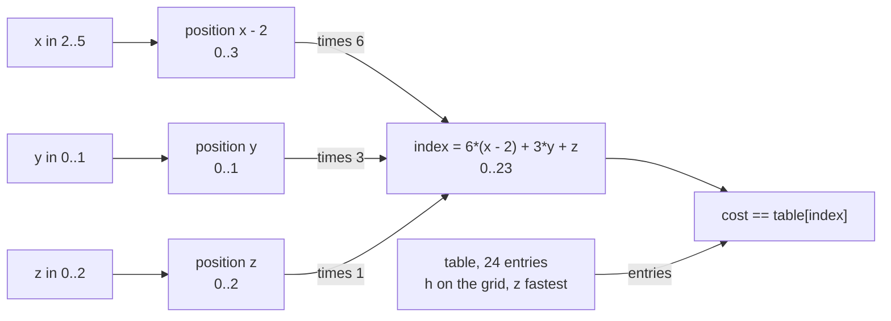
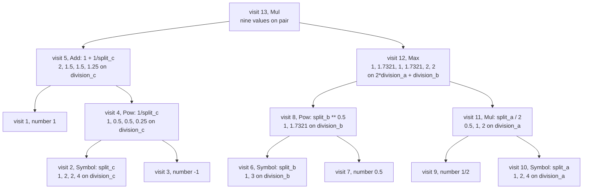

# CP-SAT table lowering, rebuilt bottom-up behind a config flag

Reference result: torch-spyre#6315 (`table-lowering-experimental`, tip `c26f6171`,
draft). Code base: torch-spyre `cab4721d`, the PR's base. Line numbers are at that
commit.

Short paths: `config.py` and `cost_model.py` are under `torch_spyre/_inductor/`.
`cpsat_table_lowering.py`, `cost_expr_numpy.py`, `cpsat_expr_printer.py`,
`ilp_solver_ortools.py`, `plan_solver.py` and `sa_cooptimizer.py` are under
`torch_spyre/_inductor/scratchpad/`.

## Goal

When the last PR of this plan merges, torch-spyre has a table lowering of the CP-SAT cost
objective behind `config.cpsat_table_lowering`, off by default, that reproduces #6315's
results. With the flag on, the objective is built from exact element tables, linear sums
and `lin_min`/`lin_max`. An objective the tables cannot lower raises, and never reaches
the printer. With the flag off, every solve goes through the printer as it does on
`main`. Table values are
computed with numpy functions, and the code arrives in layers, each with its own tests.

## Decisions (2026-11-16)

- **lambdify first, then numpy from a dict (2026-11-17).** Stage 1 computes every value
  with `sympy.lambdify`. Stage 2 adds numpy steps from a dict keyed by sympy class, and
  a class the dict does not hold stays on lambdify. There is no generic lookup of numpy
  functions by name. This replaces the 2026-11-16 decision, numpy first by name with
  lambdify as the backup.
- **A stack of PRs in the fork**, one per stage, each on the one before. Stage 1 is
  spectre-ns/torch-spyre#32, on the fork's `main` (92582da3, torch-spyre `main` of
  2026-11-17). #6315 stays open as the reference result and closes when the flag
  reproduces it.
- **Off by default.** Stages 1 to 11 add files nothing imports. Stage 12 adds the flag.
- **Base mechanics first, then one optimization per stage, integration last
  (2026-11-17).** Stage 1 lowers an expression from inputs given to it, one table per
  node, and cannot lower a real objective: its one table would hold 10^13.4 to 10^401
  entries. Stages 2 to 10 each add one optimization. Stages 11 and 12 integrate with the
  printer's maps and then with the solver.
- **Rule 4 as switched tables, a multiplication as the fallback (2026-11-17).** A Mul is
  linear in its children only when its other factors are constants. Any other product
  pushes one factor into every list of the rest as numpy tables, the factor's position
  switching the row. #6315 left this form for a switch on a collapsed sum, measured 5
  times faster on the auto-tiling prefill objectives and 3 times over the whole replay
  ("Collapsing float lists into linear terms"). Stage 11's replay measures it again,
  and if it cannot be made to work, `add_multiplication_equality` is the fallback.
- **A 0/1 literal gates its term, an optimization of the switch (2026-11-18).**
  Multiplying by a literal is multiplying by 0 or 1, the switch's two-value case with
  one value 0. A product with a factor that reads one 0/1 literal and is 0 at one of its
  values (`x`, `1 - x`, `2 - 2*x`), and a relayout charge, its literal times a price by
  division, is its rest where the literal keeps it and 0 where it does not. Two enforced
  linear constraints hold it. No table reads the literal, so the term costs its rest's
  entries, not twice them with the off half zeros, and it adds no rounding: a collapsed
  integer times 0 or 1 is exact. This is rule 5, built in Stage 9, right after the
  switch it optimizes. #6315 measured this form against tabling the literal:
  - small default-config kernels went from 2 to 2.5 times the printer's solve time to
    the printer's own: softmax 4096x2048 0.39 to 0.15 s (printer 0.15 s), add_mul 0.11
    to 0.055 s, rmsnorm 0.13 to 0.065 s;
  - the whole replay went from 494.6 to 443.8 s;
  - recognising the gate in any form, as sympy writes `2*(1 - x)` as `2 - 2*x`, cut the
    GQA test from 306,811 entries to 115,667, and the Mistral 24B prefill from 59,152 to
    21,696.
- **Behaviour, not code.** The stages below say what each layer does. #6315 is cited for
  its results only.
- **Free to deviate.** The forms need not be #6315's. Every roll-up is built from two
  moves, combine and compact, and the table constraint is measured against them.
- **Two passes: parents first, then children first (2026-11-17).** After a sympy
  normalization, a first pass visits every parent before its children and marks the nodes
  a linear reader can reach. The second rewrites the sympy graph into a `CpNode` graph,
  children first, and calls each node's `visit_op`. Both read one list,
  `sympy.postorder_traversal` with its repeats dropped: pass 2 iterates it and pass 1
  iterates it reversed; nothing recurses. There
  are two node classes, `CpNode` and `CpLinearNode`. Each holds its sympy node, injected
  as `expr` and only read: sympy says which operation the node is, gives its arguments in
  canonical form and its free symbols, and its class finds its numpy step in a dict, or
  it is lambdified. A parent reads any node as a table or linearly. No sympy node is
  changed. The passes return a plan with no model in it, and `CpEmitter` builds the
  plan into CP-SAT, each position and each form once. See Architecture.
- **Margin 2 (2026-11-17).** A Min/Max with only linear nodes above it stays a
  `lin_min`/`lin_max` only when that needs under half the entries of its table, as in
  #6315. Replayed at #6315's tip on the 46 objectives where the choice changes the model,
  each rule's solve time against margin 2's: always `lin_max` 1.35 to 1.52 times
  (slower on 39 to 43 of them); margin 1, linear whenever it has fewer entries, 0.99 on
  average but 1.22 in total, with the GQA test at 137 s against 82 s; a table whenever
  one fits 2.07 on the 14 objectives it changes, `main.caps/compile_0` 24 times. An
  exact-domain `lin_max` target and `linearization_level` 2 were within run-to-run
  noise. All reach the same optimal cost.

- **Raise when the cap is hit (2026-11-17).** With the flag on there is no fallback. An
  objective the tables cannot lower raises `TableLoweringError`, naming the node and the
  reason, with the model untouched. The printer cannot stand in: on the replay it fails
  every auto-tiling objective (`calling ** on a linear expression`), and when it fails,
  `main` solves a traffic objective that ignores the cost model with every relayout copy
  pinned out (`ilp_solver_ortools.py:886`, `:1449`). `TableLoweringError` subclasses none
  of `RuntimeError`, `TypeError` or `ValueError`, so that `except` cannot turn it into
  that solve. At #6315's tip all 50 replayed objectives lower without a refusal.
- **Copy the model, swap it back when the build fails (2026-11-17).** The entry point
  copies the model before it maps an input. When any step fails, in the walk or in the
  build, it swaps the copy back and raises `TableLoweringError`, from the original
  exception when that was of another type. So the model is as it was whenever the
  lowering raises, even when the failure comes after variables were made, as an entry
  past 2^50 does. And `TableLoweringError` is the only exception the lowering lets out:
  a `ValueError` out of numpy, or Stage 2's `NotImplementedError`, which is a
  `RuntimeError`, cannot reach that `except` and become the traffic solve. On the 50
  replayed models the copy takes 0.2 to 9 ms.

## Estimates

Measured on the 50 replayed objectives: 45 captured compiles (model blocks at the default
config and with auto tiling, plus tests) and 5 synthetic products. Two sources: a count
of what each top-level term of the objective reads (2026-11-16), and #6315's lowering at
a cap of 8192 (replay of 2026-11-15).

**Cost between buffers is rare.** Of 6663 terms:

| A term reads | Terms | Share |
|---|---|---|
| no division (residency literals only) | 1670 | 25.1% |
| one buffer's division | 4851 | 72.8% |
| two | 38 | 0.6% |
| three or more | 104 | 1.6% |

Each of the 45 captured compiles has 1 to 4 terms that read two or more divisions, the
*wide* terms.
The widest reads 4 to 8 divisions on a model block, and 35 and 49 on the two large tests.
One table over its inputs would hold from 3.6e4 to 7.5e18 entries on a model block, so it
is never one table.

**How that simplifies.**

- *Narrow terms, 98%.* Each is a list over one buffer's menu, or a coefficient on
  literals. 81% read exactly one literal, 18% none, and 57 terms read four or more. Terms
  on one division with one literal add into one list in numpy, before anything reaches
  the model. Their entries are about the sum over divisions of menu size times literals,
  which is linear in the number of buffers. No table spans two buffers, and on every
  model block the largest table is the largest menu.
- *Wide terms, 2%.* Rules 1, 2 and 4 exist for these 1 to 4 terms. By the estimate below
  they take a fifth to two fifths of the entries at the default config and half to seven
  tenths with auto tiling.

| Objective | Divisions | Largest menu | Terms | Wide | Narrow entries (est.) | Entries, #6315 | Lower (s) | Solve (s) |
|---|---|---|---|---|---|---|---|---|
| default, decode block | 12 | 20-26 | 165-169 | 2 | 249-318 | 396-525 | 0.61-0.68 | 0.08-0.10 |
| default, prefill block | 14 | 55-65 | 187-189 | 1 | 1056-1217 | 1304-1535 | 0.72-0.74 | 0.40-0.50 |
| auto tiling, decode block | 12 | 30-41 | 101-105 | 3 | 332-429 | 622-870 | 0.63-0.92 | 0.14-0.17 |
| auto tiling, prefill block | 14 | 380-450 | 165-167 | 3 | 5849-6689 | 16908-21998 | 0.89-1.27 | 1.74-2.38 |
| flash attention test | 41 | 338 | 232 | 4 | 28986 | 49227 | 2.01 | 8.89 |
| prefill batch GQA test | 91 | 662 | 401 | 3 | 58399 | 115667 | 5.94 | 13.49 |

The narrow estimate is one list per division and literal, sized by the menu: the form of
rule 5's gate, from Stage 9. Before it a literal's term is one table over the literal
and the division (Stage 3), then the switch's two-value case (Stage 8): twice that, its
off half zeros. The estimate ignores lists that turn out affine and cost nothing.

**What it says about the stages.**

- Stage 1, one table per node, lowers none of the 50 objectives: the root's table is
  over every input, 10^13.4 to 10^401 entries.
- Stage 3, linear sums, lowers 6465 of the 6521 narrow terms as one table each; the
  other 56 read four or more literals. It lowers none of the 50 objectives end to end:
  each has at least one term whose inputs pass the cap, and the lowering is all or
  nothing.
- On the wide terms, entry count is decided in Stages 4 to 8, on 1 to 4 terms per
  objective.
- Stage 9, the gate, takes the literals out of the narrow terms' tables. From it a
  literal's term is sized by its menu alone, as the estimate counts it, and a term on one
  menu with k literals that gate it is one list, where Stages 3 to 8 made one table of
  2^k times the menu. Until Stage 9 the narrow entries are about twice the estimate. How
  many of the 56 it brings under the cap is reported by Stage 11's replay.
- Lowering time matters most where the model is smallest. At the default config a decode
  block takes 0.61 to 0.68 s to lower and 0.08 to 0.10 s to solve. How much of that the
  numpy steps of Stage 2 save over Stage 1's lambdify is not measured, and Stage 11's
  replay reports it.

## How a table is read

- An *input* is one CP-SAT variable the cost depends on: a buffer's division, a residency
  literal, or another integer variable in the symbol map. A buffer's split and tile
  symbols are columns over its division.
- A node is *indexed* when its value is `values[index]`: `values` is a float list
  computed in numpy before the solve, and `index` is a CP-SAT expression that the inputs
  determine. The solver never chooses an index.
- *Entries* are the table entries a form puts in the model. The cap bounds one table.
- `Min` and `Max` are nodes of the cost expression. `lin_max` is CP-SAT's constraint
  `target == max(e_1, ..., e_n)` over linear expressions, which `add_max_equality` adds.
  CP-SAT has no min constraint: `add_min_equality` adds a `lin_max` over the negated
  expressions, and this plan calls that `lin_min`. A Min/Max node is lowered one of two
  ways. *By rung*, `lin_max` takes the max of small integer positions, and one lookup
  then reads the cost (rule 1). *Kept linear*, each operand is collapsed to an integer
  cost, and `lin_max` takes the max of the costs, with no table for the Min/Max itself.
- *Kept linear* is open to a Min/Max only when every node between it and the objective
  is linear in it: a sum, a constant factor (a negative one turns Max into Min), another
  Min/Max, a product whose factor has values of one sign, which rule 4 pushes into the
  Min/Max's operands, or a gate on a 0/1 literal (rule 5). `Max(...) ** 0.5` is not:
  CP-SAT has no root of a `lin_max`. Neither is a log, a floor, a division by the
  Min/Max or a condition on it. Under such a node the Min/Max must be a table, by rung or
  over its inputs, and when neither fits the cap the lowering raises (Decisions).
- Lists are float from the leaves up. CP-SAT holds positions only, until a list is
  collapsed into a linear term (next section).

The five rules that keep lists short:

1. A Min/Max of indexed operands is indexed by rung. Its ladder holds only the values it
   can return, each operand maps to a rung, and the Min/Max of the rungs is the rung of
   the Min/Max.
2. A product of Min/Max factors over shared inputs is indexed by the tuples of rungs that
   can occur together, found by a chain of small tables, one per group of shared inputs.
3. A node takes the cheaper, in entries, of one table over its inputs and the form built
   from its parts. A Min/Max with only linear nodes above it stays linear when that needs
   under half the entries of its table.
4. A product is linear in its children only when its other factors are constants. Any
   other product is switched tables: one factor's distinct values are pushed into every
   list of the rest, each list and the factor one numpy table on the pair of their
   positions, so the factor's position switches the row. A 0/1 literal times a term is
   the two-value case, which rule 5 optimizes. If switched tables cannot be made to
   work, the fallback is one multiplication in the solver (Decisions).
5. An optimization of rule 4's two-value case when one value is 0. A product with a
   *gate*, a factor that reads one 0/1 literal and is 0 at one of its values (`x`,
   `1 - x`, `3*x`, `2 - 2*x`), is not switched. It is its rest where the literal is at
   the other value, the kept value, and 0 elsewhere. The rest is read with the literal
   fixed at that value, so no table reads the literal, and the gate's value there is a
   coefficient on the rest. In the model the rest is collapsed into `w`, and one
   variable equals `w` where the literal keeps the term and 0 where it does not. A
   relayout charge, its literal times a price by division, is gated the same way.

## The process, step by step

Before the solve starts, numpy computes every cost value in floating point. CP-SAT never
evaluates the expression. It works out which entry of each table applies, and one
`add_element` constraint per linear term reads that entry.

### The expression graph

The cost is an expression graph: a sum at the root, operations inside, and symbols and
numbers at the leaves. The example for this section has four terms over three buffers:

```
7 * split_a ** 0.5  +  split_a ** 0.7  +  9 * split_a ** -2 * split_b ** 0.5
    +  Max(split_a / 2, split_b ** 0.5, split_c ** 0.25)
```


- **Leaves.** Each symbol belongs to one decision variable. `split_a` has the menu
  `[1, 2, 4]`, and `division_a` picks from it. `split_b` has `[1, 3]` under
  `division_b`, and `split_c` has `[1, 2, 2, 4]` under `division_c`. Numbers are drawn
  inside the node that uses them.
- **Inner nodes.** Seven nodes read one buffer, the product reads two, and the Max reads
  three.
- **Sharing.** It is a graph, not a tree. `split_a` is read by four nodes and
  `split_b ** 0.5` by two. A shared node is handled once.

### From the leaves to the root

The lowering goes over the graph from the leaves to the root, in the order Architecture
gives. Below the sum, every node becomes a float list: its value at each position of an
index. Once a node has its list, the nodes under it are not needed again, because their
values are inside it. At the sum, what is left of each term is collapsed into an integer
table.

1. **A leaf becomes a column.** `split_a` is the list `[1, 2, 4]` and its index is
   `division_a`: position `d` holds the split at candidate division `d`. `split_b` and
   `split_c` are the same over their own divisions. A residency symbol is `[0, 1]` on
   its literal, and any other integer symbol is its domain's values on its own variable.
2. **A node over one buffer stays on that buffer.** numpy applies the node to its
   child's list, entry by entry. `split_a ** 0.5` is `[1, 1.4142, 2]`, and 7 times it is
   `[7, 9.8995, 14]`, both still on `division_a`. Powers, roots, logs and divisions all
   happen here.
3. **The product joins two indexes.** Its children are on `division_a` and
   `division_b`. Its list is their outer product times 9, 3 * 2 = 6 values. Its index is
   the pair of their positions, `pair = 2*division_a + division_b`: a linear expression,
   which costs no variable, no constraint and no lookup.
4. **The Max is read by rung.** Its operands are on three buffers, and one table over
   them would hold 3 * 2 * 4 = 24 entries. The Max gets a ladder instead: the five
   values it can return, ascending. Each operand's list becomes its rungs on the ladder.
   `split_a / 2` is `[0.5, 1, 2]`. The Max is never under 1, the largest operand
   minimum, so 0.5 counts as 1 and the rungs are `[0, 0, 4]`. CP-SAT looks up the three
   rungs, and `rank` is their max.
5. **The sum stays a sum, and its lists are collapsed.** A sum is linear, so it needs no
   list of its own. One list over all three buffers would again hold 24 entries here,
   and the product of every menu on a real objective. Its four terms are lists on three
   indexes. The two on `division_a` are added in float. Each of the three lists is then
   multiplied by `COST_SCALE`, rounded once, and read by one `add_element`. The
   objective is the sum of the three cost variables.

How each node is collapsed:

| Node | Step | Its float list | Its index | It adds to the model |
|---|---|---|---|---|
| `split_a` | 1 | 1, 2, 4 | `division_a` | nothing |
| `split_b` | 1 | 1, 3 | `division_b` | nothing |
| `split_c` | 1 | 1, 2, 2, 4 | `division_c` | nothing |
| `split_a ** 0.5` | 2 | 1, 1.4142, 2 | `division_a` | nothing |
| `7 * split_a ** 0.5` | 2 | 7, 9.8995, 14 | `division_a` | nothing |
| `split_a ** 0.7` | 2 | 1, 1.6245, 2.639 | `division_a` | nothing |
| `split_a ** -2` | 2 | 1, 0.25, 0.0625 | `division_a` | nothing |
| `split_a / 2` | 2 | 0.5, 1, 2 | `division_a` | nothing |
| `split_b ** 0.5` | 2 | 1, 1.7321 | `division_b` | nothing |
| `split_c ** 0.25` | 2 | 1, 1.1892, 1.1892, 1.4142 | `division_c` | nothing |
| the product | 3 | 9, 15.5885, 2.25, 3.8971, 0.5625, 0.9743 | `pair` | nothing: `pair` is the expression `2*division_a + division_b` |
| the Max | 4 | the ladder: 1, 1.1892, 1.4142, 1.7321, 2 | `rank` | three rung lookups, 3 + 2 + 4 entries, and `rank == max(rung_a, rung_b, rung_c)` |
| the sum | 5 | none: it stays linear | None (CP-SAT) | three tables, 3 + 6 + 5 entries, and three lookups |

Every node below the sum ends inside one of three lists, and the collapse makes each of
them one integer table. These are the only tables that hold a cost:

| Table | Index | The list, in float | Entries |
|---|---|---|---|
| `table_1` | `division_a` | 8, 11.524, 16.639: the two terms on `split_a`, added | 8192, 11801, 17038 |
| `table_2` | `pair` | the product's list | 9216, 15963, 2304, 3991, 576, 998 |
| `table_3` | `rank` | the ladder | 1024, 1218, 1448, 1774, 2048 |

The rung tables hold positions, not costs: `rungs_a = [0, 0, 4]`, `rungs_b = [0, 3]` and
`rungs_c = [0, 1, 1, 2]`.

The order of the collapse matters. At `split_a = 2`:

- `7 * split_a ** 0.5` is 10137, the rounding of 7 * 1448.15. Rounding first and
  multiplying after gives 7 * 1448 = 10136.
- `split_a ** 0.5 + split_a ** 0.7` is one entry, 3112, the rounding of
  1448.15 + 1663.49. Collapsing each list alone gives 1448 + 1663 = 3111.

The graph had 13 nodes. The model gets six lookups with 23 entries and one max. `pair`
is a linear expression inside its lookup, with no constraint of its own.

At `division_a = 1`, `division_b = 1`, `division_c = 3`: `cost_1` is 11801. `pair` is 3
and `cost_2` is 3991. The rungs are 0, 3 and 2, `rank` is 3 and `cost_3` is 1774. The
objective is 17566, and the float value is 17564.84.

The example was run through CP-SAT at all 24 assignments of the three divisions. The
model has 24 solutions, minimizing and maximizing agree at each, and the worst error is
1.16 units over the three tables.

### How the tables are kept small

The starting point is one table over every input the objective reads, the product of the
menus. Each reduction below cuts it at one node of the walk:

| Reduction | Where | What it saves |
|---|---|---|
| The sum stays linear | the sum | entries add over the terms instead of multiplying over the inputs |
| Lists on one index are added | the sum | one list per index, not one per term |
| An affine list needs no table | the collapse | a list linear in its index is `table[0] + step * index`; a constant list is a number |
| Equal values share a rank | a node over several indexes | a product pairs distinct values, not divisions |
| A Min/Max is read by rung (rule 1) | a Min/Max | a ladder of the values it can return, and one remap per operand |
| Values past the bound are clamped | a Min/Max | the ladder drops the values the Min/Max can never return |

**How the walk chooses.** A node over several indexes has two candidates, one table over
its inputs and the form from its parts, and `tabulate` keeps the one with fewer entries
(rule 3). Both sizes are known before any list is computed: one table is the product of
its inputs' sizes, and the form from its parts is its list (the product of the parts'
distinct values, or the ladder) plus the remaps under its index. A candidate past the cap
is never evaluated. A Min/Max with only linear nodes above it stays a
`lin_min`/`lin_max` when that needs under half the entries of its table.

**On the graph above.** Its menus are 3, 2 and 4 long, and one table over all three is 24
entries. The reductions bring that to 23, so on menus this short they barely matter.

**On real menus.** The same graph, with each symbol replaced by a split of the default
Granite 3.3 8B decode capture: `split_a` is `buf6`'s d1 split (21 divisions, 6 values),
`split_b` is `buf13`'s d0 split (11 divisions, 6 values) and `split_c` is `buf7`'s d1
split (20 divisions, 6 values). One table over the three divisions is 21 * 11 * 20 = 4620
entries. The reductions, turned on one at a time in the order of the first table, and
each turned off alone with the others on:

| Reduction | Entries, built up | Largest table | Entries without it |
|---|---|---|---|
| none: one table over the three divisions | 4620 | 4620 | |
| the sum stays linear | 325 | 231 | 1857 |
| lists on one index are added | 304 | 231 | 173 |
| an affine list needs no table | 304 | 231 | 152 |
| equal values share a rank | 141 | 36 | 315 |
| the Max is read by rung | 153 | 36 | 141 |
| values past the bound are clamped | 152 | 36 | 153 |

- *The sum* keeps its four terms apart: two lists of 21 on `division_a`, the product's
  231, and the Max. One table for the Max would still be 4620 entries, so it stays a
  `lin_max` over its operand lists of 21, 11 and 20 (rule 3).
- *Lists on one index*: the two terms on `division_a` become one list of 21.
- *Affine lists*: this graph has none. Any list of two values is affine, so a residency
  literal times a constant never needs a table. A quarter of the terms read no division,
  only residency literals (Estimates).
- *Ranks* take the product from 21 * 11 = 231 entries to 6 * 6 = 36, plus the two remaps
  of 21 and 11. A division menu is longer than the values one split takes.
- *Rungs* cost 12 entries here: the rung form is 64 entries against a 52-entry
  `lin_max`. Rule 3 keeps the table, because 52 is not under half of 64. This is the one
  step where the walk does not take the fewest entries.
- *Clamping* drops one value from the ladder: `split_a / 2` at split 1 is 0.5, below 1,
  the smallest value the Max can return.

Every row was run through CP-SAT at all 4620 assignments: one solution per assignment,
minimizing and maximizing agree at each, and the worst error stays within the collapse
bound.

Three more reductions are not in this graph, which reads no residency literal. A gate
(rule 5) reads a product with a 0/1 literal as its rest where the literal keeps it and 0
elsewhere, so the rest's entries count once and no table reads the literal. A fold
(rule 2) reads a product of Min/Max factors over shared inputs by the tuples of rungs
that can occur together. Switched tables (rule 4) push a factor into each list of a rest
too wide to pair with it as one table. On the model blocks one table over the widest
term alone would hold 3.6e4 to 7.5e18 entries, and #6315's lowering of the whole
objective holds 396 to 21998 (Estimates). Stage 11's replay reports entries per capture
with each reduction.

Two subsections below add what the graph does not show: a buffer with several symbols on
one division, and one table over several integer variables. Every table in this section
was run through CP-SAT at every assignment of its inputs, and each came back within half
a unit of the float value.

### What a position is: a buffer's menu

A buffer does not have one variable per split. It has a menu of candidate divisions, and
one variable, its division, that picks a row. Each symbol of the buffer is a column:

| `division_a` | `split_a_d0` | `split_a_d1` | `tile_a` | a term, `8 / (split_a_d0 * tile_a)` |
|---|---|---|---|---|
| 0 | 1 | 1 | 1 | 8 |
| 1 | 2 | 1 | 1 | 4 |
| 2 | 2 | 2 | 1 | 4 |
| 3 | 4 | 1 | 2 | 1 |

A term over any of the buffer's symbols is a list with one value per row. Its index is
`division_a` itself, with no offset and no stride: position `d` holds the value at
candidate division `d`.

Equal values can share a position. The list above is `[8, 4, 4, 1]`, its distinct values
are `[1, 4, 8]`, and `rank_of = [2, 1, 1, 0]` gives each division its rank:
`rank == rank_of[division_a]`. A product pairs ranks, so repeated values do not widen its
table.

### Several variables: offsets and strides

A term `h(x, y, z)` over three integer variables: `x` in `2..5`, `y` in `0..1`, `z` in
`0..2`.



- **Offset.** A variable in `lo..hi` has the position `var - lo`. A domain with gaps
  gets its position from a lookup.
- **Stride.** A position is multiplied by the product of the sizes of the variables
  after it: 2 * 3 = 6 for `x`, 3 for `y`, 1 for `z`.
- **Linear.** The strides are constants, so the index is a linear expression: no two
  variables are multiplied. CP-SAT takes it as the index of the lookup, with no variable
  and no constraint of its own.

numpy fills the table in the same order, last variable fastest:

| `x` | `y` | `z` | index |
|---|---|---|---|
| 2 | 0 | 0 | 0 |
| 2 | 0 | 1 | 1 |
| 2 | 0 | 2 | 2 |
| 2 | 1 | 0 | 3 |
| ... | | | |
| 4 | 1 | 2 | 17 |
| ... | | | |
| 5 | 1 | 2 | 23 |

The table has 4 * 2 * 3 = 24 entries. The sizes multiply, so this form is only for a term
whose variables fit the cap together.

### Which form a node takes

Every node is tabulated, linear, or both. There is no third form, no partial lowering
and no fallback: when the objective cannot be read from tables and linear forms alone,
the lowering raises.

| A table of it fits the cap | It is linear, under linear nodes only | The node |
|---|---|---|
| yes | no | tabulated: a float list on an index |
| no | yes | linear |
| yes | yes | both forms; its reader picks one (rule 3) |
| no | no | no form: its `visit_op` raises `TableLoweringError` at once, naming the node |

- *A table* is one table over the node's inputs, or the form from its parts: a rank, a
  pair, a Min/Max by rung, a fold (rules 1 to 3).
- *Linear* nodes are a sum, a constant times one child, a product with a gate or a
  relayout charge (rule 5), and a Min/Max kept as a `lin_min`/`lin_max`. A product with
  another factor is switched tables (rule 4): its form is a sum of tables, which only a
  linear reader reads. A gated form is one variable, which also only a linear reader
  reads. Pass 1 of Architecture
  marks the nodes that only linear nodes sit above.
- The objective reads the root's linear form. A root with only a table is one linear
  term, a single lookup.

## How a table maps onto CP-SAT

Every way a list is made, how CP-SAT computes the index that reads it, and what that
guarantees. A list is computed in numpy before the solve. CP-SAT returns the right entry
because a list and its index are made together, by one rule in one order. Every operation
that makes a new list also makes the constraint that computes the new index.

The only lookup is `add_element(index, table, target)`, which enforces
`target == table[index]`. The rest is making `index` the position numpy used.

**Inputs.**

- A buffer's division is a variable in `0..n-1`, and each of the buffer's symbols has `n`
  values: position `d` holds the symbol's value at division `d`. The index is the
  division itself.
- A residency literal has the list `[0, 1]` and is its own index.
- Any other integer variable has its domain's values, ascending. Its index is `var - lo`
  when the domain has no gaps. With gaps it is a position `pos` under
  `add_element(pos, domain_values, var)`; the values are distinct, so one position fits.

**Each way a list is made.** Lists are built from the leaves of the expression upward: a
node's list is made from its arguments' lists.

| Form | The list, in numpy | Its index, in CP-SAT |
|---|---|---|
| a function of one indexed node | `f(values)`, elementwise | the same index |
| terms on one index | the lists added elementwise | the same index |
| one table over inputs of sizes `n1..nm` | the node on the row-major grid: assignment `(i1..im)` at position `i1*s1 + ... + im*sm`, `s_k = n_(k+1) * ... * n_m`, so the last input varies fastest | the linear expression `index_1*s1 + ... + index_m*sm` |
| rank: equal values share a position | `distinct`, the values ascending without repeats | `add_element(index, rank_of, rank)`, where `rank_of[i]` is the position of `values[i]` in `distinct` |
| product of lists `a` and `b` of sizes `na`, `nb` | the outer product: `a[i] * b[j]` at position `i*nb + j` | the linear expression `rank_a*nb + rank_b` |
| Min/Max by rung | the ladder, ascending | per operand `add_element(index_o, rungs_o, rung_o)`, then `rank == min(rung_o)` or `max(rung_o)` |
| fold | one value per reachable state | per step `add_element(state*size + group, next_state, state')` |

**Why the right entry comes back.**

- Every index is an input's position, a linear expression of indexes, an element or a
  min/max over indexes that are fixed themselves. Once the inputs have values, each index
  has one feasible value, and it is the position numpy used.
- The strides of a joint table, and `nb` of a pair, are read from the parts' sizes by
  the one step that makes both the numpy position and the linear expression. The inputs
  of a table are taken in one fixed order for both.
- A ladder is ascending, so position keeps order: the Min of the rungs is the rung of the
  Min. A value clamped to the bound can never be the result, so sharing the bound's rung
  changes nothing.

**Two moves make every position.** A position above an input is never chosen. The
inputs fix it through a chain of constraints, and only the last link, `cost ==
table[index]`, reads a cost. That link names no decision variable when its index comes
through a compact. Every other link is one of two moves:

- *Combine*: `left * size(right) + right`. A linear expression that turns two positions
  into one position in the larger table. It adds no variable and no constraint.
- *Compact*: `short == remap[parent]`, one `add_element`. It renumbers a position onto
  the rows that are distinct or that can occur.

| Form | Moves |
|---|---|
| one table over several inputs | combine all the inputs |
| rank | compact one list |
| product of two lists | compact each, then combine |
| Min/Max by rung | compact each operand to its rung, then take the min or max |
| fold | combine the state with the next group, compact, repeat |

The min or max over rungs is a compact that needs no table, because a ladder keeps order.

**One constraint for both moves.** `add_allowed_assignments([left, right, out], rows)`
lists the rows directly, and `out` is the next position up or the cost. It needs no
strides, a domain with gaps needs no position lookup, and a row that cannot occur is left
out. On the roll-up `Max(split_a / 2, split_b ** 0.5) * (1 + 1 / split_c)`, over the
menus of the graph example, it replaces the five constraints of the chain, two rung
lookups, the max, the factor's rank and the cost lookup, with two:
`[division_a, division_b, rank_m]` with 6 rows and `[rank_m, division_c, cost]` with 12.

Both forms were run on the roll-up and agree at all 24 assignments. Which solves faster
on real objectives is not measured. The table constraint is a second emitter,
`AllowedEmitter`, which Stage 11's replay runs in place of `CpEmitter` on the
plan `TableLowering` returns (Architecture). The plan it builds is the same one. Where
`CpEmitter` builds a position from two others by compacts and a combine,
`AllowedEmitter` lists the rows, read off `CpIndex.positions`, and where a cost is read
on such a position it puts the rounded cost in the rows as `out`.

Its rows are not the entries of the links they replace. A table constraint lists every
combination of its columns that can occur, and independent columns occur in every
combination: the product of their sizes, which is what rungs and ranks avoid. On the
roll-up `[division_a, division_b, rank_m]` has 6 rows where the two rung remaps have
5 entries, and `[rank_m, division_c, cost]` 12 where the rank remap and the cost table
have 13. For the graph's Max over three divisions it is 24 rows against 9, and at the
real menus of "On real menus" 4620 against 52. So the table constraint pays only on a
link whose columns' product is small, and it would give back rule 1 if it took in a
Min/Max's operands. Which links it takes in, and how its rows count against the cap,
are settled in Stage 10. The default is combine and compact, and Stage 11's replay
reports both.

**What the chain must guarantee.** Let D be the decision variables a term reads.

1. *Determined.* Once D has values, every position and the cost have one feasible value.
   A position is never a choice, so the lowering adds no decisions to the search.
2. *Total.* Every assignment of D the model allowed before still has a feasible chain.
   The lowering never forbids a plan. A table constraint missing a row that can occur
   would break this without any error.
3. *Complete.* Walking the chain back from the cost reaches every variable of D that the
   term's value depends on.
4. *Correct.* The cost is the term's float value at that assignment, within the collapse
   bound.

On the roll-up, in both forms: the model has 24 solutions, one per assignment of the
three divisions; minimizing and maximizing the cost at a fixed assignment give the same
value; and the worst error is 0.43 units.

**How the plan keeps them.**

- A position is made only by a combine or a compact of positions that are determined, so
  it is determined.
- A remap has an entry for every value of its parent, and a table constraint has a row
  for every combination its parents can take.
- An index is a map between table positions, made from the inputs by combine and
  compact only. A combine keeps both of its parts, and a compact merges positions only
  where the values are equal. So a term's final index is a function of every input its
  value depends on, by construction, and needs no check at run time. The exact tests
  of every stage would catch a missing input: the value would be wrong at some
  assignment, or one assignment would have several solutions.
- A list and its index are made by one operation, in one order.
- A position is made once and shared. Two terms that roll up the same sub-table read the
  same variable.
- The plan is read from the decision variables only. Positions are never read back.

**Collapsing float lists into linear terms.** Every list is float: the leaf lists over
the menus, and each list made from them. CP-SAT cannot hold a float, so below a linear
term it holds positions only (divisions, ranks, rungs, pair and fold positions), and no
cost value. A *linear term* is where a list must become a CP-SAT integer: a term of the
objective's sum, a term of an operand of a Min/Max kept linear, or a term of a gate's
rest. There the list is collapsed, in this order:

1. Every float multiplier above the list is applied to it in numpy: the term's
   coefficient, the constant factors of a product, a gate's value where it keeps the
   term (rule 5), a coefficient pushed through a linear Min/Max, where a negative one
   turns Min into Max, and a switched factor's values, which pair the list with the
   factor (rule 4).
2. Lists on one index in the same sum are added.
3. The list is rounded once, `table[i] = rint(COST_SCALE * values[i])`. An entry past
   2^50 is refused, so a sum of thousands of entries stays inside int64. This refusal
   comes during the build, and the entry point swaps its copy of the model back
   (Decisions).
4. It is read by `add_element(index, table, target)`, and the linear term is `target`.
   A list is affine when its rounded entries are, so `table[0] + step * index` equals
   the table entry for entry.

No integer made by a collapse is multiplied by a float afterwards. A unit is
1/`COST_SCALE` of the cost. Each collapsed list is within half a unit of its float
value, a sum of T lists and a constant is within (T + 1) / 2 units, a linear Min/Max
is within the largest bound among its operands, and a gate is within its rest's bound
where it keeps the term and exact where it does not.

Rule 5 keeps this. A gate multiplies a collapsed integer, but by 0 or 1 only, and an
integer times 0 or 1 is itself or 0. Its rest is collapsed into `w` as any linear form
is, every list in it rounded once, and one variable `g` takes `g == w` where the gate's
literals are at their kept values and `g == 0` where one is not: two enforced linear
constraints for one literal, one more for each further literal. The gate's coefficient,
`2` in `2 - 2*x`, is applied to the rest's lists before the rounding, by step 1. The
literal reaches no table: the rest was read with it fixed at the kept value.

Rule 4 keeps this: a factor that multiplies a sum is paired with each of the sum's lists
in numpy, before the rounding, so each switched table is one list rounded once. #6315
began with this form and left it. On the 14B and 24B auto-tiling prefill objectives the
derate factor has 80 values; the paired tables held 45k of their 80k entries, CP-SAT's
presolve expanded them into 74k enforced constraints, and lowering and solving took 26
to 27 s. #6315 replaced them with a switch on the sum already collapsed to one integer
`w`: one literal per factor value, and the product `floor(p * w / q)` held by two
enforced inequalities per value. That took 5 to 6 s, and the whole replay 144.6 s
against 443.8 s. Tabling a residency literal's term, the two-value case, had made
small default-config kernels solve 2 to 2.5 times slower than the printer, which is why
rule 5 optimizes that case into a gate (Decisions). Stage 11's replay
measures switched tables against those numbers. If they cannot be made to work, rule 4
falls back to one multiplication in the solver: the factor's values scaled to integers
over one power of two `q` and read by one `add_element`, times the rest collapsed to one
integer by `add_multiplication_equality`, divided by `q`. The largest error #6315
measured over the 50 objectives is 1.2e-7 of the cost.

The *exact* tests of every stage are the check on this mapping: they solve at every
assignment of the inputs, so an entry read from the wrong position fails.

## Architecture

The lowering is two passes over the cost expression, with no recursion, then a build.
Both passes read one list, `sympy.postorder_traversal` with its repeats dropped: the
distinct nodes, each after its arguments. The first pass iterates it reversed, every
parent before its children, and marks each node that a linear reader can reach. The
second iterates it forward and visits each node. One method,
`tabulate`, makes a node's table: its float list and the index that reads it. The passes
return a plan, float lists on indexes with no model in it, and `CpEmitter` builds the
plan into the model.

sympy nodes are immutable, and the lowering never changes one. Each node it meets gets a
`CpNode`, its CP-SAT counterpart. A parent reads its `table`, a `CpTable`, or reads it
linearly, as a `CpLinear`. Neither holds a model: the emitter makes their CP-SAT
variables, each once:

```python
from __future__ import annotations

from abc import ABC, abstractmethod
from collections.abc import Mapping, Sequence
from dataclasses import dataclass, field
from functools import cached_property
from typing import Any, TypeAlias

import numpy as np
import sympy
from ortools.sat.python import cp_model

# What CP-SAT takes as a linear expression: a LinearExpr, an IntVar or an int.
CpExpr: TypeAlias = cp_model.LinearExprT
# Each variable's values at a set of assignments, one array entry per assignment.
Values: TypeAlias = Mapping[cp_model.IntVar, np.ndarray]


class TableLoweringError(Exception):
    """An objective the tables cannot lower. node is the sympy node left with no form,
    or None for a refusal outside the walk; reason says why.

    The only exception lower_cost_with_tables lets out. It subclasses none of
    RuntimeError, TypeError and ValueError, so the except around the objective in
    _minimize_cost_expr cannot turn it into the traffic-objective solve.
    """

    def __init__(self, node: sympy.Basic | None, reason: str) -> None:
        super().__init__(reason if node is None else f"{reason}: {node}")
        self.node = node
        self.reason = reason


class IndexMap(ABC):
    """One mapping step of a CpIndex: from its parts' positions to a position
    0 .. size - 1, in numpy and in CP-SAT. Each kind of step is a subclass; CpIndex,
    the walk and the emitter do not change when one is added."""

    @abstractmethod
    def size_from(self, parts: Sequence[CpIndex]) -> int:
        """The number of positions the step maps onto. Raises ValueError for parts it
        does not take: the wrong count, or sizes its own data does not fit."""

    @property
    @abstractmethod
    def entries(self) -> int:
        """The table entries the step puts in the model, 0 for an arithmetic step."""

    @abstractmethod
    def positions(
        self, values: Values, index: CpIndex, parts: Sequence[np.ndarray]
    ) -> np.ndarray:
        """The step in numpy: index's position at each assignment in values, from its
        parts' positions there. A leaf step reads its variable's values."""

    @abstractmethod
    def cp_expr(
        self, model: cp_model.CpModel, index: CpIndex, parts: Sequence[CpExpr]
    ) -> CpExpr:
        """The step in model: the same position as a CP-SAT expression, from its
        parts' expressions. A leaf step reads its variable."""


@dataclass(frozen=True)
class Input(IndexMap):
    """A leaf: a variable's own position, v -> v - lo, for a domain lo .. lo + size - 1
    with no gaps. A division or a literal has lo 0. The variable is already in the
    model."""

    var: cp_model.IntVar
    size: int
    lo: int = 0

    def size_from(self, parts: Sequence[CpIndex]) -> int:
        """size, with no parts."""

    @property
    def entries(self) -> int:
        """0."""

    def positions(
        self, values: Values, index: CpIndex, parts: Sequence[np.ndarray]
    ) -> np.ndarray:
        """values[var] - lo."""

    def cp_expr(
        self, model: cp_model.CpModel, index: CpIndex, parts: Sequence[CpExpr]
    ) -> CpExpr:
        """var - lo: no variable, no constraint."""


@dataclass(frozen=True)
class Locate(IndexMap):
    """A leaf: the position of a variable whose domain has gaps, v -> its place in
    domain, the domain's values ascending."""

    var: cp_model.IntVar
    domain: tuple[int, ...]

    def size_from(self, parts: Sequence[CpIndex]) -> int:
        """len(domain), with no parts."""

    @property
    def entries(self) -> int:
        """len(domain)."""

    def positions(
        self, values: Values, index: CpIndex, parts: Sequence[np.ndarray]
    ) -> np.ndarray:
        """np.searchsorted(domain, values[var])."""

    def cp_expr(
        self, model: cp_model.CpModel, index: CpIndex, parts: Sequence[CpExpr]
    ) -> CpExpr:
        """A new variable pos in 0 .. size - 1 and add_element(pos, domain, var). The
        values are distinct, so one position fits."""


@dataclass(frozen=True)
class Unit(IndexMap):
    """A leaf: the one position of a constant, on no input."""

    def size_from(self, parts: Sequence[CpIndex]) -> int:
        """1, with no parts."""

    @property
    def entries(self) -> int:
        """0."""

    def positions(
        self, values: Values, index: CpIndex, parts: Sequence[np.ndarray]
    ) -> np.ndarray:
        """Position 0."""

    def cp_expr(
        self, model: cp_model.CpModel, index: CpIndex, parts: Sequence[CpExpr]
    ) -> CpExpr:
        """0."""


@dataclass(frozen=True)
class Combine(IndexMap):
    """(left, right) -> left * right.size + right. The right part's size is a
    constant, read from index.parts, so this is linear: no two variables are
    multiplied."""

    def size_from(self, parts: Sequence[CpIndex]) -> int:
        """left.size * right.size, for exactly two parts."""

    @property
    def entries(self) -> int:
        """0."""

    def positions(
        self, values: Values, index: CpIndex, parts: Sequence[np.ndarray]
    ) -> np.ndarray:
        """left * right.size + right."""

    def cp_expr(
        self, model: cp_model.CpModel, index: CpIndex, parts: Sequence[CpExpr]
    ) -> CpExpr:
        """The linear expression left * right.size + right: no variable, no
        constraint."""


@dataclass(frozen=True)
class Compact(IndexMap):
    """parent -> remap[parent], onto 0 .. size - 1: a rank's distinct values, or a
    ladder's rungs."""

    remap: tuple[int, ...]
    size: int

    def size_from(self, parts: Sequence[CpIndex]) -> int:
        """size, for one part of len(remap) positions and a remap inside
        0 .. size - 1."""

    @property
    def entries(self) -> int:
        """len(remap)."""

    def positions(
        self, values: Values, index: CpIndex, parts: Sequence[np.ndarray]
    ) -> np.ndarray:
        """np.asarray(remap)[parent]."""

    def cp_expr(
        self, model: cp_model.CpModel, index: CpIndex, parts: Sequence[CpExpr]
    ) -> CpExpr:
        """A new variable in 0 .. size - 1 and add_element(parent, remap, variable)."""


@dataclass(frozen=True)
class Extreme(IndexMap):
    """(rung_1, ..., rung_k) -> their max, or min. Exact because a ladder keeps
    order."""

    is_max: bool

    def size_from(self, parts: Sequence[CpIndex]) -> int:
        """The rungs' one size, for one part or more, all of that size."""

    @property
    def entries(self) -> int:
        """0."""

    def positions(
        self, values: Values, index: CpIndex, parts: Sequence[np.ndarray]
    ) -> np.ndarray:
        """np.maximum, or np.minimum, across the rungs."""

    def cp_expr(
        self, model: cp_model.CpModel, index: CpIndex, parts: Sequence[CpExpr]
    ) -> CpExpr:
        """A new variable in 0 .. size - 1 and one add_max_equality, or
        add_min_equality, over the rungs."""


@dataclass(frozen=True)
class CpIndex:
    """A map from the inputs' values to a position in one table, 0 .. size - 1: its
    mapping applied to its parts.

    A value, with no model in it. Two nodes that make the same position make equal
    CpIndexes, which hash alike, so an emitter builds the position once. Made from the
    leaf steps by IndexMap steps alone, so the final index of a term is a function of
    every input it was made from.
    """

    mapping: IndexMap
    parts: tuple[CpIndex, ...] = ()

    def __post_init__(self) -> None:
        """Refuses parts its mapping does not take, by asking for size."""

    @cached_property
    def size(self) -> int:
        """mapping.size_from(parts): computed, never passed in."""

    def positions(self, values: Values) -> np.ndarray:
        """The numpy side: its position at each assignment in values, its parts'
        positions first. CpEmitter.index is the CP-SAT side of the same map."""


@dataclass(frozen=True, eq=False)
class LinearExtreme:
    """A Min/Max kept linear (rule 3): lin_max, or lin_min, over linear operands."""

    is_max: bool
    operands: tuple[CpLinear, ...]


@dataclass(frozen=True, eq=False)
class LinearGate:
    """A term kept by 0/1 literals (rule 5): rest where every literal is at its kept
    value, 0 elsewhere. rest was read with the literals fixed there, so it reads none
    of them, and the gate's coefficient is already in its lists. Exact: a collapsed
    integer times 0 or 1 is itself or 0."""

    keeps: tuple[tuple[CpIndex, int], ...]  # each literal's Input and its kept value
    rest: CpLinear


@dataclass(frozen=True, eq=False, kw_only=True)
class CpLinear:
    """A node read linearly: the float form an emitter collapses into a CP-SAT
    expression. Nothing in it is rounded, and nothing in it changes once it is made:
    merging and scaling make a new form. Compared by identity, its lists being
    arrays."""

    constant: float = 0.0
    lists: Mapping[CpIndex, np.ndarray] = field(default_factory=dict)  # one per index
    extrema: tuple[LinearExtreme, ...] = ()
    gates: tuple[LinearGate, ...] = ()  # one per set of kept literals

    def __post_init__(self) -> None:
        """Refuses a list whose length is not its index's size, and marks each list
        read-only."""

    @property
    def entries(self) -> int:
        """The entries the form puts in the model: its lists, the remaps under their
        indexes, each once, and its operands' and its gates' rests' entries. What rule 3
        compares. Counted before any rounding, so a list that turns out affine or
        constant still counts in full."""


class CpTable(CpLinear):
    """A node read as a table: values[index], made together and never apart. It is a
    CpLinear with one list on one index and nothing else, so a table is read linearly
    as it is. Its entries, the list plus the remaps under its index, are what the cap
    bounds."""

    def __init__(self, *, values: np.ndarray, index: CpIndex) -> None:
        super().__init__(lists={index: values})

    @property
    def values(self) -> np.ndarray:
        """Its one list: the value at each position, float until collapsed."""

    @property
    def index(self) -> CpIndex:
        """The index of its one list."""


# Each symbol's column, the symbol's value at each row of its input, on that input.
Inputs: TypeAlias = Mapping[sympy.Symbol, CpTable]


@dataclass(eq=False)
class CpNode:
    """The CP-SAT counterpart of one sympy node.

    expr is the sympy node, injected and only read: it says which operation the node
    is, gives its arguments in sympy's canonical form, its free symbols, and the class
    its numpy step is found by. The CpNodes form the same graph as the sympy
    nodes: children holds the CpNodes of expr's children, made and visited before it,
    and a subexpression shared by two parents is one CpNode that both hold. visit_op
    sets what a parent reads. A parent reads a child's table, or reads it linearly with
    as_linear, whatever the child is. No model is involved.
    """

    expr: sympy.Basic                 # injected, read only; never changed
    children: tuple[CpNode, ...]      # the CpNodes of children_of(expr)
    linear_ok: bool = False           # pass 1: a linear reader can reach it; only a
                                      # CpLinearNode builds a linear form from it
    table: CpTable | None = field(default=None, init=False)     # set by visit_op

    def visit_op(self, lowering: TableLowering) -> None:
        """Pass 2 on this node, once, after its children: sets table. A symbol's is
        lowering.inputs[expr]; a number's, its value on the Unit position. An
        operation's is lowering.tabulate(self): the cheaper, in entries, of two
        (rule 3): one table over the inputs of expr.free_symbols, expr evaluated on
        their grid; or the table from its children's tables, its numpy step applied
        across them. The step is lambdify of expr in Stage 1; from Stage 2 it is the
        numpy function the dict holds for type(expr), and lambdify where it holds
        none. Raises TableLoweringError(expr, reason)
        when it ends with no table: a symbol with no input, a child with no table, or
        no candidate under the cap."""

    def as_linear(self) -> CpLinear:
        """The node read linearly: its table, a CpTable being a CpLinear."""


@dataclass(eq=False)
class CpLinearNode(CpNode):
    """A node that can be linear in its children: expr is an Add, Mul, Max, Min or
    RelayoutCharge."""

    linear: CpLinear | None = field(default=None, init=False)   # set by visit_op

    def visit_op(self, lowering: TableLowering) -> None:
        """Sets table as CpNode does, but None where CpNode would raise, and with one
        more candidate from expr's own parts: by rung for a Max or Min (rule 1), the
        fold of Min/Max factors for a Mul (rule 2). Then, when linear_ok, sets linear,
        the linear form for expr's class, built in float with nothing rounded:

        - an Add: its children's as_linear merged into a new form, constants added,
          the lists on one index added elementwise into one list, so
          split ** 0.5 + split ** 0.7 rounds once, to 3112 at split 2, not 1448 + 1663,
          and gates on the same kept literals merged, their rests added;
        - a Mul: through expr.as_coeff_Mul(), k times the one other child's as_linear,
          a new form with its lists, constant, operands and gates' rests scaled by k,
          so 7 * split ** 0.5 at split 2 is 10137, not 7 * 1448, and a negative k
          turns each lin_min into a lin_max; with gates among its factors (rule 5),
          one LinearGate of their literals over the rest's as_linear times the gates'
          values where they keep the term, the rest no longer reading the literals
          (lower's normalization); with more than one other child and no gate,
          switched tables (rule 4): one factor's table, ranked, pushed into every list
          of the rest's as_linear and of its gates' rests, each list and the factor
          one numpy table on the pair of their positions, the rest's constant times
          the factor's list, and the factor pushed into each Min/Max operand when its
          values have one sign. Two linear forms are never multiplied;
        - a Max or Min: lin_max or lin_min over its children's as_linear;
        - a RelayoutCharge: one LinearGate of its literal, kept at 1, over its prices,
          a list on its division.

        Raises TableLoweringError(expr, reason) when it ends with neither.
        """

    def as_linear(self) -> CpLinear:
        """The node read linearly, by rule 3: linear when table is None; table when
        linear is None; otherwise the one with fewer entries, table on a tie, and
        linear only under half the table's entries when expr is a Max or Min
        (margin 2). It builds nothing."""


class TableLowering:
    """Plans cost expressions as tables and linear forms. It holds no model, so the
    walk cannot write to one, and it keeps nothing between calls of lower."""

    inputs: Inputs
    cap: int

    def __init__(self, inputs: Inputs, *, cap: int) -> None:
        """inputs gives each symbol's column on its input; cap bounds one table.
        visit_op reads both."""

    def tabulate(self, node: CpNode) -> CpTable | None:
        """node's table from its children's tables: the cheaper, in entries, of one
        table over its inputs and the form from its parts (rule 3). None when a child
        has no table or neither fits the cap. It never raises for those: a
        CpLinearNode may still have its linear form."""

    def lower(self, root: sympy.Basic) -> CpLinear:
        """root as a plan, the form the objective reads, in four steps.

        1. Normalize: sympy-to-sympy rewrites by xreplace. A product with a gate, a
           factor of one 0/1 literal that is 0 at one of its values, has its other
           factors read with the literal at the other value, so they no longer read it.
           A relayout charge on a source this solve does not divide becomes 0. sympy
           returns a new expression; root is not changed.
        2. List: sympy.postorder_traversal with its repeats dropped, so each distinct
           node comes once, after its arguments.
        3. Pass 1, over the list reversed: mark the nodes a linear reader can reach.
        4. Pass 2, the rewrite, over the list: each sympy node but an ExprCondPair
           becomes a CpLinearNode for an Add, Mul, Max, Min or RelayoutCharge and a
           CpNode otherwise, holding its children's CpNodes, and its visit_op is called.
           Shared subexpressions stay shared.

        Returns the root's as_linear(). The list, the marks and the CpNodes are local
        to the call, so one TableLowering lowers any number of roots.
        """


class CpEmitter:
    """Builds a plan into one CP-SAT model: the only code that calls CP-SAT. It owns
    the model and the memo, so a position, and a form, is built once per emitter."""

    def __init__(self, model: cp_model.CpModel) -> None:
        """model receives the objective's variables and constraints."""

    def index(self, index: CpIndex) -> CpExpr:
        """index's position as a CP-SAT expression: its mapping's cp_expr on its
        parts' expressions, parts first. Built once per equal CpIndex."""

    def table(self, values: np.ndarray, index: CpIndex) -> CpExpr:
        """values[index] as a CP-SAT expression: the list rounded once onto
        COST_SCALE, then a number when it is constant (a number's list, on the Unit
        position, always is), a linear expression in self.index(index) when it is
        affine, and otherwise one add_element on self.index(index) into a new variable
        whose domain is the rounded values. Raises TableLoweringError for an entry
        past 2^50."""

    def linear(self, form: CpLinear) -> CpExpr:
        """form as a CP-SAT expression in COST_SCALE units, built once per form: its
        constant, plus self.table of each list, already summed per index, so a sum of
        T lists and a constant is within (T + 1) / 2 units of its float value. Each
        lin_min or lin_max is over operands behind proxy variables. Each gate is one
        variable g, its domain from 0 and the bounds of its rest's collapse w, with
        g == w enforced where every literal is at its kept value and g == 0 enforced
        where one is not, one constraint for each literal."""


def inputs_from_maps(
    sym_map: Mapping[str, Any], buffer_map: Mapping[str, Any], *, cap: int
) -> Inputs:
    """Each symbol of the printer's two maps as its column on its input: a buffer's
    symbol over its division's menu, on Input; a literal [0, 1] on itself; another
    integer variable its domain's values, on Input with its offset, or on Locate when
    the domain has gaps. A domain past cap is no input. Reads the variables the maps
    hold and adds nothing to a model. Raises TableLoweringError for two menu lengths
    on one division."""


def lower_cost_with_tables(
    model: cp_model.CpModel,
    sym_map: Mapping[str, Any],
    buffer_map: Mapping[str, Any],
    cost_expr: sympy.Basic,
    *,
    cap: int,
) -> CpExpr:
    """cost_expr as a CP-SAT objective in COST_SCALE units, from tables and linear
    forms; an int when the objective is constant.

    Copies model, maps the inputs with inputs_from_maps, plans cost_expr with
    TableLowering and builds the plan with CpEmitter(model). When any of that fails,
    the copy is swapped back, so model is as it was, and TableLoweringError is raised:
    from the original exception when that was of another type."""
```

The sketch is the public interface only: signatures and docstrings, with the bodies left
to the stages. Three type aliases at its top name the types it passes around: `CpExpr`
is what CP-SAT takes as a linear expression, ortools' own `LinearExprT`, which is a
`LinearExpr`, an `IntVar` or an int; `Values` is each variable's values at a set of
assignments, what `CpIndex.positions` reads; and `Inputs` is each symbol's column on its
input, what `TableLowering` reads. The sketch has three layers:

- **Values.** `CpIndex`, `CpLinear` and `CpTable` are frozen and hold no model. A
  `CpIndex` computes its size from its parts and refuses parts its step does not take,
  so a size or a stride is written once. A `CpLinear` marks its lists read-only, so a
  reader that merges or scales a child's list makes a new one, and a `CpTable` is
  constructed from `values` and `index` alone.
- **The walk.** `TableLowering` holds the inputs and the cap. It has no model, so no
  `visit_op` can write to one, and `lower` returns the plan.
- **The build.** `CpEmitter` turns the plan into CP-SAT. For each list the plan holds,
  it builds the list's position, each step of it once (a variable, a linear
  expression, an `add_element` or a `lin_max`), rounds the list onto `COST_SCALE` and
  reads it with one `add_element`, or as a number or an affine expression where the
  rounded list allows. The objective is the sum of what it read. It is the only code
  that writes to the model, which is why the walk cannot, and why the copy has only the
  build's writes to undo. It is a class, not a function, because it holds the model and
  the memo of what it built: equal `CpIndex`es are one key, so a position two terms
  share is built once, whether or not the walk made it as one object.

The emitter is not injected: the entry point always builds with `CpEmitter`.
`AllowedEmitter`, the table-constraint build ("One constraint for both moves"), is
there only for the measurement in Stage 11's replay, which builds the plan with it
directly, `AllowedEmitter(model).linear(plan)`, three lines it can write itself. If the
measurement favours the table constraint, it replaces `CpEmitter` in the entry point;
a parameter no production caller sets is not added for it.

`Input`, `Locate`, `Unit`, `Combine`, `Compact` and `Extreme` subclass the abstract
`IndexMap` and override its four members, so a step missing one cannot be made. A step's
numpy side and its CP-SAT side take the same arguments, and `CpIndex.positions` and
`CpEmitter.index` apply them over the same parts in the same order. Each `CpNode` holds
its sympy node as `expr`, injected by the rewrite and only read, and its `visit_op`
lowers it, dispatching on `expr`'s class. The order of the two passes, the `CpNode`
classes and `tabulate` are the design, and the other names may change. `sym_map` and
`buffer_map` are the printer's two maps, and `inputs_from_maps` maps them to `Inputs`:
each symbol's column on its input ("How a table maps onto CP-SAT"). The sketch and the
examples below pass mypy 1.13 and 2.1.0, the version the repo pins, with torch-spyre's
settings (`pyproject.toml:131`) and `empty-body` disabled: every docstring-only body
trips that check, and nothing else is reported.

**The copy.** `lower_cost_with_tables` copies the model with `model.clone()` before it
maps an input. A refusal in the walk leaves nothing to undo, because the walk has no
model. A failure in the build can come after variables were made: an entry past 2^50 is
found only at the rounding. So on any failure the entry point swaps the copy back,
`model.proto.copy_from(copy.proto)` then `model.rebuild_constant_map()`, and the
caller's variables stay valid, since the copy holds them at the same indexes. The second
call matters: without it a constant made during the failed build stays in the model's
constant map, and the next use of that value is `MODEL_INVALID`. An exception that is
not a `TableLoweringError` is re-raised as one from the original, so the solver's
`except` (Decisions) sees no `RuntimeError`, `TypeError` or `ValueError` from the
lowering, whichever library raised it. On the 50 replayed models, 35 to 7951 variables
and 21 to 14,341 constraints, the copy takes 0.2 to 9 ms and the swap back at most
12 ms.

**Using the interfaces.** A caller needs only the entry point:

```python
objective = lower_cost_with_tables(model, sym_map, buffer_map, cost_expr, cap=8192)
model.minimize(objective)
```

The entry point is where the three layers meet: `inputs_from_maps` gives the values,
`TableLowering` the plan, and `CpEmitter` the model, with the copy around all three. Its
body is all of it:

```python
def lower_cost_with_tables(
    model: cp_model.CpModel,
    sym_map: Mapping[str, Any],
    buffer_map: Mapping[str, Any],
    cost_expr: sympy.Basic,
    *,
    cap: int,
) -> CpExpr:
    copy = model.clone()
    try:
        inputs = inputs_from_maps(sym_map, buffer_map, cap=cap)  # values, no model
        plan = TableLowering(inputs, cap=cap).lower(cost_expr)   # the walk, no model
        return CpEmitter(model).linear(plan)                     # the only CP-SAT calls
    except Exception as exc:
        model.proto.copy_from(copy.proto)                        # the swap back
        model.rebuild_constant_map()
        if isinstance(exc, TableLoweringError):
            raise
        raise TableLoweringError(None, f"{type(exc).__name__}: {exc}") from exc
```

On the graph of "The process, step by step", the same three steps by hand, from an empty
model:

```python
model = cp_model.CpModel()
# each buffer's division, as the solver makes it: the row of its menu the plan picks
division_a = model.new_int_var(0, 2, "division_a")   # split_a's menu: 1, 2, 4
division_b = model.new_int_var(0, 1, "division_b")   # split_b's menu: 1, 3
division_c = model.new_int_var(0, 3, "division_c")   # split_c's menu: 1, 2, 2, 4

split_a, split_b, split_c = sympy.symbols("split_a split_b split_c", positive=True)
root = (
    7 * split_a ** 0.5 + split_a ** 0.7 + 9 * split_a ** -2 * split_b ** 0.5
    + sympy.Max(split_a / 2, split_b ** 0.5, split_c ** 0.25)
)

# the inputs, as inputs_from_maps makes them: each symbol's column on its position
pos_a = CpIndex(Input(division_a, size=3))
pos_b = CpIndex(Input(division_b, size=2))
pos_c = CpIndex(Input(division_c, size=4))
inputs = {
    split_a: CpTable(values=np.array([1.0, 2.0, 4.0]), index=pos_a),
    split_b: CpTable(values=np.array([1.0, 3.0]), index=pos_b),
    split_c: CpTable(values=np.array([1.0, 2.0, 2.0, 4.0]), index=pos_c),
}

# the walk: both passes over root, in numpy, with no model
plan = TableLowering(inputs, cap=8192).lower(root)
# plan.lists: one list on pos_a, the product's on a pair, the Max's on a rank
# plan.entries == 23: the three lists, 14 entries, and the three rung remaps, 9

# the build: the one rounding, and the only CP-SAT calls
objective = CpEmitter(model).linear(plan)
model.minimize(objective)
```

Inside `lower`, pass 2 makes the plan's positions and lists from the inputs. Here they
are built by hand, the plan as `lower` returns it for `root`:

```python
# positions: IndexMap steps over the inputs; each size comes from its parts
pair = CpIndex(Combine(), (pos_a, pos_b))      # 2*division_a + division_b, size 6
rung_a = CpIndex(Compact((0, 0, 4), size=5), (pos_a,))
rung_b = CpIndex(Compact((0, 3), size=5), (pos_b,))
rung_c = CpIndex(Compact((0, 1, 1, 2), size=5), (pos_c,))
rank = CpIndex(Extreme(is_max=True), (rung_a, rung_b, rung_c))

# tables: a node's float values, made in numpy with their index
a, b = inputs[split_a].values, inputs[split_b].values
a_half = CpTable(values=a ** 0.5, index=pos_a)
a_07 = CpTable(values=a ** 0.7, index=pos_a)
product = CpTable(values=np.outer(9 * a ** -2.0, b ** 0.5).ravel(), index=pair)
ladder = CpTable(values=np.array([1.0, 2 ** 0.25, 2 ** 0.5, 3 ** 0.5, 2.0]), index=rank)

# the tables read linearly and merged, as the Add's visit_op does: float, not rounded
form = CpLinear(lists={
    pos_a: 7 * a_half.values + a_07.values,   # two terms on one position, one list
    pair: product.values,
    rank: ladder.values,
})
# form.lists[pos_a] is about [8.0, 11.524, 16.639], added in float
# form holds the lists of plan, on equal positions
```

The names in the two blocks:

| Name | What it is | What `CpEmitter` makes of it |
|---|---|---|
| `division_a`, `division_b`, `division_c` | each buffer's division, an `IntVar` in `0..2`, `0..1` and `0..3`: the row of the buffer's menu the plan picks. The solver makes them; here they are made by hand | nothing: they are already in the model |
| `split_a`, `split_b`, `split_c` | sympy symbols, the split each buffer's chosen row gives | nothing |
| `root` | the cost expression of "The process, step by step" | nothing |
| `pos_a`, `pos_b`, `pos_c` | `CpIndex(Input(division_a, size=3))` and so on: the position a list over the buffer's menu is read at, the division itself | the division variable |
| `inputs` | each symbol's column on its position: `split_a` is `[1, 2, 4]` on `pos_a` | nothing |
| `pair` | `CpIndex(Combine(), (pos_a, pos_b))`: one position per row of `a` and row of `b`, 6 in all | the expression `2 * division_a + division_b`, no constraint |
| `rung_a`, `rung_b`, `rung_c` | `CpIndex(Compact(...))`: each Max operand's place on the Max's ladder, from its buffer's row | one `add_element` each |
| `rank` | `CpIndex(Extreme(is_max=True), ...)`: the Max's place on its ladder, the largest rung | one `add_max_equality` |
| `a_half`, `a_07`, `product`, `ladder` | `CpTable`s: the float values of `split_a ** 0.5`, `split_a ** 0.7`, the product and the Max, each on its position | nothing: only the merged lists are read |
| `plan`, `form` | a `CpLinear`: float lists on `pos_a`, `pair` and `rank`, nothing rounded; `plan` from `lower`, `form` by hand | three `add_element` lookups |
| `objective` | a `CpExpr`: the sum of the three lookups' targets | the objective |

`TableLowering` makes these reads node by node. The root is a `CpLinearNode` holding the
Add, and `as_linear` on each of its four children returns one of the reads above.
`split_a ** 0.7` is a `CpNode`, its step `np.power`, read as its table. The other three
are `CpLinearNode`s, each read as its table: `7 * split_a ** 0.5` on a tie, 3 entries
either way, and the product and the Max because rule 3 prefers it. The Max's linear
form, a `lin_max` over three operand lists of 3, 2 and 4 entries, would need 9 entries
against the table's 14. 9 is not under half of 14, so margin 2 keeps the table. The
Add's linear form then adds the two lists on `pos_a` into one. The walk sketch of
"Pass 1" (no fold, no switch) lowers `root` to these three lists on these three
positions, and rounds them to the three tables of "The process, step by step".

`CpEmitter(model).linear(plan)` rounds each list and reads it with one `add_element` on
the list's position: `[8192, 11801, 17038]` on `division_a`, the product's six entries
on the pair, and the ladder's five on the rank. Each position is built once, when a list
first reads it: `division_a` itself, the linear `2 * division_a + division_b`, three
`add_element` rung lookups and one `add_max_equality`. The objective is the sum of the
three targets, the model of the step-by-step table. With the bodies of the values and
the emitter filled in as the docstrings say and run in ortools, `form` gives 17566 at
`division_a = 1`, `division_b = 1`, `division_c = 3` and is within 1.16 units of the
float value at all 24 assignments, the figures of that section; `form.entries` is 23,
and `pair.positions` and `rank.positions` equal the CP-SAT positions at every
assignment.

- **One `CpNode` per sympy node, in the same graph.** Pass 2 makes a node's `CpNode` from
  its children's, which it made earlier: a `CpLinearNode` for an Add, Mul, Max, Min or
  `RelayoutCharge`, and a `CpNode` for every other class. So the `CpNode`s form the sympy
  graph again with their own edges, each holding its sympy node. `lower` finds a node's
  `CpNode` through a map keyed by the sympy node, which is hashable and compares by
  structure, so a subexpression that two terms share is one `CpNode` that both parents
  hold: both read one list and one position. Every result lives on the `CpNode`. The
  expression is the same object, unchanged, after the lowering.
- **Read as a table or linearly.** Pass 2 leaves each `CpNode` with its `table`, and a
  marked `CpLinearNode` also with its `linear`. Both are fields, set by `visit_op`, and
  `None` when the node has none. A parent reads a child's `table`, or reads it linearly
  with `as_linear`; on any node but a `CpLinearNode`, `as_linear` is its table as one
  list, or its constant. A read is a pick between the two and builds nothing: a node
  read both ways, such as a Max under a power and a sum, has both, and a form no parent
  reads goes no further. A node left with neither raises `TableLoweringError` at once,
  with that node and the reason (Decisions), so the error points at the innermost node
  that failed.
- **One list, read both ways, no recursion.** `postorder_traversal` yields a node after
  its arguments, and again under each further parent. `lower` keeps the first of each,
  `list(dict.fromkeys(sympy.postorder_traversal(root)))`, so the list has every distinct
  node once, after its whole subtree. Pass 2 iterates it: when a node is reached, its
  children's `CpNode`s exist and are done. Pass 1 iterates it reversed, which puts every
  parent before each of its children, so a shared node is reached once, after all of
  its parents. `lower` owns the list and both loops. A method is handed a new `CpNode`,
  whose `children` are done, and never walks. Stage 2's `numpy_value` is the pass 2 loop
  with arrays for results.
- **The list is short.** On the 50 replayed objectives it holds 110 to 11,020 nodes,
  and making it and running pass 1 take at most 0.08 s. The traversal itself yields 589
  to 71,914 nodes, 3 to 11 per distinct node. Expressions are 6 to 17 deep, so recursion
  would not overflow; the loops are chosen for clarity and so that no depth can.
- **Two classes, one dispatch.** The rewrite makes a `CpLinearNode` for an Add, Mul,
  Max, Min or `RelayoutCharge`, looking along the sympy node's class and its bases, and
  a `CpNode` for every other; `visit_op` then dispatches on `expr`'s class. The bases
  matter: `Integer(1)` is class `One` and `Rational(1, 2)` is `Half`, and both are
  numbers. An operation's step is `sympy.lambdify` of `expr` in Stage 1; from Stage 2 it
  is the numpy function a dict holds for its class, and lambdify where it holds none.
  The printer on `main` dispatches by class too, through sympy's `Printer`
  (`cpsat_expr_printer.py:186`), but each of its methods prints its own arguments; a
  node only reads its children, which are already visited.
- **Children.** A node's children are `children_of(expr)`: its arguments, with two
  exceptions. A Piecewise's children are the values and conditions of its arms, and its
  numpy step is `np.select`; pass 2 skips each arm's `ExprCondPair`, which gets no
  `CpNode`. A `RelayoutCharge`'s children are its literal and its division, and its
  prices are data its `visit_op` reads from `expr`'s arguments. A price is still a
  number in the list, so it gets a `CpNode`, one value on the `Unit` position, that no
  parent holds unless the same number is a child elsewhere. On the 50 replayed
  objectives up to 2,942 nodes of one list are pairs or prices that no parent holds.
- **No model.** The walk reads the expression, the inputs and the cap, and computes in
  numpy. `TableLowering` has no model to add to, and it rounds nothing.

### Pass 1: the nodes a linear reader can reach

A node's linear form is of use only when some path from it to the objective runs through
linear nodes only (see "How a table is read"). The first pass finds those nodes before
any list is computed:

```python
order = list(dict.fromkeys(sympy.postorder_traversal(root)))  # each node once
linear_ok: set[sympy.Basic] = {root}                 # the objective reads the root
for expr in reversed(order):                          # every parent before its children
    if expr in linear_ok:
        linear_ok.update(linear_children(expr))       # see "Linear children" below
```

- **Every parent first.** `postorder_traversal` yields a node after its arguments, and
  again under each further parent. `dict.fromkeys` keeps the first of those, so in
  `order` a node comes once, before every one of its parents. Reversed, it comes after
  all of them: when the loop reaches a node, every mark it can get is already there, and
  one visit is enough. A pre-order cannot promise that. It reaches a shared node under
  its first parent, before the second is seen, and has to walk the shared subtree again
  to carry a later mark down. Pass 2 iterates the same `order` forward.
- **Linear children.** A sum's terms, a Min/Max's operands, and a product's factors, any
  of which may be the rest of switched tables (rule 4). Every other node passes no mark
  down: the children of a power, a log, a floor, a Piecewise, a relational or a function
  are read as tables.
- **A shared node can need both forms.** In `Max(...) ** 0.5 + 3 * Max(...)` the Max is
  marked through the sum and is still read as a table by the power. It builds its linear
  form for the sum and its table for the power.
- **What the mark changes.** A `CpLinearNode` not marked builds no linear form, and a
  Min/Max not marked is never kept linear. Any other `CpNode` carries the mark too,
  `linear_ok` defaulting to false, but builds no linear form from it. Tables do not
  change, because a nonlinear reader needs them and rule 3 compares against them.
- **Checked.** The sketch was run with this pass and without it on 13 cases: the graph,
  the roll-up, a Max under a power and under a sum, a Max shared by a power and a sum, a
  log of a sum, a Piecewise and a shared subexpression, at caps where the Max does and
  does not fit. Each case gives the same model both ways, and the pass leaves out 0 to 4
  linear forms per case that no reader used. The sketch has no switch, so it marks a
  product's factor only when the other factors are constants. Both passes over the one
  list give the same 13 models as the recursive walk, and visit the roll-up's nodes in
  the same order. On the 50 replayed objectives the reversed list gives the same marks
  as `preorder_traversal` with its repeats kept.

### `tabulate` makes a node's table

`CpNode.visit_op` makes a node's `CpTable`, or none, through `TableLowering.tabulate`.
The node's value is `values[index]`. The index is a `CpIndex`: a leaf step (`Input`,
`Locate` or `Unit`), a combine, a compact, or a min or max of rungs. It is a value with
no model in it, until `CpEmitter.index` builds the CP-SAT expression. A node is
*tabulated* when it has its `CpTable`.

Every list of the lowering is made here, and a list is never made without its index.
`tabulate` is the "one operation, in one order" of the guarantees above.

1. **A leaf.** A symbol's table is its input's column, on that input: a buffer's symbol
   over the menu, `[0, 1]` for a literal, the domain's values for an integer. A number is
   one value on the `Unit` position.
2. **A child with no table.** The node has none either.
3. **Children on one index.** The node's step, its numpy function from Stage 2's dict
   or lambdify of `expr`, gives its list on the children's index. The index is the
   children's, and no entry is added. A term over one buffer's symbols never leaves this
   case.
4. **Children on several indexes.** There are two candidates:
   - *one table*: `expr` evaluated on the grid of the inputs of its free symbols, on the
     inputs combined;
   - *from its parts*, and on a `CpLinearNode` also from the parts its `expr` allows: by
     rung for a Max or Min (rule 1), by fold of Min/Max factors for a Mul (rule 2), and
     for any node each child's list compacted to its distinct values, the positions
     combined and the node's step applied across them.
5. **The cheaper one.** The candidate with fewer entries is the table (rule 3). Its
   entries are its list plus the remaps under its index. A candidate's size is known
   before its list is computed, so one past the cap is never evaluated. With no
   candidate under the cap the node has no table.

`tabulate` returns `None` for a node with no table and does not raise: a `CpLinearNode`
may still have its linear form. `visit_op` raises when the node ends with neither.

### A node that is not one list

A sum, a product, a Min/Max and a relayout charge can be read without being one list, so
a `CpLinearNode` has a second field beside `table`, its `linear`. A *linear form*, a
`CpLinear`, is a constant, one float list per index, and the `lin_min`, `lin_max` and
gated terms inside it. It
is float, as the tables are, and frozen: merging two forms or scaling one makes a new
form and leaves the children's lists as they were.

| Node, `expr` | Table | Linear form |
|---|---|---|
| `CpNode`, a symbol | its input's column | none: its column as one list |
| `CpNode`, a number | one value on `Unit` | its constant |
| `CpNode`, Pow, floor, log, Piecewise, relationals, And, Or, Not, ITE, functions | one table over its inputs, or from its parts | none: `as_linear` is the table as one list |
| `CpLinearNode`, an Add | the same | the children's `as_linear` added, where lists on one index become one list and gates on the same kept literals one gate |
| `CpLinearNode`, a Mul | the same, or the fold of Min/Max factors (rule 2) | constants times one child, through `expr.as_coeff_Mul()`: that child's `as_linear`, scaled. With a gate among its factors, the rest's `as_linear` kept where the gate's literal is at its kept value and 0 elsewhere (rule 5). Otherwise switched tables (rule 4): one factor pushed into every list of the rest, each pair one numpy table |
| `CpLinearNode`, a Max or Min | the same, or by rung (rule 1) | `lin_max` or `lin_min` over the children's `as_linear`, kept only under half the table's entries |
| `CpLinearNode`, a `RelayoutCharge` | one table over its literal and its division | its prices, a list on its division, kept where its literal is 1 and 0 elsewhere (rule 5) |

- **The reader picks the read.** Pass 1 tells a node whether a linear reader can reach
  it, but not which read that reader will make, so the `CpNode` keeps both, `table` and
  `linear`. `tabulate` reads `table` on its children. A linear form calls `as_linear` on
  every child: a `CpNode` returns its table as one list, or its constant, and a
  `CpLinearNode` its `linear` or its `table`, whichever has fewer entries, the table on
  a tie; a Min/Max keeps its linear form only under half the entries of its table
  (rule 3). The objective reads the root with `as_linear`. Only a `CpLinearNode` builds
  `linear`, on a marked node only: an Add, Mul, Max or Min from its children's
  `as_linear`, and a `RelayoutCharge` from its prices. A `CpNode` holding any other
  operation reads `table` only: under `Max(...) ** 0.5` the Max is read as its table,
  and where the Max has none, the power has none either and raises.
- **Multipliers go down in float.** Scaling a linear form makes a new form, its lists
  multiplied in numpy. Through a `lin_min` or `lin_max` it scales the operands, and a
  negative factor turns one into the other. Through a gate it scales the rest; the
  literal is not touched, since a gate's 0 times anything is 0.
- **Refusal.** A node that ends pass 2 with neither a table nor a linear form raises
  `TableLoweringError` from its own `visit_op`, with itself as `node` and the reason: a
  symbol with no input, no table under the cap and no linear reader, a child with no
  table under a nonlinear node, a pair, fold or switched table past the cap, or a
  factor of mixed sign pushed into a Min/Max. Nothing is passed up for a
  parent to work around; a relayout charge on a source this solve does not divide is
  already the number 0, from the normalization. One refusal comes later, in the build:
  an entry past 2^50, found at the rounding. Whichever it is, the entry point swaps its
  copy of the model back before the error leaves (Decisions).

This is the table of "Which form a node takes", read from the leaves up.

### From the walk to the model

The walk ends with the root's `CpNode`, and `lower` returns its `as_linear()`: the plan,
a `CpLinear` with no model in it. `CpEmitter` is the only code that calls CP-SAT, and it
builds a variable only when the plan reads it:

1. **Request.** `CpEmitter(model).linear(plan)`. Each form pulls in what it reads, and
   nothing else reaches the model: a table used only to compute a parent's table in
   numpy, or a form no parent read, adds no variable.
2. **Positions, on request.** `CpEmitter.index` builds each position once, through its
   `IndexMap`: an `Input` is its variable less its offset, a `Locate` is one
   `add_element`, a `Unit` is 0, a `Combine` is a linear expression, a `Compact` is one
   `add_element`, and an `Extreme` is one `lin_max` or `lin_min`. Its parts are built
   first. The memo is the emitter's, keyed by the `CpIndex`, and equal indexes are one
   key, so a position two terms share is built once.
3. **Collapse, on request.** `CpEmitter.table` rounds each list once and reads it with
   one `add_element`. An affine list is a linear expression with no table, and a
   constant list is a number. A gate is its rest collapsed, then one variable held by
   enforced linear constraints on its literals.

Floats become integers in step 3, and nowhere else.

The emitter is the seam for the table constraint. `AllowedEmitter` builds the same plan
with `add_allowed_assignments`, and neither the walk nor a `CpIndex` changes for it
("One constraint for both moves"). The replay calls it on the plan directly; the entry
point builds with `CpEmitter` only.

### The walk on the roll-up example

`Max(split_a / 2, split_b ** 0.5) * (1 + 1 / split_c)`, over the menus of the graph
example. Each node shows its place in the post-order of pass 2 and the list
`tabulate` returned for it. sympy orders the arguments, so the sum comes first.



| Visit | Case of `tabulate` | Result |
|---|---|---|
| 1 to 11 | a leaf, or children on one index | a list on `division_c`, `division_b` or `division_a`, with nothing added |
| 12, the Max | several indexes | one table: 6 entries, against 8 by rung (a ladder of 3, rungs of 3 and 2) |
| 13, the product | several indexes | from its parts: each child ranked to 3 distinct values and paired, 19 entries against 24 for one table |

The collapsed table holds nine entries, in sympy's argument order:
`[1280, 2217, 2560, 1536, 2660, 3072, 2048, 3547, 4096]`.

**What deciding at the node costs.** Rule 3 is applied at the node, before its parent is
realized. At visit 12 one table is the cheaper list for the Max. Its parent then ranks
that list with a 6-entry remap, where rungs would have cost 5 and needed no rank: 19
entries against 18 for the Max by rung, paired with the ranked factor. The walk could
instead keep both candidates on a `CpNode` for its reader to choose, since nothing is in
the model yet. The plan starts with the rule at the node, and Stage 11's replay reports
entries per capture.

**Checked.** A sketch of this walk was run on 15 expressions: the graph of "The process,
step by step" and the roll-up, smaller sums, a product and a Max, a buffer with three
symbols, a Piecewise over two buffers, a shared subexpression, and a sum and a Max too
wide for one table. It has
no fold and no switch. Each is exact as Stages defines it, each model has one solution
per assignment of its inputs, and the tables printed above come back, the roll-up's in
sympy's order. On the roll-up the worst error is 0.43 units. A node shared by two terms
was visited once: 10 visits for an expression of 15 nodes.

### Where each stage lands

| Stage | Adds to the architecture |
|---|---|
| 1 | `values_on_grid` by lambdify; the values (`IndexMap` with `Input`, `Locate`, `Unit` and `Combine`, `CpIndex`, `CpLinear`, `CpTable`); `CpNode`, the list and pass 2; `tabulate` for a leaf and for one table over the inputs; `CpEmitter` for positions, rounding and lookups; `TableLoweringError` |
| 2 | `numpy_value` and the dict of numpy steps, which `tabulate` applies to a node's children's lists |
| 3 | `CpLinearNode` for an Add and a Mul, pass 1, their linear forms, the choice between a node's table and its linear form, and the affine case of `CpEmitter.table` |
| 4 | the table from a node's parts: `Compact`, ranks and pairs, and the choice between it and one table over the inputs |
| 5 | a Max and a Min as `CpLinearNode`s with a table by rung: `Extreme`, ladders, rungs, clamping |
| 6 | a Mul's table by fold |
| 7 | the linear form of a Max or Min: `lin_max` and `lin_min`, margin 2, operands behind proxies |
| 8 | switched tables in a Mul's linear form: a factor pushed into every list of the rest, and into Min/Max operands |
| 9 | the gate: `LinearGate` in a Mul's linear form, `RelayoutCharge` as a `CpLinearNode`, `lower`'s first normalization (a gated product's rest read with the literal fixed), and the gate's variable and enforced constraints in `CpEmitter` |
| 10 | `AllowedEmitter` |
| 11 | `inputs_from_maps`, `lower`'s relayout normalization, and `lower_cost_with_tables` with its copy and swap back |
| 12 | nothing in the module: the flag, the solver's call and the docs |

## Stages

Every stage is one PR with its tests. Branches: `table-lowering-N-<slug>-experimental`,
each on the one before. Stage 1 builds the mechanics that lower an expression from its
inputs, naively, by lambdify. Stages 2 to 10 each add one optimization. Stages 11 and 12
integrate: first with the printer's maps, then with the solver behind the flag.

| # | PR adds | What it lowers |
|---|---|---|
| 1 | the base mechanics: inputs and an expression to a CP-SAT objective, one table per node, every value by lambdify | an expression whose inputs fit the cap together; no real objective |
| 2 | numpy steps from a dict, lambdify for any class it does not hold | the same as Stage 1, in less lowering time |
| 3 | linear sums: the sum stays linear, lists on one position added, constant factors pushed down, affine lists | a sum of terms that each fit the cap: 6465 of the 6663 real terms, no real objective |
| 4 | ranks and pairs: a node's table from its parts | products of short lists over several buffers |
| 5 | rule 1: a Min/Max by rung, clamped | a Min/Max over several buffers |
| 6 | rule 2: a fold of Min/Max factors over shared inputs | products of Min/Max factors |
| 7 | rule 3 in the objective: a Min/Max kept as `lin_max` or `lin_min` | a Min/Max too wide for any table, under linear nodes |
| 8 | rule 4: switched tables, a factor pushed into every list of the rest | a product with a factor too wide to pair |
| 9 | rule 5: a 0/1 literal gates its term, and a relayout charge its prices, with no table over the literal | the same sums, each literal's term at its rest's entries, not twice them |
| 10 | the table constraint, `AllowedEmitter`, built beside `CpEmitter` | the same plans, as table constraints |
| 11 | integration with the printer's maps: `inputs_from_maps`, normalization, the entry point | the 50 replayed objectives, checked against #6315 |
| 12 | integration with the solver: `config.cpsat_table_lowering`, the solver's call, docs | every compile, with the flag on |

**At the start, real objectives do not lower.** Stage 1 makes one table per node, so the
root's table is over every input the objective reads. On the 50 replayed objectives that
is 14 to 544 inputs and 10^13.4 to 10^401 entries, and 10^29.5 to 10^60.5 on the default
and auto-tiling model blocks, against a cap of 8192. Stage 3 keeps the sum linear, which
lowers 6465 of the 6521 narrow terms as one table each, but each objective still has a
wide term past the cap (Estimates). Stages 4 to 8 are for those 1 to 4 wide terms, and
Stage 9 gates the literals, so a narrow term costs its menu, not its menu times two for
each literal. Real objectives are first lowered end to end at Stage 11, which maps the
printer's inputs; at #6315's tip, with its gate and four rules, all 50 lower.

**On the graph of "The process, step by step"**, at its own menus and at the real menus
of "On real menus", after each stage that applies to it:

| After stage | Entries, small menus | Entries, real menus | Largest table, real menus |
|---|---|---|---|
| 1 | 24 | 4620 | 4620 |
| 3 | 24 | 4620 | 4620 |
| 4 | 24 | 4620 | 4620 |
| 5 | 23 | 152 | 36 |
| 7 | 23 | 152 | 36 |

Every row was run through CP-SAT at every assignment: one solution per assignment, and
within the collapse bound. Stages 3 and 4 change nothing here, because the Max reads all
three divisions and its only form is one table over them: the root's linear form holds
those 4620 entries and the other lists besides, more than one table over the root, and
rule 3 keeps the table. Stage 2 changes no entry anywhere. Once Stage 5 reads the Max by
rung, the linear sum and the ranked product pay at once. Stage 7 changes nothing either:
the `lin_max`, 52 entries, is not under half of the rung form's 64. Stages 6, 8 and 9
do not apply to this graph, which reads no literal and multiplies no Min/Max. The
reductions compound, so a stage is measured with the ones before it on.

In the tests below, *exact* means: at every assignment of the inputs the lowered
objective is solved by minimizing and by maximizing. Both are feasible, they agree, and
the value equals `COST_SCALE` times the expression evaluated by sympy, within the bound
stated under "Collapsing float lists into linear terms". That checks a chain is
determined, total and correct.

### Stage 1: the base mechanics

Inputs and an expression in, a CP-SAT objective out, with no optimization:
`TableLowering(inputs, cap=cap).lower(expr)`, then `CpEmitter(model).linear(plan)`.
Tests build the inputs by hand, as in "Using the interfaces". Every value is computed
by `sympy.lambdify`; numpy steps come in Stage 2.

**Values by lambdify.** `values_on_grid(expr, columns, shape)` lambdifies `expr` over its
free symbols with the `numpy` module, once per node and cached, and evaluates it at every
joint assignment of the node's inputs, row-major, the last input fastest. A value need
not be finite inside the walk: an arm of a Piecewise is infinite where it is not taken,
and every node has its own table. A list read into the objective must be finite, which
is how a Piecewise with no arm true is refused: lambdify writes it as
`select(..., default=nan)`. A node whose lambdified function takes scalars
only is evaluated point by point: `RelayoutCharge`'s `_imp_` rounds its division with
`round`, which an array does not take (checked on sympy 1.14). lambdify maps each sympy
function to sympy's own meaning: `sinc(1)` is 0.84, as in sympy.

**The lowering (`cpsat_table_lowering.py`).**

- The values: `IndexMap` with `Input`, `Locate`, `Unit` and `Combine`; `CpIndex`, which
  computes its size from its parts; `CpLinear`, here a constant and one list on one
  position; `CpTable`; and `TableLoweringError`.
- The walk: `TableLowering` makes the list, `sympy.postorder_traversal` with its repeats
  dropped, and runs pass 2 over it. Every node is a `CpNode`. There is no pass 1 yet,
  since no node has a linear form.
- `tabulate` has two cases: a leaf is its input's column, or a number on `Unit`; any
  other node is one table over the inputs of its free symbols, `values_on_grid` on their
  combined positions, in that order. When those inputs are on one position, that is a
  list on it. A node whose inputs pass the cap has no table, and its `visit_op` raises
  `TableLoweringError` naming it.
- The root is read as its table: the objective is one lookup.
- `CpEmitter` builds each position once, rounds a list once onto `COST_SCALE`, reads it
  with one `add_element`, makes a constant list a number, and refuses an entry past
  2^50.
- The whole objective is planned before anything is added to the model.

After this stage an expression whose inputs fit the cap together is lowered exactly.
Anything wider raises, and on a real objective the root, or a wide term below it, is
always wider. Nothing imports the module until Stage 12, so the raise reaches no compile.

Tests, `tests/inductor/test_cpsat_table_lowering.py`:

- the walk visits a node after its arguments, and a subexpression two terms share once,
  with one `CpNode`; the expression is the same object, equal to a copy taken before;
- every list `tabulate` returns has the length of its position; a `CpIndex` refuses
  parts its step does not take, a `CpTable` takes `values` and `index` only, and a list
  in a form cannot be written to;
- every position takes, at every assignment, the value `CpIndex.positions` gives; two
  equal `CpIndex`es made apart are built once;
- the lowered model has as many solutions as its inputs have assignments;
- one table over two inputs of different sizes, for an expression that is not symmetric
  in them, is exact: a list and a position in different orders fail it;
- a variable with gaps in its domain reads the entry of its value, through `Locate`, and
  so does one whose domain starts above 0;
- `values_on_grid`: row-major order over axes of three sizes, two symbols on one axis, a
  constant broadcast; a value that is not finite is refused when read into the
  objective; each node is lambdified once;
- a Piecewise cost, with an infinite value in an arm not taken, is exact, and one with
  no arm true is refused; `sympy.sec` and `sympy.sinc` give sympy's values; a relayout
  charge, one table over its literal and its division, is exact; an undefined function
  with no `_imp_` is refused;
- a coefficient is applied before the rounding: `7 * split ** 0.5` at split 2 is 10137,
  not 7 * 1448;
- a constant list adds no variable, and a constant objective is an int;
- an entry too large for int64 sums is refused with `TableLoweringError`;
- a symbol with no input raises, naming it;
- the naive lowering explodes: a sum of single-buffer terms over three buffers whose
  menus multiply past the cap raises `TableLoweringError` naming the sum. Stage 3 lowers
  the same sum.

### Stage 2: numpy steps from a dict

The first optimization is lowering time. A node's values are computed from its
children's lists by a numpy function, found in a dict keyed by the node's sympy class,
instead of lambdifying each node over its inputs. lambdify stays for any class the dict
does not hold. Nothing else changes: the same lists, the same tables, the same model.

**numpy values (`cost_expr_numpy.py`).** `NUMPY_STEPS`, a dict from a sympy class to its
numpy function, one entry per class the cost model builds: Add and Mul (`np.add` and
`np.multiply`, folded pairwise), Pow, Abs, Min and Max (`np.minimum`, `np.maximum`),
floor, ceiling, log, exp, the six relationals, And, Or, Not, ITE (`np.where`), Piecewise
(`np.select` over its pairs, every arm computed, NaN when no arm holds) and
`RelayoutCharge` (`is_lx * prices[division]`, 0 past the table). There is no lookup by
name and no fallback to numpy's own functions: a class is in the dict, or it is
lambdified.

`numpy_value(expr, env)` is a loop over `postorder_traversal(expr)`, each node once, with
no recursion. Values are kept in a dict by node; no node is changed:

1. a symbol is its array in `env`, a number is a float, `True` and `False` are
   themselves;
2. the arguments are evaluated first, which the post-order guarantees;
3. the step is `NUMPY_STEPS[type(node)]`;
4. a class not in the dict raises `NotImplementedError`, and the caller lambdifies that
   node instead, as Stage 1 does, cached per node and counted.

Steps 3 and 4 can be called for one node on arrays already computed: `tabulate` applies
a node's step to its children's lists when they share a position, and `values_on_grid`
uses `numpy_value` on the grid. An n-ary node folds its arguments pairwise, because
`np.add.reduce` over a list that mixes a constant with arrays raises.

The dict covers what the cost model builds today: Add, Mul, Pow (exponent -1 and
floats), Min, Max, floor, log, Piecewise ending in `True`, Eq/Le/Ge/Lt/Gt, And, Or,
numbers and `RelayoutCharge` (`plan_solver.py:487`). ITE and `False` are latent: they
need auto tiling or cost parameters other than production's. The
`decode_delivery_price_*` functions (`cost_model.py:1426-1449`) are implemented
functions, a new class each, so no dict holds them, and they stay on lambdify.

What it lowers is what Stage 1 lowers. How much lowering time it saves is reported by
Stage 11's replay.

Tests, `tests/inductor/test_cost_expr_numpy.py`:

- every dict entry against exact sympy (`float(expr.xreplace(point))`) at every grid
  point;
- the cost model's own forms: `floor(1024/split)**-0.25`, `Min(c*log(a), Max(0, 3.0 -
  c*log(b)))`, `1/split >= Rational(5, 128)` as a condition, an Or of Ge, nested
  Piecewise, ITE with `False`, `x**0.0`;
- Piecewise: an infinite value in an arm not taken is discarded; no arm true is refused;
- `RelayoutCharge` agrees with its `_imp_`, with no lambdify;
- a class not in the dict (`sympy.sec`, an implemented function) raises
  `NotImplementedError` and is then evaluated through lambdify, once;
- every list of Stage 1's tests is the same under the dict as under lambdify, to 1e-12
  relative, and every exact test of Stage 1 still passes;
- guard: on objectives built by the cost model (the builders `test_op_features.py` and
  `test_cost_model_replication.py` already use), the only nodes lambdified are the
  implemented delivery-price functions, and the values agree with
  `sympy.lambdify(modules="math")`, the annealer's evaluator (`sa_cooptimizer.py:849`).

### Stage 3: linear sums

The first optimization, the one that keeps a sum's terms apart: "the sum stays linear",
"lists on one index are added" and "an affine list needs no table" of "How the tables
are kept small", with the collapse of "Collapsing float lists into linear terms".

- An Add and a Mul become `CpLinearNode`s, and pass 1 arrives to mark the nodes a linear
  reader can reach.
- An Add's linear form is its children's `as_linear` merged: constants added, lists on
  one position added elementwise in float. A Mul's is a constant factor times its one
  other child's `as_linear`, the lists scaled in float.
- `as_linear` on a `CpLinearNode` picks its table or its linear form, whichever has
  fewer entries, the table on a tie (rule 3, without the Min/Max margin yet).
- `CpEmitter.table` reads a list affine in its position as a linear expression, with no
  table.

After this stage a sum whose terms each fit the cap is lowered exactly, with no table
across two of its terms' inputs. On real objectives that is 6465 of the 6663 terms, and
still no whole objective: each has a wide term past the cap.

Tests:

- pass 1 marks every parent before its children: a node under a power is not marked, a
  node shared by a power and a sum is, and a node not marked builds no linear form;
- the rewrite makes a `CpLinearNode` for an Add or a Mul and a `CpNode` for every other
  class, each holding its sympy node; a `CpNode` read with `as_linear` is its table as
  one list;
- the sum that raised in Stage 1 is exact, with no table across two buffers;
- terms on one position are added before the rounding: in
  `split_a ** 0.5 + split_a ** 0.7 + split_b`, the two terms on `split_a` are one list,
  3112 at `split_a = 2`, not 1448 + 1663;
- a coefficient on a sum is applied to its lists before the rounding;
- an affine list adds no table;
- a node takes its one table where that has fewer entries than its linear form.

### Stage 4: ranks and pairs

`tabulate` gains its second candidate, the table from a node's parts, and the choice
between the two (rule 3): "equal values share a rank".

- Each child's list is compacted to its distinct values, a `Compact` on its position;
  the positions are combined, and the node's numpy step is applied across them. A
  product of two short lists over two buffers is one table over the pair of their
  ranks.
- A node takes the cheaper, in entries, of one table over its inputs and the table from
  its parts.

Tests:

- a menu with repeated values reads the same entry through its rank as through its
  division;
- a product of two lists of different sizes, not symmetric in them, is exact;
- equal values share a rank before pairing; a pair past the cap is refused;
- a function of a short list adds no position;
- the smaller form in entries wins, one case each way.

### Stage 5: rule 1, a Min/Max by rung

A Max and a Min become `CpLinearNode`s, with one more candidate from their parts: by
rung (rule 1), with clamping. "The Max is read by rung" and "values past the bound are
clamped" of "How the tables are kept small".

- The ladder of a Min/Max: the values it can return, ascending, and the bound past which
  an operand's value is clamped.
- Rungs: each of an operand's clamped values as its position on the ladder, a `Compact`;
  then `Extreme`, the max or min of the rungs.

Tests:

- a Min's ladder drops the values above its smallest operand maximum; a Max mirrors it;
- values equal to 12 digits share a rung; a value off the ladder gives none;
- the Min of rungs is the rung of the Min (seeded random operands);
- a Max over three buffers is exact with no table as large as one table over them, and
  each operand lands on the rung of its clamped value;
- the graph of "The process, step by step" at the real menus is exact at all 4620
  assignments in 152 entries, where Stage 4 needs 4620.

### Stage 6: rule 2, the fold

Min/Max factors of one product, over shared inputs, become one indexed value over the
reachable tuples of their rungs, when crossing their lists would pass the cap. It is one
more candidate from a Mul's parts.

- The reachable fold: for Min/Max factors given as rungs over their inputs, the tuples of
  rungs that occur together and the steps that compute which one occurs, or none past
  the cap. Each step is a combine and a compact.

Tests:

- the fold numbers only the tuples that occur together; a constant operand seeds its
  start state; operands sharing an input join one group; a step past the cap is refused;
- a product of four Max factors over three shared buffers is exact under a cap their
  crossed ladders pass; no fold when the crossed lists fit.

### Stage 7: rule 3 in the objective, a Min/Max kept linear

A Max and a Min gain their linear form, and a reader picks between it and the table.

- A Min/Max too wide to index, or whose table is over twice its linear form, stays a
  `lin_min`/`lin_max` over linear operands. It does so only under nodes linear in it:
  sums, constant factors and other Min/Max nodes here, then the switched tables of
  Stage 8, which push a factor of one sign into its operands, and Stage 9's gates.
- A coefficient on the Min/Max is applied to its operands' lists before they are
  collapsed. A negative one turns Min into Max.
- Each operand sits behind a variable of its own. With a long sum of literals inside
  `lin_max`, CP-SAT's presolve ran out of memory (`bad_alloc` past 40 GB on a Qwen3 0.6B
  prefill objective). The proxies also carry the speed: without them, margin 2 solves
  1.5 times slower on average and up to 29 times, and 7 of the 46 objectives above do
  not solve in 60 s or crash.

Tests: a Min of two sums of residency literals stays linear and is exact, with no table
over its inputs; a near tie keeps the table; a negative coefficient gives a `lin_max`;
a fractional coefficient on a linear Min is within the largest operand's bound; each
operand is a single variable; a Max too wide to index under a power, a log or a division
raises, and the same Max under a sum, a constant and a Min stays linear.

### Stage 8: rule 4, switched tables

A Mul with two or more factors that are not constants gains its switched tables. It is
linear in its children only with constant factors (Stage 3); every other product is
tables.

- One factor is switched: the one with the fewest distinct values, ranked to them. The
  rest, the product of the other factors, is read with `as_linear`.
- The factor is pushed into every list of the rest. The list and the factor's distinct
  values make one numpy table, `outer(values, list)`, on the pair of their positions, or
  on the list's own position when the factor's inputs are among the list's, whichever
  has fewer entries (rule 3). The factor's position picks the row, so the switch is a
  lookup. The rest's constant becomes the factor's list times it.
- A Min/Max kept linear in the rest takes the factor into each operand when the factor's
  values have one sign, a negative sign turning Min into Max. A factor of mixed sign
  raises there.
- A switched table is float until the collapse and rounded once, so it is within half a
  unit, and no float multiplies a collapsed integer.
- A 0/1 literal, one minus it, or a multiple of either, is the two-value case: the
  table is the rest's list where the literal is on and 0 where it is off, on the pair of
  the literal and the list's position. A relayout charge needs nothing here: since
  Stage 1 it is one table over its literal and its division. Stage 9 optimizes both.
- A switched table past the cap raises, naming the product.

The risk is measured, not argued: #6315 found this form 5 times slower than a switch on
a collapsed sum on the auto-tiling prefill objectives and 3 times over the whole replay,
and tabled literal terms 2 to 2.5 times slower on small kernels ("Collapsing float lists
into linear terms"). The second is what Stage 9's gate removes. Stage 11's replay
compares. If switched tables cannot be made to work, one more stage adds the fallback:
the factor's values scaled to integers by one `add_element`, multiplied by the rest
collapsed to one integer with `add_multiplication_equality`, and divided by the scale.

Tests: a factor times a sum of lists over several buffers is exact, with one table per
list and one rounding per table; a factor whose inputs are among a list's adds no
position; a factor times a Min too wide to pair is exact, also inside a Min; a negative
factor turns that Min into a Max; a factor of mixed sign pushed into a Min raises; a
literal times a sum over several buffers and a relayout charge are exact as the
two-value case; a constant rest adds no table; a switched table past the cap raises.

### Stage 9: rule 5, a 0/1 literal gates its term

An optimization of Stage 8's switch. Multiplying by a 0/1 literal is multiplying by 0 or
1: a switch on two values, one of them 0. Through Stage 8 the term is a table over the
literal and the rest's positions, Stage 3's one table or Stage 8's two-value case:
twice the rest's entries, the off half zeros. A relayout charge is one table over its
literal and its division. The 0 case needs no table, and the 1 case needs none over the
literal, so a gate keeps the rest once and drops the literal from every table. Most
narrow terms read one literal (Estimates), so this is where their tables come down to
the menu's size.

- **The gate.** A factor of a Mul is a gate when it reads one 0/1 literal and is 0 at
  one of the literal's values: `x`, `1 - x`, `3*x`, or `2 - 2*x`, which is how sympy
  writes `2*(1 - x)`. Its value at the literal's other value, the kept value, is a
  coefficient. A product may hold gates on several literals. A factor of one literal
  that is 0 at neither value, such as `1 + x`, is not a gate.
- **The rest reads no literal.** `lower`'s normalization reads a gated product's other
  factors with each gate's literal at its kept value, by `xreplace`, so
  `x * Max(x*a, b)` becomes `x * Max(a, b)`. A product with only constants beside its
  gate is a constant times the gate's list on its literal, which is affine (Stage 3): no
  gate and no table. So `(1 - x) * (c - c*x + c*x/t)` becomes `c * (1 - x)`, with no
  table over the tile's division.
- **The linear form.** A gated Mul's linear form is one `LinearGate`: its literals with
  their kept values, and the rest's `as_linear` times the gates' coefficients, in float.
  An Add merges gates on the same kept literals into one, their rests added, so the
  lists on one position inside them are one list and round once.
- **A relayout charge** becomes a `CpLinearNode`. Its linear form gates its prices, a
  list on its division, by its literal kept at 1, so it costs the division's menu
  once. Its table over the literal and the division stays for a nonlinear reader.
- **The build.** `CpEmitter` collapses the rest into `w` as it collapses any form. It
  then makes one variable `g`, whose domain spans 0 and the bounds of `w`, with
  `g == w` enforced where every literal is at its kept value and `g == 0` enforced
  where one is not, one constraint per literal. `g` is the linear term. The gate adds
  no error to its rest's: within the rest's bound where it keeps the term, exactly 0
  elsewhere.
- **The choice.** Rule 3 compares the gated form, its rest's entries, with the
  product's one table over the literal and the rest's inputs, which doubles them for
  each literal. A gate is read only linearly: under a power, a log or any other
  nonlinear node, the product is its table, as in Stage 3.
- **With the switch.** A gate takes the place of the two-value case: a product with a
  gate is gated, not switched, and its literal is never the switched factor. A factor
  that Stage 8 pushes into a form holding gates goes into each gate's rest, never across
  its literal. A gate inside an operand of a Min/Max kept linear (Stage 7) is one more
  term of that operand.

#6315 measured this form against tabling the literal (Decisions). Small default-config
kernels went from 2 to 2.5 times the printer's solve time to the printer's own. Once a
gate in any form was recognised, the GQA test went from 306,811 entries to 115,667.
Stage 11's replay reports entries with this stage on and off.

After this stage each literal's term costs its rest's entries. A term on one menu whose
k literals all gate it is one list, where Stages 3 to 8 made one table of 2^k times the
menu.

Tests:

- every gated case below gives the same cost at every assignment as Stage 8's two-value
  case, with the literal in no table and fewer entries;
- `x * f(split)` on a literal `x` is exact, with one list of the menu's length on the
  division and no table over `x`. So are `(1 - x) * f(split)`, `3*x * f(split)` and
  `(2 - 2*x) * f(split)`, the last kept where `x` is 0, with coefficient 2;
- the gate's variable takes one value at every assignment: minimizing and maximizing
  agree, and it is 0 wherever the literal is off;
- gates on two literals keep the term only where both are at their kept values;
- terms gated by one literal on one division are one gate with one list, rounded once:
  `x * split ** 0.5 + x * split ** 0.7` with `x` on and split 2 is 3112, not
  1448 + 1663;
- the rest reads no literal: `x * Max(x * a, b)` reads `x` only through its gate;
- `(1 - x) * (c - c*x + c*x/t)` is `c * (1 - x)`: affine, with no gate and no table over
  the tile's division;
- `(1 + x)` times a list is not gated;
- a relayout charge is exact as a gate of its prices on its division, with as many
  entries as the menu; under a power it is its table over the literal and the division;
- a gated product under a power or a log is its one table, as in Stage 3.

### Stage 10: the table constraint

`AllowedEmitter`, a second emitter, builds the same plan with
`add_allowed_assignments` ("One constraint for both moves"): its rows are read off
`CpIndex.positions`, and a cost read on a rolled-up position goes into the rows. A
table constraint over independent columns has their product as rows, so it takes in a
link only where its rows are no more than the entries of the `add_element`s it
replaces, and its rows count against the cap as a table's entries do. `CpEmitter` stays
the default, and Stage 11's replay measures both.

Tests: a three-buffer roll-up, a Max by rung times a ranked factor, is exact under both
emitters, with the same cost at every assignment, and its last lookup names no division;
under `AllowedEmitter` the model has one solution per assignment, so no row that can
occur is missing.

### Stage 11: integration with the printer's maps

- `inputs_from_maps` maps the inputs from the printer's two maps. A buffer's symbols
  share its division as their position. Any other variable is indexed by its domain:
  `Input` with its offset, or `Locate`, a position lookup, when the domain has gaps. A
  domain past the cap is not an input. Mapping the inputs adds nothing to the model: a
  `Locate`'s lookup is built by the emitter, when a list reads it.
- `lower`'s normalization: a relayout charge on a source this solve does not divide
  becomes 0.
- `lower_cost_with_tables(model, sym_map, buffer_map, cost_expr, cap=...)` copies the
  model and returns the objective, an `int` when it is constant. On any failure it
  swaps the copy back and raises `TableLoweringError`, and nothing else.

Real objectives lower end to end from here. Nothing imports the module yet, so the
replay of "Verification" calls the entry point directly.

Tests:

- two menu lengths on one division are refused; a variable with gaps in its domain gets
  a position; a domain past the cap is no input;
- a relayout of a buffer this solve does not divide costs 0;
- a failure in the walk or in the build leaves the model equal to its copy, and a
  constant made during the failed build is not reused by the next one;
- an exception of another type raised inside the lowering leaves as
  `TableLoweringError`, with the original as its cause, and the error carries its `node`
  and `reason`.

### Stage 12: integration with the solver, the flag

- `config.py`, beside `cpsat_time_limit_seconds` (`:407`), in the style of `ktir_emitter`
  (`:137`):
  `cpsat_table_lowering: bool = os.environ.get("CPSAT_TABLE_LOWERING", "0") == "1"` and
  `cpsat_table_cap: int` from `CPSAT_TABLE_CAP`, default 8192. Both names are public, so
  both enter the FX graph cache key: plans can differ between lowerings.
- `ilp_solver_ortools.py`: the printer's import (`:134`) is unchanged.
  `_minimize_cost_expr` (`:830`) reads the flag where it calls the printer (`:865`).
  With the flag on it imports the table module there and calls
  `lower_cost_with_tables(model, sym_map, buffer_map, cost_expr,
  cap=config.cpsat_table_cap)` instead; the printer is never called with the flag on.
  The table module has one entry point and no function of the printer's name.
- The call stays inside the `try`. A refusal is a `TableLoweringError` with the node and
  the reason, and so is any other failure inside the lowering, so the `except` at `:886`
  catches neither. A constant objective comes back as an `int`, which the guard at
  `:866` already leaves out of `minimize`.
- Docs: rows in the env var table of `docs/source/api/torch_spyre.rst`; the file table
  and objective paragraph in `docs/source/compiler/scratchpad_planning.md` (`:300`,
  `:636-648`); `docs/source/compiler/co_optimizer.md` (`:296`, `:424-431`).

Tests, with `config.patch` as the suites do:

- flag on: an expression the tables cannot lower raises `TableLoweringError` out of the
  solve, and is not caught at `ilp_solver_ortools.py:886` into the traffic objective;
- flag on: a `ValueError` raised inside the lowering (patched in) leaves the solve as
  `TableLoweringError` too, and no traffic-objective solve follows;
- flag off: a `CpSatLayoutSolver` solve never calls the table module (patched to raise);
- flag on: the same solve never calls the printer, ends `OPTIMAL`, and its plan's exact
  cost is no higher than the printer's plan, within one `COST_SCALE` unit per table.

Known difference: the tables' objective is `COST_SCALE` (1024) times the cost, and the
printer's is in cost units. Only the uniqueness probe reads it
(`ilp_solver_ortools.py:825-827`, off by default); its "within 1" becomes within 1/1024.

## Verification

Each PR:

- `python3 -m pytest tests/inductor/test_cost_expr_numpy.py
  tests/inductor/test_cpsat_table_lowering.py`
- `make precommit`, `mypy torch_spyre tests` and `make check-all-configs`. Both test
  files are listed in
  `tests/configs/torch_spyre_tests/inductor/test_cpsat_table_lowering_config.yaml`.
- `git commit -s`, the Apache header on new files, `feat(scratchpad): ...` subjects.
- Stages 1 to 11: `git diff main --stat` shows new files only.

After Stage 11, posted on that PR, with the replay calling `lower_cost_with_tables`:

1. **Same results as #6315.** Replay the 50 captured objectives
   (`~/pr6301-review/replay.py`, #6315's results in `~/pr6301-review/tableonly/`). Every
   capture is `OPTIMAL` at the exact cost #6315 reaches, and no objective is further from
   exact than 1.2e-7. A different plan at that cost is a tie. None may raise
   `TableLoweringError`.
2. **Size and time, reported.** Entries, largest table, lowering time and solve time per
   capture, beside the table in Estimates, for `CpEmitter` and for `AllowedEmitter`.
   Entries also with each stage's optimization turned off alone. A capture with more
   entries or a slower solve than #6315 is explained in the PR.
3. **Rule 4 against #6315's switch, and the gate against the printer.** Lowering and
   solve time of the 14B and 24B auto-tiling prefill objectives, 5.9 and 5.2 s under
   #6315's switch. If switched tables are far behind, the multiplication fallback is
   built as one more stage before Stage 12. Entries and solve time of the default-config
   objectives with Stage 9's gate on and off: #6315's gate brought the small kernels
   whose terms it gates to the printer's solve time (softmax 4096x2048 0.15 s, add_mul
   0.055 s, rmsnorm 0.065 s).

After Stage 12, posted on that PR:

4. **Flag on.** The planner suites with `CPSAT_TABLE_LOWERING=1`:
   `test_scratchpad_solver.py`, `test_scratchpad_use.py`,
   `test_cost_model_replication.py` and `test_solver_relayout_decision.py`. #6315's CI
   ran every shard with the tables on the default path and all passed; its one red job
   was a card fault (`DdrInitRetryLimitExceeded`). No suite may raise
   `TableLoweringError`: a refusal fails the run, since with the flag on it fails a
   compile.
5. **Flag off.** The same suites with no flag, unchanged.

## Next step

Stage 1 is built: spectre-ns/torch-spyre#32, branch `table-lowering-1-base-experimental`,
24 device-free tests. Stage 2 stacks on it in the fork.
