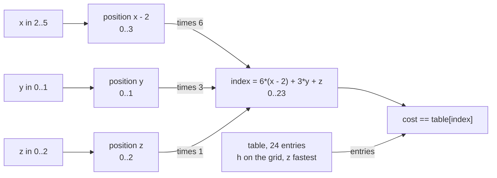

# CP-SAT table lowering, rebuilt bottom-up behind a config flag

Reference results: an earlier prototype of this lowering, called *the prototype* below,
measured on 50 replayed objectives. Its results are kept in
`~/pr6301-review/tableonly/`, and Stage 13's replay compares against them. The prototype
is cited for its results only. Code base: torch-spyre `cab4721d`. Line numbers are at
that commit.

Short paths: `config.py` and `cost_model.py` are under `torch_spyre/_inductor/`.
`cpsat_table_lowering.py`, `cost_expr_numpy.py`, `cpsat_expr_printer.py`,
`ilp_solver_ortools.py`, `plan_solver.py` and `sa_cooptimizer.py` are under
`torch_spyre/_inductor/scratchpad/`.

## Goal

When the last PR of this plan merges, torch-spyre has a table lowering of the CP-SAT
cost objective behind `config.cpsat_table_lowering`, off by default, that reproduces the
prototype's results. With the flag on, the objective is built from exact element tables,
linear sums and `lin_min`/`lin_max`. An objective the tables cannot lower raises, and
never reaches the printer. With the flag off, every solve goes through the printer as it
does on `main`. Table values are computed with numpy functions, and the code arrives in
layers, each with its own tests.

## Decisions (2026-11-16)

- **lambdify first, then numpy from a dict (2026-11-17).** Stage 1 computes every value
  with `sympy.lambdify`. Stage 4 adds numpy steps from a dict keyed by sympy class, and
  a class the dict does not hold stays on lambdify. There is no generic lookup of numpy
  functions by name. This replaces the 2026-11-16 decision, numpy first by name with
  lambdify as the backup.
- **Caching first, then numpy (2026-11-19).** Stage 1 realizes each node once, but a
  parent never reads its children's tables: it lambdifies its whole expression over its
  inputs, so each operation runs again in every ancestor, and each node pays for its own
  lambdify. Stage 3 keeps what is computed: a node's list is its own operation on its
  operands' lists, and as first built lambdify ran once per class. The numpy steps
  follow as Stage 4, in place of those functions. The owner asked why the numpy steps
  were "so much more complex than lambdify", and on the measurements (Stage 3) said
  "Lets defer conversion to numpy", then "Ok let move this caching to a new stage. The
  caching comes first." Every later stage is one later. Measured the same day against
  the cache of lambdified functions Stage 3 then had, Stage 4's numpy steps saved
  nothing per lowering. That cache was removed on 2026-11-20 (below), so the numpy
  functions are now what spares each node its lambdify (Stage 4).
- **A stack of PRs**, one per stage, each on the one before, from branches in the fork.
  Stage 1 is torch-spyre/torch-spyre#6475, from the fork's
  `table-lowering-1-base-experimental` on torch-spyre `main` of 2026-11-17 (92582da3).
  It merged into `main` on 2026-11-19 as one squashed commit, 290b5e0f, so Stage 2
  branches from `main`. It was first reviewed on the fork as spectre-ns/torch-spyre#32,
  which the plan cites below for that review's decisions.
- **From the review of Stage 1 (2026-11-19).** #6475 was approved with a request for
  the next PR of the stack, a note for the stage that wires the module in, and a
  suggestion for the stack. Each lands in the stage that first needs it:
  - Stage 2: the test module calls `pytest.importorskip("ortools.sat.python.cp_model")`
    before it imports ortools or the table module. ortools is not installed on s390x or
    ppc64le (`pyproject.toml:40`), and there an unguarded import is a collection error,
    not a skip.
  - Stage 2: the tests move from `tests/inductor/` to `tests/`.
    `tests/inductor/conftest.py` allocates on a Spyre device for every session, so a
    device-free test there cannot run without a device.
  - Stage 14: the table module guards its ortools import as the printer does. The review
    asks this of the stage that wires the module into the solver, which it numbers 11,
    counting the switch and the gate as one stage and with no stage of tests. Here that
    stage is 14; until then nothing imports the module.
- **Stage 2 is synthetic examples of the later optimizations, as strict xfails
  (2026-11-19).** Stage 2 adds no code to the module. It adds one synthetic objective
  per optimization of Stages 5 to 11, each one table past its cap, which no stage before
  its own can lower and that stage's optimization can, plus a trivial example that
  lowers today so the check runs end to end. Each is marked `xfail` with `strict=True`
  until its stage, which drops the mark, so the marks show what each stage adds. The
  owner moved away from modelling real blocks ("we would need the whole cost model to do
  this right"), after a captured fixture, the real blocks compiled on the device, and
  the blocks' shapes written in sympy. The tests were first planned with the numpy
  steps; the owner made them Stage 2, ahead of every optimization, and every later
  stage moved one later.
- **Off by default.** Stages 1 to 13 add files nothing imports. Stage 14 adds the flag.
- **Base mechanics first, then one optimization per stage, integration last
  (2026-11-17).** Stage 1 lowers an expression from inputs given to it, one table per
  node, and cannot lower a real objective: its one table would hold 10^13.4 to 10^401
  entries. Stage 2 adds tests only (2026-11-19). Stages 3 to 11 each add one
  optimization, and Stage 12 is an experiment off the stack. Stages 13 and 14 integrate
  with the printer's maps and then with the solver.
- **Rule 4 as a switch on the collapsed rest (2026-11-18).** A Mul is linear in its
  children only when its other factors are constants. Any other product is a switch.
  - The factor with the fewest distinct values stays constants, one per value, and its
    inputs pick which one applies, through one true/false per value.
  - The rest, the other factors, is collapsed once into one integer `w`, however many
    lists it holds.
  - Per value `c`, one enforced linear constraint gives the product `g == c·w`; a
    fraction `p/q` takes two, `q·g <= p·w <= q·g + q - 1`, so `g` is the floor.

  No table crosses factor and rest, and no two variables are multiplied. This replaces
  the 2026-11-17 decision, switched tables with `add_multiplication_equality` as the
  fallback. The prototype measured both:
  - switched tables put 45k of the 80k entries of the 14B and 24B auto-tiling prefill
    objectives into pairs with the 80-value derate factor;
  - CP-SAT's presolve expanded those pairs into 74k enforced constraints, and lowering
    and solving took 26 to 27 s;
  - the switch took 5.9 and 5.2 s, and the whole replay 144.6 s against 443.8 s.

  `add_multiplication_equality` is the generic form of the same product: CP-SAT splits
  it into cases itself only when one factor is 0/1, and it takes no fraction.
- **A 0/1 literal gates its term, an optimization of the switch (2026-11-18).**
  Multiplying by a literal is multiplying by 0 or 1, the switch's two-value case with
  one value 0. A product with a factor that reads one 0/1 literal and is 0 at one of its
  values (`x`, `1 - x`, `2 - 2*x`), and a relayout charge, its literal times a price by
  division, is its rest where the literal keeps it and 0 where it does not.
  - Two enforced linear constraints hold it, and the literal is its own true/false.
  - The rest is read with the literal fixed and the one nonzero value pushed into it in
    float, so the gate adds no rounding.
  - Its rest's entries count once; a relayout charge's table over the literal and the
    division held them twice, its off half zeros.

  This is rule 5, built in Stage 7, right after the switch it optimizes. The prototype
  measured this form against tabling the literal:
  - small default-config kernels went from 2 to 2.5 times the printer's solve time to
    the printer's own: softmax 4096x2048 0.39 to 0.15 s (printer 0.15 s), add_mul 0.11
    to 0.055 s, rmsnorm 0.13 to 0.065 s;
  - the whole replay went from 494.6 to 443.8 s;
  - recognising the gate in any form, as sympy writes `2*(1 - x)` as `2 - 2*x`, cut the
    GQA test from 306,811 entries to 115,667, and the Mistral 24B prefill from 59,152 to
    21,696.
- **A value that is not a finite number raises (2026-11-18).** A NaN, `inf` or `-inf` in
  any list a node makes raises `TableLoweringError` at the node that made it, naming it.
  That covers one table over the inputs, a table from its parts (including combinations
  of positions that cannot occur), a Piecewise arm whether it is taken or not, a rank, a
  ladder, a bound and a switch's values. Nothing is computed from such a value, so a NaN
  cannot reach a Min/Max's bound, a sign or a comparison and turn into a silent wrong
  cost. On the 50 replayed objectives, none of the 59,492 arms of their 15,975 Piecewise
  nodes is ever non-finite, and every Piecewise has an arm true at every assignment
  (`~/gap-probe/spyre-roadmap-pr21/2026-11-18/nonfinite/`). #32 refuses it this way. The
  check is in the node that makes the list (`Node._finite`), and a node reads its
  children's realizations as it is realized. So every node under the root is realized
  and checks its own list, whether or not the root's value depends on it: an arm that is
  not taken raises in Stage 1 too. The owner's words (2026-11-19): "The non-finite
  should just be a check in the child node".
- **Behaviour, not code.** The stages below say what each layer does. The prototype is
  cited for its results only.
- **Free to deviate.** The forms need not be the prototype's. Every roll-up is built
  from two moves, combine and compact, and the table constraint is measured against
  them.
- **A factory of nodes that realize themselves (2026-11-18).** This replaces the
  2026-11-17 design of two passes, a visitor and an emitter.
  - `TableLowering` is a factory: it makes one `Node` per distinct sympy node, children
    first, of the class the node's sympy class calls for. It hands each node what it
    reads and does nothing else.
  - A node realizes itself the first time its realization is read (`realize`, kept as
    `realization`). It reads its children's realizations as it does, so reading the root
    realizes every node under it, each once. A node nobody reads is never realized.
  - A realization builds its own CP-SAT side (`cp_expr`), as a position already does
    (`Index.cp_expr`), and there is no emitter. The objective is `TableLowering(inputs,
    cap=cap).lower(expr).cp_expr(model)`.
  - A position is one class, `Index`, whose steps hold their parts as fields:
    `CombineIndex(left, right)`, as a node holds its children. It replaces `IndexMap`
    and the earlier `CpIndex`, which referred to each other: the step took the `CpIndex`
    it sat in. `CompactIndex`, `ExtremeIndex` and `LocateIndex`, written on it,
    type-check and are exact in CP-SAT on the step-by-step graph at the real menus: the
    ranked product in 68 entries, the Max by rung in 63
    (`~/gap-probe/spyre-roadmap-pr22/2026-11-18/merged/`). One thing is given up: a part
    reached twice in one build is built twice, where `IndexMap`'s walk built it once.
    That is free while no step writes the model, and Stage 6 builds positions once.
  - Each kind of node, realization and position step is a thin subclass of a small
    interface, so an operation, a realization or a step is added without changing the
    others. Changing how something is emitted means changing its class's `cp_expr`.
  - Each hook a later stage needs is built in that stage, not before.

  The owner's words: "Can we redesign this so the tabulation should be on the node base
  class?", "Drop visitation it's not as clean as using the open closed principle",
  "Drop CpEmitter", "Lets build the hooks when they're needed", "Implement a CpForm base
  class", and on positions "IndexMap's interface should take IndexMap rather than
  CpIndex", "The relationship is circular right now", "Yeah merge them together".
  Spectre-ns/torch-spyre#32 is built this way. See Architecture.
- **The factory is a sympy `Printer` (2026-11-20).** From Stage 3 `TableLowering`
  subclasses `sympy.printing.printer.Printer`, as the solver's other lowering,
  `_SympyExprToCpSat`, does, and prints a node as its `Node`. The owner's words: "Lets
  update [torch-spyre/torch-spyre#6525] to use a sympy printer".
  - A Printer already does what the factory did by hand. It dispatches on a node's sympy
    class, the nearest class along its MRO that has a print method, and falls back to
    `emptyPrinter`. So each node class is made by a print method: `_print_Symbol` makes
    the `InputNode`, from Stage 5 `_print_Add` the `AddNode`, and so on. `rewrite`,
    `children_of` and a table of node classes are not needed.
  - Only the making of the nodes moves. A node still realizes itself, and a realization
    and a position are neither sympy nor CP-SAT values, so nothing else is a printer's
    work. A print method returns a `Node`, not a string, as sympy's pretty, MathML and
    LLVM printers return types of their own. `lower` is the entry point, and `doprint`,
    which returns a string, is not overridden.
  - `_print` keeps each `Node` by its sympy node, which is what makes a shared
    subexpression one node. A printer keeps its nodes between calls of `lower`; the
    factory kept nothing.
  - Measured on a build of every stage (torch-spyre branch
    `table-lowering-full-printer-experimental`): the 55 captures of the replay lower to
    the same model, byte for byte, in the same time, with 76 lines added to the module
    and 67 removed. At Stage 3, on 12 expressions at two caps, each of 232 nodes has the
    class, the children and the realization, or the refusal, that the factory gave it
    (`~/gap-probe/table-lowering-printer/2026-11-20/`).
- **The Nodes are merged into the printer (2026-11-20).** From Stage 3 there are no
  `Node` classes. The owner's words: "Lets merge the Nodes into the printer such that
  they return realizations to their parents that can be converted to TableRealizations
  if requested by their parents. The printer should be able to build the indexes
  directly... Do this in current stage 3". This replaces the nodes that realize
  themselves of the 2026-11-18 entry.
  - A print method returns the node's realization to the node's parent. It prints the
    node's operands first, which returns theirs, and asks an operand for its table when
    it computes its own list from it: `AbstractRealization.table(cap)`. In Stage 3 every
    realization is a table and returns itself.
  - The conversion takes the cap. The owner's words: "So this means that realizing to
    a table realization will result in evaluation of all child realizations" and "The
    AbstractRealizations should take the cap into table". From Stage 5 a realization
    that is not a table makes one from its operands' tables, which asks each of them for
    theirs, down to the leaves: the operands' own lists are already computed, and what
    is new is the one list over all their inputs. The cap is passed so that table is
    refused before it is computed. A `TableRealization` reads no cap: it makes nothing.
  - `print` is the printer's public method, and the print methods return an
    `AbstractRealization`. The owner's words: "print should be a public member of
    TableLowering" and "Shouldn't the print methods call return abstract realizations?"
    So a parent gets a table only by asking a realization for it.
  - The printer builds the positions: a symbol's column on an `InputIndex` of its
    variable, and an operation's position from its inputs' positions, combined in the
    order of its symbols.
  - Printing realizes, so `lower` raises a refusal itself and returns the root's
    realization. What the nodes guaranteed is kept: a node whose table would pass the
    cap is refused before anything under it is printed or evaluated, and a value that is
    not finite at the node that makes it. A refusal from the build, an entry past 2^50,
    names no node.
  - For the later stages: where this plan names a node class (`AddNode`, `MulNode`,
    `ExtremeNode`, `RelayoutChargeNode`), it is the print method of that sympy class
    (`_print_Add`, `_print_Mul`, `_print_Min` and `_print_Max`,
    `_print_RelayoutCharge`), returning what the class was to realize. A node's two
    reads, its `realization` and its `table`, are the returned realization and its
    `table(cap)`. Those stages' sections keep the node names until each is built.
  - Measured on the 55 captures of the replay: each of the 104,234 nodes that fit the
    cap has the list and the position the Nodes gave it, and each of the 770 refusals
    names the same node for the same reason.
- **Measurements are relative to the production path (2026-11-20).** The production path
  is the CP-SAT printer: it is what lowers a compile's objective. The table path on
  `main` lowers no real model, so it is not a baseline for a claim about speed. The
  owner's words: "Make your measurements relative to the production path. Table path on
  main doesn't lower real models yet." A stage that touches the printer reports the
  printer's time and model on the captures, on `main` and after. A stage that only
  changes the table path says it changes no production time, and reports the table
  path's own times as that, between stages, on the nodes that fit the cap. The table
  path is first measured against the printer where it lowers whole objectives, at Stage
  13's replay.
- **No cache that outlives a lowering (2026-11-20).** Stage 3 as first built kept each
  lambdified function in a module-level `lru_cache`, one per class and form of operands.
  The review of torch-spyre/torch-spyre#6525 asked for no cache that hangs around, and
  the owner's words were "Remove the caching", in that PR. A node now lambdifies its
  function when it is realized, and nothing keeps it. The cache is not weighed in any
  measurement here: Stage 4's numpy functions take lambdify's place. The owner's words:
  "We shouldn't consider the cache as its being removed to use numpy look ups. Lets
  remeasure." The remeasured times are in Stages 3 and 4.
- **Floating point until CP-SAT, and not the annealer's bits (2026-11-20).** A list is
  computed in floating point and rounded once, onto `COST_SCALE`, where it enters
  CP-SAT. It is held to the expression's value, not to another evaluator's result. The
  owner's words: "We don't care about exactly matching the annealer as it's not able to
  determine global optimals. We will get some rounding but we should be able to use
  floating point math until we move into CP-SAT to contain the span." So a list may
  differ from Stage 1's whole-expression lambdify in its last bits, and by one step
  where a `floor` or `ceiling` argument lands on an integer: a node sums its operands in
  their own order, and reads a constant as the double it is, where lambdify prints a
  Float to 15 digits (its `ceiling(2/3 * c)` is one high at c = 3, 6 and 9). On the 55
  captures of the replay, 22,167 of 104,234 lists differ from Stage 1's in their last
  bits and no entry differs after the rounding.
- **An xfail reason gives the failure, not a stage of the plan (2026-11-20).** The
  synthetic examples' reasons named the stage that lowers each. The owner's words: "No
  we shouldn't link to plan. Add the reason to the xfail reasons." Each reason now says
  which table is past the cap, how many entries it needs, and what is not built that
  would lower it (#6525, d579576e).
- **Names say what a class is (2026-11-19).** The lowering's classes drop the `Cp`
  prefix. A node ends in `Node`, what a node is realized as ends in `Realization`, and a
  position step ends in `Index`:

  | Was | Is |
  |---|---|
  | `CpNode`, `CpSymbol`, `CpConstant` | `Node`, `InputNode`, `ConstantNode` |
  | `CpForm`, `CpTable` | `AbstractRealization`, `TableRealization` |
  | `CpIndex`, `Input`, `Unit`, `Combine` | `Index`, `InputIndex`, `UnitIndex`, `CombineIndex` |
  | a node's `form` | its `realization` |

  An `InputNode` is a symbol's node: it holds the symbol's input, the variable and
  values the caller hands over. `CpExpr` and the `cp_expr` methods keep their names,
  since they are CP-SAT expressions. The owner gave the first seven names and asked for
  the rest to follow, then said "I think that is cleaner naming." #32 is renamed
  (8367e1a1). The classes of later stages follow the same pattern in this plan, though
  the owner has not named them one by one: `LinearRealization`, `AddNode`, `MulNode`,
  `ExtremeNode`, `CompactIndex`, `ExtremeIndex` and `LocateIndex`.
- **The switch and the gate right after the linear sums (2026-11-18).** The order is 1
  base, 2 the synthetic examples (from 2026-11-19), 3 caching (from 2026-11-19), 4
  numpy, 5 linear sums, 6 the switch, 7 the gate, 8 ranks and pairs, 9 rungs, 10 the
  fold, 11 `lin_max`. Before
  2026-11-18 ranks, rungs, the fold and `lin_max` came before the switch and the gate.
  - The switch needs only Stage 5: its rest is a realization Stage 5 makes, a table or a
    `LinearRealization`. It brings `CompactIndex` and the choice between ways by entries
    (rule 3), which Stage 8 extends.
  - It serves both kinds of term: it takes the literals out of the narrow terms' tables
    and splits the wide products. On the step-by-step graph's product it is 38 entries
    against 68 as a pair at the real menus.
  - Each `Index` step lands with the stage that first uses it: `InputIndex`, `UnitIndex`
    and `CombineIndex` in Stage 1, `CompactIndex` in 6, `ExtremeIndex` in 9,
    `LocateIndex` in 13. `LocateIndex` left #32 because no replayed objective needs it:
    none of the 4,159 non-buffer variables the 50 replayed objectives read has a domain
    with gaps (`~/gap-probe/spyre-roadmap-pr21/2026-11-18/locate/`).
  - An `InputNode` makes its own `InputIndex` (2026-11-19, 9a5f45ab). The caller hands
    each symbol its variable and its values, and no position. The node makes the
    position on the variable, its offset and size read from the variable's domain, and
    refuses values that are not one per value of the variable. So Stage 1 is the basic
    conversion from sympy to CP-SAT by itself, and nothing in it is constructed only by
    its tests. Before that the caller built each position, and only the tests did. The
    owner's words: "Don't add stuff that is not in stage one", then "We should be able
    to do basic sympy -> cp_sat in table format" and "The input index should be created
    inside the conversion from nodes to cp_sat. Probably input node should create it."
  - By that rule, the same day, `Index` lost what Stage 1 never calls (ff12b042): its
    entry count (`entries`, with `parts` and `under()` to walk an index),
    `TableRealization.entries`, and `positions`, the numpy side of a position. Stage 1
    asks an index for its size and its `cp_expr`, and the cap bounds the length of one
    table's list. The entry counts come back in Stage 6, with the first step that has a
    lookup of its own. `positions` comes back with the first stage whose code reads a
    position in numpy: Stage 3, as `Index.on_grid` (2026-11-19). Asked whether to move
    them out as well, the owner said "Yes".

  The owner asked "Do we need all the IndexMap specializations before we implement the
  optimizations?" and, given this order and `LocateIndex`'s move, said "Do that". The
  end state is the same, so Stage 13's replay against the prototype's results does not
  change.
- **Margin 2 (2026-11-17).** A Min/Max with only linear nodes above it stays a
  `lin_min`/`lin_max` only when that needs under half the entries of its table, as in
  the prototype. Replayed on the prototype on the 46 objectives where the choice changes
  the model, each rule's solve time against margin 2's: always `lin_max` 1.35 to 1.52
  times (slower on 39 to 43 of them); margin 1, linear whenever it has fewer entries,
  0.99 on average but 1.22 in total, with the GQA test at 137 s against 82 s; a table
  whenever one fits 2.07 on the 14 objectives it changes, `main.caps/compile_0` 24
  times. An exact-domain `lin_max` target and `linearization_level` 2 were within
  run-to-run noise. All reach the same optimal cost.

- **Raise when the cap is hit (2026-11-17).** With the flag on there is no fallback. An
  objective the tables cannot lower raises `TableLoweringError`, naming the node and the
  reason, with the model untouched. The printer cannot stand in: on the replay it fails
  every auto-tiling objective (`calling ** on a linear expression`), and when it fails,
  `main` solves a traffic objective that ignores the cost model with every relayout copy
  pinned out (`ilp_solver_ortools.py:886`, `:1449`). On `main` the allocator withholds
  those objectives from CP-SAT altogether. With the flag on, Stage 14 hands them over.
  `TableLoweringError` subclasses none of `RuntimeError`, `TypeError` or `ValueError`,
  so that `except` cannot turn it into that solve. On the prototype all 50 replayed
  objectives lower without a refusal.
- **Copy the model, swap it back when the build fails (2026-11-17).** The entry point
  copies the model before it maps an input. When any step fails, in realizing a node or
  in building it, it swaps the copy back and raises `TableLoweringError`, from the
  original exception when that was of another type. So the model is as it was whenever
  the lowering raises, even when the failure comes after variables were made, as an
  entry past 2^50 does. And `TableLoweringError` is the only exception the lowering lets
  out: a `ValueError` out of numpy, or Stage 4's `NotImplementedError`, which is a
  `RuntimeError`, cannot reach that `except` and become the traffic solve. On the 50
  replayed models the copy takes 0.2 to 9 ms.

## Estimates

Measured on the 50 replayed objectives: 45 captured compiles (model blocks at the
default config and with auto tiling, plus tests) and 5 synthetic products. Two sources:
a count of what each top-level term of the objective reads (2026-11-16), and the
prototype's lowering at a cap of 8192 (replay of 2026-11-15).

**Cost between buffers is rare.** Of 6663 terms:

| A term reads | Terms | Share |
|---|---|---|
| no division (residency literals only) | 1670 | 25.1% |
| one buffer's division | 4851 | 72.8% |
| two | 38 | 0.6% |
| three or more | 104 | 1.6% |

Each of the 45 captured compiles has 1 to 4 terms that read two or more divisions, the
*wide* terms.
The widest reads 4 to 8 divisions on a model block, and 35 and 49 on the two large tests.
One table over its inputs would hold from 3.6e4 to 7.5e18 entries on a model block, so it
is never one table.

**How that simplifies.**

- *Narrow terms, 98%.* Each is a list over one buffer's menu, or a coefficient on
  literals. 81% read exactly one literal, 18% none, and 57 terms read four or more. Terms
  on one division with one literal add into one list in numpy, before anything reaches
  the model. Their entries are about the sum over divisions of menu size times literals,
  which is linear in the number of buffers. No table spans two buffers, and on every
  model block the largest table is the largest menu.
- *Wide terms, 2%.* Rules 1, 2 and 4 exist for these 1 to 4 terms. By the estimate below
  they take a fifth to two fifths of the entries at the default config and half to seven
  tenths with auto tiling.

| Objective | Divisions | Largest menu | Terms | Wide | Narrow entries (est.) | Entries, prototype | Lower (s) | Solve (s) |
|---|---|---|---|---|---|---|---|---|
| default, decode block | 12 | 20-26 | 165-169 | 2 | 249-318 | 396-525 | 0.61-0.68 | 0.08-0.10 |
| default, prefill block | 14 | 55-65 | 187-189 | 1 | 1056-1217 | 1304-1535 | 0.72-0.74 | 0.40-0.50 |
| auto tiling, decode block | 12 | 30-41 | 101-105 | 3 | 332-429 | 622-870 | 0.63-0.92 | 0.14-0.17 |
| auto tiling, prefill block | 14 | 380-450 | 165-167 | 3 | 5849-6689 | 16908-21998 | 0.89-1.27 | 1.74-2.38 |
| flash attention test | 41 | 338 | 232 | 4 | 28986 | 49227 | 2.01 | 8.89 |
| prefill batch GQA test | 91 | 662 | 401 | 3 | 58399 | 115667 | 5.94 | 13.49 |

The narrow estimate is one list per division and literal, sized by the menu: the form of
rule 4's switch, which collapses a literal term's rest once, from Stage 6. Before it a
literal's term is one table over the literal and the division (Stage 5): twice that,
its off half zeros. The estimate ignores lists that turn out affine and cost nothing.

**What it says about the stages.**

- Stage 1, one table per node, lowers none of the 50 objectives: the root's table is
  over every input, 10^13.4 to 10^401 entries.
- Stage 5, linear sums, lowers 6465 of the 6521 narrow terms as one table each; the
  other 56 read four or more literals. It lowers none of the 50 objectives end to end:
  each has at least one term whose inputs pass the cap, and the lowering is all or
  nothing.
- On the wide terms, entry count is decided in Stages 6 and 8 to 11, on 1 to 4 terms per
  objective.
- Stage 6, the switch, takes the literals out of the narrow terms' tables: a literal's
  term is its rest collapsed once, sized by its menu alone, as the estimate counts it. A
  term on one menu with k literals is one list under k switches, where Stage 5 made one
  table of 2^k times the menu. Until Stage 6 the narrow entries are about twice the
  estimate. Stage 7's gate then drops the literal from the rest and makes a fractional
  coefficient exact. How many of the 56 the switch brings under the cap is reported by
  Stage 13's replay.
- Lowering time matters most where the model is smallest. At the default config a decode
    block takes 0.61 to 0.68 s to lower and 0.08 to 0.10 s to solve. Stage 3 lowers a
  600-node expression in 0.16 s, against 0.18 s for Stage 1: each node reads its
  children's lists, but still pays for a lambdify of its own. Numpy functions in place
  of the lambdified ones lower it in 23 ms (Stage 4). What that saves on the decode
  blocks is reported by Stage 13's replay.

## How a table is read

- An *input* is one CP-SAT variable the cost depends on: a buffer's division, a residency
  literal, or another integer variable in the symbol map. A buffer's split and tile
  symbols are columns over its division.
- A node is *indexed* when its value is `values[index]`: `values` is a float list
  computed in numpy before the solve, and `index` is a CP-SAT expression that the inputs
  determine. The solver never chooses an index.
- *Entries* are the table entries a realization puts in the model. The cap bounds one
  table.
- `Min` and `Max` are nodes of the cost expression. `lin_max` is CP-SAT's constraint
  `target == max(e_1, ..., e_n)` over linear expressions, which `add_max_equality` adds.
  CP-SAT has no min constraint: `add_min_equality` adds a `lin_max` over the negated
  expressions, and this plan calls that `lin_min`. A Min/Max node is lowered one of two
  ways. *By rung*, `lin_max` takes the max of small integer positions, and one lookup
  then reads the cost (rule 1). *Kept linear*, each operand is collapsed to an integer
  cost, and `lin_max` takes the max of the costs, with no table for the Min/Max itself.
- *Kept linear* is open to a Min/Max only when every node between it and the objective
  is linear in it: a sum, a constant factor (a negative one turns Max into Min), another
  Min/Max, or a product, whose switch multiplies the Min/Max's collapsed value by each of
  the factor's values, of any sign (rules 4 and 5). `Max(...) ** 0.5` is not:
  CP-SAT has no root of a `lin_max`. Neither is a log, a floor, a division by the
  Min/Max or a condition on it. Under such a node the Min/Max must be a table, by rung or
  over its inputs, and when neither fits the cap the lowering raises (Decisions).
- Lists are float from the leaves up. CP-SAT holds positions only, until a list is
  collapsed into a linear term (next section).

The five rules that keep lists short:

1. A Min/Max of indexed operands is indexed by rung. Its ladder holds only the values it
   can return, each operand maps to a rung, and the Min/Max of the rungs is the rung of
   the Min/Max.
2. A product of Min/Max factors over shared inputs is indexed by the tuples of rungs that
   can occur together, found by a chain of small tables, one per group of shared inputs.
3. A node takes the cheaper, in entries, of one table over its inputs and the one built
   from its parts. A Min/Max with only linear nodes above it stays linear when that
   needs under half the entries of its table.
4. A product is linear in its children only when its other factors are constants. Any
   other product is a *switch*. The factor with the fewest distinct values stays
   constants, and its inputs pick one through a true/false per value. The rest is
   collapsed once into an integer `w`, and the true/false that is on enforces
   `g == c·w` for its value `c`: one linear constraint per value, two for a fraction,
   `g == 0` for 0. No table crosses factor and rest.
5. An optimization of rule 4's two-value case when one value is 0. A product with a
   *gate*, a factor that reads one 0/1 literal and is 0 at one of its values (`x`,
   `1 - x`, `3*x`, `2 - 2*x`), is a switch on the literal itself, with three savings:
   - the literal is its own true/false;
   - the rest is read with the literal fixed at its other value, the kept value, so no
     table reads the literal;
   - the gate's value there is pushed into the rest's lists before the rounding, so the
     case is `g == w`, exact even for a fraction.

   A relayout charge, its literal times a price by division, is gated the same way.

## The process, step by step

Before the solve starts, numpy computes every cost value in floating point. CP-SAT never
evaluates the expression. It works out which entry of each table applies, and one
`add_element` constraint per linear term reads that entry.

### The expression graph

The cost is an expression graph: a sum at the root, operations inside, and symbols and
numbers at the leaves. The example for this section has four terms over three buffers:

```
7 * split_a ** 0.5  +  split_a ** 0.7  +  9 * split_a ** -2 * split_b ** 0.5
    +  Max(split_a / 2, split_b ** 0.5, split_c ** 0.25)
```


- **Leaves.** Each symbol belongs to one decision variable. `split_a` has the menu
  `[1, 2, 4]`, and `division_a` picks from it. `split_b` has `[1, 3]` under
  `division_b`, and `split_c` has `[1, 2, 2, 4]` under `division_c`. Numbers are drawn
  inside the node that uses them.
- **Inner nodes.** Seven nodes read one buffer, the product reads two, and the Max reads
  three.
- **Sharing.** It is a graph, not a tree. `split_a` is read by four nodes and
  `split_b ** 0.5` by two. A shared node is handled once.

### From the leaves to the root

The lowering goes over the graph from the leaves to the root, in the order Architecture
gives. Below the sum, every node becomes a float list: its value at each position of an
index. Once a node has its list, the nodes under it are not needed again, because their
values are inside it. At the sum, what is left of each term is collapsed into an integer
table.

1. **A leaf becomes a column.** `split_a` is the list `[1, 2, 4]` and its index is
   `division_a`: position `d` holds the split at candidate division `d`. `split_b` and
   `split_c` are the same over their own divisions. A residency symbol is `[0, 1]` on
   its literal, and any other integer symbol is its domain's values on its own variable.
2. **A node over one buffer stays on that buffer.** numpy applies the node to its
   child's list, entry by entry. `split_a ** 0.5` is `[1, 1.4142, 2]`, and 7 times it is
   `[7, 9.8995, 14]`, both still on `division_a`. Powers, roots, logs and divisions all
   happen here.
3. **The product joins two indexes.** Its children are on `division_a` and
   `division_b`. Its list is their outer product times 9, 3 * 2 = 6 values. Its index is
   the pair of their positions, `pair = 2*division_a + division_b`: a linear expression,
   which costs no variable, no constraint and no lookup.
4. **The Max is read by rung.** Its operands are on three buffers, and one table over
   them would hold 3 * 2 * 4 = 24 entries. The Max gets a ladder instead: the five
   values it can return, ascending. Each operand's list becomes its rungs on the ladder.
   `split_a / 2` is `[0.5, 1, 2]`. The Max is never under 1, the largest operand
   minimum, so 0.5 counts as 1 and the rungs are `[0, 0, 4]`. CP-SAT looks up the three
   rungs, and `rank` is their max.
5. **The sum stays a sum, and its lists are collapsed.** A sum is linear, so it needs no
   list of its own. One list over all three buffers would again hold 24 entries here,
   and the product of every menu on a real objective. Its four terms are lists on three
   indexes. The two on `division_a` are added in float. Each of the three lists is then
   multiplied by `COST_SCALE`, rounded once, and read by one `add_element`. The
   objective is the sum of the three cost variables.

How each node is collapsed:

| Node | Step | Its float list | Its index | It adds to the model |
|---|---|---|---|---|
| `split_a` | 1 | 1, 2, 4 | `division_a` | nothing |
| `split_b` | 1 | 1, 3 | `division_b` | nothing |
| `split_c` | 1 | 1, 2, 2, 4 | `division_c` | nothing |
| `split_a ** 0.5` | 2 | 1, 1.4142, 2 | `division_a` | nothing |
| `7 * split_a ** 0.5` | 2 | 7, 9.8995, 14 | `division_a` | nothing |
| `split_a ** 0.7` | 2 | 1, 1.6245, 2.639 | `division_a` | nothing |
| `split_a ** -2` | 2 | 1, 0.25, 0.0625 | `division_a` | nothing |
| `split_a / 2` | 2 | 0.5, 1, 2 | `division_a` | nothing |
| `split_b ** 0.5` | 2 | 1, 1.7321 | `division_b` | nothing |
| `split_c ** 0.25` | 2 | 1, 1.1892, 1.1892, 1.4142 | `division_c` | nothing |
| the product | 3 | 9, 15.5885, 2.25, 3.8971, 0.5625, 0.9743 | `pair` | nothing: `pair` is the expression `2*division_a + division_b` |
| the Max | 4 | the ladder: 1, 1.1892, 1.4142, 1.7321, 2 | `rank` | three rung lookups, 3 + 2 + 4 entries, and `rank == max(rung_a, rung_b, rung_c)` |
| the sum | 5 | none: it stays linear | None (CP-SAT) | three tables, 3 + 6 + 5 entries, and three lookups |

Every node below the sum ends inside one of three lists, and the collapse makes each of
them one integer table. These are the only tables that hold a cost:

| Table | Index | The list, in float | Entries |
|---|---|---|---|
| `table_1` | `division_a` | 8, 11.524, 16.639: the two terms on `split_a`, added | 8192, 11801, 17038 |
| `table_2` | `pair` | the product's list | 9216, 15963, 2304, 3991, 576, 998 |
| `table_3` | `rank` | the ladder | 1024, 1218, 1448, 1774, 2048 |

The rung tables hold positions, not costs: `rungs_a = [0, 0, 4]`, `rungs_b = [0, 3]` and
`rungs_c = [0, 1, 1, 2]`.

The order of the collapse matters. At `split_a = 2`:

- `7 * split_a ** 0.5` is 10137, the rounding of 7 * 1448.15. Rounding first and
  multiplying after gives 7 * 1448 = 10136.
- `split_a ** 0.5 + split_a ** 0.7` is one entry, 3112, the rounding of
  1448.15 + 1663.49. Collapsing each list alone gives 1448 + 1663 = 3111.

The graph had 13 nodes. The model gets six lookups with 23 entries and one max. `pair`
is a linear expression inside its lookup, with no constraint of its own.

At `division_a = 1`, `division_b = 1`, `division_c = 3`: `cost_1` is 11801. `pair` is 3
and `cost_2` is 3991. The rungs are 0, 3 and 2, `rank` is 3 and `cost_3` is 1774. The
objective is 17566, and the float value is 17564.84.

The example was run through CP-SAT at all 24 assignments of the three divisions. The
model has 24 solutions, minimizing and maximizing agree at each, and the worst error is
1.16 units over the three tables.

### How the tables are kept small

The starting point is one table over every input the objective reads, the product of the
menus. Each reduction below cuts it at one node of the walk:

| Reduction | Where | What it saves |
|---|---|---|
| The sum stays linear | the sum | entries add over the terms instead of multiplying over the inputs |
| Lists on one index are added | the sum | one list per index, not one per term |
| An affine list needs no table | the collapse | a list linear in its index is `table[0] + step * index`; a constant list is a number |
| Equal values share a rank | a node over several indexes | a product pairs distinct values, not divisions |
| A Min/Max is read by rung (rule 1) | a Min/Max | a ladder of the values it can return, and one remap per operand |
| Values past the bound are clamped | a Min/Max | the ladder drops the values the Min/Max can never return |

**How the walk chooses.** A node over several indexes has two candidates, one table over
its inputs and the table from its parts, and `realize` keeps the one with fewer entries
(rule 3). Both sizes are known before any list is computed: one table is the product of
its inputs' sizes, and the table from its parts is its list (the product of the parts'
distinct values, or the ladder) plus the remaps under its index. A candidate past the
cap is never evaluated. A Min/Max with only linear nodes above it stays a
`lin_min`/`lin_max` when that needs under half the entries of its table.

**On the graph above.** Its menus are 3, 2 and 4 long, and one table over all three is 24
entries. The reductions bring that to 23, so on menus this short they barely matter.

**On real menus.** The same graph, with each symbol replaced by a split of the default
Granite 3.3 8B decode capture: `split_a` is `buf6`'s d1 split (21 divisions, 6 values),
`split_b` is `buf13`'s d0 split (11 divisions, 6 values) and `split_c` is `buf7`'s d1
split (20 divisions, 6 values). One table over the three divisions is 21 * 11 * 20 = 4620
entries. The reductions, turned on one at a time in the order of the first table, and
each turned off alone with the others on:

| Reduction | Entries, built up | Largest table | Entries without it |
|---|---|---|---|
| none: one table over the three divisions | 4620 | 4620 | |
| the sum stays linear | 325 | 231 | 1857 |
| lists on one index are added | 304 | 231 | 173 |
| an affine list needs no table | 304 | 231 | 152 |
| equal values share a rank | 141 | 36 | 315 |
| the Max is read by rung | 153 | 36 | 141 |
| values past the bound are clamped | 152 | 36 | 153 |

- *The sum* keeps its four terms apart: two lists of 21 on `division_a`, the product's
  231, and the Max. One table for the Max would still be 4620 entries, so it stays a
  `lin_max` over its operand lists of 21, 11 and 20 (rule 3).
- *Lists on one index*: the two terms on `division_a` become one list of 21.
- *Affine lists*: this graph has none. Any list of two values is affine, so a residency
  literal times a constant never needs a table. A quarter of the terms read no division,
  only residency literals (Estimates).
- *Ranks* take the product from 21 * 11 = 231 entries to 6 * 6 = 36, plus the two remaps
  of 21 and 11. A division menu is longer than the values one split takes.
- *Rungs* cost 12 entries here: the table by rung is 64 entries against a 52-entry
  `lin_max`. Rule 3 keeps the table, because 52 is not under half of 64. This is the one
  step where the walk does not take the fewest entries.
- *Clamping* drops one value from the ladder: `split_a / 2` at split 1 is 0.5, below 1,
  the smallest value the Max can return.

Every row was run through CP-SAT at all 4620 assignments: one solution per assignment,
minimizing and maximizing agree at each, and the worst error stays within the collapse
bound.

Three more reductions are not in the table above:
- **The switch (rule 4)** reads a product by collapsing its rest once into an integer
  and multiplying that by each of the factor's values, one enforced constraint per
  value. It applies to this graph's product: 38 entries against the ranks' 36 + 21 +
  11 = 68, so with it the built-up total is 122 (Stage 6).
- **The gate (rule 5)** is the switch on a 0/1 literal. Its rest's entries count once,
  and no table reads the literal. This graph reads no literal.
- **The fold (rule 2)** reads a product of Min/Max factors over shared inputs by the
  tuples of rungs that can occur together. This graph multiplies no Min/Max.

On the model blocks, one table over the widest term alone would hold 3.6e4 to 7.5e18
entries, and the prototype's lowering of the whole objective holds 396 to 21998
(Estimates). Stage 13's replay reports entries per capture with each reduction.

Two subsections below add what the graph does not show: a buffer with several symbols on
one division, and one table over several integer variables. Every table in this section
was run through CP-SAT at every assignment of its inputs, and each came back within half
a unit of the float value.

### What a position is: a buffer's menu

A buffer does not have one variable per split. It has a menu of candidate divisions, and
one variable, its division, that picks a row. Each symbol of the buffer is a column:

| `division_a` | `split_a_d0` | `split_a_d1` | `tile_a` | a term, `8 / (split_a_d0 * tile_a)` |
|---|---|---|---|---|
| 0 | 1 | 1 | 1 | 8 |
| 1 | 2 | 1 | 1 | 4 |
| 2 | 2 | 2 | 1 | 4 |
| 3 | 4 | 1 | 2 | 1 |

A term over any of the buffer's symbols is a list with one value per row. Its index is
`division_a` itself, with no offset and no stride: position `d` holds the value at
candidate division `d`.

Equal values can share a position. The list above is `[8, 4, 4, 1]`, its distinct values
are `[1, 4, 8]`, and `rank_of = [2, 1, 1, 0]` gives each division its rank:
`rank == rank_of[division_a]`. A product pairs ranks, so repeated values do not widen its
table.

### Several variables: offsets and strides

A term `h(x, y, z)` over three integer variables: `x` in `2..5`, `y` in `0..1`, `z` in
`0..2`.



- **Offset.** A variable in `lo..hi` has the position `var - lo`. A domain with gaps
  gets its position from a lookup, `LocateIndex` (Stage 13).
- **Stride.** A position is multiplied by the product of the sizes of the variables
  after it: 2 * 3 = 6 for `x`, 3 for `y`, 1 for `z`.
- **Linear.** The strides are constants, so the index is a linear expression: no two
  variables are multiplied. CP-SAT takes it as the index of the lookup, with no variable
  and no constraint of its own.

numpy fills the table in the same order, last variable fastest:

| `x` | `y` | `z` | index |
|---|---|---|---|
| 2 | 0 | 0 | 0 |
| 2 | 0 | 1 | 1 |
| 2 | 0 | 2 | 2 |
| 2 | 1 | 0 | 3 |
| ... | | | |
| 4 | 1 | 2 | 17 |
| ... | | | |
| 5 | 1 | 2 | 23 |

The table has 4 * 2 * 3 = 24 entries. The sizes multiply, so this form is only for a term
whose variables fit the cap together.

### Which realization a node takes

Every node is tabulated, linear, or both. There is no third realization, no partial
lowering and no fallback: when the objective cannot be read from tables and linear
realizations alone, the lowering raises.

| A table of it fits the cap | It is linear, under linear nodes only | The node |
|---|---|---|
| yes | no | tabulated: a float list on an index |
| no | yes | linear |
| yes | yes | both realizations; its reader picks one (rule 3) |
| no | no | no realization: its `realize` raises `TableLoweringError` when a reader reads it, naming the node |

- *A table* is one table over the node's inputs, or the one built from its parts: a
  rank, a pair, a Min/Max by rung, a fold (rules 1 to 3).
- *Linear* nodes are a sum, a constant times one child, any other product as a switch
  (rule 4), a product with a gate or a relayout charge as a gated switch (rule 5), and a
  Min/Max kept as a `lin_min`/`lin_max`. A switch is one variable that only a linear
  reader reads. A linear realization is built only when a linear reader reads the node,
  so nothing has to mark ahead which nodes only linear nodes sit above.
- The objective reads the root's linear realization. A root with only a table is one
  linear term, a single lookup.

## How a table maps onto CP-SAT

Every way a list is made, how CP-SAT computes the index that reads it, and what that
guarantees. A list is computed in numpy before the solve. CP-SAT returns the right entry
because a list and its index are made together, by one rule in one order. Every operation
that makes a new list also makes the constraint that computes the new index.

The only lookup is `add_element(index, table, target)`, which enforces
`target == table[index]`. The rest is making `index` the position numpy used.

**Inputs.**

- A buffer's division is a variable in `0..n-1`, and each of the buffer's symbols has `n`
  values: position `d` holds the symbol's value at division `d`. The index is the
  division itself.
- A residency literal has the list `[0, 1]` and is its own index.
- Any other integer variable has its domain's values, ascending. Its index is `var - lo`
  when the domain has no gaps. With gaps it is a position `pos` under `add_element(pos,
  domain_values, var)`; the values are distinct, so one position fits. That lookup is
  `LocateIndex`, from Stage 13: no replayed objective reads such a variable.

**Each way a list is made.** Lists are built from the leaves of the expression upward: a
node's list is made from its arguments' lists.

| Form | The list, in numpy | Its index, in CP-SAT |
|---|---|---|
| a function of one indexed node | `f(values)`, elementwise | the same index |
| terms on one index | the lists added elementwise | the same index |
| one table over inputs of sizes `n1..nm` | the node on the row-major grid: assignment `(i1..im)` at position `i1*s1 + ... + im*sm`, `s_k = n_(k+1) * ... * n_m`, so the last input varies fastest | the linear expression `index_1*s1 + ... + index_m*sm` |
| rank: equal values share a position | `distinct`, the values ascending without repeats | `add_element(index, rank_of, rank)`, where `rank_of[i]` is the position of `values[i]` in `distinct` |
| product of lists `a` and `b` of sizes `na`, `nb` | the outer product: `a[i] * b[j]` at position `i*nb + j` | the linear expression `rank_a*nb + rank_b` |
| Min/Max by rung | the ladder, ascending | per operand `add_element(index_o, rungs_o, rung_o)`, then `rank == min(rung_o)` or `max(rung_o)` |
| fold | one value per reachable state | per step `add_element(state*size + group, next_state, state')` |

**Why the right entry comes back.**

- Every index is an input's position, a linear expression of indexes, an element or a
  min/max over indexes that are fixed themselves. Once the inputs have values, each index
  has one feasible value, and it is the position numpy used.
- The strides of a joint table, and `nb` of a pair, are read from the parts' sizes by
  the one step that makes both the numpy position and the linear expression. The inputs
  of a table are taken in one fixed order for both.
- A ladder is ascending, so position keeps order: the Min of the rungs is the rung of the
  Min. A value clamped to the bound can never be the result, so sharing the bound's rung
  changes nothing.

**Two moves make every position.** A position above an input is never chosen. The
inputs fix it through a chain of constraints, and only the last link, `cost ==
table[index]`, reads a cost. That link names no decision variable when its index comes
through a compact. Every other link is one of two moves:

- *Combine*: `left * size(right) + right`. A linear expression that turns two positions
  into one position in the larger table. It adds no variable and no constraint.
- *Compact*: `short == remap[parent]`, one `add_element`. It renumbers a position onto
  the rows that are distinct or that can occur.

| Form | Moves |
|---|---|
| one table over several inputs | combine all the inputs |
| rank | compact one list |
| product of two lists | compact each, then combine |
| Min/Max by rung | compact each operand to its rung, then take the min or max |
| fold | combine the state with the next group, compact, repeat |

The min or max over rungs is a compact that needs no table, because a ladder keeps order.

**One constraint for both moves.** `add_allowed_assignments([left, right, out], rows)`
lists the rows directly, and `out` is the next position up or the cost. It needs no
strides, a domain with gaps needs no position lookup, and a row that cannot occur is left
out. On the roll-up `Max(split_a / 2, split_b ** 0.5) * (1 + 1 / split_c)`, over the
menus of the graph example, it replaces the five constraints of the chain, two rung
lookups, the max, the factor's rank and the cost lookup, with two:
`[division_a, division_b, rank_m]` with 6 rows and `[rank_m, division_c, cost]` with 12.

Both forms were run on the roll-up and agree at all 24 assignments. Which solves faster
on real objectives is not measured. There is no emitter to swap (Architecture), so the
table constraint is built by changing the `cp_expr` of the classes it replaces, on a
branch that Stage 13's replay runs beside the stack (Stage 12). The plan is the same.
Where the stack builds a position from two others by compacts and a combine, that branch
lists the rows, read off `Index.on_grid`, and where a cost is read on such a position
it puts the rounded cost in the rows as `out`.

Its rows are not the entries of the links they replace. A table constraint lists every
combination of its columns that can occur, and independent columns occur in every
combination: the product of their sizes, which is what rungs and ranks avoid. On the
roll-up `[division_a, division_b, rank_m]` has 6 rows where the two rung remaps have
5 entries, and `[rank_m, division_c, cost]` 12 where the rank remap and the cost table
have 13. For the graph's Max over three divisions it is 24 rows against 9, and at the
real menus of "On real menus" 4620 against 52. So the table constraint pays only on a
link whose columns' product is small, and it would give back rule 1 if it took in a
Min/Max's operands. Which links it takes in, and how its rows count against the cap,
are settled in Stage 12. The default is combine and compact, and Stage 13's replay
reports both.

**What the chain must guarantee.** Let D be the decision variables a term reads.

1. *Determined.* Once D has values, every position and the cost have one feasible value.
   A position is never a choice, so the lowering adds no decisions to the search.
2. *Total.* Every assignment of D the model allowed before still has a feasible chain.
   The lowering never forbids a plan. A table constraint missing a row that can occur
   would break this without any error.
3. *Complete.* Walking the chain back from the cost reaches every variable of D that the
   term's value depends on.
4. *Correct.* The cost is the term's float value at that assignment, within the collapse
   bound.

On the roll-up, in both forms: the model has 24 solutions, one per assignment of the
three divisions; minimizing and maximizing the cost at a fixed assignment give the same
value; and the worst error is 0.43 units.

**How the plan keeps them.**

- A position is made only by a combine or a compact of positions that are determined, so
  it is determined.
- A remap has an entry for every value of its parent, and a table constraint has a row
  for every combination its parents can take.
- An index is a map between table positions, made from the inputs by combine and
  compact only. A combine keeps both of its parts, and a compact merges positions only
  where the values are equal. So a term's final index is a function of every input its
  value depends on, by construction, and needs no check at run time. The exact tests
  of every stage would catch a missing input: the value would be wrong at some
  assignment, or one assignment would have several solutions.
- A list and its index are made by one operation, in one order.
- A position is made once and shared. Two terms that roll up the same sub-table read the
  same variable.
- The plan is read from the decision variables only. Positions are never read back.

**Collapsing float lists into linear terms.** Every list is float: the leaf lists over
the menus, and each list made from them. CP-SAT cannot hold a float, so below a linear
term it holds positions only (divisions, ranks, rungs, pair and fold positions), and no
cost value. A *linear term* is where a list must become a CP-SAT integer: a term of the
objective's sum, a term of an operand of a Min/Max kept linear, or a term of a switch's
rest. There the list is collapsed, in this order:

1. Every float multiplier above the list is applied to it in numpy: the term's
   coefficient, the constant factors of a product, a gate's value where it keeps the
   term (rule 5), and a coefficient pushed through a linear Min/Max, where a negative one
   turns Min into Max.
2. Lists on one index in the same sum are added.
3. The list is rounded once, `table[i] = rint(COST_SCALE * values[i])`. An entry past
   2^50 is refused, so a sum of thousands of entries stays inside int64. This refusal
   comes during the build, and the entry point swaps its copy of the model back
   (Decisions).
4. It is read by `add_element(index, table, target)`, and the linear term is `target`.
   A list is affine when its rounded entries are, so `table[0] + step * index` equals
   the table entry for entry.

A collapsed integer is multiplied afterwards in one place only: a switch multiplies its
rest's `w` by each of its factor's values (rule 4). A unit is 1/`COST_SCALE` of the
cost.
- Each collapsed list is within half a unit of its float value.
- A sum of T lists and a constant is within (T + 1) / 2 units.
- A linear Min/Max is within the largest bound among its operands.
- A switch is within |v| times its rest's bound for a whole value `v`. For a fraction
  it adds under one unit for the floor and |w| / (2q) for writing `v` as `p/q`.
- A gate is within its rest's bound where it keeps the term, and exact where it does not.

**Rule 4 multiplies after the collapse, by constants.**
- A switch's rest is collapsed into `w` as any linear realization is, every list in it
  rounded once.
- Its factor's distinct values `v_1 .. v_K` stay numbers. One true/false per value is
  on exactly where the factor takes that value: `add_map_domain` on the factor's rank,
  or a literal is its own.
- One variable `g` takes, under the true/false of each value:
  - for a whole value, `g == v·w`, exact;
  - for a fraction, `q·g <= p·w <= q·g + q - 1`, which makes `g` the floor of
    `p·w / q`. Here `p` is `v·q` rounded, and `q` is the largest power of two up to 2^24
    that keeps every `p·w` under 2^60. A factor whose values are all whole takes q = 1.
  - for 0, `g == 0`.
- Every constraint is linear, its coefficients the factor's values, so no two variables
  are multiplied and no table crosses factor and rest. `add_multiplication_equality`
  states the same product generically: CP-SAT splits it into cases itself only when
  one factor is 0/1, and it takes no fraction.
- The product is taken after the collapse, so the rest may be anything linear: a sum of
  lists on several buffers, a Min/Max kept linear, whatever the sign of the factor, or
  another switch, so a product of three factors switches twice.
- Products with one factor and one set of values are one switch: factor·A + factor·B
  is factor·(A + B), their rests added before the collapse.

The prototype measured this form against pushing the factor into every list of the rest
(Decisions). Its largest error over the 50 objectives is 1.2e-7 of the cost.

**Rule 5 makes the two-value case exact and smaller.** A gate is a switch on a 0/1
literal whose value at one of the literal's values is 0.
- Its other value is pushed into the rest's lists before the rounding, by step 1. `2`
  in `2 - 2*x` is one such value. So the case is `g == w`, and the gate adds no
  rounding.
- The 0 case is `g == 0`, and the literal is its own true/false: two enforced linear
  constraints for one literal, and one more for each further literal.
- The rest was read with the literal fixed at the kept value, so no table reads it.

Tabling a residency literal's term had made small default-config kernels solve 2 to 2.5
times slower than the printer; the gate is the prototype's answer to that (Decisions).

The *exact* tests of every stage are the check on this mapping: they solve at every
assignment of the inputs, so an entry read from the wrong position fails.

## Architecture

Three layers, each a small interface with thin subclasses, so that adding an operation,
a realization or a position step changes nothing else:

- **Values.** A *position* is an `Index`: one step that holds its parts (`InputIndex`,
  `UnitIndex`, `CombineIndex`; later `CompactIndex`, `ExtremeIndex` and `LocateIndex`).
  A *realization* is what a node is realized as, an `AbstractRealization`: a
  `TableRealization` (a float list on a position) and, from Stage 5, a
  `LinearRealization`. Values hold no model.
- **The printer.** `TableLowering` is a sympy `Printer` (in Stages 1 and 2, a factory
  with a walk of its own, making nodes that realize themselves). Its print of a sympy
  node is the node's realization: a print method, chosen by the node's sympy class,
  prints the node's operands, asks each for its table when it computes its own list from
  it, builds the node's position, and returns the realization to the node's parent. Each
  distinct node is printed once.
- **The build.** Each value builds its own CP-SAT side with `cp_expr(model)`: a step, a
  position, a table. There is no emitter. The objective is `TableLowering(inputs,
  cap=cap).lower(expr).cp_expr(model)`.

This is how torch-spyre/torch-spyre#6475 is built. The design came out of review on that
PR on 2026-11-18, and replaces the two passes, the visitor, the pass that marked linear
readers, and `CpEmitter` of the earlier plan (Decisions).

```python
from __future__ import annotations

from abc import ABC, abstractmethod
from collections.abc import Mapping, Sequence
from dataclasses import dataclass, field
from functools import cached_property
from typing import Any, TypeAlias

import numpy as np
import sympy
from ortools.sat.python import cp_model
from sympy.printing.printer import Printer

# What CP-SAT takes as a linear expression: a LinearExpr, an IntVar or an int.
CpExpr: TypeAlias = cp_model.LinearExprT


class TableLoweringError(Exception):
    """An objective the tables cannot lower. node is the sympy node it names, or None
    for a refusal outside the nodes; reason says why. It subclasses none of
    RuntimeError, TypeError and ValueError, so the except around the objective in
    _minimize_cost_expr cannot turn it into the traffic-objective solve."""

    def __init__(self, node: sympy.Basic | None, reason: str) -> None:
        super().__init__(reason if node is None else f"{reason}: {node}")
        self.node = node
        self.reason = reason


# ------------------------------------------------------------------------- positions


class Index(ABC):
    """A position: from the inputs' values to 0 .. size - 1, as a CP-SAT expression.
    Each kind of step is a subclass that holds its parts as its own fields, so a step
    depends on Index alone. InputIndex, UnitIndex and CombineIndex are its subclasses
    in Stage 1; CompactIndex (Stage 6), ExtremeIndex (Stage 9) and LocateIndex (Stage
    13) join them. Steps are frozen dataclasses: equal positions compare equal and hash
    alike."""

    size: int  # a field of each step, given or computed from its parts

    @abstractmethod
    def cp_expr(self, model: cp_model.CpModel) -> CpExpr:
        """The position in model, from its parts' cp_expr."""

    @abstractmethod
    def on_grid(self, grid: Mapping[Index, np.ndarray]) -> Any:
        """From Stage 3: the position at every point of a grid of input positions, from
        its parts' on_grid. What cp_expr builds, computed."""


@dataclass(frozen=True)
class InputIndex(Index):
    """A leaf, and the thinnest step: a variable's own position, v - lo, for a variable
    whose values run from lo to lo + size - 1. The printer makes one on a symbol's
    variable."""

    var: cp_model.IntVar
    size: int
    lo: int = 0

    def cp_expr(self, model: cp_model.CpModel) -> CpExpr:
        """var - lo: no variable, no constraint."""


@dataclass(frozen=True)
class CombineIndex(Index):
    """(left, right) -> left * right.size + right: linear, as right.size is a
    constant."""

    left: Index
    right: Index
    size: int = field(init=False, repr=False, compare=False)  # left.size * right.size

    def cp_expr(self, model: cp_model.CpModel) -> CpExpr:
        """left.cp_expr(model) * right.size + right.cp_expr(model)."""


# ---------------------------------------------------------------------- realizations


class AbstractRealization(ABC):
    """What a node is realized as: what the printer returns for it to its parent, and
    what the objective takes of the root. A value that builds its own CP-SAT side: a
    TableRealization, and from Stage 5 a LinearRealization, what a sum is realized
    as."""

    @abstractmethod
    def cp_expr(self, model: cp_model.CpModel) -> CpExpr:
        """The realization in model, in COST_SCALE units."""

    @abstractmethod
    def table(self, cap: int) -> TableRealization:
        """The realization as one table, for a parent that computes its own list from
        it. cap bounds the entries of a table that has to be made."""


@dataclass(frozen=True, eq=False, kw_only=True)
class TableRealization(AbstractRealization):
    """values[index], made together and never apart: a read-only float list, refused
    when its length is not the index's size."""

    values: np.ndarray
    index: Index

    @property
    def finite(self) -> bool:
        """Whether every value in its list is a finite number."""

    def cp_expr(self, model: cp_model.CpModel) -> CpExpr:
        """Rounded once onto COST_SCALE; a number when constant, its position never
        built; otherwise one add_element on its index's position. Raises
        TableLoweringError for an entry past 2^50."""

    def table(self, cap: int) -> TableRealization:
        """Itself: none is made, and cap is not read."""


# Each symbol's input: the variable that picks its value, and the symbol's value at
# each of that variable's values, from its lowest to its highest.
Input: TypeAlias = tuple[cp_model.IntVar, Sequence[float]]
Inputs: TypeAlias = Mapping[sympy.Symbol, Input]


# --------------------------------------------------------------------------- printer


class TableLowering(Printer):
    """A sympy Printer whose print of a node is the node's realization (from Stage
    3). It holds the inputs, the cap and the realizations it has printed, and no
    model."""

    def __init__(self, inputs: Inputs, *, cap: int) -> None:
        """inputs gives each symbol's variable and values; cap bounds one table."""

    def lower(self, root: sympy.Basic) -> AbstractRealization:
        """print of the root. Raises TableLoweringError naming the node that cannot be
        lowered."""

    def print(self, expr: sympy.Basic) -> AbstractRealization:
        """expr's realization, printed the first time it is met and kept: the
        Printer's dispatch on expr's sympy class, with emptyPrinter as the fallback.
        The public method: a print method prints its operands with it."""

    def _print_Symbol(self, expr: sympy.Basic) -> AbstractRealization:
        """The symbol's column on an InputIndex made here on its variable."""

    def _print_Piecewise(self, expr: sympy.Basic) -> AbstractRealization:
        """Over its arms' values and conditions; no ExprCondPair is printed."""

    def emptyPrinter(self, expr: sympy.Basic) -> AbstractRealization:
        """Any other class, over its arguments."""

    def _operation(
        self, expr: sympy.Basic, operands: Sequence[sympy.Basic]
    ) -> TableRealization:
        """expr as one table: its value on UnitIndex when it has no free symbol,
        otherwise one table over its inputs, positions combined in symbol order, the
        last fastest. Refuses a table past the cap before printing an operand, then
        prints the operands, reads each one's table at its own entries, and refuses a
        value that is not finite."""


# ------------------------------------------------------------------- from Stage 5 on


@dataclass(frozen=True, eq=False)
class LinearRealization(AbstractRealization):
    """A sum read linearly: its constant plus its terms, A + B + C, each a child's
    realization, kept whole."""

    constant: float
    terms: tuple[AbstractRealization, ...]

    def cp_expr(self, model: cp_model.CpModel) -> CpExpr:
        """Its rounded constant plus each term's cp_expr."""

    def table(self, cap: int) -> TableRealization:
        """Its terms' tables added on one position over their inputs, refused when
        that would pass cap."""


# TableLowering._print_Add(self, expr) -> LinearRealization: a sum is always realized
# as a LinearRealization of its operands' realizations.


# ------------------------------------------------------------------ from Stage 13 on


def inputs_from_maps(
    sym_map: Mapping[str, Any], buffer_map: Mapping[str, Any], *, cap: int
) -> Inputs:
    """Each symbol of the printer's two maps as its variable and its values."""


def lower_cost_with_tables(
    model: cp_model.CpModel,
    sym_map: Mapping[str, Any],
    buffer_map: Mapping[str, Any],
    cost_expr: sympy.Basic,
    *,
    cap: int,
) -> CpExpr:
    """cost_expr as a CP-SAT objective in COST_SCALE units. Copies model, maps the
    inputs, lowers cost_expr and builds the root; on any failure swaps the copy back
    and raises TableLoweringError, from the original exception when that was of
    another type."""
```

The sketch is the interface: signatures and docstrings, with the bodies in #32. The
sketch passes mypy 2.1.0 with torch-spyre's settings and `empty-body` disabled.

**The printer.** `TableLowering` is a `sympy.printing.printer.Printer`. Its public
method is `print`: `print(expr)` returns the node's realization, and `lower` is `print`
of the root. It dispatches on the node's sympy class, the nearest class along its MRO
that has a print method, and falls back to `emptyPrinter`. A print method returns an
`AbstractRealization`, and prints its node's operands with `print`. `print` keeps each
realization by its sympy node, so a subexpression two terms share is printed once, and
both parents read one realization:
- `_print_Symbol` returns the symbol's column: its values on an `InputIndex` the printer
  makes on the symbol's variable.
- A node with no free symbol is its value on `UnitIndex`, whatever its class: a number,
  `true`/`false`, or an operation on numbers such as `sqrt(2)`.
- `emptyPrinter` returns one table over the node's inputs for any other class
  (`_operation`). From Stage 5, `_print_Add` returns a `LinearRealization`, and each
  later operation gets its print method the same way.

The 50 replayed objectives hold 110 to 11,020 distinct nodes each, in a traversal of 589
to 71,914. In Stages 1 and 2 `TableLowering` is a factory with a walk of its own,
`rewrite`, over `sympy.postorder_traversal`, making nodes that realize themselves when
read; Stage 3 makes it the printer (Decisions).

**Realized when printed.** Printing a node realizes it. `_operation` first finds the
node's position: its inputs' positions, each symbol's column printed, combined in the
order of its symbols. A table that would pass the cap is refused there, before any
operand is printed, so nothing under it is evaluated, and the refusal names the highest
node past the cap: the root, when the root is. Under the cap the operands are printed
first, each checking its own list, which is how a value that is not finite is refused at
the node that makes it (Decisions). Then the node's list is its own operation on its
operands' tables, each read at the node's entries, its class lambdified over
placeholders, and Stage 4 replaces most of those functions with numpy steps. A parent
asks an operand's realization for its `table(cap)`: in Stage 3 every realization is a
table, and from Stage 5 one that is not converts itself. Printing recurses as deep as
the expression (6 to 17 on the replay). In Stage 1 a node lambdified its whole
expression over its inputs, when its realization was first read.

On the product of the step-by-step graph, `9 * split_a ** -2 * split_b ** 0.5`, Stage 1
realizes the root as one table of 6 entries on `2*division_a + division_b` and builds it
as one `add_element`. Its three children and the four nodes under them are realized too,
each checking its own list, and the two powers are lambdified. Only the root is built,
so they add nothing to the model. The inputs are each symbol's variable and its values,
and the printer makes the positions:

```python
model = cp_model.CpModel()
division_a = model.new_int_var(0, 2, "division_a")   # split_a's menu: 1, 2, 4
division_b = model.new_int_var(0, 1, "division_b")   # split_b's menu: 1, 3
split_a, split_b = sympy.symbols("split_a split_b", positive=True)
inputs = {split_a: (division_a, [1.0, 2.0, 4.0]), split_b: (division_b, [1.0, 3.0])}
root = TableLowering(inputs, cap=8192).lower(9 * split_a ** -2 * split_b ** 0.5)
model.minimize(root.cp_expr(model))   # 3 variables, 1 constraint
```

**Operands.** A node's operands are what its print method prints: its arguments, with
one exception. A Piecewise's operands are its arms' values and conditions
(`_print_Piecewise`); an arm's `ExprCondPair` is not printed. A `RelayoutCharge` needs
no method of its own: its prices are printed as the constants they are. A Mul also reads
the base of a factor with a negative rational exponent, in that factor's place (Stage
3).

**Refusals.** The printer raises `TableLoweringError`, naming the node, when a node has
no realization:
- a symbol with no input;
- an input the printer cannot make a position on: a variable that is not an `IntVar` (a
  negated literal), a variable whose domain has gaps (until `LocateIndex` in Stage 13),
  or values that are not one number per value of the variable;
- one table past the cap, which is never evaluated;
- a value that is not finite (`TableLowering._finite`, wherever a table is made), at the
  node that makes it, since a node's operands are printed before its own table is made;
- a function with no numeric value, and anything else evaluating a node raises;
- an entry past 2^50, found when the table is built: this one comes from the
  realization's `cp_expr` and names no node.

Every refusal is a `TableLoweringError`, so none can reach an `except` around the
objective as a `RuntimeError`, `TypeError` or `ValueError`.

`lower` touches no model, so a refusal from it leaves the model as it was. From Stage
4, when one sum's terms are built in turn, a later term can refuse after an earlier one
was built, and the entry point's copy and swap back (Decisions) restores the model.

**The build.** `Index.cp_expr` builds a position, each step building its parts first,
`TableRealization.cp_expr` a table (rounded once; a number, adding nothing, when
constant; otherwise one `add_element` on its position). Only `cp_expr` methods touch
the model. In Stage 1 each call builds anew,
and a part reached twice is built twice: enough while only the root is built and no step
writes the model. Stage 5 builds a node once and Stage 6 a position once, through one
memo per build.

**The copy.** `lower_cost_with_tables` copies the model with `model.clone()` before it
maps an input. A failure in the build can come after variables were made: an entry past
2^50 is found only at the rounding, and from Stage 5 a term can refuse after another was
built. So on any failure the entry point swaps the copy back,
`model.proto.copy_from(copy.proto)` then `model.rebuild_constant_map()`, and the
caller's variables stay valid. Without the second call, a constant made during the
failed build stays in the model's constant map, and its next use is `MODEL_INVALID`.
An exception that is not a `TableLoweringError` is re-raised as one. On the 50 replayed
models the copy takes 0.2 to 7 ms and the swap back at most 11 ms.

```python
def lower_cost_with_tables(model, sym_map, buffer_map, cost_expr, *, cap):
    copy = model.clone()
    try:
        inputs = inputs_from_maps(sym_map, buffer_map, cap=cap)
        return TableLowering(inputs, cap=cap).lower(cost_expr).cp_expr(model)
    except Exception as exc:
        model.proto.copy_from(copy.proto)
        model.rebuild_constant_map()
        if isinstance(exc, TableLoweringError):
            raise
        raise TableLoweringError(None, f"{type(exc).__name__}: {exc}") from exc
```

### Hooks, built when they are needed

Stage 1 has only what Stage 1 uses. Each later need lands in the stage that has it:

| Stage | Hook |
|---|---|
| 3 | `Index.on_grid`, the numpy side of a position, on every step; a node's function, its class lambdified over placeholders when the node is realized, applied to its operands' lists; `TableLowering` as a sympy `Printer` whose print methods return realizations, with a print method for each operation a stage adds; `AbstractRealization.table(cap)`, a realization as one table for a parent that asks |
| 4 | a node's numpy step in place of its lambdified function |
| 5 | `LinearRealization` and `AddNode`, with a sum always realized as a `LinearRealization`; `MulNode` for a constant times one child. A second read, a node's `table`, for a parent that needs a child's list when the child's realization is linear (a power, a log, a Piecewise). The build memo: one per build, passed with the model, so a node with several readers is built once |
| 6 | the switch realization; the `CompactIndex` step; positions built once through the build memo, keyed by value; a second way to realize a node, and with it the choice between ways by entries (rule 3), with an entry count on the realizations it weighs: the switch and `LinearRealization`. A step's own `entries`, with `parts` and `under()` to count the remaps under an index once, and `TableRealization.entries` |
| 7 | the gate, and `RelayoutCharge` as its own node |
| 8 | one more way to realize a node, from its parts. Rule 3 picks at the node, before the parent is known: 19 entries against 18 on the roll-up, and the review showed it can refuse an objective that lowers. Stage 8 decides whether a node keeps its two best tables for its reader |
| 9 | the `ExtremeIndex` step; a Min/Max node with its ladder |
| 10 | the fold, one more way to realize a product |
| 11 | the `lin_max`/`lin_min` realization, with its entry count for margin 2 |
| 13 | the `LocateIndex` step, `inputs_from_maps`, `lower`'s normalization, `lower_cost_with_tables` |

`Index.positions`, the numpy side of a position, held back from Stage 1, is Stage 3's
`Index.on_grid`. Stage 12's rows read it too.

Open in Stage 5: whether terms of one sum that are tables on equal positions are added
before the rounding, one lookup and one rounding (`split ** 0.5 + split ** 0.7` is 3112
at split 2, against 1448 + 1663 = 3111), or kept apart.

### Where each stage lands

| Stage | Adds to the architecture |
|---|---|
| 1 | the values (`Index` with its steps `InputIndex`, `UnitIndex`, `CombineIndex`; `AbstractRealization`, `TableRealization`), each with `cp_expr`; `values_on_grid` by lambdify; `Node`, `InputNode`, `ConstantNode`; `TableLowering`, the factory; `TableLoweringError` |
| 2 | nothing in the module: synthetic examples of Stages 5 to 11 as strict xfails, and a trivial one that lowers; Stage 1's tests moved to `tests/` and skipped without ortools |
| 3 | `Index.on_grid` on each step; a node's function (`_lambdified`), applied to its operands' lists, a Mul dividing by the base of a factor with a negative rational exponent; `values_on_grid` goes; `TableLowering` becomes a sympy `Printer` (`_print`, `_print_Symbol`, `_print_Piecewise`, `emptyPrinter`, `_operation`) that returns realizations and builds the positions; `AbstractRealization.table(cap)`; `Node`, `InputNode`, `ConstantNode`, `rewrite` and `children_of` go |
| 4 | the dict of numpy steps, applied in place of a node's lambdified function |
| 5 | `LinearRealization`, `AddNode` and `MulNode` for a constant factor, made by `_print_Add` and `_print_Mul`, a node's `table` read, building once what several readers share, and the affine case of `TableRealization.cp_expr` |
| 6 | the switch: a product's linear realization, the rest collapsed once and multiplied per factor value; `CompactIndex`; the choice between ways (rule 3); entry counts on steps and tables |
| 7 | the gate, and `RelayoutCharge` as its own node |
| 8 | a node realized from its parts: ranks and pairs |
| 9 | Min/Max nodes realized by rung: `ExtremeIndex`, ladders, rungs, clamping |
| 10 | a product realized by fold |
| 11 | the linear realization of a Min/Max: `lin_max` and `lin_min`, margin 2, operands behind proxies |
| 12 | not in the stack: the table constraint as a branch that changes the `cp_expr` methods |
| 13 | `LocateIndex`, `inputs_from_maps`, `lower`'s normalization, and `lower_cost_with_tables` with its copy and swap back |
| 14 | in the module, only its ortools import, guarded as the printer's is; outside it, the flag, the solver's call, `linear_cost_only` under the flag, and the docs |

## Stages

Every stage is one PR with its tests. Branches: `table-lowering-N-<slug>`, each on the
one before, or on `main` once the one before has merged; Stage 1's was
`table-lowering-1-base-experimental`, and the `-experimental` suffix is no longer needed
(owner, 2026-11-19). Stage 1 builds the mechanics that lower an expression from its
inputs, naively, by lambdify. Stage 2 adds tests only: a synthetic example per later
optimization, each marked `xfail` until its stage. Stages 3 to 11 each add one
optimization, and Stage 12 is an experiment off the stack. Stages 13 and 14 integrate:
first with the printer's maps, then with the solver behind the flag. A stage that lowers
an example removes its `xfail` mark, and none is left after Stage 11.

| # | PR adds | What it lowers |
|---|---|---|
| 1 | the base mechanics: inputs and an expression to a CP-SAT objective, one table per node, every value by lambdify | an expression whose inputs fit the cap together; no real objective |
| 2 | synthetic examples of the later optimizations as strict xfails; Stage 1's tests out of `tests/inductor/`, skipped where ortools is not installed | the same as Stage 1; each example raises until its stage, and its test says so |
| 3 | caching: each node's list from its operands' lists, its class lambdified once | the same as Stage 1, in less lowering time |
| 4 | numpy steps from a dict, the lambdified function for any class it does not hold | the same as Stage 3 |
| 5 | linear sums: the sum stays linear, lists on one position added, constant factors pushed down, affine lists | a sum of terms that each fit the cap: 6465 of the 6663 real terms, no real objective |
| 6 | rule 4: the switch, the rest collapsed once and multiplied by each of the factor's values under enforced linear constraints; `CompactIndex` and the choice by entries | any product of a rest and a factor with few values; each literal's term at its rest's entries, not twice them |
| 7 | rule 5: the gate, the switch on a 0/1 literal with the literal out of the rest and its value pushed in exactly; a relayout charge gated by its literal | the same, the literal in no table, fractional coefficients exact |
| 8 | ranks and pairs: a node's table from its parts | nodes over several buffers read as tables: products under a power, a log or a Piecewise, short lists over several buffers |
| 9 | rule 1: a Min/Max by rung, clamped | a Min/Max over several buffers |
| 10 | rule 2: a fold of Min/Max factors over shared inputs | products of Min/Max factors |
| 11 | rule 3 in the objective: a Min/Max kept as `lin_max` or `lin_min` | a Min/Max too wide for any table, under linear nodes, products included |
| 12 | not in the stack: the table constraint, a branch that changes the `cp_expr` methods, measured by Stage 13's replay | the same plans, as table constraints |
| 13 | integration with the printer's maps: `inputs_from_maps`, normalization, the entry point | the 50 replayed objectives, checked against the prototype's results |
| 14 | integration with the solver: the module importable without ortools, `config.cpsat_table_lowering`, the solver's call, auto tiling's cost expression, docs | every compile, with the flag on, auto tiling included |

**At the start, real objectives do not lower.** Stage 1 makes one table per node, so the
root's table is over every input the objective reads. On the 50 replayed objectives that
is 14 to 544 inputs and 10^13.4 to 10^401 entries, and 10^29.5 to 10^60.5 on the default
and auto-tiling model blocks, against a cap of 8192. Stage 5 keeps the sum linear, which
lowers 6465 of the 6521 narrow terms as one table each, but each objective still has a
wide term past the cap (Estimates). The switch comes next, in Stage 6, because it serves
both kinds of term and needs only Stage 5: it takes the literals out of the narrow
terms' tables, so a narrow term costs its menu, not its menu times two for each literal,
and it splits the wide products. Stage 7 gates the literals. Stages 8 to 11 are for what
is left of the 1 to 4 wide terms: a Min/Max, and a node read as a table. Real objectives
are first lowered end to end at Stage 13, which maps the printer's inputs; on the
prototype, with its gate and four rules, all 50 lower.

**On the graph of "The process, step by step"**, term by term, after each stage that
changes it. Each cell is entries at its own menus · at the real menus of "On real
menus"; an empty cell is unchanged:

| After stage | Two terms on `split_a` | The product | The Max | Entries |
|---|---|---|---|---|
| 1 | one table over the root | | | 24 · 4620 |
| 5 | 3 · 21, one list | 6 · 231, one table | 24 · 4620, one table | 33 · 4872 |
| 6 | | 5 · 38, the switch | | 32 · 4679 |
| 8 | | 5 · 38, the switch; 6 · 68 as a pair | 22 · 268, from ranked parts | 30 · 327 |
| 9 | | | 14 · 63, by rung | 22 · 122 |

- From Stage 5 the sum is linear, so it holds each term's realization: 33 entries where
  one table over the root is 24. On menus this short the terms' tables together are
  larger than the root's one table; at real sizes one table is never an option.
- The two terms on `split_a` are one list if Stage 5 adds lists on one position before
  the rounding (open there); kept apart, each total is 3 · 21 more.
- Stage 6's switch takes the product from 231 entries to 38. Stage 8 leaves it a switch,
  which has fewer entries than the pair.
- The Max's ranked parts at Stage 8 assume ranks apply to a Min/Max before Stage 9
  (review M2, open). If they do not, the Max stays one table until Stage 9, and Stage 8
  changes nothing here.
- Stage 11 changes nothing: the `lin_max`, 52 entries, is not under half of the table by
  rung's 63. Stages 3, 4, 7 and 10 change no entry here: this graph reads no literal and
  multiplies no Min/Max.

Each term's realization was run through CP-SAT at every assignment, minimizing and
maximizing agreeing at each, within its bound: the switch and the ranked Max on
2026-11-18 (`~/gap-probe/spyre-roadmap-pr22/2026-11-18/`), the one tables and the table
by rung in the 2026-11-17 runs. The totals are sums of the terms, not runs of the whole
objective. The reductions compound, so a stage is measured with the ones before it on.

In the tests below, *exact* means: at every assignment of the inputs the lowered
objective is solved by minimizing and by maximizing. Both are feasible, they agree, and
the value equals `COST_SCALE` times the expression evaluated by sympy, within the bound
stated under "Collapsing float lists into linear terms". That checks a chain is
determined, total and correct.

### Stage 1: the base mechanics

Merged: torch-spyre/torch-spyre#6475 (290b5e0f, 2026-11-19), first reviewed as
spectre-ns/torch-spyre#32. Inputs and an expression in, a CP-SAT objective out, with no
optimization: `TableLowering(inputs, cap=cap).lower(expr).cp_expr(model)`. The inputs
are each symbol's variable and its value at each of the variable's values; tests make
them by hand, as in Architecture. Every value is computed by `sympy.lambdify`; numpy
steps come in Stage 4.

**Values by lambdify.** `values_on_grid(expr, columns, positions)` lambdifies `expr`
over its free symbols with the `numpy` module and evaluates it at every joint assignment
of `positions`, row-major, the last position fastest. Each symbol is read from its
column at its own position, so two symbols of one buffer move together. A node calls it
once, when it is realized. A function that takes scalars only is evaluated point by
point, retried when it raises `TypeError` or `ValueError` on arrays: `RelayoutCharge`'s
`_imp_` rounds its division with `round`, which an array does not take (checked on sympy
1.14), and a function that tests its value with `if` raises `ValueError`. lambdify maps
each sympy function to sympy's own meaning: `sinc(1)` is 0.84, as in sympy.

**Values that are not finite.** A NaN, `inf` or `-inf` raises `TableLoweringError` at
the node whose list holds it (Decisions). A node reads its children's realizations as it
is realized, so every node under the root makes its list and checks it, whether or not
the root's value depends on it:
- a Piecewise with an arm that is infinite where it is not taken raises at the arm,
  though the Piecewise's own list is finite;
- `Min(1/(a - 2), 5)` raises at `1/(a - 2)`, though the Min drops the infinite value;
- a condition on `sqrt(a - 3)` raises at the `sqrt`, where the comparison alone would
  read a NaN as false;
- a Piecewise with no arm true is NaN, which lambdify writes as `select(...,
  default=nan)`, and raises at the Piecewise.

**The lowering (`cpsat_table_lowering.py`).**

- The values: `Index`, a position, with its steps `InputIndex`, `UnitIndex` and
  `CombineIndex`, each holding its parts as fields (`CombineIndex(left, right)`, its
  size computed from them); `AbstractRealization` and `TableRealization`, with `finite`;
  each with `cp_expr`; and `TableLoweringError`. An index is asked only for its size and
  its `cp_expr`: the entry counts and the numpy side of a position come with the stages
  that call them (Architecture).
- The nodes: `Node`, which realizes one table over its inputs; `InputNode`, handed its
  symbol's variable and values, which makes its column on an `InputIndex` of its own;
  `ConstantNode`, its value on `UnitIndex`. `columns` and `realization` are kept from
  their first read. A table past the cap is never evaluated and raises, naming the node.
  Under the cap a node reads its children's realizations before it makes its table.
- The factory: `TableLowering.rewrite` makes one node per distinct sympy node, children
  first, and `lower` returns the root's node, realizing nothing.
- The build: `TableRealization.cp_expr` rounds a list once onto `COST_SCALE`, makes a
  constant one a number without building its position, reads any other with one
  `add_element`, and refuses an entry past 2^50. The objective is the root's one lookup.

`LocateIndex`, the position of a variable whose domain has gaps, waits for Stage 13 and
the printer's maps: no replayed objective reads such a variable. Until then an input
node refuses one, naming its symbol.

After this stage an expression whose inputs fit the cap together is lowered exactly.
Anything wider raises, and on a real objective the root is always wider. Nothing
imports the module until Stage 14, so the raise reaches no compile.

Tests, `tests/inductor/test_cpsat_table_lowering.py` as merged, 33, device-free (run
with `--noconftest` off a Spyre host until Stage 2 moves them to `tests/`):

- the factory makes children first, shares a subexpression as one node, and leaves the
  expression unchanged; a Piecewise arm gets no node; each node is an `InputNode`, a
  `ConstantNode` or a `Node` by its expression; a node gathers its columns from its
  children;
- an input node makes its position on its variable, with the variable's offset; two
  symbols of one variable share it; values that are not one per value of the variable
  are refused, naming the symbol;
- a node realizes itself when its realization is read, with only its children and its
  cap, and reads its children's realizations as it does; a table past the cap is never
  evaluated, nor any node under it; `lower` realizes nothing, and a refusal leaves the
  model as it was; a node is lambdified once, and only when its realization is read;
  `lower(...).cp_expr` lambdifies every node under the root once, the root last;
- an `AbstractRealization` cannot be made, nor a subclass without `cp_expr`, and a
  `TableRealization` is one; a table builds its own lookup, and a constant one adds
  nothing to the model;
- a list must have its index's size; a step takes the parts it names, and equal steps
  are one position, hashing alike; a `TableRealization` takes `values` and `index` only,
  and its list cannot be written to or replaced; a combined position is row-major in
  CP-SAT at every assignment;
- `values_on_grid`: row-major over three sizes, two symbols on one position, a constant
  broadcast;
- exact (one solution per assignment, within half a unit): one table over two inputs of
  different sizes, not symmetric in them; variables above and below 0; `sympy.sec` and
  `sympy.sinc` at sympy's values; a relayout charge, one table over its literal and its
  division; a function that takes scalars only, evaluated point by point; a node at the
  cap exactly;
- refused: a value that is not finite, at the root, and under a finite root at the
  operation, constant or input that makes it; an infinite Piecewise arm at the arm,
  taken or not; a Piecewise with no arm true; an undefined function, and a function that
  fails at a point; an entry too large for int64 sums, naming its node; a symbol with no
  input, by name; an input node's variable that is not an `IntVar` or has gaps, and
  values that are too few or not numbers; the naive lowering past the cap, naming the
  sum, which Stage 5 lowers;
- a coefficient is applied before the rounding (10137 at split 2, not 7 * 1448); a
  constant objective is an int and adds no variable.

### Stage 2: synthetic examples, expected to fail

No code in the module. Stage 2 is tests: the two changes the review of Stage 1 asked for
its tests, and a synthetic example per optimization of Stages 5 to 11, each marked to
fail until its stage lowers it. From here every stage shows, in the marks it removes,
what it adds.

**Stage 1's tests, as its review asked (Decisions).** Two changes to files Stage 1
merged, and none to its module:

- **Skipped without ortools.** `pyproject.toml:40` installs ortools only when
  `platform_machine` is not `s390x` or `ppc64le`. `test_cpsat_table_lowering.py` imports
  `cp_model` and the table module, which imports ortools at its top, at module level, so
  on those machines the file fails to collect. It now calls
  `pytest.importorskip("ortools.sat.python.cp_model")` at module level before both
  imports, as `test_solver_relayout_decision.py:46` does for `ortools`. So does every
  later test file of the stack that imports ortools or the table module.
  `cost_expr_numpy.py` imports neither, so a test of it alone needs no skip.
- **Out of `tests/inductor/`.** `tests/inductor/conftest.py` has a session-scoped
  autouse fixture, `_poison_device_hbm` (`:55`), that writes to a Spyre device before
  any test runs, so on a machine with no device these tests run only with
  `--noconftest`. `tests/conftest.py` touches no device. `git mv` puts the file at
  `tests/test_cpsat_table_lowering.py`, beside `test_frontend_timing_summarize.py`, where
  torch-spyre/torch-spyre#6457 puts its own device-free scratchpad test. Its config
  moves with it, to
  `tests/configs/torch_spyre_tests/test_cpsat_table_lowering_config.yaml`; Stage 4
  adds its numpy tests to it. The move costs no recorded timing: a config with fewer
  than 5 recorded runs runs as its own CI job until it has them
  (`.github/test_layout_policy.json`), and the old path has none in
  `.github/test_timings.json`.

**Synthetic examples, expected to fail (2026-11-19).** In
`tests/test_cpsat_table_lowering.py`, `EXAMPLES` is a list of `pytest.param`, each a
lambda that writes its objective in sympy over inputs a small helper, `_with`, declares
(an int for a buffer's division menu, a `(lo, size)` pair for an integer variable), with
the cap it is lowered under. Each example is one table past its cap, which no stage
before its own can lower, by the plan's account of what each stage lowers, and that
stage's optimization can:

| Example | Stage | Objective | Refused until then because |
|---|---|---|---|
| `trivial` | — | `a**0.5 + 3b - 2x`, menus of 8 and 6, a 0/1 literal | it lowers today, unmarked, so the check runs end to end on every stage |
| `linear_sum` | 5, linear sums | four terms on a buffer each, menus of 10 | one table of 10^4 |
| `switch` | 6, the switch | `k * (a**0.5 + log b + c**-0.25)`, `k` in {1, 2, 3} | one table of 12,288; `k` is never 0, so it is no gate |
| `gate` | 7, the gate | `x * log(a + 1 + x·a/2)`, cap 40 | the switch's rest reads `x`: 80 entries; read with `x` fixed, 40 |
| `ranks` | 8, ranks and pairs | `(floor(a/16) * floor(b/32))**0.5`, menus of 128 | one table of 16,384 under the power; 45 as a pair of ranks |
| `rung` | 9, a Min/Max by rung | `Max(a, 1.5b, 2c + 0.25)`, all values distinct | ranks don't shrink it: one table of 8,640 |
| `lin_min` | 11, a Min kept linear | `Min` of two sums over 15 residency literals | one table of 32,768, and no operand fits in a table |

- **Not covered.** Stage 3's caching and Stage 4's numpy steps change no lowering, so
  they have no example.
  The fold (Stage 10) gets one with that stage, if any: the switch lowers products of
  coupled Min/Max factors under a linear reader (on `Max(f(a), g(b)) * Max(h(b), k(c))`
  with menus of 32, about 181 entries against the fold's 13,395 and crossed ladders'
  2,809), so the fold's own case is a product that needs one index under a nonlinear
  reader. Whether any replayed objective has one is to be measured before Stage 10 is
  built (`~/gap-probe/torch-spyre-pr6501/fold/`).
- **The marks.** Each param's id is the example's name and its mark is
  `pytest.mark.xfail(raises=TableLoweringError, strict=True, reason=...)`. The reason
  gives the failure itself: which table is past the cap, its entries, and what is not
  built that would lower it. It names no stage of the plan (Decisions; as #6501 merged
  them each named its stage, and #6525 rewrote them). With `raises`, only a refusal is
  an expected
  failure. With `strict`, an example that starts to lower fails the run as an unexpected
  pass, so the stage that lowers it drops its mark. An example lowered earlier or later
  than its stage shows as that, and the PR of the stage that sees it moves the mark.
- **The check, when an example lowers**, as Stage 1's exact tests check, at two
  assignments instead of every one: each variable at its lowest value and at its
  highest, fixed by equality constraints under one assumption literal each, so one
  lowered model serves both (the owner dropped a third, seeded random one, 2026-11-19).
  At each, minimizing and maximizing agree and equal `COST_SCALE` times sympy's value,
  within half a unit per constraint the lowering adds, plus half: at least the
  (T + 1) / 2 units of a sum of T rounded lists.

Tests, in `tests/test_cpsat_table_lowering.py`: each example lowers exactly, under its
mark. At this stage each but `trivial` raises `TableLoweringError`, at exactly the size
its reason states; with the cap raised to 10^6 each lowers as one table and passes the
check.

Built: torch-spyre/torch-spyre#6501 at 1fe04ab6, the owner's squash of the examples
(477f042d) and the random assignment dropped: the file gives 34 passed and 6 xfailed in
0.8 s, with no device.

### Stage 3: caching, each node from its children's lists

Stage 1 realizes each node once and keeps its table, but a parent never reads that
table: it lambdifies its whole expression and evaluates it from the inputs. So each
operation runs again in every ancestor, up to the root. Here a node's list is its own
operation on its operands' lists, which its children have already computed. The stage
also makes `TableLowering` a sympy `Printer`. Nothing else changes: the same lists, the
same tables, the same model.

- **A node's own function.** A node's function is its sympy class over one placeholder
  per operand, lambdified with the numpy module by the node when it is realized
  (`_lambdified`). Nothing keeps it once the lowering is done: as first built it sat in
  a module-level `lru_cache`, one function per class and form of operands, which the
  review asked to remove (Decisions). A node keeps its realization, so a node two
  parents read is lambdified once. The placeholders are plain symbols, `operand0`,
  `operand1`, ..., whose names are Python identifiers. When any argument is a `Dummy`,
  lambdify renames every argument, rebuilding the expression through its class once per
  argument: a Min of 35 operands took 10.5 s, and the 142 distinct functions of the 50
  replayed objectives 30.1 s, against 0.28 s and 1.1 s over plain symbols. The
  expression holds nothing but placeholders, so no name clashes.
- **Floating point until CP-SAT.** A list is the expression's value in floating point,
  rounded once where it enters CP-SAT, and is not held to Stage 1's bits or the
  annealer's (Decisions). A node sums its operands in their own order and reads a
  constant as the double it is.
- **`TableLowering` is a sympy `Printer` that returns realizations.** The factory's walk
  and its tests of a node's class become the Printer's, and the nodes are merged into it
  (Decisions): a print method returns the node's realization to the node's parent, and
  `AbstractRealization.table(cap)` gives a parent the table it computes its own list from.
  `print`, its public method, keeps each realization by its sympy node, `_print_Symbol`
  returns the symbol's column on an `InputIndex` the printer makes, and
  `_print_Piecewise` and `emptyPrinter` return one table over the node's inputs
  (`_operation`). `Node`, `InputNode`, `ConstantNode`, `rewrite` and `children_of` go.
  The lists, the positions and the refusals are unchanged (Architecture).
- **Each operand read at the node's entries.** An operand on the node's own position is
  read as it is. One on fewer positions is read at its own position: `Index.on_grid`
  computes, from each input position's coordinate at every entry of the node's table,
  what `cp_expr` builds. An `InputIndex` reads its coordinate, a `UnitIndex` is 0, and a
  `CombineIndex` is `left * right.size + right`. A constant is read at every entry, as
  `numpy.amax`, which lambdify writes for a Max, takes operands of one length only.
  `values_on_grid` goes: no node evaluates its expression from its inputs.
- **The forms of an operand.** A Piecewise's function pairs its operands, value then
  condition. A condition read from a table is 1.0 or 0.0, and the function compares it
  with 0, as `numpy.select` takes booleans only. A RelayoutCharge's prices are
  constants. A function that takes scalars only, RelayoutCharge's `_imp_` and the
  delivery-price functions, is applied point by point, now at its own node only.
- **A quotient is divided.** `98/a` is `Mul(98, Pow(a, -1))`. From its children's lists
  it would be `98 * (1/a)`, which is 1.9999999999999998 at `a = 49`, so its floor is 1;
  Stage 1's lambdify prints `98/a`, and its floor is 2. A Mul reads the base of a factor
  with a negative rational exponent in that factor's place, and its function raises the
  base to the exponent, so it divides as lambdify prints it: `x/y`, `x/y**2`,
  `x/sqrt(y)`. A rational coefficient needs nothing: lambdify prints `b/3` as
  `(1/3)*b`, as the node computes it. That base is the one node a node reads that is
  not its child.

Lowering a 600-node expression with a root table of 8,192 entries takes 0.18 s in Stage
1 and 0.16 s here: no operation runs twice, but each node still pays for a lambdify of
its own. Every entry of its root is Stage 1's to 4e-15.

Against the production path (Decisions): a compile lowers its objective with the
printer, which this stage does not touch, and no compile runs the table module, so Stage
3 changes no production time. The table path lowers none of the 55 captures of the
replay at this stage, as in Stage 1: each is refused at its root, one table past the
cap.

Inside the table path, remeasured on those captures, 2026-11-20
(`~/gap-probe/table-lowering-numpy-core/2026-11-20/stage-times-separate.jsonl`): they
hold 105,004 operation nodes, of which 104,234 have a table under the cap and 770 are
refused, the same ones in every build. Realizing all of them takes 93 s in Stage 1 and
70 s here, summed over the captures, each build in its own process. Stage 3 is not the
faster on every capture: building the function of a Min or Max of 35 operands takes 0.27
s, and every such node pays it. Stage 4 lambdifies none of these nodes.

Tests, in `tests/test_cpsat_table_lowering.py`:

- `values_on_grid`'s tests become a node's list: row-major, the last position fastest,
  each term read at its own position; two symbols of one position together; a constant
  operand at every entry;
- a node lambdifies once and nothing is kept: 40 terms of one shape make 397 nodes, each
  lambdified once, among them at most 12 distinct functions; a second lowering
  lambdifies as many again; the root's list is Stage 1's;
- the printer: a `Dummy`, a subclass of `Symbol`, is printed as its column; a class with
  no print method goes to `emptyPrinter`; what two calls of `lower` share is one
  realization; operands are printed before their parents and a shared subexpression is
  evaluated once; a Piecewise arm is not printed;
- positions: a symbol's is made on its variable, and an operation's combines its inputs'
  in symbol order, however the expression is written;
- refusals: a table at the cap is made and one past it is refused before anything is
  evaluated, naming the root; `lower` touches no model; an entry past 2^50 is refused by
  the build, naming no node;
- names kept: a Min of 35 operands is lambdified with its parameters named `operand0` to
  `operand34`, nothing renamed; over `Dummy` placeholders the test fails, in 10 s;
- a constant read as the double it is: `ceiling(Float(2)/3 * c)` is 1, 2, 4, 5, 6 at c =
  1, 3, 6, 7, 9, and exact through CP-SAT, where lambdify's 15-digit constant gives 3,
  5, 7 at 3, 6, 9;
- a quotient divided: `floor(x/y) + floor(x/y**2)` is exact at (98, 49), (98, 7) and
  (49, 7), where a reciprocal floors one low;
- every node's list is Stage 1's, its whole expression lambdified over its inputs, to
  1e-12 relative, on 7 expressions, among them a base read on another position than its
  Mul;
- guard: on the objective `predict_ops` builds for a gate_up projection, at decode and
  past it, its splits on one candidate variable and the weight's residency on another,
  every entry of the root's table is `sympy.lambdify(modules="math")`, the annealer's
  evaluator (`sa_cooptimizer.py:849`), at its candidate and residency, to 1e-9;
- with the division turned off, the quotient test, the 40-term test and one of the
  Stage 1 lists fail;
- the synthetic examples keep their marks, each with a reason that gives its failure:
  this stage changes no lowering.

Built: torch-spyre/torch-spyre#6525 at 1d2006b3, with `main` merged in: the file gives
50 passed and 6 xfailed in 3.7 s, with no device.

### Stage 4: numpy steps from a dict

Deferred behind the caching (owner, 2026-11-19). A node's function, Stage 3's lambdified
class, is replaced by a numpy function found in a dict keyed by the node's sympy class.
lambdify stays for any class the dict does not hold. Nothing else changes: the same
lists, the same tables, the same model.

**numpy steps (`cost_expr_numpy.py`).** `NUMPY_STEPS`, a dict from a sympy class to its
numpy function, one entry per class the cost model builds: Add and Mul (`np.add` and
`np.multiply`, folded pairwise), Pow, Abs, Min and Max (`np.minimum`, `np.maximum`),
floor, ceiling, log, exp, the six relationals, And, Or, Not, ITE (`np.where`), Piecewise
(`np.select` over its pairs, every arm computed, NaN when no arm holds) and
`RelayoutCharge` (`is_lx * prices[division]`, 0 past the table). There is no lookup by
name and no fallback to numpy's own functions: a class is in the dict, or it keeps its
lambdified function.

A node applies its class's step to its operands' lists, read as Stage 3 reads them
(`Node.operands`), and takes their forms: a condition is a list of 1.0 and 0.0, read
as true where it is not 0, and a Mul divides by the base of a factor with a negative
rational exponent, so the lists stay Stage 3's. A class not in the dict raises
`NotImplementedError`, and the node applies its lambdified function instead. An n-ary
node folds its operands pairwise.

The dict covers what the cost model builds today: Add, Mul, Pow (exponent -1 and
floats), Min, Max, floor, log, Piecewise ending in `True`, Eq/Le/Ge/Lt/Gt, And, Or,
numbers and `RelayoutCharge` (`plan_solver.py:487`). ITE and `False` are latent: they
need auto tiling or cost parameters other than production's. The
`decode_delivery_price_*` functions (`cost_model.py:1426-1449`) are implemented
functions, a new class each, so no dict holds them, and they keep their lambdified
function.

What it lowers is what Stage 3 lowers. What it saves was measured before it is built
(2026-11-19, `~/gap-probe/torch-spyre-pr6501/stage4-measure/`), with the first build's
steps dropped in for Stage 3's functions, while Stage 3 still kept those in a cache:

- **Per lowering.** On Stage 3's 600-node expression, numpy steps take 23 ms. With its
  cache Stage 3 took 30 ms in a fresh process and 22 ms after, and every root entry was
  equal: a kept function calls the same numpy functions a step does. With no cache
  (2026-11-20) Stage 3 takes 0.16 s, so the steps save each node its lambdify.
- **The functions lambdified.** The 50 replayed objectives hold 99,210 operation
  nodes, and they need 142 functions, one per class and form, 7 to 61 for one objective.
  Lambdifying all 142 takes 1.1 s, 0.82 s of it for the four widest Min/Max (35, 33, 32
  and 16 operands). Nodes past the cap are never evaluated, and from Stage 5 a sum is
  linear, with no function, so a process lambdifies fewer.
- **Every class is in the dict.** Add, And, Eq, Ge, ITE, Le, Max, Min, Mul, Or,
  Piecewise, Pow, RelayoutCharge, Gt, Lt, floor and log, so no node of the replayed
  objectives would keep a lambdified function. None of them holds a delivery-price
  function, which would.

So against Stage 3 as built, with no cache, the numpy steps are what makes a lowering
fast: 0.16 s to 23 ms on that expression. The first build and its tests are kept in
`~/gap-probe/torch-spyre-pr6501/stage3-numpy-deferred/`.

Tests, `tests/test_cost_expr_numpy.py`, added to the config Stage 2 moved:

- every dict entry against exact sympy (`float(expr.xreplace(point))`) at every grid
  point;
- the cost model's own forms: `floor(1024/split)**-0.25`, `Min(c*log(a), Max(0, 3.0 -
  c*log(b)))`, `1/split >= Rational(5, 128)` as a condition, an Or of Ge, nested
  Piecewise, ITE with `False`, `x**0.0`;
- Piecewise: an arm with an infinite value raises, taken or not; no arm true raises;
- `RelayoutCharge` agrees with its `_imp_`, with no lambdify;
- a class not in the dict (`sympy.sec`, an implemented function) raises
  `NotImplementedError` and keeps its lambdified function;
- a quotient divided, as in Stage 3;
- every list of Stage 3's tests is the same under the dict as under Stage 3's functions,
  to 1e-12 relative, and every exact test still passes;
- guard: on the objectives of Stage 3's guard, the only nodes left to lambdify are the
  implemented delivery-price functions, and the values are the annealer's;
- the synthetic examples keep their marks: the numpy steps change no lowering.

### Stage 5: linear sums

The second optimization, the first that changes entries: "the sum stays linear" and "an
affine list needs no table" of "How the tables are kept small", with the collapse of
"Collapsing float lists into linear terms".

- `LinearRealization`, an `AbstractRealization`: a constant and its terms, each a
  realization. Its `cp_expr` is its rounded constant plus each term's `cp_expr`.
- `AddNode`, made by `_print_Add` for an Add, is always realized as a `LinearRealization`
  of its children's realizations, `A + B + C`, kept whole.
- `MulNode`, for a Mul with constant factors and one other child: its realization is the
  child's with the factor applied in float before the rounding. `7 * split ** 0.5` at
  split 2 is 10137, not 7 * 1448.
- A node's `table`, for a parent that computes its own values from a child's list (a
  power, a log, a Piecewise): one table over its inputs, as Stage 1 realizes it, read
  only when such a parent asks. A sum read that way is one table again, and raises past
  the cap.
- Built once: the entry point makes one memo per build and passes it with the model,
  as #32 did before its hooks were cut (92d7bd42). A node read by several parents is
  built once through it. It lives for one build: the swap back after a failure drops it
  with the copy, so nothing built into the discarded model is reused. Positions go
  through it from Stage 6, when a step first writes the model.
- `TableRealization.cp_expr` reads a list that is affine in its position as a linear
  expression, with no table.
- Open: whether terms of one sum that are tables on equal positions are added before
  the rounding (one lookup, `split ** 0.5 + split ** 0.7` is 3112 at split 2) or kept
  apart (two lookups, 1448 + 1663 = 3111).

After this stage a sum whose terms each fit the cap is lowered exactly, with no table
across two of its terms' inputs. On real objectives that is 6465 of the 6663 terms, and
still no whole objective: each has a wide term past the cap.

Tests:

- the printer makes an `AddNode` for an Add and a `MulNode` for a constant times one
  child; a sum's realization is a `LinearRealization` of its children's realizations;
- the sum that raised in Stage 1 is exact, with no table across two buffers;
- a coefficient on a term, and on a sum, is applied before the rounding;
- an affine list adds no table;
- a sum under a power is read as its table, and raises past the cap;
- a subexpression shared by two terms is built once;
- terms on one position: one lookup or two, as the open question is settled.

### Stage 6: rule 4, the switch

A Mul with two or more factors that are not constants gains its linear realization, a
switch. Through Stage 5 such a product is one table over its inputs. From here a linear
reader can read it as its rest, collapsed once, times its factor's value, with no table
crossing the two. It comes right after the linear sums because it needs nothing else:
its rest is a realization Stage 5 already makes. It brings two things later stages
reuse, `CompactIndex` and the choice between a node's ways by entries (rule 3).

- **The factor.** The factor with the fewest distinct values, among those with a table,
  is the one switched on. Where its list repeats a value, it is ranked to its distinct
  values by `CompactIndex`, a new `Index` step: one lookup from its position to the rank
  of its value. Where it does not, its position is its rank. Its values stay numbers.
  `CompactIndex` is the first step that writes the model, so from here a position is
  built once per build: `Index.cp_expr` looks it up in the build memo by its value. Two
  tables on equal positions share one lookup even when two nodes made them, and a part
  reached twice in one position is built once. Without it each is built twice: two rank
  lookups where one is needed
  (`~/gap-probe/spyre-roadmap-pr22/2026-11-18/merged/future_steps.py`). A step's data is
  a tuple, never an array, so that it hashes.
- **The true/falses.** `add_map_domain` takes the factor's position as it is, any linear
  expression: ortools 9.15 writes it as enforced linear constraints, so the position
  needs no variable of its own. A step over a variable with an offset passes the
  variable and the offset.
- **The rest.** The product of the other factors, read as their realization: one child's
  realization when one is left, a further switch when more are. It may hold lists on
  several buffers, a constant and other switches, and from Stage 11 a Min/Max kept
  linear. All of it collapses into one integer `w`.
- **The cases.** `add_map_domain` on the factor's rank gives one true/false per value,
  on exactly where the factor takes it. One variable `g` takes, under each true/false:
  - for a whole value `v`, `g == v·w`;
  - for a fraction, `q·g <= p·w <= q·g + q - 1`, with `p` the value times `q` rounded
    and `q` the largest power of two up to 2^24 that keeps every `p·w` under 2^60;
  - for 0, `g == 0`.

  A factor whose values are all whole takes q = 1. `g` is the linear term.
- **One switch per factor.** Products with one factor and one set of values add their
  rests into one switch. `factor·A + factor·B` builds one `w` for `A + B`, one set of
  true/falses and one `g`.
- **Any sign.** The product is taken on the collapsed rest, so a factor of any sign
  multiplies whatever the rest holds as it multiplies a list, a `lin_max` or `lin_min`
  too once Stage 11 keeps one. No operand is touched, and nothing is refused for its
  sign.
- **Literals.** A 0/1 literal times a term is the two-value case: two true/falses, on at
  0 and at 1, over the rest collapsed once. From here a literal's term costs its rest's
  entries, not twice them as Stage 5's one table held it. Stage 7 optimizes this case.
  A relayout charge stays one table over its literal and its division until Stage 7.
- **The choice (rule 3).** A node gains a second way to be realized, and the choice
  between its ways by entries, which Stages 8 to 11 extend. The switch, its rest's
  entries plus one per factor value and the factor's `CompactIndex`, is weighed against
  the product's one table over its inputs. A factor with a repeated value times a short
  list can keep its table: `[1, 1, 2]` times a list of 2 is 6 entries as a table and 7
  as a switch. Under a nonlinear reader the product is its table, as in Stage 5.
- **Entries.** `AbstractRealization` stays `cp_expr` alone; the realizations the choice
  weighs get an entry count here. The switch counts its rest's entries, one per factor
  value and the factor's `CompactIndex`. `LinearRealization` counts its terms', since a
  switch's rest can be a sum: `derate * (A + B)` weighs its switch, over `A`'s and `B`'s
  tables, against one table over every input of the product.
- **The cap.** A factor's values count as entries; a factor with more values than the
  cap has no switch.

The error: a whole value scales its rest's bound, and a fraction adds under one unit
plus `|w| / (2q)` ("Collapsing float lists into linear terms"). This is the form the
prototype settled on (Decisions). Pushing the factor into every list instead held 45k of
the 80k entries on the 14B and 24B auto-tiling prefill objectives and took 26 to 27 s.
The switch took 5.9 and 5.2 s, and the whole replay 144.6 s against 443.8 s, with the
largest error 1.2e-7 of the cost. Stage 13's replay compares against the prototype's
results.

On the product of the step-by-step graph, `9 * split_a ** -2 * split_b ** 0.5`, the
switch is 5 entries against the table's 6 at its own menus, and 38 against 231 at the
real menus: the rest's 21, the factor's 6 values and its `CompactIndex` of 11. At every
assignment minimizing and maximizing agree, within 0.66 and 0.91 units
(`~/gap-probe/spyre-roadmap-pr22/2026-11-18/switch_product.py`).

Tests:

- a factor with a whole value, a fraction and 0, times a sum of lists over two buffers,
  is exact within the switch's bound at every assignment: minimizing and maximizing
  agree, one table per list, and no table over factor and rest together;
- each case's true/false is on exactly where the factor takes its value;
- a factor whose values are all whole is exact within its values times the rest's
  bound, with one constraint per value;
- two products with one factor are one switch with one `w`;
- two tables on equal `CompactIndex` positions, made by two nodes, add one rank lookup,
  and a `CompactIndex` reached twice in one position adds one;
- a factor of mixed sign, and a negative one, times a sum of lists over two buffers is
  exact;
- a factor with a repeated value is ranked by one `CompactIndex`, and one with distinct
  values adds none;
- a product of three non-constant factors is a switch inside a switch, and is exact;
- a literal times a sum over several buffers is the two-value switch, with the rest's
  entries counted once;
- a factor with a repeated value times a short list keeps its table where that has
  fewer entries; under a power or a log a product is its table, not its switch;
- a factor with more values than the cap has no switch, and with no table either, the
  product raises, naming it.

### Stage 7: rule 5, a 0/1 literal gates its term

An optimization of Stage 6's switch for a factor of one 0/1 literal that is 0 at one of
its values. From Stage 6 such a product is already its rest collapsed once, under two
true/falses, with `g == v·w` for its nonzero value `v` and `g == 0` for the other.
Three savings are left:
- the literal is its own true/false, so it needs no rank and no `add_map_domain`;
- the rest can be read with the literal fixed, so no table under the switch reads it;
- the nonzero value can go into the rest's lists in float, so the case is `g == w`, and
  a fractional coefficient such as `0.5 - 0.5*x` adds no rounding.

A relayout charge, which is not a Mul, is realized the same way here. Until now it was
one table over its literal and its division, twice the menu, its off half zeros.

- **The gate.** A factor of a Mul is a gate when it reads one 0/1 literal and is 0 at
  one of the literal's values: `x`, `1 - x`, `3*x`, or `2 - 2*x`, which is how sympy
  writes `2*(1 - x)`. Its value at the literal's other value, the kept value, is a
  coefficient. A product may hold gates on several literals. A factor of one literal
  that is 0 at neither value, such as `1 + x`, is not a gate.
- **The rest reads no literal.** `lower`'s normalization reads a gated product's other
  factors with each gate's literal at its kept value, by `xreplace`, so
  `x * Max(x*a, b)` becomes `x * Max(a, b)`. A product with only constants beside its
  gate is a constant times the gate's list on its literal, which is affine (Stage 5): no
  gate and no table. So `(1 - x) * (c - c*x + c*x/t)` becomes `c * (1 - x)`, with no
  table over the tile's division.
- **The linear realization.** A gate is a switch realization on the literal's position,
  with values 0 and 1. Its kept case's rest is the rest's realization times the gate's
  value, in float, and the other case is empty. A product with gates on several literals
  is a switch inside a switch. An Add merges gates on one literal into one, their rests
  added case by case, so lists on one position inside them are one list and round once.
- **A relayout charge** gets a node class of its own. Its realization gates its prices,
  a list on its division, by its literal kept at 1, so it costs the division's menu
  once. Its table over the literal and the division stays for a nonlinear reader.
- **The build.** A gate's `cp_expr` builds it as any switch, with the literal, or its
  negation, as the kept case's true/false: `g == w` under it and `g == 0` under the
  other. `g` is the linear term. The gate adds no error to its rest's: within the rest's
  bound where it keeps the term, exactly 0 elsewhere.
- **The choice.** A gate replaces Stage 6's two-value switch whenever the factor is a
  gate: it never has more entries, since its rest reads the literal no more. A gate is
  read only linearly: under a power, a log or any other nonlinear node, the product is
  its table, as in Stage 5.
- **Inside other realizations.** A product of a gate and other non-constant factors is
  the gate's switch, its rest the product of the others, switched by Stage 6 when more
  than one is left. A gate inside the rest of another switch is one more term there, and
  so, from Stage 11, is a gate inside an operand of a Min/Max kept linear.

The prototype measured this form against tabling the literal (Decisions). Small
default-config kernels went from 2 to 2.5 times the printer's solve time to the
printer's own. Once a gate in any form was recognised, the GQA test went from 306,811
entries to 115,667. Stage 13's replay reports entries with this stage on and off.

After this stage no table reads a gating literal, and a gate's fractional coefficient
is exact. A term on one menu whose k literals all gate it is one list under k gates.
Stage 5 made it one table of 2^k times the menu, and Stage 6 one list under k two-value
switches, each with its own `add_map_domain`.

Tests:

- every gated case below gives Stage 6's two-value switch's cost, within its bound, at
  every assignment, with the literal in no table and no more entries;
- `x * f(split)` on a literal `x` is exact, with one list of the menu's length on the
  division and no table over `x`. So are `(1 - x) * f(split)`, `3*x * f(split)` and
  `(2 - 2*x) * f(split)`, the last kept where `x` is 0, with coefficient 2;
- the gate's variable takes one value at every assignment: minimizing and maximizing
  agree, and it is 0 wherever the literal is off;
- gates on two literals keep the term only where both are at their kept values;
- terms gated by one literal on one division are one gate with one list, rounded once:
  `x * split ** 0.5 + x * split ** 0.7` with `x` on and split 2 is 3112, not
  1448 + 1663;
- the rest reads no literal: `x * Max(x * a, b)` reads `x` only through its gate;
- `(1 - x) * (c - c*x + c*x/t)` is `c * (1 - x)`: affine, with no gate and no table over
  the tile's division;
- `(1 + x)` times a list is not gated: it stays Stage 6's switch, with values 1 and 2;
- `(0.5 - 0.5*x) * f(split)` is exact within half a unit, where Stage 6's switch is
  within one unit more;
- a relayout charge is exact as a gate of its prices on its division, with as many
  entries as the menu; under a power it is its table over the literal and the division;
- a gated product under a power or a log is its one table, as in Stage 5.

### Stage 8: ranks and pairs

A node gains one more way to be realized, the table from its parts: "equal values share
a rank". Stage 6's choice by entries (rule 3) picks among its ways.

- Each child's list is compacted to its distinct values, a `CompactIndex` (Stage 6) on
  its position; the positions are combined, and the node's function is applied across
  them. A product of two short lists over two buffers is one table over the pair of
  their ranks.
- A node takes the cheapest, in entries, of its ways: one table over its inputs, the
  table from its parts, and for a product its switch. A nonlinear reader's `table` read
  takes the cheaper of the two tables.
- Rule 3 picks at the node, before the parent is known: 19 entries against 18 on the
  roll-up, and the review showed it can refuse an objective that lowers. This stage
  decides whether a node keeps its two best tables for its reader.

With the switch before it, a product of two lists on one buffer each, under a linear
reader, stays its switch: the switch never has more entries than the pair. With `n` the
rest's positions, `d` and `d_f` the rest's and the factor's distinct values, the switch
is `n + d_f` against `d * d_f`, plus `n` when the rest repeats a value, both with the
factor's `CompactIndex`. On the step-by-step graph's product that is 38 against 68. So
the pairs of this stage pay where a table is read: under a power, a log or a Piecewise,
and at nodes that are not products, such as a Max over several buffers before Stage 9.

Tests:

- a menu with repeated values reads the same entry through its rank as through its
  division;
- a product of two lists of different sizes, not symmetric in them, read as its table
  under a power, is exact as their pair;
- equal values share a rank before pairing; a pair past the cap is refused;
- a function of a short list adds no position;
- the smallest way in entries wins: the table from parts over one table, one table over
  the table from parts, and a switch over a pair.

### Stage 9: rule 1, a Min/Max by rung

A Max and a Min get a node class of their own, `ExtremeNode`, with one more way to be
realized from their parts: by rung (rule 1), with clamping. "The Max is read by rung"
and "values past the bound are clamped" of "How the tables are kept small".

- The ladder of a Min/Max: the values it can return, ascending, and the bound past which
  an operand's value is clamped.
- Rungs: each of an operand's clamped values as its position on the ladder, a
  `CompactIndex`; then `ExtremeIndex`, the max or min of the rungs.

Tests:

- a Min's ladder drops the values above its smallest operand maximum; a Max mirrors it;
- values equal to 12 digits share a rung; a value off the ladder gives none;
- the Min of rungs is the rung of the Min (seeded random operands);
- a Max over three buffers is exact with no table as large as one table over them, and
  each operand lands on the rung of its clamped value;
- the graph of "The process, step by step" at the real menus is exact at all 4620
  assignments in 122 entries, with the two terms on `division_a` added (open in
  Stage 5), where ranks alone need 327.

### Stage 10: rule 2, the fold

Min/Max factors of one product, over shared inputs, become one indexed value over the
reachable tuples of their rungs, when crossing their lists would pass the cap. It is one
more candidate from a Mul's parts.

- The reachable fold: for Min/Max factors given as rungs over their inputs, the tuples of
  rungs that occur together and the steps that compute which one occurs, or none past
  the cap. Each step is a combine and a compact.

Tests:

- the fold numbers only the tuples that occur together; a constant operand seeds its
  start state; operands sharing an input join one group; a step past the cap is refused;
- a product of four Max factors over three shared buffers is exact under a cap their
  crossed ladders pass; no fold when the crossed lists fit.

### Stage 11: rule 3 in the objective, a Min/Max kept linear

A Max and a Min gain their linear realization, and a reader picks between it and the
table.

- A Min/Max too wide to index, or whose table is over twice its linear realization,
  stays a `lin_min`/`lin_max` over linear operands. It does so only under nodes linear
  in it: sums, constant factors, other Min/Max nodes, and any product, whose switch
  (Stage 6) multiplies the collapsed Min/Max by its factor's values. Its operands are
  linear realizations, so a switch or a gate inside one is one more term there.
- A coefficient on the Min/Max is applied to its operands' lists before they are
  collapsed. A negative one turns Min into Max.
- The linear realization counts its entries, its operands' lists, which margin 2 weighs
  against the table's.
- Each operand sits behind a variable of its own. With a long sum of literals inside
  `lin_max`, CP-SAT's presolve ran out of memory (`bad_alloc` past 40 GB on a Qwen3 0.6B
  prefill objective). The proxies also carry the speed: without them, margin 2 solves
  1.5 times slower on average and up to 29 times, and 7 of the 46 objectives above do
  not solve in 60 s or crash.

Tests: a Min of two sums of residency literals stays linear and is exact, with no table
over its inputs; a near tie keeps the table; a negative coefficient gives a `lin_max`;
a fractional coefficient on a linear Min is within the largest operand's bound; each
operand is a single variable; a factor of mixed sign, and a negative one, times a Min
kept linear is exact; a Max too wide to index under a power, a log or a division raises,
and the same Max under a sum, a constant, a product and a Min stays linear.

### Stage 12: the table constraint, an experiment off the stack

With no emitter to swap (Architecture), the table constraint is built by changing the
`cp_expr` of the classes it replaces (`TableRealization`, `CompactIndex`,
`ExtremeIndex`) to `add_allowed_assignments` ("One constraint for both moves"), on a
branch beside the stack. Its rows are read off `Index.on_grid`, and a cost read on a
rolled-up position goes into the rows. A table constraint over independent columns has
their product as rows, so it takes in a link only where its rows are no more than the
entries of the `add_element`s it replaces. Stage 13's replay runs the stack and the
branch. The branch merges only if it wins, as a change to those `cp_expr` methods.

Checks on the branch: a three-buffer roll-up, a Max by rung times a ranked factor, is
exact on both, with the same cost at every assignment, and its last lookup names no
division; on the branch the model has one solution per assignment, so no row that can
occur is missing.

### Stage 13: integration with the printer's maps

- `inputs_from_maps` maps the inputs from the printer's two maps: each symbol's variable
  and its values. A buffer's symbols share its division, so their input nodes make equal
  positions on it. Any other variable is indexed by its domain, by the same
  `InputIndex`, or, when the domain has gaps, by `LocateIndex`, the `Index` step this
  stage adds: a position lookup. None of the 4,159 non-buffer variables the 50 replayed
  objectives read has gaps, so `LocateIndex` is for objectives the replay does not hold.
  A domain past the cap is not an input. Mapping the inputs adds nothing to the model: a
  `LocateIndex`'s lookup is built by its `cp_expr`, when a table on it is built.
- `lower`'s normalization: a relayout charge on a source this solve does not divide
  becomes 0.
- `lower_cost_with_tables(model, sym_map, buffer_map, cost_expr, cap=...)` copies the
  model and returns the objective, an `int` when it is constant. On any failure it
  swaps the copy back and raises `TableLoweringError`, and nothing else.

Real objectives lower end to end from here. Nothing imports the module yet, so the
replay of "Verification" calls the entry point directly.

Tests:

- two menu lengths on one division are refused; a variable with gaps in its domain gets
  a position; a domain past the cap is no input;
- a relayout of a buffer this solve does not divide costs 0;
- a failure in realizing or in building leaves the model equal to its copy, and a
  constant made during the failed build is not reused by the next one;
- an exception of another type raised inside the lowering leaves as
  `TableLoweringError`, with the original as its cause, and the error carries its `node`
  and `reason`.

### Stage 14: integration with the solver, the flag

- `config.py`, beside `cpsat_time_limit_seconds` (`:407`), in the style of `ktir_emitter`
  (`:137`):
  `cpsat_table_lowering: bool = os.environ.get("CPSAT_TABLE_LOWERING", "0") == "1"` and
  `cpsat_table_cap: int` from `CPSAT_TABLE_CAP`, default 8192. Both names are public, so
  both enter the FX graph cache key: plans can differ between lowerings.
- **The table module imports without ortools** (Decisions, the review of Stage 1). Until
  this stage nothing imports it, so its plain `from ortools.sat.python import cp_model`
  at the top is safe. From here the solver imports it, and on s390x and ppc64le, where
  `pyproject.toml:40` installs no ortools, that import must not fail. So the module
  imports ortools as the printer does (`cpsat_expr_printer.py:40-46`): under
  `TYPE_CHECKING` for mypy, and otherwise in a `try` whose `except ImportError` sets
  `cp_model = None`. `ilp_solver_ortools.py` guards its own import the same way
  (`:127-132`). The two aliases that read `cp_model` when the module is imported,
  `CpExpr` (`cp_model.LinearExprT`) and `Input` (`tuple[cp_model.IntVar, ...]`), are
  written as strings, so they stay importable names; every other use of `cp_model` is in
  an annotation or inside a method. Without ortools nothing in the module is called:
  `CpSatLayoutSolver.__init__` refuses to be made (`:663`), and the allocator picks the
  greedy solver instead (`_cpsat_solver_class`, `allocator.py:5589`).
- `ilp_solver_ortools.py`: the printer's import (`:134`) is unchanged.
  `_minimize_cost_expr` (`:830`) reads the flag where it calls the printer (`:865`).
  With the flag on it imports the table module there and calls
  `lower_cost_with_tables(model, sym_map, buffer_map, cost_expr,
  cap=config.cpsat_table_cap)` instead; the printer is never called with the flag on.
  The table module has one entry point and no function of the printer's name.
- The call stays inside the `try`. A refusal is a `TableLoweringError` with the node and
  the reason, and so is any other failure inside the lowering, so the `except` at `:886`
  catches neither. A constant objective comes back as an `int`, which the guard at
  `:866` already leaves out of `minimize`.
- **Auto tiling gets the cost expression.** `CpSatLayoutSolver.linear_cost_only()`
  (`:652`) returns `True`, and with `auto_coarse_tiling` on the allocator then hands
  CP-SAT no cost expression (`allocator.py:3397-3421`, "cost objective skipped"). The
  capability says the solver "can only minimize a cost expression that lowers to linear
  terms, so the objective must avoid the cost model's fractional powers". That is the
  printer's limit, not the tables', so with the flag on it returns `False`:
  `return not config.cpsat_table_lowering`. With the flag off, nothing changes.
  - The pin `"linear_cost_only": True` in `test_scratchpad_use.py:1906` becomes the
    flag-off answer, with a flag-on twin.
  - The capability checks in `plan_solver.py` call it when a class is made, at the
    import-time config, and read the same either way, because `linear_cost_only`
    requires only `chooses_core_divisions`.
  - The allocator's comment gives two more reasons for the gate. The cost model scores
    every tiling alike, so the choice falls to whichever optimum the portfolio reaches
    first. And building the expression raised on symbolic args once an op was output
    tiled (#3810). Of the 50 replayed objectives, 33 were captured with the gate lifted,
    so the expression is built there. Whether ties between tilings matter is what this
    stage's auto-tiling suite runs report.
- Docs: rows in the env var table of `docs/source/api/torch_spyre.rst`; the file table
  and objective paragraph in `docs/source/compiler/scratchpad_planning.md` (`:300`,
  `:636-648`, the gate at `:645`); `docs/source/compiler/co_optimizer.md` (`:296`, the
  gate at `:297`, and `:424-431`).

Tests, with `config.patch` as the suites do:

- flag on: an expression the tables cannot lower raises `TableLoweringError` out of the
  solve, and is not caught at `ilp_solver_ortools.py:886` into the traffic objective;
- flag on: a `ValueError` raised inside the lowering (patched in) leaves the solve as
  `TableLoweringError` too, and no traffic-objective solve follows;
- flag off: a `CpSatLayoutSolver` solve never calls the table module (patched to raise);
- flag on: the same solve never calls the printer, ends `OPTIMAL`, and its plan's exact
  cost is no higher than the printer's plan, within one `COST_SCALE` unit per table;
- flag on with `auto_coarse_tiling`: the allocator hands the solver its cost
  expression, and the solve lowers it; flag off with `auto_coarse_tiling`: the
  expression is still withheld, as on `main`;
- in a fresh interpreter where importing `ortools` fails, the table module imports,
  its `cp_model` is `None`, and `ilp_solver_ortools` imports too. This test needs no
  ortools, so it sits in a file without Stage 2's module-level skip.

Known difference: the tables' objective is `COST_SCALE` (1024) times the cost, and the
printer's is in cost units. Only the uniqueness probe reads it
(`ilp_solver_ortools.py:825-827`, off by default); its "within 1" becomes within 1/1024.

## Verification

Each PR, from Stage 2 on:

- `python3 -m pytest tests/test_cpsat_table_lowering.py`, and from Stage 4
  `tests/test_cost_expr_numpy.py`, on a machine with no Spyre device and without
  `--noconftest`.
- The same with ortools hidden from the interpreter (a `sys.modules["ortools"] = None`
  in a `sitecustomize` on `PYTHONPATH` will do): the table lowering files are reported as
  skipped, not as collection errors, and from Stage 4 `test_cost_expr_numpy.py` runs.
- The PR description lists each synthetic example: whether it lowers, and if so its
  entries, lowering time and solve time, and which `xfail` marks the PR removes.
- `make precommit`, `mypy torch_spyre tests` and `make check-all-configs`. Every test
  file of the stack is listed in
  `tests/configs/torch_spyre_tests/test_cpsat_table_lowering_config.yaml`.
- `git commit -s`, the Apache header on new files, `feat(scratchpad): ...` subjects.
- Stages 2 to 13 change no file but the table lowering's own: its two modules, their
  tests and their config. Stage 1 added only new files, and Stage 2 changes no module.

After Stage 13, posted on that PR, with the replay calling `lower_cost_with_tables`:

1. **Same results as the prototype.** Replay the 50 captured objectives
   (`~/pr6301-review/replay.py`, the prototype's results in
   `~/pr6301-review/tableonly/`). Every capture is `OPTIMAL` at the exact cost the
   prototype reaches, and no objective is further from exact than 1.2e-7. A different
   plan at that cost is a tie. None may raise `TableLoweringError`. The replay also
   reads five common blocks' real objectives (flash attention, causal SDPA, simple
   attention, GQA decode, chained RMSNorm), captured from `main` at 3e32bfd7 in the
   replay's format (`~/gap-probe/spyre-roadmap-pr23/2026-11-19/blocks/fixture_replay/`);
   the prototype lowers all five `OPTIMAL` there, in 714 to 5,635 entries. They are held
   to the same: `OPTIMAL` at the prototype's cost, with no refusal. Their objectives are
   small, so the test is their rounding bound, half a unit per table, not 1.2e-7.
2. **Size and time, reported.** Entries, largest table, lowering time and solve time per
   capture, beside the table in Estimates, for the stack and for Stage 12's branch.
   Entries also with each stage's optimization turned off alone. A capture with more
   entries or a slower solve than the prototype is explained in the PR.
3. **The switch and the gate against the prototype.** Lowering and solve time of the 14B
   and 24B auto-tiling prefill objectives (847607 captures): 3.28 and 3.12 s on the
   prototype, 5.94 and 5.24 s when it first switched. Entries and solve time of the
   default-config objectives with Stage 7's gate on and off: the prototype's gate
   brought the small kernels whose terms it gates to the printer's solve time (softmax
   4096x2048 0.15 s, add_mul 0.055 s, rmsnorm 0.065 s).

After Stage 14, posted on that PR:

4. **Flag on.** The planner suites with `CPSAT_TABLE_LOWERING=1`, once as they are and
   once with `AUTO_COARSE_TILING=1`, which now gives CP-SAT the cost expression:
   `test_scratchpad_solver.py`, `test_scratchpad_use.py`,
   `test_cost_model_replication.py` and `test_solver_relayout_decision.py`. The
   prototype's CI ran every shard with the tables on the default path and all passed;
   its one red job was a card fault (`DdrInitRetryLimitExceeded`). No suite may raise
   `TableLoweringError`: a refusal fails the run, since with the flag on it fails a
   compile.
5. **Flag off.** The same suites with no flag, unchanged.

## Next step

Stage 1 is merged: torch-spyre/torch-spyre#6475, 290b5e0f on torch-spyre `main`
(2026-11-19), 33 device-free tests, with the design of Architecture. Stage 2 is built:
torch-spyre/torch-spyre#6501, synthetic examples of the later optimizations as strict
xfails, with the two changes the review of Stage 1 asked for its tests. Stage 3 is
built: torch-spyre/torch-spyre#6525, caching, stacked on #6501. Stage 4, the numpy
steps, is next.
