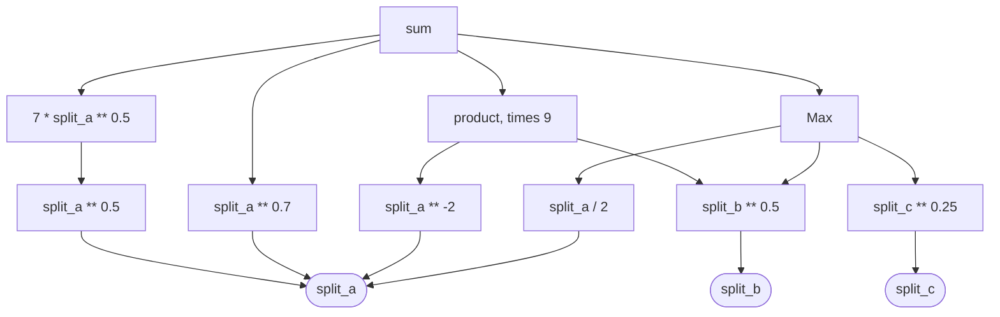
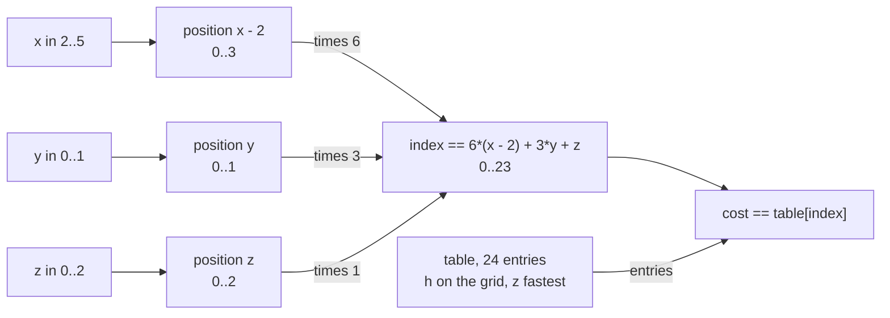
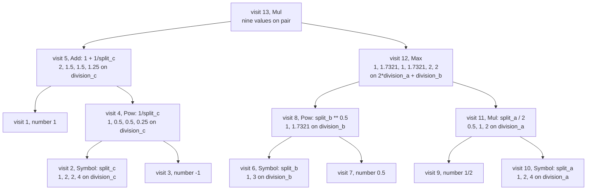

# CP-SAT table lowering, rebuilt bottom-up behind a config flag

Reference result: torch-spyre#6315 (`table-lowering-experimental`, tip `c26f6171`, draft).
Code base: torch-spyre `cab4721d`, the PR's base. Line numbers are at that commit.

Short paths: `config.py` and `cost_model.py` are under `torch_spyre/_inductor/`.
`cpsat_table_lowering.py`, `cost_expr_numpy.py`, `cpsat_expr_printer.py`,
`ilp_solver_ortools.py`, `plan_solver.py` and `sa_cooptimizer.py` are under
`torch_spyre/_inductor/scratchpad/`.

## Goal

When the last PR of this plan merges, torch-spyre has a table lowering of the CP-SAT cost
objective behind `config.cpsat_table_lowering`, off by default, that reproduces #6315's
results. With the flag on, the objective is built from exact element tables, linear sums
and `lin_min`/`lin_max`. An objective the tables cannot lower raises, and never reaches
the printer. With the flag off, every solve goes through the printer as it does on
`main`. Table values are
computed with numpy functions, and the code arrives in layers, each with its own tests.

## Decisions (2026-11-16)

- **numpy first, lambdify as the backup.** A generic evaluator finds each node's numpy
  function by name. A node with no numpy function is evaluated through lambdify.
- **A stack of PRs**, one per stage, off torch-spyre `main`. #6315 stays open as the
  reference result and closes when the flag reproduces it.
- **Off by default.** Stages 1 to 7 add files nothing imports. Stage 8 adds the flag.
- **Behaviour, not code.** The stages below say what each layer does. #6315 is cited for
  its results only.
- **Free to deviate.** The forms need not be #6315's. Every roll-up is built from two
  moves, combine and compact, and the table constraint is measured against them.
- **Two passes: parents first, then children first (2026-11-17).** A first pass visits
  every parent before its children and marks the nodes a linear reader can reach. The
  visitor then visits each node after its arguments, and one function, `tabulate`,
  realizes a node. Pass 1 iterates `sympy.preorder_traversal`, pass 2
  `sympy.postorder_traversal`; nothing recurses. Each sympy node gets a `CpNode`, its
  CP-SAT counterpart, which a parent reads as a table or linearly; no sympy node is
  changed. Reads and CP-SAT variables are made when first requested and memoized. See
  Architecture.
- **Margin 2 (2026-11-17).** A Min/Max with only linear nodes above it stays a
  `lin_min`/`lin_max` only when that needs under half the entries of its table, as in
  #6315. Replayed at #6315's tip on the 46 objectives where the choice changes the model,
  each rule's solve time against margin 2's: always `lin_max` 1.35 to 1.52 times
  (slower on 39 to 43 of them); margin 1, linear whenever it has fewer entries, 0.99 on
  average but 1.22 in total, with the GQA test at 137 s against 82 s; a table whenever
  one fits 2.07 on the 14 objectives it changes, `main.caps/compile_0` 24 times. An
  exact-domain `lin_max` target and `linearization_level` 2 were within run-to-run
  noise. All reach the same optimal cost.

- **Raise when the cap is hit (2026-11-17).** With the flag on there is no fallback. An
  objective the tables cannot lower raises `TableLoweringError`, naming the node and the
  reason, with the model untouched. The printer cannot stand in: on the replay it fails
  every auto-tiling objective (`calling ** on a linear expression`), and when it fails,
  `main` solves a traffic objective that ignores the cost model with every relayout copy
  pinned out (`ilp_solver_ortools.py:886`, `:1449`). `TableLoweringError` subclasses none
  of `RuntimeError`, `TypeError` or `ValueError`, so that `except` cannot turn it into
  that solve. At #6315's tip all 50 replayed objectives lower without a refusal.

## Estimates

Measured on the 50 replayed objectives: 45 captured compiles (model blocks at the default
config and with auto tiling, plus tests) and 5 synthetic products. Two sources: a count of
what each top-level term of the objective reads (2026-11-16), and #6315's lowering at a
cap of 8192 (replay of 2026-11-15).

**Cost between buffers is rare.** Of 6663 terms:

| A term reads | Terms | Share |
|---|---|---|
| no division (residency literals only) | 1670 | 25.1% |
| one buffer's division | 4851 | 72.8% |
| two | 38 | 0.6% |
| three or more | 104 | 1.6% |

Each of the 45 captured compiles has 1 to 4 terms that read two or more divisions, the
*wide* terms.
The widest reads 4 to 8 divisions on a model block, and 35 and 49 on the two large tests.
One table over its inputs would hold from 3.6e4 to 7.5e18 entries on a model block, so it
is never one table.

**How that simplifies.**

- *Narrow terms, 98%.* Each is a list over one buffer's menu, or a coefficient on
  literals. 81% read exactly one literal, 18% none, and 57 terms read four or more. Terms
  on one division under one gate add into one list in numpy, before anything reaches the
  model. Their entries are about the sum over divisions of menu size times gated groups,
  which is linear in the number of buffers. No table spans two buffers, and on every
  model block the largest table is the largest menu.
- *Wide terms, 2%.* Rules 1, 2 and 4 exist for these 1 to 4 terms. By the estimate below
  they take a fifth to two fifths of the entries at the default config and half to seven
  tenths with auto tiling.

| Objective | Divisions | Largest menu | Terms | Wide | Narrow entries (est.) | Entries, #6315 | Lower (s) | Solve (s) |
|---|---|---|---|---|---|---|---|---|
| default, decode block | 12 | 20-26 | 165-169 | 2 | 249-318 | 396-525 | 0.61-0.68 | 0.08-0.10 |
| default, prefill block | 14 | 55-65 | 187-189 | 1 | 1056-1217 | 1304-1535 | 0.72-0.74 | 0.40-0.50 |
| auto tiling, decode block | 12 | 30-41 | 101-105 | 3 | 332-429 | 622-870 | 0.63-0.92 | 0.14-0.17 |
| auto tiling, prefill block | 14 | 380-450 | 165-167 | 3 | 5849-6689 | 16908-21998 | 0.89-1.27 | 1.74-2.38 |
| flash attention test | 41 | 338 | 232 | 4 | 28986 | 49227 | 2.01 | 8.89 |
| prefill batch GQA test | 91 | 662 | 401 | 3 | 58399 | 115667 | 5.94 | 13.49 |

The narrow estimate is one list per division and gate, sized by the menu. It ignores lists
that turn out affine and cost nothing, so it runs high.

**What it says about the stages.**

- Stage 3 lowers 6465 of the 6521 narrow terms as one table each; the other 56 read
  four or more literals. It lowers none of the 50 objectives end to end: each has at
  least one term whose inputs pass the cap, and the lowering is all or nothing.
- Entry count is decided in Stages 4 to 7, on 1 to 4 terms per objective.
- Lowering time matters most where the model is smallest. At the default config a decode
  block takes 0.61 to 0.68 s to lower and 0.08 to 0.10 s to solve. How much of that the
  numpy evaluator of Stage 1 saves is not measured, and the last PR reports it.

## How a table is read

- An *input* is one CP-SAT variable the cost depends on: a buffer's division, a residency
  literal, or another integer variable in the symbol map. A buffer's split and tile
  symbols are columns over its division.
- A node is *indexed* when its value is `values[index]`: `values` is a float list
  computed in numpy before the solve, and `index` is a CP-SAT expression that the inputs
  determine. The solver never chooses an index.
- *Entries* are the table entries a form puts in the model. The cap bounds one table.
- `Min` and `Max` are nodes of the cost expression. `lin_max` is CP-SAT's constraint
  `target == max(e_1, ..., e_n)` over linear expressions, which `add_max_equality` adds.
  CP-SAT has no min constraint: `add_min_equality` adds a `lin_max` over the negated
  expressions, and this plan calls that `lin_min`. A Min/Max node is lowered one of two
  ways. *By rung*, `lin_max` takes the max of small integer positions, and one lookup
  then reads the cost (rule 1). *Kept linear*, each operand is collapsed to an integer
  cost, and `lin_max` takes the max of the costs, with no table for the Min/Max itself.
- *Kept linear* is open to a Min/Max only when every node between it and the objective
  is linear in it: a sum, a constant factor (a negative one turns Max into Min), another
  Min/Max, or a product switched on a factor's values (rule 4), which is linear once the
  factor's value is fixed. `Max(...) ** 0.5` is not: CP-SAT has no root of a `lin_max`.
  Neither is a log, a floor, a division by the Min/Max or a condition on it. Under such
  a node the Min/Max must be a table, by rung or over its inputs, and when neither fits
  the cap the lowering raises (Decisions).
- Lists are float from the leaves up. CP-SAT holds positions only, until a list is
  collapsed into a linear term (next section).

The four rules that keep lists short:

1. A Min/Max of indexed operands is indexed by rung. Its ladder holds only the values it
   can return, each operand maps to a rung, and the Min/Max of the rungs is the rung of
   the Min/Max.
2. A product of Min/Max factors over shared inputs is indexed by the tuples of rungs that
   can occur together, found by a chain of small tables, one per group of shared inputs.
3. A node takes the cheaper, in entries, of one table over its inputs and the form built
   from its parts. A Min/Max with only linear nodes above it stays linear when that needs
   under half the entries of its table.
4. A product whose factor cannot share a table with the rest is switched on the factor's
   value: one literal per value holds the product at that value times the rest. A 0/1
   literal times a term is the two-value case.

## The process, step by step

Before the solve starts, numpy computes every cost value in floating point. CP-SAT never
evaluates the expression. It works out which entry of each table applies, and one
`add_element` constraint per linear term reads that entry.

### The expression graph

The cost is an expression graph: a sum at the root, operations inside, and symbols and
numbers at the leaves. The example for this section has four terms over three buffers:

```
7 * split_a ** 0.5  +  split_a ** 0.7  +  9 * split_a ** -2 * split_b ** 0.5
    +  Max(split_a / 2, split_b ** 0.5, split_c ** 0.25)
```



- **Leaves.** Each symbol belongs to one decision variable. `split_a` has the menu
  `[1, 2, 4]`, and `division_a` picks from it. `split_b` has `[1, 3]` under
  `division_b`, and `split_c` has `[1, 2, 2, 4]` under `division_c`. Numbers are drawn
  inside the node that uses them.
- **Inner nodes.** Seven nodes read one buffer, the product reads two, and the Max reads
  three.
- **Sharing.** It is a graph, not a tree. `split_a` is read by four nodes and
  `split_b ** 0.5` by two. A shared node is handled once.

### From the leaves to the root

The lowering goes over the graph from the leaves to the root, in the order Architecture
gives. Below the sum, every node becomes a float list: its value at each position of an
index. Once a node has its list, the nodes under it are not needed again, because their
values are inside it. At the sum, what is left of each term is collapsed into an integer
table.

1. **A leaf becomes a column.** `split_a` is the list `[1, 2, 4]` and its index is
   `division_a`: position `d` holds the split at candidate division `d`. `split_b` and
   `split_c` are the same over their own divisions. A residency symbol is `[0, 1]` on
   its literal, and any other integer symbol is its domain's values on its own variable.
2. **A node over one buffer stays on that buffer.** numpy applies the node to its
   child's list, entry by entry. `split_a ** 0.5` is `[1, 1.4142, 2]`, and 7 times it is
   `[7, 9.8995, 14]`, both still on `division_a`. Powers, roots, logs and divisions all
   happen here.
3. **The product joins two indexes.** Its children are on `division_a` and
   `division_b`. Its list is their outer product times 9, 3 * 2 = 6 values. Its index is
   the pair of their positions, `pair == 2*division_a + division_b`, which costs one
   linear equality and no lookup.
4. **The Max is read by rung.** Its operands are on three buffers, and one table over
   them would hold 3 * 2 * 4 = 24 entries. The Max gets a ladder instead: the five
   values it can return, ascending. Each operand's list becomes its rungs on the ladder.
   `split_a / 2` is `[0.5, 1, 2]`. The Max is never under 1, the largest operand
   minimum, so 0.5 counts as 1 and the rungs are `[0, 0, 4]`. CP-SAT looks up the three
   rungs, and `rank` is their max.
5. **The sum stays a sum, and its lists are collapsed.** A sum is linear, so it needs no
   list of its own. One list over all three buffers would again hold 24 entries here,
   and the product of every menu on a real objective. Its four terms are lists on three
   indexes. The two on `division_a` are added in float. Each of the three lists is then
   multiplied by `COST_SCALE`, rounded once, and read by one `add_element`. The
   objective is the sum of the three cost variables.

How each node is collapsed:

| Node | Step | Its float list | Its index | It adds to the model |
|---|---|---|---|---|
| `split_a` | 1 | 1, 2, 4 | `division_a` | nothing |
| `split_b` | 1 | 1, 3 | `division_b` | nothing |
| `split_c` | 1 | 1, 2, 2, 4 | `division_c` | nothing |
| `split_a ** 0.5` | 2 | 1, 1.4142, 2 | `division_a` | nothing |
| `7 * split_a ** 0.5` | 2 | 7, 9.8995, 14 | `division_a` | nothing |
| `split_a ** 0.7` | 2 | 1, 1.6245, 2.639 | `division_a` | nothing |
| `split_a ** -2` | 2 | 1, 0.25, 0.0625 | `division_a` | nothing |
| `split_a / 2` | 2 | 0.5, 1, 2 | `division_a` | nothing |
| `split_b ** 0.5` | 2 | 1, 1.7321 | `division_b` | nothing |
| `split_c ** 0.25` | 2 | 1, 1.1892, 1.1892, 1.4142 | `division_c` | nothing |
| the product | 3 | 9, 15.5885, 2.25, 3.8971, 0.5625, 0.9743 | `pair` | `pair == 2*division_a + division_b` |
| the Max | 4 | the ladder: 1, 1.1892, 1.4142, 1.7321, 2 | `rank` | three rung lookups, 3 + 2 + 4 entries, and `rank == max(rung_a, rung_b, rung_c)` |
| the sum | 5 | none: it stays linear | None (CP-SAT) | three tables, 3 + 6 + 5 entries, and three lookups |

Every node below the sum ends inside one of three lists, and the collapse makes each of
them one integer table. These are the only tables that hold a cost:

| Table | Index | The list, in float | Entries |
|---|---|---|---|
| `table_1` | `division_a` | 8, 11.524, 16.639: the two terms on `split_a`, added | 8192, 11801, 17038 |
| `table_2` | `pair` | the product's list | 9216, 15963, 2304, 3991, 576, 998 |
| `table_3` | `rank` | the ladder | 1024, 1218, 1448, 1774, 2048 |

The rung tables hold positions, not costs: `rungs_a = [0, 0, 4]`, `rungs_b = [0, 3]` and
`rungs_c = [0, 1, 1, 2]`.

The order of the collapse matters. At `split_a = 2`:

- `7 * split_a ** 0.5` is 10137, the rounding of 7 * 1448.15. Rounding first and
  multiplying after gives 7 * 1448 = 10136.
- `split_a ** 0.5 + split_a ** 0.7` is one entry, 3112, the rounding of
  1448.15 + 1663.49. Collapsing each list alone gives 1448 + 1663 = 3111.

The graph had 13 nodes. The model gets six lookups with 23 entries, one linear equality
and one max.

At `division_a = 1`, `division_b = 1`, `division_c = 3`: `cost_1` is 11801. `pair` is 3
and `cost_2` is 3991. The rungs are 0, 3 and 2, `rank` is 3 and `cost_3` is 1774. The
objective is 17566, and the float value is 17564.84.

The example was run through CP-SAT at all 24 assignments of the three divisions. The
model has 24 solutions, minimizing and maximizing agree at each, and the worst error is
1.16 units over the three tables.

### How the tables are kept small

The starting point is one table over every input the objective reads, the product of the
menus. Each reduction below cuts it at one node of the walk:

| Reduction | Where | What it saves |
|---|---|---|
| The sum stays linear | the sum | entries add over the terms instead of multiplying over the inputs |
| Lists on one index are added | the sum | one list per index, not one per term |
| An affine list needs no table | the collapse | a list linear in its index is `table[0] + step * index`; a constant list is a number |
| Equal values share a rank | a node over several indexes | a product pairs distinct values, not divisions |
| A Min/Max is read by rung (rule 1) | a Min/Max | a ladder of the values it can return, and one remap per operand |
| Values past the bound are clamped | a Min/Max | the ladder drops the values the Min/Max can never return |

**How the walk chooses.** A node over several indexes has two candidates, one table over
its inputs and the form from its parts, and `tabulate` keeps the one with fewer entries
(rule 3). Both sizes are known before any list is computed: one table is the product of
its inputs' sizes, and the form from its parts is its list (the product of the parts'
distinct values, or the ladder) plus the remaps under its index. A candidate past the cap
is never evaluated. A Min/Max with only linear nodes above it stays a
`lin_min`/`lin_max` when that needs under half the entries of its table.

**On the graph above.** Its menus are 3, 2 and 4 long, and one table over all three is 24
entries. The reductions bring that to 23, so on menus this short they barely matter.

**On real menus.** The same graph, with each symbol replaced by a split of the default
Granite 3.3 8B decode capture: `split_a` is `buf6`'s d1 split (21 divisions, 6 values),
`split_b` is `buf13`'s d0 split (11 divisions, 6 values) and `split_c` is `buf7`'s d1
split (20 divisions, 6 values). One table over the three divisions is 21 * 11 * 20 =
4620 entries. The reductions, turned on one at a time in the order of the first table, and
each turned off alone with the others on:

| Reduction | Entries, built up | Largest table | Entries without it |
|---|---|---|---|
| none: one table over the three divisions | 4620 | 4620 | |
| the sum stays linear | 325 | 231 | 1857 |
| lists on one index are added | 304 | 231 | 173 |
| an affine list needs no table | 304 | 231 | 152 |
| equal values share a rank | 141 | 36 | 315 |
| the Max is read by rung | 153 | 36 | 141 |
| values past the bound are clamped | 152 | 36 | 153 |

- *The sum* keeps its four terms apart: two lists of 21 on `division_a`, the product's
  231, and the Max. One table for the Max would still be 4620 entries, so it stays a
  `lin_max` over its operand lists of 21, 11 and 20 (rule 3).
- *Lists on one index*: the two terms on `division_a` become one list of 21.
- *Affine lists*: this graph has none. Any list of two values is affine, so a residency
  literal times a constant never needs a table. A quarter of the terms read no division,
  only residency literals (Estimates).
- *Ranks* take the product from 21 * 11 = 231 entries to 6 * 6 = 36, plus the two remaps
  of 21 and 11. A division menu is longer than the values one split takes.
- *Rungs* cost 12 entries here: the rung form is 64 entries against a 52-entry
  `lin_max`. Rule 3 keeps the table, because 52 is not under half of 64. This is the one
  step where the walk does not take the fewest entries.
- *Clamping* drops one value from the ladder: `split_a / 2` at split 1 is 0.5, below 1,
  the smallest value the Max can return.

Every row was run through CP-SAT at all 4620 assignments: one solution per assignment,
minimizing and maximizing agree at each, and the worst error stays within the collapse
bound.

Two more reductions are not in this graph. A fold (rule 2) reads a product of Min/Max
factors over shared inputs by the tuples of rungs that can occur together. A switch
(rule 4) leaves a factor too wide to pair out of every table. On the model blocks one
table over the widest term alone would hold 3.6e4 to 7.5e18 entries, and #6315's lowering
of the whole objective holds 396 to 21998 (Estimates). The last PR reports entries per
capture with each reduction.

Two subsections below add what the graph does not show: a buffer with several symbols on
one division, and one table over several integer variables. Every table in this section
was run through CP-SAT at every assignment of its inputs, and each came back within half a
unit of the float value.

### What a position is: a buffer's menu

A buffer does not have one variable per split. It has a menu of candidate divisions, and
one variable, its division, that picks a row. Each symbol of the buffer is a column:

| `division_a` | `split_a_d0` | `split_a_d1` | `tile_a` | a term, `8 / (split_a_d0 * tile_a)` |
|---|---|---|---|---|
| 0 | 1 | 1 | 1 | 8 |
| 1 | 2 | 1 | 1 | 4 |
| 2 | 2 | 2 | 1 | 4 |
| 3 | 4 | 1 | 2 | 1 |

A term over any of the buffer's symbols is a list with one value per row. Its index is
`division_a` itself, with no offset and no stride: position `d` holds the value at
candidate division `d`.

Equal values can share a position. The list above is `[8, 4, 4, 1]`, its distinct values
are `[1, 4, 8]`, and `rank_of = [2, 1, 1, 0]` gives each division its rank:
`rank == rank_of[division_a]`. A product pairs ranks, so repeated values do not widen its
table.

### Several variables: offsets and strides

A term `h(x, y, z)` over three integer variables: `x` in `2..5`, `y` in `0..1`, `z` in
`0..2`.



- **Offset.** A variable in `lo..hi` has the position `var - lo`. A domain with gaps
  gets its position from a lookup.
- **Stride.** A position is multiplied by the product of the sizes of the variables
  after it: 2 * 3 = 6 for `x`, 3 for `y`, 1 for `z`.
- **Linear.** The strides are constants, so the index is a linear equality. No two
  variables are multiplied, and CP-SAT takes it as an ordinary linear constraint.

numpy fills the table in the same order, last variable fastest:

| `x` | `y` | `z` | index |
|---|---|---|---|
| 2 | 0 | 0 | 0 |
| 2 | 0 | 1 | 1 |
| 2 | 0 | 2 | 2 |
| 2 | 1 | 0 | 3 |
| ... | | | |
| 4 | 1 | 2 | 17 |
| ... | | | |
| 5 | 1 | 2 | 23 |

The table has 4 * 2 * 3 = 24 entries. The sizes multiply, so this form is only for a term
whose variables fit the cap together.

### Which form a node takes

Every node is tabulated, linear, or both. There is no third form, no partial lowering
and no fallback: when the objective cannot be read from tables and linear forms alone,
the lowering raises.

| A table of it fits the cap | It is linear, under linear nodes only | The node |
|---|---|---|
| yes | no | tabulated: a float list on an index |
| no | yes | linear |
| yes | yes | both forms; its reader picks one (rule 3) |
| no | no | no form, so neither has its parent. At the root, the lowering raises `TableLoweringError` |

- *A table* is one table over the node's inputs, or the form from its parts: a rank, a
  pair, a Min/Max by rung, a fold (rules 1 to 3).
- *Linear* nodes are a sum, a constant times one child, a Min/Max kept as a
  `lin_min`/`lin_max`, and a product switched on one factor's values (rule 4). Pass 1
  of Architecture marks the nodes that only linear nodes sit above.
- The objective reads the root's linear form. A root with only a table is one linear
  term, a single lookup.

## How a table maps onto CP-SAT

Every way a list is made, how CP-SAT computes the index that reads it, and what that
guarantees. A list is computed in numpy before the solve. CP-SAT returns the right entry
because a list and its index are made together, by one rule in one order. Every operation
that makes a new list also makes the constraint that computes the new index.

The only lookup is `add_element(index, table, target)`, which enforces
`target == table[index]`. The rest is making `index` the position numpy used.

**Inputs.**

- A buffer's division is a variable in `0..n-1`, and each of the buffer's symbols has `n`
  values: position `d` holds the symbol's value at division `d`. The index is the
  division itself.
- A residency literal has the list `[0, 1]` and is its own index.
- Any other integer variable has its domain's values, ascending. Its index is `var - lo`
  when the domain has no gaps. With gaps it is a position `pos` under
  `add_element(pos, domain_values, var)`; the values are distinct, so one position fits.

**Each way a list is made.** Lists are built from the leaves of the expression upward: a
node's list is made from its arguments' lists.

| Form | The list, in numpy | Its index, in CP-SAT |
|---|---|---|
| a function of one indexed node | `f(values)`, elementwise | the same index |
| terms on one index | the lists added elementwise | the same index |
| one table over inputs of sizes `n1..nm` | the node on the row-major grid: assignment `(i1..im)` at position `i1*s1 + ... + im*sm`, `s_k = n_(k+1) * ... * n_m`, so the last input varies fastest | `joint == index_1*s1 + ... + index_m*sm` |
| rank: equal values share a position | `distinct`, the values ascending without repeats | `add_element(index, rank_of, rank)`, where `rank_of[i]` is the position of `values[i]` in `distinct` |
| product of lists `a` and `b` of sizes `na`, `nb` | the outer product: `a[i] * b[j]` at position `i*nb + j` | `pair == rank_a*nb + rank_b` |
| Min/Max by rung | the ladder, ascending | per operand `add_element(index_o, rungs_o, rung_o)`, then `rank == min(rung_o)` or `max(rung_o)` |
| fold | one value per reachable state | per step `position == state*size + group`, then `add_element(position, next_state, state')` |

**Why the right entry comes back.**

- Every index is fixed by an equality, an element or a min/max over indexes that are
  fixed themselves. Once the inputs have values, each index has one feasible value, and
  it is the position numpy used.
- The strides of a joint table, and `nb` of a pair, are computed once and used for both
  the numpy list and the linear equality. The inputs of a table are taken in one fixed
  order for both.
- A ladder is ascending, so position keeps order: the Min of the rungs is the rung of the
  Min. A value clamped to the bound can never be the result, so sharing the bound's rung
  changes nothing.

**Two moves make every position.** A position above an input is never chosen. The
inputs fix it through a chain of constraints, and only the last link, `cost ==
table[index]`, reads a cost. That link names no decision variable when the index is
derived. Every other link is one of two moves:

- *Combine*: `parent == left * size(right) + right`. A linear equality that turns two
  positions into one position in the larger table.
- *Compact*: `short == remap[parent]`, one `add_element`. It renumbers a position onto
  the rows that are distinct or that can occur.

| Form | Moves |
|---|---|
| one table over several inputs | combine all the inputs |
| rank | compact one list |
| product of two lists | compact each, then combine |
| Min/Max by rung | compact each operand to its rung, then take the min or max |
| fold | combine the state with the next group, compact, repeat |

The min or max over rungs is a compact that needs no table, because a ladder keeps order.

**One constraint for both moves.** `add_allowed_assignments([left, right, out], rows)`
lists the rows directly, and `out` is the next position up or the cost. It needs no
strides, a domain with gaps needs no position lookup, and a row that cannot occur is left
out. On the roll-up `Max(split_a / 2, split_b ** 0.5) * (1 + 1 / split_c)`, over the
menus of the graph example, it replaces the six constraints of rungs, ranks and pair with
two: `[division_a, division_b, rank_m]` with 6 rows and `[rank_m, division_c, cost]` with
12.

Both forms were run on the roll-up and agree at all 24 assignments. Which solves faster on
real objectives is not measured. The table constraint is one more `IndexMap`,
`Allowed(rows)`, injected in place of `Combine` and `Compact`. The default is combine and
compact, and the last PR reports both on the replay.

**What the chain must guarantee.** Let D be the decision variables a term reads.

1. *Determined.* Once D has values, every position and the cost have one feasible value.
   A position is never a choice, so the lowering adds no decisions to the search.
2. *Total.* Every assignment of D the model allowed before still has a feasible chain.
   The lowering never forbids a plan. A table constraint missing a row that can occur
   would break this without any error.
3. *Complete.* Walking the chain back from the cost reaches every variable of D that the
   term's value depends on.
4. *Correct.* The cost is the term's float value at that assignment, within the collapse
   bound.

On the roll-up, in both forms: the model has 24 solutions, one per assignment of the
three divisions; minimizing and maximizing the cost at a fixed assignment give the same
value; and the worst error is 0.43 units.

**How the plan keeps them.**

- A position is made only by a combine or a compact of positions that are determined, so
  it is determined.
- A remap has an entry for every value of its parent, and a table constraint has a row
  for every combination its parents can take.
- An index is a map between table positions, made from the inputs by combine and
  compact only. A combine keeps both of its parts, and a compact merges positions only
  where the values are equal. So a term's final index is a function of every input its
  value depends on, by construction, and needs no check at run time. The exact tests
  of every stage would catch a missing input: the value would be wrong at some
  assignment, or one assignment would have several solutions.
- A list and its index are made by one operation, in one order.
- A position is made once and shared. Two terms that roll up the same sub-table read the
  same variable.
- The plan is read from the decision variables only. Positions are never read back.

**Collapsing float lists into linear terms.** Every list is float: the leaf lists over
the menus, and each list made from them. CP-SAT cannot hold a float, so below a linear
term it holds positions only (divisions, ranks, rungs, pair and fold positions), and no
cost value. A *linear term* is where a list must become a CP-SAT integer: a term of the
objective's sum, a term of an operand of a Min/Max kept linear, or a term of the sum
inside a switched product. There the list is collapsed, in this order:

1. Every float multiplier above the list is applied to it in numpy: the term's
   coefficient, the constant factors of a product, and a coefficient pushed through a
   linear Min/Max, where a negative one turns Min into Max.
2. Lists on one index in the same sum are added.
3. The list is rounded once, `table[i] = rint(COST_SCALE * values[i])`. An entry past
   2^50 is refused, so a sum of thousands of entries stays inside int64.
4. It is read by `add_element(index, table, target)`, and the linear term is `target`.
   A list is affine when its rounded entries are, so `table[0] + step * index` equals
   the table entry for entry.

No integer made by a collapse is multiplied by a float afterwards, with the one exception
below. A unit is 1/`COST_SCALE` of the cost. Each collapsed list is within half a unit of
its float value, a sum of T lists and a constant is within (T + 1) / 2 units, and a
linear Min/Max is within the largest bound among its operands.

The exception is rule 4, where a factor too wide to pair multiplies a sum that is already
collapsed:

- a 0/1 literal: the product is the sum or 0, and nothing is added;
- whole values `v`: the product is `v * w` exactly, so the sum's bound times `|v|`;
- fractional values: `floor(p * w / q)`, which adds `|w| / (2q) + 1` units, with `q`
  from 2^16 to 2^24.

Collapsing this form too means pairing every list of the sum with the factor's values. It
is exact to half a unit per list and costs the factor's number of values times the
entries. #6315 measured that form at 26 to 27 s against 5 to 6 s for the switch on the 14B
and 24B auto-tiling prefill objectives. The plan keeps the switch. The largest error
measured over the 50 objectives is 1.2e-7 of the cost.

The *exact* tests of every stage are the check on this mapping: they solve at every
assignment of the inputs, so an entry read from the wrong position fails.

## Architecture

The lowering is two passes over the cost expression, with no recursion. The first
iterates `sympy.preorder_traversal`, every parent before its children, and marks each
node that a linear reader can reach. The second iterates `sympy.postorder_traversal`,
every node after its arguments, and realizes it. One function, `tabulate`, makes a
node's table: its float list and the index that reads it.

sympy nodes are immutable, and the lowering never changes one. Each node it meets gets a
`CpNode`, its CP-SAT counterpart. A parent reads it as a `CpTable` or as a `CpLinear`,
and each of those makes its CP-SAT variables itself, on first request:

```python
from __future__ import annotations

from collections.abc import Mapping, Sequence
from dataclasses import dataclass, field
from typing import Any, Protocol

import numpy as np
import sympy
from ortools.sat.python import cp_model


class TableLoweringError(Exception):
    """An objective the tables cannot lower, naming the node left with no form and why.

    Subclasses none of RuntimeError, TypeError and ValueError, so the except around the
    objective in _minimize_cost_expr cannot turn it into the traffic-objective solve.
    """


class IndexMap(Protocol):
    """One mapping step, injected into a CpIndex: from the positions of its parts to a
    position 0 .. size - 1. A new kind of step is a new IndexMap; CpIndex and the walk
    do not change."""

    @property
    def entries(self) -> int:
        """The table entries the step puts in the model, 0 for an arithmetic step."""

    def __call__(self, *parts: np.ndarray) -> np.ndarray:
        """The step in numpy: the position for each combination of the parts' positions,
        broadcast across the parts."""

    def cp_expr(
        self, model: cp_model.CpModel, parts: Sequence[cp_model.LinearExprT], size: int
    ) -> cp_model.LinearExprT:
        """The step in model, from its parts' CP-SAT expressions."""


@dataclass(frozen=True)
class Input:
    """IndexMap of a variable's own position, d -> d: no parts, no entries, and the
    variable as its CP-SAT expression. The variable is already in the model."""

    var: cp_model.IntVar


@dataclass(frozen=True)
class Combine:
    """IndexMap (left, right) -> left * right_size + right: one linear expression, no
    entries."""

    right_size: int


@dataclass(frozen=True)
class Compact:
    """IndexMap parent -> remap[parent]: one add_element, len(remap) entries."""

    remap: tuple[int, ...]


@dataclass(frozen=True)
class Extreme:
    """IndexMap (rung_1, ..., rung_k) -> their max, or min: one lin_max or lin_min, no
    entries. Exact because a ladder keeps order."""

    is_max: bool


@dataclass(frozen=True)
class CpIndex:
    """A map from the inputs' positions to a position in one table, 0 .. size - 1: its
    mapping applied to its parts.

    Made from Input leaves by injected IndexMap steps alone, so the final index of a
    term is a function of every input it was made from. The walk interns it: two nodes
    that make the same position get the same CpIndex object, so its expression is made
    once.
    """

    size: int
    mapping: IndexMap
    parts: tuple[CpIndex, ...] = ()

    def cp_expr(self, model: cp_model.CpModel) -> cp_model.LinearExprT:
        """mapping.cp_expr on the parts' cp_expr, made in model on the first call and
        memoized. Its parts are made first."""


@dataclass(frozen=True, eq=False)
class CpTable:
    """A node read as a table: values[index], made together and never apart. Compared by
    identity, values being an array."""

    values: np.ndarray                # the value at each position, float until collapsed
    index: CpIndex

    def __post_init__(self) -> None:
        """Refuses a list whose length is not index.size."""

    @property
    def entries(self) -> int:
        """Its list plus the remaps under its index: what rule 3 compares, and what the
        cap bounds."""

    def cp_expr(self, model: cp_model.CpModel) -> cp_model.LinearExprT:
        """values[index] as a CP-SAT expression, made in model on the first call and
        memoized: the list rounded once onto COST_SCALE, then a number when it is
        constant, a linear expression in index.cp_expr(model) when it is affine, and
        otherwise one add_element on index.cp_expr(model) into a new variable whose
        domain is the rounded values."""


@dataclass
class CpLinear:
    """A node read linearly: the float form that cp_expr collapses into a CP-SAT
    LinearExpr. Nothing in it is rounded until then."""

    constant: float = 0.0
    lists: dict[CpIndex, np.ndarray] = field(default_factory=dict)   # one list per index
    extrema: list[tuple[bool, list[CpLinear]]] = field(default_factory=list)  # is_min, operands
    switched: list[tuple[CpTable, CpLinear]] = field(default_factory=list)    # rule 4

    def __add__(self, other: CpLinear) -> CpLinear:
        """The sum, still in float: constants added, lists on one index added
        elementwise into one list, extrema and switches kept side by side. So
        split ** 0.5 + split ** 0.7 is one list, rounded once to 3112 at split 2,
        where rounding each first would give 1448 + 1663 = 3111."""

    def __mul__(self, coeff: float) -> CpLinear:
        """Every list, the constant and every operand scaled in float before any
        rounding, so 7 * split ** 0.5 at split 2 is 10137, not 7 * 1448. A negative
        coeff turns each lin_min into a lin_max and back."""

    __rmul__ = __mul__

    @property
    def entries(self) -> int:
        """The entries its lists, operands and switches put in the model."""

    def cp_expr(self, model: cp_model.CpModel) -> cp_model.LinearExprT:
        """The form as a CP-SAT expression, made in model on the first call and
        memoized. Each list, already summed per index, becomes
        CpTable(values, index).cp_expr(model): the one rounding, so a sum of T lists and
        a constant is within (T + 1) / 2 units of its float value. Each lin_min or
        lin_max is over operands behind proxy variables, and each switch is one literal
        per factor value."""


@dataclass(eq=False)
class CpNode:
    """The CP-SAT counterpart of one sympy node, which it never changes.

    The CpNodes form the same graph as the sympy nodes: children holds the CpNodes of
    the sympy node's children, made before it, and a subexpression shared by two
    parents is one CpNode that both hold. A parent reads a child as a table or
    linearly. Each read is made on first request and memoized, so a node that two
    parents read differently makes both, and a read nobody requests is never made.
    """

    expr: sympy.Basic                 # the sympy node, read only
    children: tuple[CpNode, ...]      # its children's CpNodes, in children_of order
    linear_ok: bool                   # pass 1: a linear reader can reach it

    def as_table(self) -> CpTable:
        """The node read as a table, from pass 2's candidate. Raises TableLoweringError
        when no table of it fits the cap."""

    def as_linear(self) -> CpLinear:
        """The node read linearly: its own linear form, or its table as one list,
        whichever rule 3 prefers (margin 2 for a Min/Max). Raises TableLoweringError
        when it has neither."""


class TableLowering:
    """One cost expression, lowered to tables and linear forms, then to CP-SAT."""

    def __init__(self, model: cp_model.CpModel, inputs: Inputs, cap: int) -> None:
        """model receives the objective's variables; inputs maps each symbol to its
        input and column; cap bounds one table."""

    def lower(self, root: sympy.Basic) -> cp_model.LinearExprT:
        """root as a CP-SAT objective in COST_SCALE units.

        Pass 1 iterates preorder_traversal and marks the sympy nodes a linear reader can
        reach, repeats kept. Pass 2 iterates postorder_traversal and makes each node's
        CpNode once, from its children's CpNodes, with its candidate table and linear
        form, reading the children with as_table and as_linear. Only then does
        it return the root's as_linear().cp_expr(model), which makes just the variables
        that form requests. Every refusal raises TableLoweringError during the passes,
        before any variable is made, so the model is untouched when it raises.
        """


def lower_cost_with_tables(
    model: cp_model.CpModel,
    sym_map: Mapping[str, Any],
    buffer_map: Mapping[str, Any],
    cost_expr: sympy.Basic,
    cap: int,
) -> cp_model.LinearExpr:
    """cost_expr as a CP-SAT objective in COST_SCALE units, from tables and linear forms.
    Raises TableLoweringError, with the model untouched, when it cannot."""
```

The sketch is the public interface only: signatures and docstrings, with the bodies left
to the stages. The walk makes no CP-SAT variable: a `CpIndex` is the recipe for one, so
a refusal leaves the model untouched. `cp_expr` makes them after the walk, when the
objective's form requests them, each once. `Input`, `Combine`, `Compact` and `Extreme`
each implement the three members of `IndexMap`; the sketch shows their fields only.
Inside `TableLowering`, the dispatch to one
method per node class, the
methods (`generic_visit`, `visit_Add`, `visit_Mul`, `visit_Min`, `visit_Max`,
`visit_RelayoutCharge`), `tabulate` and the reader that applies rule 3 are private, and
the sections below describe them. The order of the two passes, `CpNode` and `tabulate`
are the design, and the other names may change. `Inputs` is the map from each symbol to
its input and column ("How a table maps onto CP-SAT"), and `sym_map` and `buffer_map`
are the printer's two maps. With `Inputs` as an empty class the sketch passes mypy with
torch-spyre's settings (`pyproject.toml:131`), the bodies being empty.

- **One `CpNode` per sympy node, in the same graph.** Pass 2 makes a node's `CpNode` from
  its children's, which it made earlier, so the `CpNode`s form the sympy graph again
  with their own edges. It finds a node's `CpNode` through a map keyed by the sympy
  node, which is hashable and compares by structure, so a subexpression that two terms
  share is one `CpNode` that both parents hold: both read one list and one position.
  Every result lives on the `CpNode`. The expression is the same object, unchanged,
  after the lowering.
- **Read as a table or linearly.** Pass 2 leaves each `CpNode` with a candidate table, a
  candidate linear form, or both. A parent reads a child with `as_table` or `as_linear`,
  and each read is made on first request and memoized: a node read both ways, such as a
  Max under a power and a sum, makes both, and a candidate no parent reads goes no
  further. A node left with neither candidate raises `TableLoweringError` at once,
  naming that node and why (Decisions), so the error points at the innermost node that
  failed.
- **Pre-order, then post-order, no recursion.** Pass 1 keeps the repeats: pre-order
  yields a shared node once under each parent, after that parent, which is what lets a
  mark from its second parent reach its children. Pass 2 skips them: a node's first
  post-order occurrence comes after its whole subtree, so its children's `CpNode`s exist
  and are done. `lower` owns both walks. A method is handed a new `CpNode`, whose
  `children` are done, and never walks. Stage 1's `numpy_value` is the pass 2 loop with arrays for
  results.
- **The walks are short.** On the 50 replayed objectives each yields 589 to 71,914
  nodes, 3 to 11 per distinct node, in at most 0.1 s. Expressions are 6 to 17 deep, so
  recursion would not overflow; the loops are chosen for clarity and so that no depth
  can.
- **One method per class.** A private dispatch looks for `visit_<Class>` along the
  node's class and its bases, and falls back to `generic_visit`. The bases matter:
  `Integer(1)` is class `One` and `Rational(1, 2)` is `Half`. The printer on `main` dispatches the same
  way through sympy's `Printer` (`cpsat_expr_printer.py:186`), but each of its methods
  prints its own arguments.
- **Children.** A node's children are its arguments, with two exceptions. A Piecewise's
  children are the values and conditions of its arms; the walks also yield each arm's
  `ExprCondPair`, whose `CpNode` has no form of its own and is read by its Piecewise. A `RelayoutCharge`'s children are its
  literal and its division; its prices are numbers the walks yield, and its method does
  not read them.
- **No model.** The walk reads the expression, the inputs and the cap, and computes in
  numpy. It adds nothing to the CP-SAT model and rounds nothing.

### Pass 1: the nodes a linear reader can reach

A node's linear form is of use only when some path from it to the objective runs through
linear nodes only (see "How a table is read"). The first pass finds those nodes before
any list is computed:

```python
linear_ok: set[sympy.Basic] = {root}                 # the objective reads the root
for expr in sympy.preorder_traversal(root):           # parents first, repeats kept
    if expr in linear_ok:
        linear_ok.update(linear_children(expr))       # see "Linear children" below
```

- **Parents first, shared nodes included.** `preorder_traversal` repeats a shared node
  under each parent, after that parent. When the mark reaches a shared node from its
  second parent, that occurrence's subtree is walked again, so the mark still reaches
  its children. A pre-order that skipped nodes it had seen would lose that mark.
- **Linear children.** A sum's terms, a Min/Max's operands, and a product's factors, any
  of which may be the rest of a switch (rule 4). Every other node passes no mark down:
  the children of a power, a log, a floor, a Piecewise, a relational or a function are
  read as tables.
- **A shared node can need both forms.** In `Max(...) ** 0.5 + 3 * Max(...)` the Max is
  marked through the sum and is still read as a table by the power. It builds its linear
  form for the sum and its table for the power.
- **What the mark changes.** A `CpNode` not marked builds no linear form, and a Min/Max not
  marked is never kept linear. Tables do not change, because a nonlinear reader needs
  them and rule 3 compares against them.
- **Checked.** The sketch was run with this pass and without it on 13 cases: the graph,
  the roll-up, a Max under a power and under a sum, a Max shared by a power and a sum, a
  log of a sum, a Piecewise and a shared subexpression, at caps where the Max does and
  does not fit. Each case gives the same model both ways, and the pass leaves out 0 to 4
  linear forms per case that no reader used. The sketch has no switch, so it marks a
  product's factor only when the other factors are constants. Pass 1 over
  `preorder_traversal` and pass 2 over `postorder_traversal` give the same 13 models as
  the recursive walk, and realize the roll-up's nodes in the same order.

### `tabulate` realizes a node

`tabulate(node, children)` makes the node's candidate `CpTable`, or none. The node's
value is `values[index]`. The index is a `CpIndex`: an input, a combine, a compact, or
a min or max of rungs, a recipe until its `cp_expr` makes the CP-SAT expression. A node
is *tabulated* when it has its `CpTable`.

Every list of the lowering is made here, and a list is never made without its index.
`tabulate` is the "one operation, in one order" of the guarantees above.

1. **A leaf.** A symbol's table is its input's column, on that input: a buffer's symbol
   over the menu, `[0, 1]` for a literal, the domain's values for an integer. A number
   is one value on no input.
2. **A child with no table.** The node has none either.
3. **Children on one index.** The node's numpy function, the one-node step of Stage 1,
   is applied to the children's lists elementwise. The index is the children's, and no
   entry is added. A term over one buffer's symbols never leaves this case.
4. **Children on several indexes.** There are two candidates:
   - *one table*: the node on the grid of its inputs, from `values_on_grid`, on the
     inputs combined;
   - *from its parts*: a Min/Max by rung (rule 1), a product of Min/Max factors by fold
     (rule 2), and any other node by compacting each child's list to its distinct
     values, combining the positions and applying the node's numpy function across them.
5. **The cheaper one.** The candidate with fewer entries is the table (rule 3). Its
   entries are its list plus the remaps under its index. A candidate's size is known
   before its list is computed, so one past the cap is never evaluated. With no
   candidate under the cap it sets neither.

### A node that is not one list

A sum, a product and a Min/Max can be read without being one list, so their methods
give the `CpNode` a second candidate beside the table. A *linear form*, a `CpLinear`, is
a constant, one float list per index, and the `lin_min`, `lin_max` and switched terms
inside it. It is float, as the tables are.

| Method | Table | Linear form |
|---|---|---|
| `generic_visit`: symbols, numbers, Pow, floor, log, Piecewise, relationals, And, Or, Not, ITE, functions | `tabulate` | none |
| `visit_Add` | `tabulate` | the children's linear forms added, where lists on one index become one list |
| `visit_Mul` | `tabulate` | constants times one child: that child's linear form, scaled. Otherwise rule 4: switched on one factor's values, with a 0/1 literal as the gate |
| `visit_Min`, `visit_Max` | `tabulate` | `lin_min` or `lin_max` over the children's linear forms |
| `visit_RelayoutCharge` | `tabulate`, or the number 0 when this solve does not divide the source | its literal as a gate on the price list |

- **The reader picks the read.** Pass 1 tells a node whether a linear reader can reach
  it, but not which read that reader will make, so the `CpNode` keeps its candidates.
  `tabulate` calls `as_table` on its children. A linear form calls `as_linear`, which
  returns the child's own linear form or its table as one list, whichever has fewer
  entries; a Min/Max keeps its linear form only under half the entries of its table
  (rule 3). The objective reads the root with `as_linear`. Only `visit_Add`,
  `visit_Mul`, `visit_Min` and `visit_Max` call `as_linear`. They and
  `visit_RelayoutCharge` build a linear candidate, on a marked node only.
  `generic_visit` calls `as_table` only: under `Max(...) ** 0.5` the Max is read as its
  table, and a Max with no table raises there.
- **Multipliers go down in float.** Scaling a linear form multiplies its lists in numpy.
  Through a `lin_min` or `lin_max` it scales the operands, and a negative factor turns
  one into the other.
- **Refusal.** A node can come back with no form. Its parent then has only the forms
  that do not read it, which is how a relayout charge on a source this solve does not
  divide becomes 0. When the root has no linear form, `lower_cost_with_tables` raises
  `TableLoweringError` with the node that had no form and why: no table under the cap
  and a nonlinear parent, a pair or fold past the cap, two factors too wide to pair, an
  entry past 2^50, or a switched factor too wide for its precision. The model is
  untouched, because the walk never wrote to it.

This is the table of "Which form a node takes", read from the leaves up.

### From the walk to the model

The walk ends with the root's `CpNode`. The last step of `lower` is the only code that
calls CP-SAT, and it makes a variable only when a form requests it:

1. **Request.** `root.as_linear().cp_expr(model)`. Each form pulls in what it reads,
   and nothing else reaches the model: a table used only to compute a parent's table in
   numpy, or a candidate no parent read, adds no variable.
2. **Positions, on request.** `CpIndex.cp_expr` makes each position once and memoizes
   it, through its injected `IndexMap`: an `Input` is its variable, a `Combine` is a
   linear expression, a `Compact` is one `add_element`, and an `Extreme` is one
   `lin_max` or `lin_min`. Its parts are made first, and interning makes a shared
   position one object. The `IndexMap` is the seam: the table constraint is another
   one, injected without a change to the walk.
3. **Collapse, on request.** `CpLinear.cp_expr` rounds each list once and reads it with
   one `add_element`. An affine list is a linear expression with no table, and a
   constant list is a number.

Floats become integers in step 3. The one other place is the `p/q` of a switched
factor (rule 4).

### The walk on the roll-up example

`Max(split_a / 2, split_b ** 0.5) * (1 + 1 / split_c)`, over the menus of the graph
example. Each node shows its place in the post-order of pass 2 and the list
`tabulate` returned for it. sympy orders the arguments, so the sum comes first.



| Visit | Case of `tabulate` | Result |
|---|---|---|
| 1 to 11 | a leaf, or children on one index | a list on `division_c`, `division_b` or `division_a`, with nothing added |
| 12, the Max | several indexes | one table: 6 entries, against 8 by rung (a ladder of 3, rungs of 3 and 2) |
| 13, the product | several indexes | from its parts: each child ranked to 3 distinct values and paired, 19 entries against 24 for one table |

The collapsed table holds nine entries, in sympy's argument order:
`[1280, 2217, 2560, 1536, 2660, 3072, 2048, 3547, 4096]`.

**What deciding at the node costs.** Rule 3 is applied at the node, before its parent is
realized. At visit 12 one table is the cheaper list for the Max. Its parent then ranks
that list with a 6-entry remap, where rungs would have cost 5 and needed no rank: 19
entries against 18 for the Max by rung, paired with the ranked factor. The walk could
instead keep both candidates on a `CpNode` for its reader to choose, since nothing is in
the model yet. The plan starts with the rule at the node, and the last PR reports
entries per capture.

**Checked.** A sketch of this walk was run on 15 expressions: the graph of "The process,
step by step" and the roll-up, smaller sums, a product and a Max, a buffer with three
symbols, a Piecewise over two buffers, a shared subexpression, and a sum and a Max too
wide for one table. It has
no fold and no switch. Each is exact as Stages defines it, each model has one solution
per assignment of its inputs, and the tables printed above come back, the roll-up's in
sympy's order. On the roll-up the worst error is 0.43 units. A node shared by two terms
was visited once: 10 visits for an expression of 15 nodes.

### Where each stage lands

| Stage | Adds to the architecture |
|---|---|
| 1 | `numpy_value`, and its one-node step that `tabulate` applies to lists |
| 2 | the pure helpers `tabulate` calls: ladder, rungs, fold, scaling |
| 3 | `CpNode`, pass 1, pass 2, `generic_visit`, `visit_Add`, `visit_RelayoutCharge`, the `cp_expr` methods that make the model's variables, and `tabulate` for a leaf, for one index and for one table over the inputs |
| 4 | `tabulate` from a node's parts: by rung, rank and pair, and the choice by entries |
| 5 | `tabulate` from a node's parts: the fold |
| 6 | the linear form of `visit_Min` and `visit_Max`, and a constant times one child in `visit_Mul` |
| 7 | the switch and the gate in `visit_Mul`, and the gate of `visit_RelayoutCharge` |
| 8 | nothing: the flag chooses between this visitor and the printer, and a refusal raises |

## Stages

Every stage is one PR with its tests. Branches: `table-lowering-N-<slug>-experimental`,
each on the one before.

| # | PR adds | Needs ortools |
|---|---|---|
| 1 | numpy values of a cost expression: `cost_expr_numpy.py` | no |
| 2 | pure helpers: ladders, rungs, fold, scaling | no |
| 3 | inputs, indexes, one table per node, linear sums | yes |
| 4 | rule 1 and parts: Min/Max by rung, ranks, pairs, functions of a list | yes |
| 5 | rule 2: fold of Min/Max factors over shared inputs | yes |
| 6 | rule 3 in the objective: linear Min/Max where the table is larger | yes |
| 7 | rule 4: switched products and literal gates | yes |
| 8 | `config.cpsat_table_lowering`, the solver's choice, the raise on a refusal, docs | yes |

In the tests below, *exact* means: at every assignment of the inputs the lowered
objective is solved by minimizing and by maximizing. Both are feasible, they agree, and
the value equals `COST_SCALE` times the expression evaluated by sympy, within the bound
stated under "Collapsing float lists into linear terms". That checks a chain is
determined, total and correct.

### Stage 1: numpy values (`cost_expr_numpy.py`)

One function, `numpy_value(expr, env)`, a loop over `postorder_traversal(expr)`, each
node once, with no recursion. Values are kept in a dict by node; no node is changed:

1. a symbol is its array in `env`, a number is a float, `True` and `False` are
   themselves;
2. the arguments are evaluated first, which the post-order guarantees;
3. the numpy function is found by the node's class name: a table of overrides first,
   then numpy's own function of that name;
4. with no function it raises `NotImplementedError`.

A caller that gets `NotImplementedError` evaluates that node through `sympy.lambdify`
instead. This is the only use of lambdify. It is cached per node and counted.

Steps 3 and 4 can be called for one node on arrays already computed. `tabulate` applies
them to its children's lists.

Overrides, for names numpy does not share: Add, Mul, Pow, Abs; Min and Max
(`np.minimum`, `np.maximum`); ceiling; the six relationals; And, Or, Not; ITE
(`np.where`); Piecewise (`np.select` over its pairs, every arm computed, NaN when no arm
holds); `RelayoutCharge` (`is_lx * prices[division]`, 0 past the table); an implemented
function through its `_imp_`, vectorized.

Two rules for the lookup, both checked on numpy 2.5.1 and sympy 1.14:

- The by-name lookup takes ufuncs only. `np.floor`, `np.log`, `np.exp` and `np.sign` are
  ufuncs and mean what sympy means. `np.sinc` has sympy's name and another meaning
  (`sinc(1)` is 0.84 in sympy and 0 in numpy), and it is not a ufunc.
- An n-ary node folds its arguments pairwise. `np.add.reduce` over a list that mixes a
  constant with arrays raises.

`values_on_grid(expr, columns, shape)` is `numpy_value` at every joint assignment of the
node's inputs, row-major, with the lambdify backup. It refuses a value that is not finite.

The overrides cover everything the cost model builds today: Add, Mul, Pow (exponent -1 and
floats), Min, Max, floor, log, Piecewise ending in `True`, Eq/Le/Ge/Lt/Gt, And, Or,
numbers, `decode_delivery_price_*` (`cost_model.py:1426-1449`) and `RelayoutCharge`
(`plan_solver.py:487`). ITE and `False` are latent: they need auto tiling or cost
parameters other than production's.

Tests, `tests/inductor/test_cost_expr_numpy.py`:

- every override, and every by-name function the cost model uses, against exact sympy
  (`float(expr.xreplace(point))`) at every grid point;
- the cost model's own forms: `floor(1024/split)**-0.25`, `Min(c*log(a), Max(0, 3.0 -
  c*log(b)))`, `1/split >= Rational(5, 128)` as a condition, an Or of Ge, nested
  Piecewise, ITE with `False`, `x**0.0`;
- Piecewise: an infinite value in an arm not taken is discarded; no arm true is refused;
- `RelayoutCharge` agrees with its `_imp_`; the real decode delivery price is evaluated
  with no lambdify; an undefined function with no `_imp_` is refused;
- a name numpy lacks (`sympy.sec`) raises `NotImplementedError` and is then evaluated
  through lambdify, once; `sympy.sinc` takes that path too and gives sympy's value;
- `values_on_grid`: row-major order over axes of three sizes, two symbols on one axis, a
  constant broadcast;
- guard: objectives built by the cost model (the builders `test_op_features.py` and
  `test_cost_model_replication.py` already use) never reach lambdify, and agree with
  `sympy.lambdify(modules="math")`, the annealer's evaluator (`sa_cooptimizer.py:849`).

### Stage 2: pure helpers (`cpsat_table_lowering.py`, first slice)

Functions of numbers and lists, with no CP-SAT model:

- the ladder of a Min/Max: the values it can return, ascending, and the bound past which
  an operand's value is clamped;
- rungs: each of a list's clamped values as its position on a ladder, or None when one is
  not on it;
- the reachable fold: for Min/Max factors given as rungs over their inputs, the tuples of
  rungs that occur together and the steps that compute which one occurs, or None past
  the cap;
- scaling: one rounding of a float list onto `COST_SCALE`;
- the switch scale: for a factor with fractional values, the power of two `q` that holds
  each value as `p/q` with every product inside int64.

Tests, `tests/inductor/test_cpsat_table_lowering.py`:

- a Min's ladder drops the values above its smallest operand maximum; a Max mirrors it;
- values equal to 12 digits share a rung; a value off the ladder gives None;
- the Min of rungs is the rung of the Min (seeded random operands);
- the fold numbers only the tuples that occur together; a constant operand seeds its
  start state; operands sharing an input join one group; a step past the cap is refused;
- scaling rounds once;
- the switch scale is 1 for whole values and otherwise keeps `p * w` under 2^60;
- the pair `q*P <= p*w`, `q*P >= p*w - (q-1)` admits only `P = (p*w) // q`, negatives
  included.

### Stage 3: inputs, indexes, tables, linear sums

- The two passes of Architecture arrive: `CpNode`, pass 1, pass 2, `generic_visit`,
  `visit_Add`, `visit_RelayoutCharge` and the `cp_expr` methods. `tabulate`
  realizes a leaf, a node whose children share an index, and a node whose inputs fit one
  table.
- Positions are made by injected `IndexMap` steps: `Input`, `Combine` and `Compact` here,
  `Extreme` in Stage 4.
- Inputs are mapped from the printer's two maps. A buffer's symbols share its division as
  their index. Any other variable is indexed by its domain, through a position lookup
  when the domain has gaps. A domain past the cap is not an input.
- A node whose inputs fit the cap is one table over them, read through a joint index in
  the order `values_on_grid` uses.
- The objective is a constant plus one list per index. Lists are collapsed here and
  nowhere below: the coefficient is applied and terms on one index are added in float,
  then the list is rounded once. A list affine in its index is a linear term with no
  table, and a constant list is a number.
- The whole objective is planned before anything is added to the model.
- `lower_cost_with_tables(model, sym_map, buffer_map, cost_expr, cap)` returns the
  objective, or raises `TableLoweringError` with the model untouched.

After this stage a sum whose terms each fit one table is lowered exactly. Anything else
raises. Nothing imports the module until Stage 8, so the raise reaches no compile.

Tests:

- the walk visits a node after its arguments, and a subexpression two terms share once,
  with one `CpNode`; the expression is the same object, equal to a copy taken before;
- pass 1 marks every parent before its children: a node under a power is not marked, a
  node shared by a power and a sum is, and a node not marked builds no linear form;
- every list `tabulate` returns has the length of its index;
- a sum of single-buffer terms is exact, with no table across two buffers;
- the lowered model has as many solutions as its inputs have assignments;
- a coefficient is applied before the rounding: `7 * split ** 0.5` at split 2 is 10137,
  not 7 * 1448;
- terms on one index are added before the rounding: `split ** 0.5 + split ** 0.7` at
  split 2 is one entry, 3112, not 1448 + 1663;
- one table over two inputs of different sizes, for an expression that is not symmetric
  in them, is exact: a list and an index in different orders fail it;
- a variable with gaps in its domain reads the entry of its value;
- a Piecewise cost, a function with no numpy name and a relayout charge are exact;
- two menu lengths on one division are refused; a variable with gaps in its domain gets a
  position; a domain past the cap is no input;
- an affine list adds no table; a constant list adds no variable;
- an entry too large for int64 sums is refused;
- a relayout of a buffer this solve does not divide costs 0;
- an expression it cannot lower leaves the model's variables and constraints unchanged.

### Stage 4: rule 1 and parts

All of this stage is inside `tabulate`: its second candidate, the form from a node's
parts, and the choice between the two.

- A Min/Max of indexed operands is indexed by rung (rule 1).
- Equal values share one rank, and a product of two short lists is one table over the
  pair of their ranks.
- A function of an indexed node keeps that node's index.
- A node takes the cheaper of one table over its inputs and the form built from its parts
  (rule 3).
- `Allowed(rows)`, one more `IndexMap`, builds a roll-up as one table constraint, for the
  measurement in the last PR.

Tests:

- a Max over three buffers is exact with no table as large as the joint table, and each
  operand lands on the rung of its clamped value;
- a menu with repeated values reads the same entry through its rank as through its
  division;
- a product of two lists of different sizes, not symmetric in them, is exact;
- equal values share a rank before pairing; a pair past the cap is refused;
- a function of a short list adds no index;
- the smaller form in entries wins, one case each way;
- a three-buffer roll-up, a Max by rung times a ranked factor, is exact in both forms,
  and its last lookup names no division.

### Stage 5: rule 2

Min/Max factors of one product, over shared inputs, become one indexed value over the
reachable tuples of their rungs, when crossing their lists would pass the cap. It is one
more form from a node's parts inside `tabulate`.

Tests: a product of four Max factors over three shared buffers is exact under a cap their
crossed ladders pass; no fold when the crossed lists fit.

### Stage 6: rule 3 in the objective

`visit_Min` and `visit_Max` gain their linear form, and a reader picks between it and
the table.

- A Min/Max too wide to index, or whose table is over twice its linear form, stays a
  `lin_min`/`lin_max` over linear operands. It does so only under nodes linear in it:
  sums, constant factors and other Min/Max nodes here, and the switch of Stage 7.
- A coefficient on the Min/Max is applied to its operands' lists before they are
  collapsed. A negative one turns Min into Max.
- Each operand sits behind a variable of its own. With a long sum of literals inside
  `lin_max`, CP-SAT's presolve ran out of memory (`bad_alloc` past 40 GB on a Qwen3 0.6B
  prefill objective). The proxies also carry the speed: without them, margin 2 solves
  1.5 times slower on average and up to 29 times, and 7 of the 46 objectives above do
  not solve in 60 s or crash.

Tests: a Min of two sums of residency literals stays linear and is exact, with no table
over its inputs; a near tie keeps the table; a negative coefficient gives a `lin_max`;
a fractional coefficient on a linear Min is within the largest operand's bound; each
operand is a single variable; a Max too wide to index under a power, a log or a division
raises with the model untouched, and the same Max under a sum, a constant and a Min stays
linear.

### Stage 7: rule 4

`visit_Mul` and `visit_RelayoutCharge` gain their linear forms.

- A product whose factor cannot pair with the rest is switched on the factor's value.
  Whole values take one equality per value. Fractional values take the floor pair of
  Stage 2. This is the one form where a float multiplies a sum already collapsed, with
  the bound stated under "Collapsing float lists into linear terms".
- A 0/1 literal, one minus it, or a multiple of either, times a term is the two-value
  case: the term is lowered with the literal fixed on, and no table reads the literal. A
  relayout charge is its literal times a price by division.
- A gate whose rest is constant is a coefficient on the literal.

Tests: a fractional factor times a sum of lists with fractional entries is within the
rule 4 bound; a factor times a Min too wide to pair is exact, also inside a Min; a relayout
charge and a gated term are exact with no table larger than the menu; a constant rest adds
no table; two wide factors raise with the model untouched; a product too wide for its
factor's precision raises.

### Stage 8: the flag

- `config.py`, beside `cpsat_time_limit_seconds` (`:407`), in the style of `ktir_emitter`
  (`:137`):
  `cpsat_table_lowering: bool = os.environ.get("CPSAT_TABLE_LOWERING", "0") == "1"` and
  `cpsat_table_cap: int` from `CPSAT_TABLE_CAP`, default 8192. Both names are public, so
  both enter the FX graph cache key: plans can differ between lowerings.
- `cpsat_table_lowering.py`: `cost_expr_to_cpsat`, the tables only, reading
  `config.cpsat_table_cap` when called. A refusal raises `TableLoweringError` with the
  node and the reason; the printer is never called with the flag on.
- `ilp_solver_ortools.py`: the printer's import (`:134`) is unchanged.
  `_minimize_cost_expr` (`:865`) reads the flag when called and imports the table module
  only when it is on.
- Docs: rows in the env var table of `docs/source/api/torch_spyre.rst`; the file table
  and objective paragraph in `docs/source/compiler/scratchpad_planning.md` (`:300`,
  `:636-648`); `docs/source/compiler/co_optimizer.md` (`:296`, `:424-431`).

Tests, with `config.patch` as the suites do:

- flag on: an expression the tables cannot lower raises `TableLoweringError` out of the
  solve, and is not caught at `ilp_solver_ortools.py:886` into the traffic objective;
- flag off: a `CpSatLayoutSolver` solve never calls the table module (patched to raise);
- flag on: the same solve never calls the printer, ends `OPTIMAL`, and its plan's exact
  cost is no higher than the printer's plan, within one `COST_SCALE` unit per table.

Known difference: the tables' objective is `COST_SCALE` (1024) times the cost, and the
printer's is in cost units. Only the uniqueness probe reads it
(`ilp_solver_ortools.py:825-827`, off by default); its "within 1" becomes within 1/1024.

## Verification

Each PR:

- `python3 -m pytest tests/inductor/test_cost_expr_numpy.py
  tests/inductor/test_cpsat_table_lowering.py`
- `make precommit`, `mypy torch_spyre tests` and `make check-all-configs`. Both test files
  are listed in `tests/configs/torch_spyre_tests/inductor/test_cpsat_table_lowering_config.yaml`.
- `git commit -s`, the Apache header on new files, `feat(scratchpad): ...` subjects.
- Stages 1 to 7: `git diff main --stat` shows new files only.

After Stage 8, posted on that PR:

1. **Same results as #6315.** Replay the 50 captured objectives (`~/pr6301-review/replay.py`,
   #6315's results in `~/pr6301-review/tableonly/`). Every capture is `OPTIMAL` at the
   exact cost #6315 reaches, and no objective is further from exact than 1.2e-7. A
   different plan at that cost is a tie.
2. **Size and time, reported.** Entries, largest table, lowering time and solve time per
   capture, beside the table in Estimates, for combine and compact and for the table
   constraint. Entries also with each reduction of "How the tables are kept small" turned
   off alone. A capture with more entries or a slower solve than #6315 is explained in
   the PR.
3. **Flag on.** The planner suites with `CPSAT_TABLE_LOWERING=1`:
   `test_scratchpad_solver.py`, `test_scratchpad_use.py`, `test_cost_model_replication.py`
   and `test_solver_relayout_decision.py`. #6315's CI ran every shard with the tables on
   the default path and all passed; its one red job was a card fault
   (`DdrInitRetryLimitExceeded`). No suite and none of the 50 replayed objectives may
   raise `TableLoweringError`: a refusal fails the run, since with the flag on it fails a
   compile.
4. **Flag off.** The same suites with no flag, unchanged.

## Next step

Stage 1 starts in a new torch-spyre worktree off `upstream/main`. PRs to torch-spyre open
on the owner's go.
