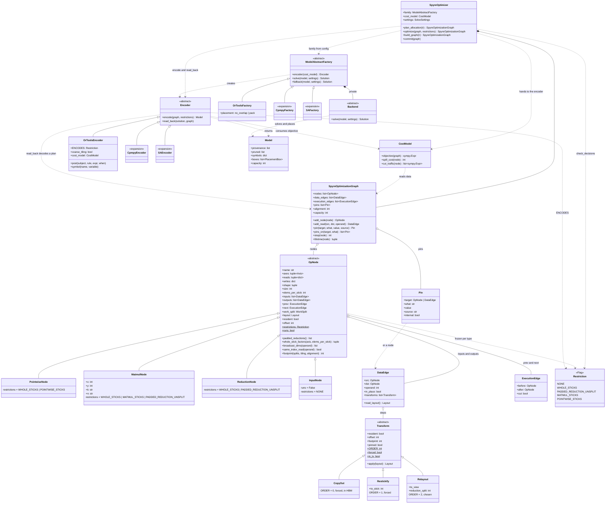
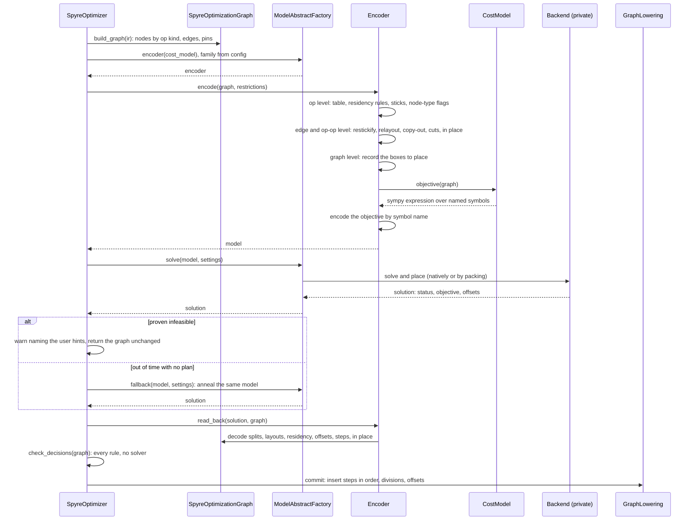

# LX allocator: implementation plan

## Goal

Replace the scratchpad planner's several solvers and duplicated rule sets with one
optimizer. The optimizer runs in five steps:

1. build a graph of the program;
2. encode every restriction into one model;
3. solve the model with one solver family;
4. check the decoded plan without a solver;
5. commit the plan.

That one solve decides work division, sticks, restickify, relayout, copy-out, in place,
coarse tiling and LX placement.

Today the same stick rule can exist in up to three places (`propagate_layouts`,
`optimize_restickify` and `op_spec_validation`), each dispatched differently. Several
solver classes each own part of the problem, with fallbacks between them. When this
plan is done:

- each rule exists once;
- one solver family encodes and solves the problem;
- a single solver-free check judges every plan, however it was produced.

## Design

The design has two layers.

- **The graph layer holds no solver types.** It is plain data, so a family can encode
  it, it can be annealed, and it can be tested without a solver.
  - The optimizer owns a graph of op nodes, data edges carrying transform steps,
    execution edges and pins.
  - A cost model writes the objective as a sympy expression.
  - What is special about an op type is a set of `Restriction` flags that its node type
    ORs together and freezes.
- **The family layer** is one object per solver family that encodes and solves.
  - Its encoder applies the rules at every level (op, edge, op-op and graph), records
    the boxes to place, and consumes the cost model.
  - Its private backend solves the model and places the boxes.

### Class diagram



### `optimize`



### Restrictions

A `Restriction` flag names what is special about an op type's decisions:

```python
class Restriction(Flag):
    NONE = 0
    WHOLE_STICKS = auto()              # a stuck axis splits in whole sticks
    PADDED_REDUCTION_UNSPLIT = auto()  # a padded reduction stays on one core while stuck
    MATMUL_STICKS = auto()             # x read stuck on K, y on N, the output on N
    POINTWISE_STICKS = auto()          # inputs that index the output's stick axis stick on it;
                                       # broadcast dims are exempt

class OpNode:
    restrictions: ClassVar[Restriction] = Restriction.WHOLE_STICKS

class MatmulNode(OpNode):
    x: int = 0; y: int = 1; k: str = "K"; n: str = "N"   # the attributes MATMUL_STICKS reads
    restrictions = OpNode.restrictions | Restriction.MATMUL_STICKS | Restriction.PADDED_REDUCTION_UNSPLIT
```

- **Flags are frozen per node type.** Setting `restrictions` on an instance raises. A
  test can override a type's flags through a mapping passed to `encode`,
  `check_decisions` and `optimize`, for example
  `{ReductionNode: ReductionNode.restrictions & ~Restriction.PADDED_REDUCTION_UNSPLIT}`.
- **A flag only names a rule.** Two functions turn a flag into data from the node's
  facts and the attributes its subtype adds:
  - `splits_while_stuck(node, flag)` gives split domains that apply while something is
    stuck;
  - `stick_tables(node, flag)` gives tables of legal sticks.

  Each family's encoder encodes that data, and `check_decisions` evaluates it.
- **Coverage is checked.** `OrToolsEncoder.ENCODES` is itself a flag set, and
  `coverage()` reports any flag on the graph's node types that a family cannot encode.
- **A new flag needs three things:** its data, an encoding in each family, and a check.

**Always-on rules** hold for every op, so they are not flags. The `Always` class names
them; the encoder always applies them and `check_decisions` always checks them:

- the split divides the axis;
- the core budget holds;
- at most one reduction axis is split;
- tiles are on output axes, never the stick dim;
- a copied-out tile that stays resident has no reduction split;
- the residency rules hold;
- a restickify appears only where the read stick differs;
- pinned steps stay;
- a copy-out lives in HBM;
- in-place conditions hold;
- tiles line up inside a nest;
- resident boxes fit LX and never overlap.

Data edges carry no restrictions.

### Decisions

| topic | decision |
|---|---|
| Graph inputs | Leaf `InputNode`s with downstream edges only. How an input arrives (its stick) is a pin. |
| Layout | One `Layout` per node (its output), with no ports. What a consumer needs is a restriction, and a mismatch is a step on the edge. |
| Memory | No `Buffer` class. Nodes and transform steps carry their own footprint, residency and offset, and placement works over both. |
| Who applies rules | The family's encoder, at op, edge, op-op and graph level. There is no separate lookup or strategy object. |
| Residency rules | Always on, applied while the table is built. A division is banned together with residency rather than removed. |
| Work division | Enumerated eagerly, as today, and pruned by the rules that hold unconditionally. Conditional rules are posted under their stick literal. |
| Cuts | Derived wherever adjacent ops' tiles don't match. Two ops share a nest only if every data edge between them lines up tile by tile. A nest is the run of ops between two cuts, not an object. |
| Copy-out | Forced when a cut lies between a data edge's ends. Its buffer lives in HBM, filled tile by tile, and is never placed in LX. There is one per producer, shared by every reader outside the nest, and its traffic is priced by the cost model. |
| Restickify | A transform, forced where the read stick differs, so it needs no elision. A restickify inserted before the graph is built is a pinned step. |
| Relayout | A chosen step, keyed by the producer's reduction split as well as the two layouts, so a completed-reduction route can read only the last core of each K group. Only from a resident source: a spilled producer reloads from HBM in the consumer's configuration. Inside a tile it is priced per tile times the trip count. Never across a cut. |
| In place | A variable on the edge, allowed only when the consumer reads at the producer's index, adjacent lifetimes, both resident, same layout and footprint, and at most one per op. The pair shares one offset. |
| Objective | A sympy expression from the cost model. The encoder consumes it and encodes it into its own variables by symbol name, and an unknown name fails. More cores only break ties. |
| Placement | A backend detail. CP-SAT places natively (offsets under a 2-D no-overlap) or by packing (a cumulative under a roof, then a first-fit packer; on overflow the roof comes down and the model is solved again). Annealing and MIP solvers pack. |
| Families | One object encodes and solves, and its backend is private. Chosen from config, so the choice is in the FX graph cache key, never from the environment. OR-Tools comes first, and CPMpy and SA are expansion axes. |
| Pins | Constraints that narrow the solve, never decisions, never dropped. They come from hints, graph-input arrival, the restickify pre-pass, hazards, and greedy pins the encoder may add to cut search. Internal pins must never be infeasible. |
| Failure | A model proven infeasible is returned infeasible, with nothing decoded or committed and a warning naming the user hints. A solve out of time with no plan anneals the same model. A failed check raises `RuleViolation`, because it means a bug. |
| Decisions | They live in the solution. `read_back` decodes them onto the graph only from a plan, and commit lowers from the graph. |
| Determinism | Opt-in. `SolveSettings(deterministic=True)` budgets by deterministic time with a fixed seed and interleaved search. Otherwise speed wins. |
| Loops | Not modelled. User-written loops are opaque hazards, pinned and never re-tiled. Drains stay with whatever inserts them. |
| After commit | `LxContextSwitchingPass` stays a separate pass. |
| Out of the first implementation | Lazy work division, conflict explanation (MUS/MCS), `AxisRotation`, multi-level tiles, and the CPMpy and SA families. |

## Stages

Each stage is its own PR on `main` and leaves the full suite green. Through Phase 1, and
in Phase 2 wherever the rules agree with today's, the CP model stays byte-identical and
the committed plans stay identical. Any other difference is listed by rule in its PR
and either justified or fixed.

### Phase 1: the graph and the check, no change to the solve

**Stage 0. Harness and baseline.**
- A device-free equivalence harness solves deterministically: one worker, seed 0, a
  deterministic time budget and no wall-clock limit.
- For each solve it records the model proto, status, objective and decisions. After
  `_push_allocation` it also records the committed plan: inserted clones, relayout ops,
  addresses, divisions and spill reasons.
- The corpus is:
  - the unit-test solves;
  - the synthetic co-optimization graphs;
  - captures from the zoo at default and `AUTO_COARSE_TILING=1`, with one forced solve
    failure to cover the fallback;
  - every `layout_solver` × `co_optimizing_lx_planning` combination.
- No production code changes in this stage.

**Stage 1. Graph types.**
- Add `SpyreOptimizationGraph`, `OpNode` and its subtypes (`PointwiseNode`,
  `MatmulNode` with `x`, `y`, `k`, `n`, `ReductionNode`, `InputNode`), `DataEdge`,
  `ExecutionEdge`, `Pin`, `Transform`, `CopyOut`, `Restickify`, `Relayout`, `Layout`,
  `WorkSplit` and `Axis`.
- The graph layer imports no solver.
- Unit tests cover each class: flags frozen per type, overrides, lifetimes, an edge's
  read layout after its steps, and pins by source.

**Stage 2. Builder.**
- `build_graph` makes one node per op, choosing the subtype from the op kind with the
  same predicates codegen uses.
- It works out the axis-to-dim maps once from each read's index expression, and builds
  data edges by operand index and execution edges from op order.
- It adds pins for:
  - graph-input arrival;
  - restickifies the pre-pass inserted (pinned steps);
  - work-division hints;
  - hazards (user-written loops, drains);
  - every op's stick as `propagate_layouts` fixed it.
- The stick pins keep Phases 1–2 at parity: commit then never changes a layout, and
  Stage 10 lifts them.
- Build from the allocator's full record list, never from a solver's filtered view.

**Stage 3. Restrictions and the check.**
- Add `Restriction`, `Always`, the residency rules, `splits_while_stuck`,
  `stick_tables`, `check_decisions` and `coverage`.
- They take over these rules from today's code:
  - `work_division_constraints.py`: `coordinate_mask_blocked_vars` becomes
    `PADDED_REDUCTION_UNSPLIT`, and each other op-specific constraint function becomes
    a flag on the node types it applies to, with its data taken from the node's facts.
    Examples are the qfp8wt K split domain, `plain_reduction_k_split_domains` and
    `reduction_window_blocked_vars`;
  - `_matmul_layouts` becomes `MATMUL_STICKS`;
  - `_multi_arg_pointwise_layouts` and `_check_stick_all_same` become
    `POINTWISE_STICKS`;
  - `WorkDivisionContext.is_legal`, `ResidencyChecks` and
    `check_in_place_parent_is_read` become always-on rules.
- `check_decisions` runs on every plan today's solve commits. It reports but never
  fails a compile.
- **Phase 1 exit:** across the unit and device suites, `check_decisions` reports nothing,
  or every report traces to a real bug that gets an issue.

### Phase 2: the OR-Tools family, behind config

**Stage 4. Cost model.**
- `CostModel.objective(graph)` ports today's objective:
  - `spill_cost`, with graph inputs and outputs discounted;
  - `_cut_traffic_terms` for copy-outs;
  - the co-optimizing cost expression's per-bundle terms and relayout charges;
  - cores, only to break ties.
- `Sym` names every symbol, and `cpsat_expr_printer` encodes the expression by name.
- Proven by: on the Stage 0 corpus, the objective equals today's, solve for solve.

**Stage 5. `OrToolsEncoder`, op level.**
- The encoder builds today's work-division table (`enumerate_work_division_candidates`),
  with coarse tilings in the same table when enabled.
- Residency rules are applied while the table is built.
- Sticks are variables, or constants where pinned.
- Each node type's flags are posted: conditional splits under their stick literal, and
  stick tables as table constraints.
- Every constraint is tagged with its rule in the model's provenance, and the table
  entries each rule pruned are recorded.
- Proven by: an empty proto diff against today's model wherever the rules agree.

**Stage 6. `OrToolsEncoder`, edge and op-op level.**
- **Restickify** is forced where the read stick differs, or pinned.
- **Cross-frame hazard (an always-on rule).** A restickify may not read a core-sliced
  resident source unless a relayout comes first. Today's `_restickify_barrier` enforces
  this.
- **Relayout** options are a table over source layout, producer reduction split and
  destination layout, including completed-reduction routes
  (`derive_completed_reduction_routes`). Relayouts are allowed inside a tile when both
  ends share a nest, never across a cut.
- **Cuts and copy-outs.** Cuts are derived through a running nest id that steps at each
  cut, with tile alignment on every edge inside a run and copy-outs forced at cuts.
  - A tiled op's live range starts at its nest's start, a solve decision as in today's
    `_add_nest_starts`.
  - The partial-reduction cut guard is an always-on rule.
- **In place** is a variable on the edge.
- **Clone reads** are constraints between the clone's view and the consumer's.

**Stage 7. Families and placement.**
- Add `Model`, `ModelAbstractFactory` and `OrToolsFactory`, registered in `FACTORIES`
  and chosen by a `config.layout_solver` value.
- The private `CpSatBackend` places in one of two modes, set by a config option:
  natively, under a 2-D no-overlap, or by packing (a cumulative under a roof, then
  first-fit in several orders, lowering the roof on overflow).
  - An in-place pair packs as one box.
- `SolveSettings` carries the time limit, workers and opt-in determinism.

**Stage 8. `SpyreOptimizer`.**
- `optimize` runs encode → solve, then `read_back` → `check_decisions` → commit.
- **A model proven infeasible** returns with a warning naming the user hints, and
  nothing is decoded or committed.
- **A solve out of time with no plan** runs `fallback`, simulated annealing over the
  same model, which packs. It replaces the greedy re-plan only once it matches today's
  SA co-optimizer's plans across the corpus; until then the greedy re-plan stays as the
  fallback.
- **A failed check** raises `RuleViolation`.
- **Phase 2 exit**, with the new family selected:
  - the unit and device suites pass;
  - HBM traffic is no worse than `CoOptimizingAllocator`'s on the suites and the zoo,
    including committed mode (every division pinned);
  - planning time on the zoo stays within run-to-run noise of today's.

### Phase 3: commit, sticks in the solve, switch-over

**Stage 9. Commit.**
- `SpyreOptimizer.commit` inserts each edge's steps in canonical order (pinned steps
  already exist), then commits divisions and offsets through `GraphEditor`. This
  replaces `_push_allocation`.
- `LxContextSwitchingPass` runs after commit, unchanged.

**Stage 10. Sticks in the solve.**
- Lift the Stage 2 stick pins, except graph inputs and pre-pass restickifies. The
  solver then chooses each op's stick and places the restickifies it needs.
- This requires four things:
  - `propagate_layouts` accepts a stick decided by the solve;
  - codegen accepts layouts decided after LX planning;
  - the Stage 6 cross-frame hazard holds;
  - a restickify's compute time is accounted for.
- The restickify pre-pass stays as the source of pinned steps.
- `elide_proven_read_copies` goes, because a restickify is never present where the
  sticks agree.

**Stage 11. Default flip.**
- Run the old and new paths side by side on CI models, comparing traffic, planning time
  and correctness, then make the new optimizer the default.

**Stage 12. Deletions.**
- `ScratchpadAllocator` and `CoOptimizingAllocator`, whose role `SpyreOptimizer` takes
  over. Joint division and placement is the only mode, and placement-only is the same
  model with every division pinned.
- `MemoryPlanSolver`, `CoreDivisionLayoutSolver` and `CpSatLayoutSolver`.
- `GreedyLayoutSolver`, `FirstFitLayoutSolver`, `BestFitLayoutSolver` and
  `ExhaustiveSearchSolver`. First-fit lives on inside the backends that pack.
- `SimulatedAnnealingLayoutSolver` and `SaCoOptimizingSolver`, once the annealing
  fallback has replaced them.
- The `SolveError` re-plan in `scratchpad_planning`.
- The stick rules now held once in the flags: `_matmul_layouts`,
  `_multi_arg_pointwise_layouts` and `_check_stick_all_same`.
- **Phase 3 exit:** the optimizer is the default, and the replaced solvers and the
  duplicated rules are gone.

## Verification

- **Every stage:** the Stage 0 harness, comparing proto, decisions and committed plans
  between the stage's parent and the change. Baselines are re-recorded after every
  rebase.
- **From Stage 3:** `check_decisions` runs on every plan in every suite.
- **Unit suites, run serially:**
  - `test_scratchpad_solver`, `test_solver_relayout_decision`,
    `test_cooptimization_types`, `test_cost_expr_dump`;
  - `test_restickify_cost_model`, `test_sa_cooptimizer`, `test_coarse_tiling`,
    `test_work_division*`;
  - `test_scratchpad_patterns`, `test_perm_layout_solver`, `test_scratchpad_use`,
    `test_solver_auto_coarse_tiling`;
  - the new graph-layer tests.
- **Device suites after Stages 5, 6, 8, 9 and 10:** `test_scratchpad_use`,
  `test_work_division`, `test_solver_relayout_e2e`, `test_solver_auto_coarse_tiling`
  and `test_lx_planning_suite`. After Stages 8 and 10, also the `test_inductor_ops_lx_*`
  shards.
- **Planning time, after Stages 5, 8 and 10:** replay the zoo captures on base and
  change, in one process and interleaved, and flag growth beyond noise.
- **Housekeeping:** `pre-commit run --files <changed>` (ruff, mypy).
