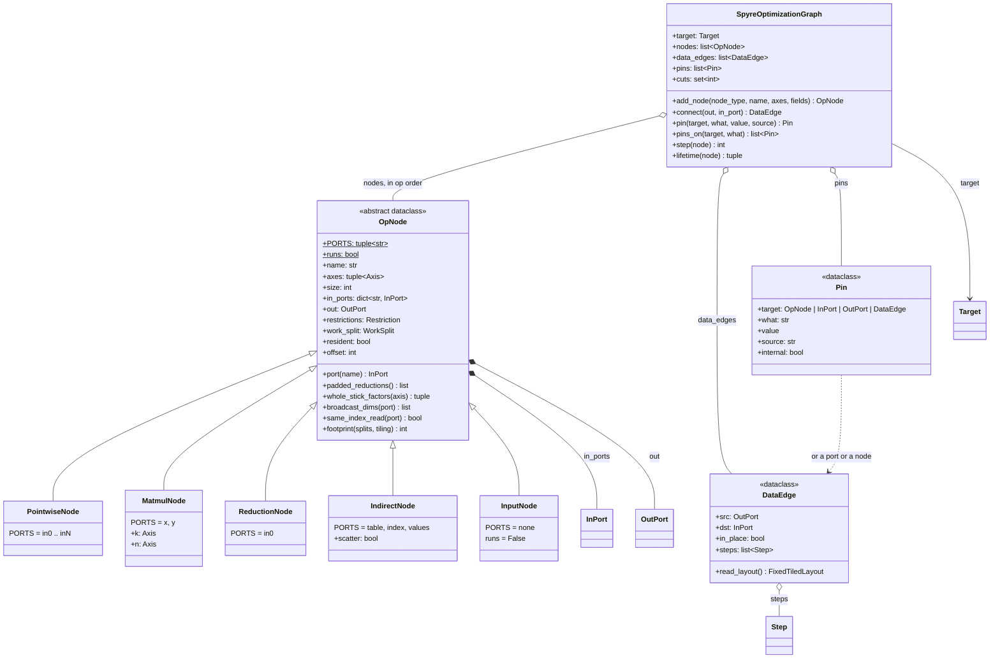
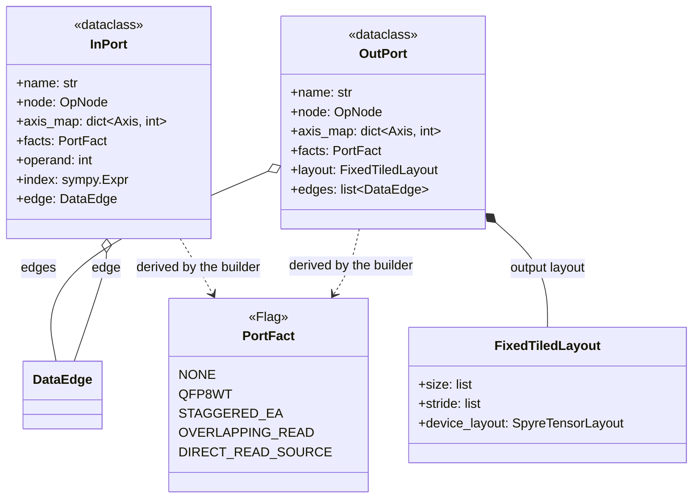
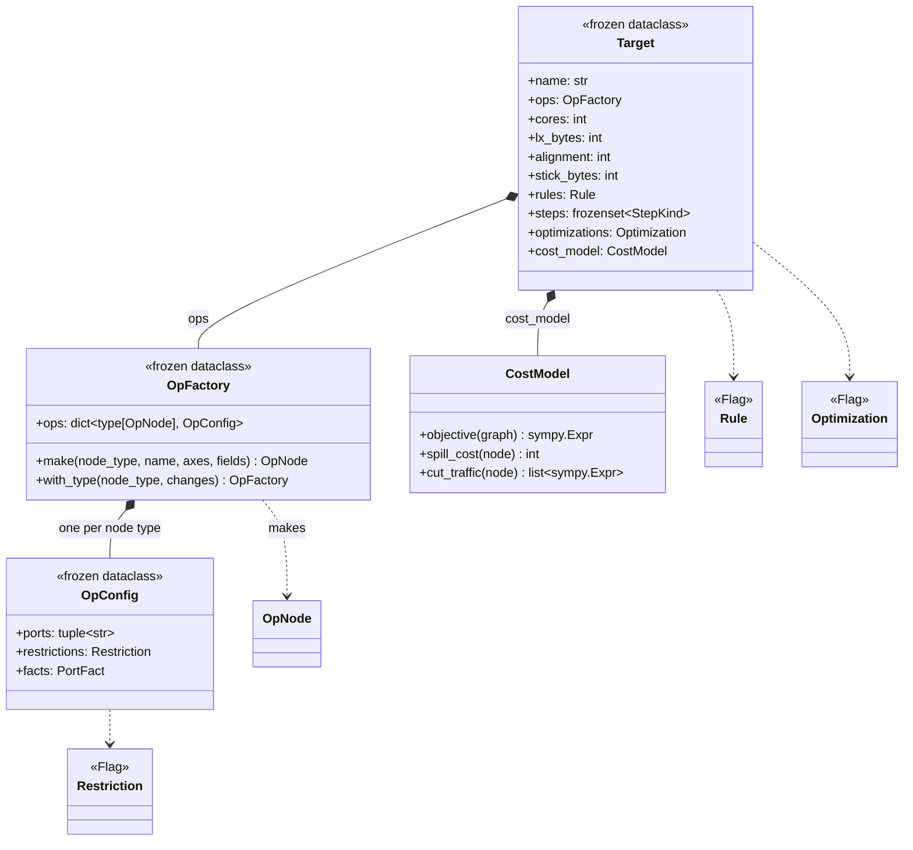
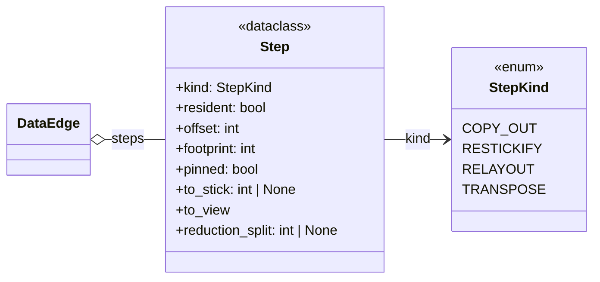
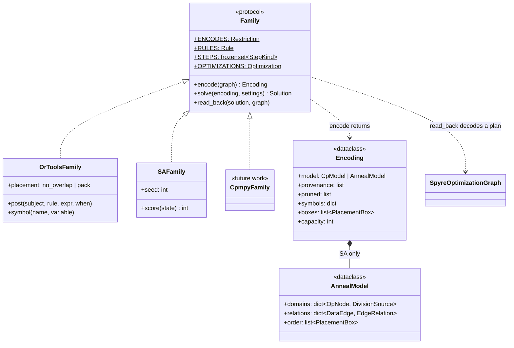
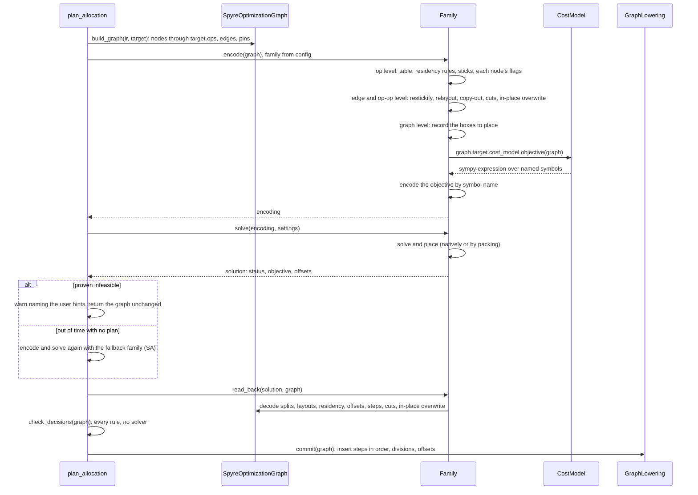

# LX allocator: implementation plan

## Goal

Replace the scratchpad planner's several solvers and duplicated rule sets with one
optimizer. The optimizer runs in five steps:

1. build a graph of the program;
2. encode every restriction into one model;
3. solve the model with one solver family;
4. check the decoded plan without a solver;
5. commit the plan.

That one solve decides work division, sticks, restickify, relayout, copy-out, LX prefetch,
in-place overwrite, coarse tiling and LX placement.

Today the same stick rule can exist in up to three places (`propagate_layouts`,
`optimize_restickify` and `op_spec_validation`), each dispatched differently. Several
solver classes each own part of the problem, with fallbacks between them. When this
plan is done:

- each rule exists once;
- one solver family encodes and solves the problem;
- a single solver-free check judges every plan, however it was produced;
- a new accelerator card is a configuration, not new classes.

## Design

The design has three parts.

- **The graph holds no solver types.** It is plain data, so a family can encode it, it can
  be annealed, and it can be tested without a solver.
  - Op nodes are joined by data edges, which carry transform steps. The graph also keeps
    the op order and the pins.
  - Each op kind is a dataclass subclass of `OpNode` that carries the fields its
    restrictions read. The target's op factory sets each node's `Restriction` flags and
    allowed port facts when the builder makes it.
- **The target describes the card.** A frozen `Target` holds everything that differs
  between accelerator cards: the op factory, the sizes, the rules that vary by card, the
  steps the card can perform, the optimizations the solve may use, and the cost model. It
  is chosen from config, and the graph keeps it.
- **A family encodes and solves.** One object per solver family:
  - it applies the rules at every level (op, edge, op-op and graph);
  - it records the boxes to place and consumes the cost model;
  - it solves the model and reads the plan back onto the graph.

Plain data is a dataclass. Node types subclass `OpNode`, because a restriction may need
data fields only its op carries, such as a matmul's `k` and `n`. A kind that differs from
another only in constants, such as a step kind, is an enum value with a row in a table.
Behaviour lives in functions and in the families.

### Entry point

There is no optimizer class. One function runs the five steps:

```python
def plan_allocation(ir, config) -> SpyreOptimizationGraph:
    target = TARGETS[config.target]
    graph = build_graph(ir, target)
    optimize(graph, FAMILIES[config.layout_solver], FAMILIES[config.fallback_solver],
             SolveSettings.from_config(config))
    commit(graph)
    return graph
```

`SolveSettings` is a dataclass holding the time limit, the workers and opt-in
determinism.

### Class diagrams

The classes fall into five groups, one diagram each. A class drawn without members
belongs to another group's diagram.

#### Graph

Op nodes are joined by data edges, which carry steps. The node list is in op order, which
replaces execution edges: `cuts` holds the positions in that order where the solve cut a
nest. Pins narrow the solve.



A subclass adds only the fields its restrictions read. `MatmulNode.k` and `.n` are the
contraction axis and the output-column axis that `MATMUL_STICKS` reads (port `x` stuck
on K, port `y` and the out port on N). The builder finds them once from the reads' index
symbols, as `_matmul_layouts` does today with `find_reduction_var` and `find_matmul_generated_var`,
including the `M = 1` and `N = 1` cases where one symbol simplifies away. Ports `x` and
`y` bind to operands 0 and 1 (`identify_matmul_inputs` confirms the positional order).

`IndirectNode` is a gather (an indirect read) or a scatter (an indirect write,
`scatter = True`). Port `table` reads the shared value table or scatter destination,
`index` reads the indices, and `values` reads a scatter's source (a gather leaves it
unbound). Every core reads the table at one base address, so `INDIRECT_ACCESS` keeps its
data dims unsplit; only the index-entry dims carry the op's parallelism.

#### Ports

A node connects to data edges through named ports: one `InPort` per operand it reads and
one `OutPort` for what it writes. Each node type declares its port names in `PORTS`, so rules,
pins and edges name an operand (`x`, `table`) rather than an index. Both are dataclasses
with no shared base. They are not frozen, because `connect` attaches the edges after the
builder makes them. The out port carries the node's output layout as a
`FixedTiledLayout`, the host size and stride plus the `SpyreTensorLayout` that codegen
uses, so every rule reads the same device layout the compiler commits.



An in port records how its operand is read: the operand index it is bound to, the read's
index expression and its axis-to-dim map. The out port records the write's map. The
builder works these out once, so a rule asks `node.port("x")` instead of searching the
reads.

A port also carries `facts`, a `PortFact` flag set the builder derives once, masked by
the op config's `facts`, so a card that lacks a format never derives its fact. A fact
describes the tensor or the read behind one operand, not the op. A rule keyed on a fact
therefore applies to every op that touches that tensor, through the port that carries
it, and the port's axis map turns the tensor dims it names into the op's loop axes.
`QFP8WT` on a weight restricts both the op that writes it (its out port) and the matmul
that reads it (port `y`), and no node type mentions QFP8WT.

#### Target and op factory

A `Target` is one card. Its `OpFactory` holds one `OpConfig` per node type, and `make`
stamps that config onto each node it builds. A node type's fields and ports are the same
on every card, because they describe the op; its flags and allowed facts are
configuration, because they describe what the card can do with it.



Every target fills `ops` for every node type. A second card that shares most of the first
card's rules is derived from it, so the shared part is defined once and the differences
are visible in one place:

```python
SPYRE = Target(name="spyre", ops=SPYRE_OPS, cores=SPYRE_CORES, lx_bytes=SPYRE_LX_BYTES,
               alignment=SPYRE_ALIGNMENT, stick_bytes=SPYRE_STICK_BYTES, rules=~Rule.NONE,
               steps=frozenset({StepKind.COPY_OUT, StepKind.RESTICKIFY,
                                StepKind.RELAYOUT}),
               optimizations=~Optimization.NONE, cost_model=SpyreCostModel())

# Illustration only: a card whose matmul may split an encoded K and that can transpose.
OTHER = replace(
    SPYRE,
    name="other",
    ops=SPYRE_OPS.with_type(
        MatmulNode,
        restrictions=SPYRE_OPS.ops[MatmulNode].restrictions
        & ~Restriction.ENCODED_K_UNSPLIT),
    steps=SPYRE.steps | {StepKind.TRANSPOSE},
)
```

- **Chosen from config.** `config.target` names an entry in `TARGETS`, so the target is
  in the FX graph cache key and never comes from the environment at solve time.
- **Read only through the graph.** `build_graph(ir, target)` makes every node through
  `target.ops` and stores `graph.target`. The encoder, the cost model and
  `check_decisions` read sizes, rules, steps and optimizations from `graph.target`, so
  none of them takes a target argument and the solve and the check cannot see different
  cards.
- **A new card is one `Target` value**, plus a cost model if its numbers differ.
- **Steps stay a table.** If a card's step footprints or constants differ, a step
  factory in `Target` follows the same pattern. It is not built until a card needs it.

#### Steps

A data edge carries an ordered list of steps that turn the producer's layout into the
one the consumer reads. Each step has its own footprint, residency and offset, so
placement treats it like a node. A step is one dataclass; what differs between kinds is
a row in `STEP_KINDS`, and `apply(step, layout)` dispatches on the kind.



| `StepKind` | `ORDER` | chosen or forced | where it lives | fields it uses |
|---|---|---|---|---|
| `COPY_OUT` | 0 | forced at a cut | HBM | none |
| `RESTICKIFY` | 1 | forced where the read stick differs | LX or HBM | `to_stick` |
| `RELAYOUT` | 2 | chosen | LX or HBM | `to_view`, `reduction_split` |
| `TRANSPOSE` | out of scope | chosen | LX | a permutation |

`TRANSPOSE` is listed only to show where it would go: a step that permutes the device
dims of a resident tile, priced like a relayout. It is not built in this plan (see
"Future work"), and its `ORDER` among the other steps is left for its own design. A
target offers only the step kinds in `target.steps`.

#### Families

A family is one object that encodes, solves and reads back. There is no separate
factory, encoder, backend or model hierarchy. Each family encodes into its own native
model, wrapped in an `Encoding` record that holds what every family records. OR-Tools
builds a CP-SAT `CpModel`. SA builds an `AnnealModel`, a port of today's
`SaCoOptimizingSolver` state, because an annealer moves through divisions and a placement
order rather than through CP variables. `CpmpyFamily` is future work, not part of this
plan.



### `optimize`



### Restrictions

Four flag sets name the rules and choices. A `Restriction` names what is special about an
op kind, a `PortFact` what is special about one operand, a `Rule` what is special about
a card, and an `Optimization` a decision axis the solve may use:

```python
class Restriction(Flag):
    NONE = 0
    WHOLE_STICKS = auto()              # a stuck axis splits in whole sticks
    PADDED_REDUCTION_UNSPLIT = auto()  # a padded reduction stays on one core while stuck
    MATMUL_STICKS = auto()             # port x stuck on K, port y on N, the output on N
    POINTWISE_STICKS = auto()          # inputs that index the output's stick axis stick on it;
                                       # broadcast dims are exempt
    INDIRECT_ACCESS = auto()           # a gather table's or scatter destination's data dims stay
                                       # unsplit; so does an entry dim whose last index stick is
                                       # partial, unless the gather output was padded to a stick
    ENCODED_K_UNSPLIT = auto()         # K stays unsplit when a port is QFP8WT or STAGGERED_EA

class PortFact(Flag):
    NONE = 0
    QFP8WT = auto()              # the tensor is QFP8WT (a 2x64 stick)
    STAGGERED_EA = auto()        # FP32_TO_DL16 or DL16_TO_FP32: elements reordered in a stick
    OVERLAPPING_READ = auto()    # the read overlaps itself, as in x.unfold
    DIRECT_READ_SOURCE = auto()  # a staged copy whose read may later go straight to a graph input

class Rule(Flag):
    NONE = 0
    ONE_REDUCTION_SPLIT = auto()        # at most one reduction axis is split
    TILES_OFF_STICK = auto()            # tiles are on output axes, never the stick dim
    RESIDENT_TILE_UNREDUCED = auto()    # a copied-out tile that stays resident has no
                                        # reduction split
    COPY_OUT_IN_HBM = auto()            # a copy-out lives in HBM

class Optimization(Flag):
    NONE = 0
    CORE_SPLIT = auto()      # work division across cores
    LX_RESIDENCY = auto()    # keeping a buffer in LX
    IN_PLACE = auto()        # in-place overwrite
    PREFETCH = auto()        # LX prefetch of a graph input
    COARSE_TILING = auto()   # coarse tiles and their nests
```

Each node type's restrictions in `SPYRE_OPS`, and the fields they read:

| node type | restrictions | fields the restrictions read |
|---|---|---|
| `PointwiseNode` | `WHOLE_STICKS \| POINTWISE_STICKS` | ports' axis maps |
| `MatmulNode` | `WHOLE_STICKS \| MATMUL_STICKS \| PADDED_REDUCTION_UNSPLIT \| ENCODED_K_UNSPLIT` | `k`, `n`, ports' facts |
| `ReductionNode` | `WHOLE_STICKS \| PADDED_REDUCTION_UNSPLIT` | padded reductions |
| `IndirectNode` | `WHOLE_STICKS \| INDIRECT_ACCESS` | `scatter`, ports `table` and `index` |
| `InputNode` | `NONE` | none |

- **Flags are set per node by the factory.** The builder never assigns `restrictions`
  after `make`, and it asserts that every node of one type carries that type's config,
  so two matmuls in one graph cannot disagree. A test changes flags by building with a
  derived target, for example
  `replace(SPYRE, ops=SPYRE_OPS.with_type(ReductionNode, restrictions=...))`, so
  `encode` and `check_decisions` take no override argument.
- **A flag only names a rule.** Two functions turn a flag into data from the node's
  facts and the fields its node type adds:
  - `splits_while_stuck(node, flag)` gives split domains that apply while something is
    stuck;
  - `stick_tables(node, flag)` gives tables of legal sticks.

  Each family's `encode` encodes that data, and `check_decisions` evaluates it.
- **Port facts trigger rules a node type cannot.** A rule keyed only on a fact is an
  always-on rule over every port that carries it:
  - `QFP8WT`: the dims indexing the second stick coordinate and the batch dims stay
    unsplit;
  - `OVERLAPPING_READ`: the window variable splits so no core sweeps an overlap;
  - `DIRECT_READ_SOURCE`: the source's stick dim splits in whole sticks.

  An op flag can also require a fact. `ENCODED_K_UNSPLIT` keeps a matmul's K unsplit
  only when one of its ports is `QFP8WT` or `STAGGERED_EA`.
- **An optimization that is off gets no variables.** The encoder creates none for an
  axis outside `graph.target.optimizations` (narrowed further by config, as coarse
  tiling is today), and `check_decisions` rejects a plan that uses it anyway.
- **Coverage is checked at config time.** `coverage(family, target)` reports every
  restriction (across all node types), rule, step kind and optimization the target uses
  that the family's `ENCODES`, `RULES`, `STEPS` or `OPTIMIZATIONS` lacks. Tests run over
  every (family, target) pair, and a gap is an explicit skip.
- **A new flag needs three things:** its data (a new field on the node types it applies
  to, if the existing ones don't hold it), an encoding in each family that serves a card
  using it, and a check. Cards without the flag never see it.

**Always-on rules** hold on every card, so they are not flags. The `ALWAYS` list names
the check functions; the encoder always applies them and `check_decisions` always checks
them, with sizes read from `graph.target`:

- the split divides the axis;
- the core budget (`target.cores`) holds;
- the residency rules hold;
- a restickify appears only where the read stick differs;
- pinned steps stay;
- in-place conditions hold;
- the rules each port fact names hold;
- tiles line up inside a nest;
- resident boxes fit LX (`target.lx_bytes`) and never overlap.

The four `Rule` flags describe this hardware rather than arithmetic, so another card may
drop them. Which rules belong in `Rule` and which in `ALWAYS` is provisional and is
confirmed before Stage 3.

Data edges carry no restrictions.

### Decisions

| topic | decision |
|---|---|
| Targets | One frozen `Target` per accelerator card: op factory, sizes, rules, steps, optimizations, cost model. Chosen from config, so it is in the FX graph cache key. A card that shares rules with another is derived from it with `dataclasses.replace` and flag arithmetic. Different cards in one program are future work. |
| Node types | A dataclass subclass of `OpNode` per op kind, adding only the fields its restrictions read (`MatmulNode.k` and `.n`, `IndirectNode.scatter`) and declaring its `PORTS`. The target's `OpFactory` sets each node's flags and allowed facts from its type's `OpConfig` at build, so a card's differences live in configuration, not in new node classes. |
| Class count | Plain data is a dataclass. Node types are subclasses because their fields differ. A kind that differs only in constants, such as a step kind, is an enum value with a table row. Only the families carry behaviour. |
| Graph inputs | Leaf `InputNode`s with downstream edges only. How an input arrives (its stick) is a pin. |
| Ports | Every operand a node reads is a named `InPort` and its output an `OutPort`, both dataclasses, with names declared per node type. Data edges run from an out port to an in port, and rules and pins name ports, never operand indices. |
| Port facts | A `PortFact` set on each port, derived once by the builder and masked by the op config. Out-port facts come from the layout's element arrangement. In-port facts come from the edge's read layout, so a step that changes the layout changes them, and from the read itself (overlap, direct-read provenance). Rules keyed on a tensor property live here, not on node types. |
| Layout | One `FixedTiledLayout` per node, on its out port, carrying its `SpyreTensorLayout`. An in port holds no layout of its own: what a consumer needs is a restriction over its port names, and a mismatch is a step on the edge. |
| Memory | No `Buffer` class. Nodes and steps carry their own footprint, residency and offset, and placement works over both. |
| Who applies rules | The family's `encode`, at op, edge, op-op and graph level. There is no separate lookup or strategy object. |
| Residency rules | Always on, applied while the table is built. A division is banned together with residency rather than removed. |
| Work division | Enumerated eagerly, as today, and pruned by the rules that hold unconditionally. Conditional rules are posted under their stick literal. |
| Op order | The node list is in op order; there are no execution edges. `graph.cuts` holds the positions where the solve cut a nest. |
| Cuts | Derived wherever adjacent ops' tiles don't match. Two ops share a nest only if every data edge between them lines up tile by tile. A nest is the run of ops between two cuts, not an object. |
| Copy-out | Forced when a cut lies between a data edge's ends. Its buffer lives in HBM, filled tile by tile, and is never placed in LX. There is one per producer, shared by every reader outside the nest, and its traffic is priced by the cost model. |
| Restickify | A step, forced where the read stick differs, so it needs no elision. A restickify inserted before the graph is built is a pinned step. |
| Relayout | A chosen step, keyed by the producer's reduction split as well as the two layouts, so a completed-reduction route can read only the last core of each K group. Only from a resident source: a spilled producer reloads from HBM in the consumer's configuration. Inside a tile it is priced per tile times the trip count. Never across a cut. |
| In-place overwrite | A variable on the edge: the consumer's output overwrites the producer's storage in LX. Allowed only when the read pattern is safe, with adjacent lifetimes, both resident, same layout and footprint, and at most one per op. The pair shares one offset. Safety is a property of the memory read pattern, not of the op kind. The first implementation keeps today's eligibility (`get_op_pointwise_inputs`, a read at the producer's index) so plans stay at parity, and "Future work" widens it. |
| LX prefetch | Loading a graph input into LX once, ahead of its readers, so each reader avoids its own HBM read. The code calls this an input clone. Whether and where to prefetch is an optimization axis, and where that is decided is an implementation detail: the solve or a pre-solve pass. The first implementation decides it as today: `_eligible_clone_inputs` names the inputs read more than once that fit LX, and the solve chooses their residency and view. Output clones copy a value back to HBM, so they are not prefetches and keep their name. |
| Optimizations | `target.optimizations` names the decision axes the solve may use. An axis that is off gets no variables, and `check_decisions` rejects a plan that uses it. |
| Objective | A sympy expression from the target's cost model. The family's `encode` consumes it and encodes it into its own variables by symbol name, and an unknown name fails. More cores only break ties. |
| Placement | A family detail. CP-SAT places natively (offsets under a 2-D no-overlap) or by packing (a cumulative under a roof, then a first-fit packer; on overflow the roof comes down and the model is solved again). Annealing and MIP solvers pack. |
| Families | One object per family encodes, solves and reads back; there is no factory, encoder, backend or model hierarchy. Chosen from config, so the choice is in the FX graph cache key, never from the environment. OR-Tools and SA are built here, each encoding into its own native model inside an `Encoding` record; CPMpy is future work. |
| Pins | Constraints that narrow the solve, never decisions, never dropped. They come from hints, graph-input arrival, the restickify pre-pass, hazards, and greedy pins the encoder may add to cut search. Internal pins must never be infeasible. |
| Failure | A model proven infeasible is returned infeasible, with nothing decoded or committed and a warning naming the user hints. A solve out of time with no plan is retried with the fallback family (SA by default), which encodes the same graph into its own model. A failed check raises `RuleViolation`, because it means a bug. |
| Decisions | They live in the solution. `read_back` decodes them onto the graph only from a plan, and commit lowers from the graph. |
| Determinism | Opt-in. `SolveSettings(deterministic=True)` budgets by deterministic time with a fixed seed and interleaved search. Otherwise speed wins. |
| Loops | Not modelled. User-written loops are opaque hazards, pinned and never re-tiled. Drains stay with whatever inserts them. |
| After commit | `LxContextSwitchingPass` stays a separate pass. |
| Out of the first implementation | Lazy work division, multi-level tiles, a second card's `Target`, and everything under "Future work": the CPMpy family, explanations, SA over CPMpy, axis rotations (with the `TRANSPOSE` step), stick layout optimization and different cards in one program. |

## Stages

Each stage is its own PR on `main` and leaves the full suite green. Through Phase 1, and
in Phase 2 wherever the rules agree with today's, the CP model stays byte-identical and
the committed plans stay identical. Any other difference is listed by rule in its PR
and either justified or fixed.

### Phase 1: the graph and the check, no change to the solve

**Stage 0. Harness and baseline.**
- A device-free equivalence harness solves deterministically: one worker, seed 0, a
  deterministic time budget and no wall-clock limit.
- For each solve it records the model proto, status, objective and decisions. After
  `_push_allocation` it also records the committed plan: inserted clones, relayout ops,
  addresses, divisions and spill reasons.
- The corpus is:
  - the unit-test solves;
  - the synthetic co-optimization graphs;
  - captures from the zoo at default and `AUTO_COARSE_TILING=1`, with one forced solve
    failure to cover the fallback;
  - every `layout_solver` × `co_optimizing_lx_planning` combination.
- No production code changes in this stage.

**Stage 1. Graph types.**
- Add the dataclasses `SpyreOptimizationGraph`, `OpNode` and its subtypes with their
  `PORTS` (`PointwiseNode`, `MatmulNode` with `k` and `n`, `ReductionNode`,
  `IndirectNode` with `scatter`, `InputNode`), `InPort`, `OutPort`, `DataEdge`, `Pin`,
  `Step`, `WorkSplit` and `Axis`, the enum `StepKind` with the `STEP_KINDS` table, and
  `PortFact`. Layouts are torch-spyre's own
  `FixedTiledLayout` and `SpyreTensorLayout`, not a new type.
- Add `Target`, `OpFactory` and `OpConfig`, and the `SPYRE` target with `SPYRE_OPS` for
  every node type. `config.target` selects it and defaults to `SPYRE`.
- The graph layer imports no solver.
- Unit tests cover: a node's flags and allowed facts come from its type's config, a derived
  target changes only what it names, ports by name, port facts masked by the config,
  lifetimes, an edge's read layout after its steps, and pins by source.

**Stage 2. Builder.**
- `build_graph(ir, target)` makes one node per op through `target.ops`, choosing the
  node type with the same predicates codegen uses, keeps the nodes in op order, and stores
  `graph.target`. It asserts that every node of one type carries that type's config.
- It binds each operand to its node type's in port, works out each port's axis-to-dim map once
  from the read's index expression, and connects data edges from out port to in port.
- It derives each port's facts, masked by the op config: `QFP8WT` and `STAGGERED_EA`
  from the layout's element arrangement, `OVERLAPPING_READ` from the read's coordinates
  (`overlapping_coordinate_extents`), and `DIRECT_READ_SOURCE` from a staged copy's
  saved direct-read record.
- It adds pins for:
  - graph-input arrival;
  - restickifies the pre-pass inserted (pinned steps);
  - work-division hints;
  - hazards (user-written loops, drains);
  - every op's stick as `propagate_layouts` fixed it;
  - the dim order `reorder_nonstick_dims` gives a gather table or scatter destination.
- The stick pins keep Phases 1–2 at parity: commit then never changes a layout, and
  Stage 11 lifts them.
- Build from the allocator's full record list, never from a solver's filtered view.

**Stage 3. Restrictions and the check.**
- Add `Restriction`, `Rule`, `Optimization`, `ALWAYS`, the residency rules,
  `splits_while_stuck`, `stick_tables`, `check_decisions(graph)` and
  `coverage(family, target)`.
- Confirm which of today's always-on rules are card properties (`Rule`) and which are
  arithmetic (`ALWAYS`).
- They take over these rules from today's code:
  - `work_division_constraints.py`: `coordinate_mask_blocked_vars` becomes
    `PADDED_REDUCTION_UNSPLIT`, and each other op-specific constraint function becomes
    a flag in the configs of the node types it applies to, with its data taken from the
    node's facts.
    Examples are the qfp8wt K split domain, `plain_reduction_k_split_domains` and
    `reduction_window_blocked_vars`;
  - `indirect_access_split_domains` (`indirect_forbidden_split_syms`) becomes
    `INDIRECT_ACCESS`. The flag reads its shared-table dims from the node's `table`
    port and its partial-stick entry dims from its `index` port; whether the gather output
    was padded (`is_output_stick_aligned_for_entry`) is a fact the builder records;
  - the rules keyed on a tensor property become port-fact rules:
    `qfp8wt_split_domains` (`QFP8WT`), `overlapping_window_split_domains`
    (`OVERLAPPING_READ`) and `direct_read_source_stick_split_domains`
    (`DIRECT_READ_SOURCE`). `qfp8wt_matmul_k_split_domains` becomes
    `ENCODED_K_UNSPLIT`, a node flag that reads its ports' facts;
  - `_matmul_layouts` becomes `MATMUL_STICKS`;
  - `_multi_arg_pointwise_layouts` and `_check_stick_all_same` become
    `POINTWISE_STICKS`;
  - `WorkDivisionContext.is_legal`, `ResidencyChecks` and
    `check_in_place_parent_is_read` become always-on rules or `Rule` flags.
- `check_decisions` runs on every plan today's solve commits. It reports but never
  fails a compile.
- **Phase 1 exit:** across the unit and device suites, `check_decisions` reports nothing,
  or every report traces to a real bug that gets an issue.

### Phase 2: the OR-Tools and SA families, behind config

**Stage 4. Cost model.**
- `SpyreCostModel.objective(graph)`, held by the `SPYRE` target, ports today's objective:
  - `spill_cost`, with graph inputs and outputs discounted;
  - `_cut_traffic_terms` for copy-outs;
  - the co-optimizing cost expression's per-bundle terms and relayout charges;
  - cores, only to break ties.
- `Sym` names every symbol, and `cpsat_expr_printer` encodes the expression by name.
- Proven by: on the Stage 0 corpus, the objective equals today's, solve for solve.

**Stage 5. `OrToolsFamily.encode`, op level.**
- The encoder builds today's work-division table (`enumerate_work_division_candidates`),
  with coarse tilings in the same table when enabled.
- Residency rules are applied while the table is built.
- Sticks are variables, or constants where pinned.
- Each node's flags are posted: conditional splits under their stick literal, and
  stick tables as table constraints.
- Every constraint is tagged with its rule in the model's provenance, and the table
  entries each rule pruned are recorded.
- Proven by: an empty proto diff against today's model wherever the rules agree.

**Stage 6. `OrToolsFamily.encode`, edge and op-op level.**
- **Restickify** is forced where the read stick differs, or pinned.
- **Cross-frame hazard (an always-on rule).** A restickify may not read a core-sliced
  resident source unless a relayout comes first. Today's `_restickify_barrier` enforces
  this.
- **Relayout** options are a table over source layout, producer reduction split and
  destination layout, including completed-reduction routes
  (`derive_completed_reduction_routes`). Relayouts are allowed inside a tile when both
  ends share a nest, never across a cut.
- **Cuts and copy-outs.** Cuts are derived through a running nest id that steps at each
  cut, with tile alignment on every edge inside a run and copy-outs forced at cuts.
  - A tiled op's live range starts at its nest's start, a solve decision as in today's
    `_add_nest_starts`.
  - The partial-reduction cut guard is an always-on rule.
- **In-place overwrite** is a variable on the edge.
- **LX prefetch reads** are constraints between the prefetched input's view and the consumer's.

**Stage 7. Families and placement.**
- Add the `Family` protocol, `Encoding` and `OrToolsFamily`, registered in `FAMILIES`
  and chosen by a `config.layout_solver` value.
- `OrToolsFamily.solve` places in one of two modes, set by its `placement` field from a
  config option:
  natively, under a 2-D no-overlap, or by packing (a cumulative under a roof, then
  first-fit in several orders, lowering the roof on overflow).
  - An in-place pair packs as one box.
- `SolveSettings` carries the time limit, workers and opt-in determinism.

**Stage 8. `SAFamily`, today's SA co-optimizer as a family.**
- `SAFamily.encode` builds an `AnnealModel`, not a CP model. It ports what
  `SaCoOptimizingSolver` builds today:
  - per node, a division source over the same work-division table as Stage 5
    (`_MenuDivisions`), or drawn tilings when coarse tiling is on
    (`_GeneratedDivisions`);
  - per data edge, a relation between producer and consumer divisions
    (`_TableRelation`, `_ViewRelation`); an edge with no compatible pair becomes a cut;
  - the boxes to place, in a placement order that the first-fit packer
    (`NativePermutationLayoutSolver`) turns into offsets.
- The rules come from the same data as the OR-Tools encoder (`splits_while_stuck`,
  `stick_tables`, the always-on rules). Unconditional rules prune the domains and edge
  rules live in the relations, so every state the annealer visits is legal; nothing is
  priced as a penalty. `ENCODES`, `RULES`, `STEPS`, `OPTIMIZATIONS` and `coverage` work
  as for OR-Tools.
- `score` compiles the cost model's sympy objective once, by symbol name, into the
  integer fixed-point evaluator `_build_score_fn` makes today. An unknown name fails,
  as in the OR-Tools encoder.
- `SAFamily.solve` keeps today's moves (reorder, division flip, region
  recolor), the Metropolis test, best-seen from the seed state, and a seeded `Random`,
  so a run is reproducible.
- Registered in `FAMILIES` under its own `config.layout_solver` value, and the
  default `fallback` family.
- Proven by: on the Stage 0 corpus with the same seed, the plans equal today's
  `SaCoOptimizingSolver` plans wherever the rules agree, and `check_decisions` passes
  on every one.

**Stage 9. `plan_allocation` and `optimize`.**
- `optimize` runs encode → solve, then `read_back` → `check_decisions` → commit.
- **A model proven infeasible** returns with a warning naming the user hints, and
  nothing is decoded or committed.
- **A solve out of time with no plan** encodes and solves the graph again with the
  `fallback` family, SA by default. It replaces the greedy re-plan only once Stage 8's
  parity holds; until then the greedy re-plan stays as the fallback.
- **A failed check** raises `RuleViolation`.
- **Phase 2 exit**, with each new family selected in turn:
  - the unit and device suites pass;
  - HBM traffic is no worse than today's on the suites and the zoo:
    `CoOptimizingAllocator` for OR-Tools, `SaCoOptimizingSolver` for SA, including
    committed mode (every division pinned);
  - planning time on the zoo stays within run-to-run noise of today's.

### Phase 3: commit, sticks in the solve, switch-over

**Stage 10. Commit.**
- `commit(graph)` inserts each edge's steps in canonical order (pinned steps
  already exist), then commits divisions and offsets through `GraphEditor`. This
  replaces `_push_allocation`.
- `LxContextSwitchingPass` runs after commit, unchanged.

**Stage 11. Sticks in the solve.**
- Lift the Stage 2 stick pins, except graph inputs and pre-pass restickifies. The
  solver then chooses each op's stick and places the restickifies it needs. In
  OR-Tools a stick is a variable; in SA it joins each node's domain, so a division flip
  can change it and the edge relations force the restickifies.
- This requires four things:
  - `propagate_layouts` accepts a stick decided by the solve;
  - codegen accepts layouts decided after LX planning;
  - the Stage 6 cross-frame hazard holds;
  - a restickify's compute time is accounted for;
  - port facts that come from a layout become conditional on the layout the solve
    picks, posted under its literal like the stick rules.
- The restickify pre-pass stays as the source of pinned steps.
- `elide_proven_read_copies` goes, because a restickify is never present where the
  sticks agree.

**Stage 12. Default flip.**
- Run the old and new paths side by side on CI models, comparing traffic, planning time
  and correctness, then make the new optimizer the default.

**Stage 13. Deletions.**
- `ScratchpadAllocator` and `CoOptimizingAllocator`, whose role `plan_allocation`
  takes over. Joint division and placement is the only mode, and placement-only is the same
  model with every division pinned.
- `MemoryPlanSolver`, `CoreDivisionLayoutSolver` and `CpSatLayoutSolver`.
- `GreedyLayoutSolver`, `FirstFitLayoutSolver`, `BestFitLayoutSolver` and
  `ExhaustiveSearchSolver`. First-fit lives on inside the backends that pack.
- `SimulatedAnnealingLayoutSolver` and `SaCoOptimizingSolver`, whose role the SA
  family takes over. Placement-only annealing is the SA family with every division
  pinned.
- The `SolveError` re-plan in `scratchpad_planning`.
- The stick rules now held once in the flags: `_matmul_layouts`,
  `_multi_arg_pointwise_layouts` and `_check_stick_all_same`.
- **Phase 3 exit:** the optimizer is the default, and the replaced solvers and the
  duplicated rules are gone.

## Future work

None of this is staged above. Each item builds on the graph, the flags, the targets and
the families without changing them.

- **CPMpy family.** `CpmpyFamily` encodes the same graph and flags
  into a CPMpy model, so any solver CPMpy drives (OR-Tools, Exact, Gurobi and others)
  can solve it. `coverage` names any flag the family cannot encode yet. If it matches
  the OR-Tools family on the corpus, it may replace it.
- **Explanations with `cpmpy.tools.explain`.** For a model proven infeasible, the
  encoder's provenance already tags each constraint with its rule and each pin with its
  source. Passed to `mus` or `optimal_mus` with pins as the soft constraints and rules
  as the hard ones, they name the smallest set of user hints that conflict, instead of
  the warning listing every hint. `quickxplain` takes the pins in preference order and
  returns the preferred conflict, the one built from the earliest pins it can use. With
  user hints listed first and internal pins after, its explanation names user hints
  wherever a conflict made of them exists. `mcs` gives the fewest hints to drop, and
  `marco` enumerates the alternatives.
  Reference: [CP2023, "Explainable Constraint Solving: A Hands-On
  Tutorial"](https://www.youtube.com/watch?v=V9DPHZq0gXk), the Association for Constraint
  Programming's tutorial on these techniques.
- **SA over the CPMpy model.** An annealer that walks assignments of the CPMpy model's
  variables, so SA and the CP families share one encoding instead of SA keeping its own
  `AnnealModel`. The open question is speed: each move evaluates CPMpy expressions
  rather than today's fixed-point score function.
- **Axis rotations (`AxisRotation`).** Dim-order conversions for memory locality, where
  a consumer walks a buffer across its contiguous dim:
  - a transpose step on the edge (`StepKind.TRANSPOSE`), which helps only that
    consumer;
  - a rotated write on the producer, which changes the layout every consumer sees;
  - a rotated read on the consumer (reordered loops), which moves no data but feeds
    back into its work split.

  Each is a choice among the few permutations that make an inner loop contiguous,
  priced by the cost model against the strided-read penalty. The edge relations must
  then be computed under the chosen order.
- **Stick layout optimization.** Stage 11 lets the solve pick each op's stick dim among
  the legal ones. Beyond that, the solve could choose the rest of the
  `SpyreTensorLayout`: dim order and how sticks span the device dims. The cost model
  would then price stick utilization (partial sticks) alongside traffic.
- **Padding.** Today padding is fixed before the solve:
  - `enforce_indirect_access_layout` grows a gather output to whole index sticks so its
    entry dim can split;
  - a padded reduction stays on one core (`PADDED_REDUCTION_UNSPLIT`).

  The solve could instead choose to pad a dim, to a stick multiple or a core-count
  multiple, when the extra footprint and traffic buy a split the unpadded size forbids.
  The logical size stays the same, as with the gather padding today. A padded
  dim's extent becomes a decision on the out port's layout, priced by the cost model.
  Any read of the pad needs the masking padded reductions already get.
- **In-place overwrite beyond pointwise ops.** Pointwise is only the obvious case. A
  matmul `C += A @ B` could overwrite a resident `C`, if the hardware allows it. The check
  should come from the memory read pattern. Say the op's accesses run from index `0` to
  `N - 1`, and at index `i` it writes output position `j`. Overwriting is safe when `j` is
  not in the set of positions it reads later, `arg(n)` for `n` from `i + 1` to `N - 1`.
  The rule replaces the op-kind test behind `In-place overwrite` and changes plans, so it
  is listed as a rule change. It needs confirming that the hardware's actual read order
  matches this model.
- **LX fragmentation as an objective.** There are two ways to minimize it:
  - **A cost term.** The cost model gains a calibrated cost on peak LX use. Depending on
    the calibration, plans may then favour more core divisions and relayouts at the
    expense of some performance. Ideally the term would estimate the cost of filling LX
    incrementally, but that looks hard.
  - **A constraint.** Set a bound and search for the minimum relaxation over some
    criterion. The code base does not use constraint relaxation today, so this is new
    work to build and tune.
- **Different cards in one program.** Partition the FX graph by device before Build.
  Each partition gets its own graph, target and solve, and a tensor that crosses cards
  goes through HBM as an ordinary graph input and output of its partition. A solve that
  spans cards, sharing LX or core decisions, would need a target per node, which the op
  factory already allows, and transfer steps between cards. Not built until a workload
  needs it.
- **Soft checks after the scheduler and codegen.** The optimizer runs before both, so the
  final SuperDSC can drift from the plan. `SpyreOptimizationGraph` gives one representation
  of the plan that does not depend on the solving method, which is what such a check can
  compare against. It would report drift without failing the compile, as `check_decisions`
  does in Phase 1.

## Verification

- **Every stage:** the Stage 0 harness, comparing proto, decisions and committed plans
  between the stage's parent and the change. Baselines are re-recorded after every
  rebase.
- **From Stage 3:** `check_decisions` runs on every plan in every suite.
- **Unit suites, run serially:**
  - `test_scratchpad_solver`, `test_solver_relayout_decision`,
    `test_cooptimization_types`, `test_cost_expr_dump`;
  - `test_restickify_cost_model`, `test_sa_cooptimizer`, `test_coarse_tiling`,
    `test_work_division*`;
  - `test_scratchpad_patterns`, `test_perm_layout_solver`, `test_scratchpad_use`,
    `test_solver_auto_coarse_tiling`;
  - the new graph-layer tests.
- **Device suites after Stages 5, 6, 8, 9, 10 and 11:** `test_scratchpad_use`,
  `test_work_division`, `test_solver_relayout_e2e`, `test_solver_auto_coarse_tiling`
  and `test_lx_planning_suite`. After Stages 9 and 11, also the `test_inductor_ops_lx_*`
  shards.
- **Planning time, after Stages 5, 8, 9 and 11:** replay the zoo captures on base and
  change, in one process and interleaved, and flag growth beyond noise.
- **Housekeeping:** `pre-commit run --files <changed>` (ruff, mypy).
